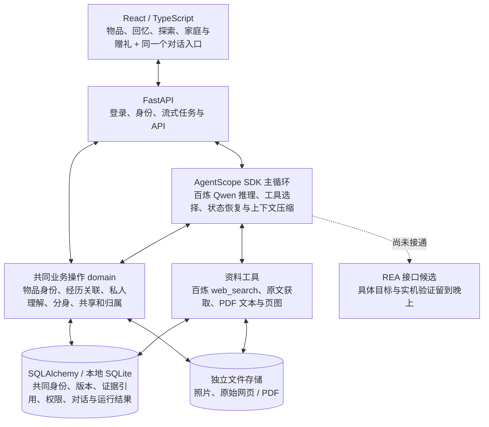

# 物间 Wujian 开发基线与协作约定

版本：0.2，2026-11-04。性质：开发共同基线；产品约定已确认，实际实现与验证范围同步记录。

本文件承接 01 产品愿景、02 工作方法和 03 沟通边界，并记录其后对话中的补充。原文件保留。冲突时以用户最新明确约定为准。团队从本文件和 README 进入开发，无需反复整理聊天记录。

## 1. 已确认的产品约定

物间通过理解人和物，帮助人兑现、创造、延续和传递物的价值。四类价值共享身份、现实状态、知识、经历、关系和可接续任务；用户可以从任意入口进入。

- 兑现是刚需：确认具体型号与版本，结合可信说明书、图示、条件和用户当前状态提供实际帮助。
- 创造包含目标驱动的物品组合、主动打开探索后的新玩法，以及 REA 支持的软件或设备能力探索与改变。创造不限于预设能力标签。
- 延续包含主动记录的照片文字回忆、日常聊天连续性，以及形象和性格可设定、也能随共同经历成长的物品分身。
- 传递包含家庭协作与关怀，以及实物、选定故事和带有赠送者心意的分身。接收后由接收者决定后续修改；私人聊天不会因赠礼自动共享。
- 普通商品、手工礼物、画、石头等均可录入。非标物无需商品型号，实物丢失也可保留故事与分身。
- 主动照片文字记录形成回忆墙；聊天后台积累有用理解，不频繁询问是否保存。一次经历关联多个物品，不复制成多份独立记录。
- 创意与回忆可以被发现，但不以频繁推送占据主界面。
- 拍照是主要录入方式；天猫订单自动录入是未来接入假设。
- REA 是必须验证的核心能力。首个候选为真实屏保改变，具体设备和实现方式待实际测试。
- 首版电脑浏览器为主，手机提供拍照上传和基本浏览；完整手机布局随后完善。

首版要连接四类价值的基本体验，不先完善反复赠礼等细节。每次使用也不必强制走完四类价值。

## 2. 语言与工具的实施选择

| 选择 | 决定及理由 | 重新评估条件 |
|---|---|---|
| 前端 | TypeScript，优先复用 React 与适用的 Ant Design / Ant Design X 组件。浏览器体验、交互状态和共享类型是其职责。 | 实际团队技能或组件限制表明其他方案总成本更低。 |
| 智能后端 | Python 作为首轮实施语言。优先验证 AgentScope 对百炼、MCP、上下文与状态的现成支持，减少模型执行机制自研。 | 模型能力、恢复能力或团队维护成本的实测表明其他路线更好。 |
| REA | 保留其 Node.js 运行环境，通过成熟 MCP 客户端或 CLI 接口连接。后端语言不决定设备能否改变。 | 具体目标、宿主环境和分析工具验证结果。 |
| 运行框架 | 已选 AgentScope SDK 2.0.11 作为唯一主循环，真实百炼工具调用和状态恢复探针通过。保留 FastAPI 作为物间业务 API；不叠加完整 Agent Service 管理平台。 | SDK 的实际能力不足，或托管服务明确降低总成本时再评估。 |
| 持久化 | 当前本机没有 PostgreSQL 服务，采用 SQLAlchemy + SQLite 完成本地闭环，原始媒体独立保存。暂不部署向量库或图数据库。 | 多实例部署、多人同时写入或检索质量实测需要时，再迁移 PostgreSQL/增加适合的检索；尚未验证 PostgreSQL 运行。 |
| 接口契约 | API 由 Pydantic → OpenAPI → openapi-typescript 生成前端类型。开发样本的 JSON Schema 仅负责样本约束，不再承担 API 定义。 | 接口变化同步生成和调用方，不手工维护平行类型。 |

两种语言的代价是多一条构建链和接口协同。通过标准 API、生成的类型与集中契约控制代价。语言本身不保证智能效果。Python 便于直接复用已验证的阿里 AgentScope、百炼与资料处理工具；TypeScript 承担浏览器交互与契约检查。REA 自身的 Node.js 运行环境不要求整个后端改成 JavaScript。

优先使用阿里生态中确实适配的成熟工具；同一职责不重复部署多套实现。现成应用服务足够时，不再另造会话、事件、工具循环和后台调度框架。

## 3. 共同底座的边界

逻辑关系：任意用户入口 ↔ 成熟 Agent 运行机制与百炼模型 ↔ 共同生活认知和工具；实际结果、用户反馈与更正返回共同认知。

共同生活认知至少连接：人、商品型号、具体物品、资料来源、能力与条件、状态、经历、偏好、分身、任务和关系授权。它是持续理解能力的产品目标，不预设为一个独立训练模型或服务。

商品共性知识与具体物品状态分开；同一型号的不同市场、商业版本、硬件或固件可能不同。型号代码不是唯一充分身份，未知版本保留未知。

上下文采用必要初始信息加执行中自主检索。模型可以继续发现相关物品、查原始资料、读取已授权经历、提出新用途和改变方案。初始检索结果不是模型可探索范围的封闭清单。首版不独立建设通用 Context Compiler。

物品空间、生活回忆墙、探索、家庭和礼物等视图复用相同对象与记录。分身通过身份、人格配置、相关经历和工具能力形成；无需每件物品常驻一个进程。

界面和模型调用相同的业务操作。身份、授权、事务、实际操作条件由程序执行；开放推理、创作与动态工具选择由模型承担。工具结果、用户报告、虚构故事和模型推断保留性质与来源，个人感受无需外部验证。

后台记忆不是另一份不可纠正的真相库。用户更正或撤回授权后，依赖的信息使用需要变化。聊天与回忆可相互关联，但不自动把聊天转成公开回忆。

## 4. 先设计再分工的方法

一名底座负责人先主导共享概念、关键边界与初版契约，另一位成员用实际功能调用它并复核。这一负责人负责一致性，不要求他独自设计所有功能细节。

顺序如下：

1. 固化产品约定与必要共享身份，列出仍待验证的选择。
2. 用最薄的跨功能切片检验底座：物品身份与来源 → 帮助或创意 → 同一任务中的经历记录 → 授权传递。
3. 尽早并行验证真实百炼和 REA 的高风险能力，不等界面完善后再接入。
4. 契约初步可用后并行开发，短周期集成真实接口，按结果调整内部实现。

不先完成一个庞大通用平台。Mock 可以帮助并行，但集成节点必须说明哪些是真实能力，哪些仍是接口替身。

### 建议责任边界

| 工作线 | 负责内容 | 共享约束 |
|---|---|---|
| 底座与集成负责人 | 共享身份、关系、业务操作、契约、运行框架、数据迁移和集成 | 统一维护核心概念与接口变更。 |
| 体验与功能实现 | 物品、对话、回忆、探索、家庭礼物等用户旅程；按实际技能拆分 | 不自行建立另一套身份、记忆或任务。 |
| 产品与验收负责人 | 场景、用户反馈、来源、演示证据、真实设备和独立验收安排 | 不以 Mock 或工程回归代替智能验收。 |

这是责任划分，不假设三位成员都有编程能力；具体人选按团队技能分配。Codex 可承担已授权的实现与集成。

接口变更：说明使用场景与影响 → 同步契约和调用方 → 必要验证 → 移除旧路径。能向后兼容的新增优先；破坏性变化显式通知调用方。数据库迁移集中管理。功能内部细节由负责人自行改进。

## 5. 测试物品与证据约定

可以生成模拟用户、物品档案、状态和经历，供开发与演示使用。每份数据明确标识模拟来源。

标准商品必须写明品牌、商业名称、型号、中国大陆市场以及已知版本；国内版本未知时不得用海外独有版本替代。固件未知时不捏造。非标物品保留独特身份，不要求型号。

第一组开发样本：

| 商品 | 型号和范围 | 官方来源 |
|---|---|---|
| 索尼无线降噪耳机 | WH-1000XM5，中国大陆销售型号；固件未知 | https://www.sonystyle.com.cn/products/headphone/wh_1000xm5/wh_1000xm5_r_feature.html |
| 米家台灯1S | MJTD01SYL，对应中国官网的米家台灯1S参数页；不混用增强版或海外参数 | https://www.mi.com/mjsmartlamp-1s/specs |
| 爱普生墨仓式一体机 | L3256，中国大陆产品；不以海外相似编号替代 | https://www.epson.com.cn/products/l-all-in-ones/l3256/ |

这些来源用于核对样本身份，不代表所有操作知识已获取或验收。为避免预置答案掩盖资料发现能力，样本不写死操作答案；相关官方地址是否提供给模型，由具体实验明确设置。

另外包含模拟旅行石头和手绘向日葵，检验非标身份、个人意义与故事传递。

- 开发样本可以反复查看和调试，不能再当作冻结的陌生商品盲测。
- 独立验收另留国内适用的陌生型号，答案对实现方隔离；不能一边调试一边宣称独立验收通过。
- 模拟档案能验证结构、关联、上下文接续和流程；拍照识别需要真实照片，操作指导需要原始资料，设备改变需要真实目标与结果观察。
- 创造力评价结合新颖性、可行性、资源条件、个性化和用户感受，不要求固定工具路径或固定措辞。

## 6. 研发方法的实际采用

- IDEO、JTBD：以具体场景中的功能、情感和关系价值定义任务，不以页面数定义成果。
- Double Diamond、Teresa Torres：保留真正不同的候选，以低成本实验优先消除危险假设；不把全部技术细节提前锁死。
- Google SRE、深模块：只保留解决必要问题的边界，合并重复转发、重复理解和重复状态。
- DDD、ADR：保持概念一致，重要选择记录理由、替代方案和重新评估条件。
- Google Small CLs、DORA：小而自洽的变更、早集成，持续验证完整用户结果。
- TDD：用于必要的确定性规则与缺陷复现；Agent 评测检查真实结果和轨迹，不写死创作思路。
- Anthropic Agent 工程：开放任务保留模型决策能力，新增编排或子 Agent 需要收益证据。

一手资料入口：

- https://sre.google/sre-book/simplicity/
- https://dora.dev/capabilities/working-in-small-batches/
- https://google.github.io/eng-practices/review/developer/small-cls.html
- https://www.anthropic.com/engineering/effective-context-engineering-for-ai-agents
- https://www.anthropic.com/research/demystifying-evals-for-ai-agents
- https://agentscope.io/blog/agentscope-faq/
- https://github.com/agentscope-ai/agentscope/tree/v2.0.11
- https://github.com/morluto/rea
- https://docs.bailian.console.aliyun.com/zh/model-studio/managed-agents-api-overview
- https://docs.pydantic.dev/latest/concepts/json_schema/

## 7. 当前实际架构

这些框是职责说明，不是分别部署的服务。首版只有一个后端进程、一套业务持久化和一个前端构建。没有额外世界模型服务、独立 Context Compiler、四个价值各自的 Agent 或通用消息总线。

“个人物品世界模型”在当前实现中是连接生活资料的领域记录与持续理解机制：商品身份、具体物品、私人档案、经历、资料证据和关系权限有稳定引用。它不是已训练好的现实模拟模型，也还没有跨账号商品知识共建与全量语义图谱。

初始上下文提供当前物品、已授权资源索引、近期经历与私人理解；模型可继续调用工具查找更多资源和原文。SDK 负责执行循环与压缩，业务程序负责权限和事实状态。复杂任务默认允许主模型思考；`QWEN_THINKING` 可用于效果/延迟对比。公开搜索子调用单独关闭思考以减少重复推理，仍要求出现真实搜索调用记录。

内部以标准 JSON、稳定 ID、Pydantic/OpenAPI 类型和证据引用传递信息；原文与照片独立保留，窗口截断会标记。向量是未来可能的检索索引，不取代精确型号、授权或原始证据。不为追求模型可读而另造未经验证的编码协议。

## 8. 当前结果与后续验证

已运行：本地登录与持久化、物品编辑、真实千问与工具调用、流式结果、对话接续、跨会话私人理解、图片输入、主动回忆、多物关联、分身设定与成长笔记、好友共享撤权、选定故事赠礼与接收归属、应用内家庭事项。

真实模型、离线工程与浏览器流程的验证范围见 `docs/2026-11-04_开发验证记录.md`。工程通过不表示陌生商品知识、创造力或长期个性化已达到产品验收。正式独立题集仍需冻结后执行。

2026-11-04 用户已授权真实百炼和联网测试，并在本地配置密钥，本轮已实际使用；这不包含开通新云资源。REA 实机操作按用户最新要求先跳过、晚上再做，不宣称已接通。没有创建 Git 仓库、导入旧 Demo 或对外部署。

接下来以真实体验修正机制：陌生国内型号的操作准确性、开放创造力、真实照片身份校验、长时间理解与纠错，以及晚上的 REA 改变。家庭事项目前不等于系统级通知；图形分身成长、自动归档和天猫订单仍属后续工作。
