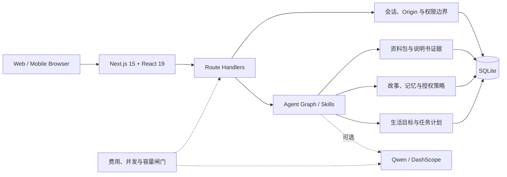

<div align="center">
  

  <h1>物间 Wujian</h1>

  <p><strong>让已有的物品，成为 AI 理解生活、采取行动和保存记忆的入口。</strong></p>

  <p>
    物品使用助手 · 生活创意规划 · 家庭协作 · 可授权故事记忆
  </p>

  [](https://github.com/Starry-Curry/ProductAgent/actions/workflows/ci.yml)
  
  
  
  

  <p>
    <a href="#快速开始">快速开始</a> ·
    <a href="docs/PRODUCT.md">产品方案</a> ·
    <a href="docs/ARCHITECTURE.md">技术架构</a> ·
    <a href="docs/DEMO_GUIDE.md">演示指南</a> ·
    <a href="docs/DEPLOYMENT.md">部署</a>
  </p>
</div>

> 当前独立交付：2026-10-30 完整产品基础收口，尚未合main。陌生商品录入、独立本机身份与协作、赠礼及真实REA软件验证可体验；事实问答候选未达标，保持实验。见[交付、运行与真实证据](docs/engineering/product-foundation-2026-10-30/README.md)。

> **一句话 Pitch：** 通用助手知道很多事，却不知道“你手边有什么、你正在完成什么、哪些经历可以记住”。物间把这些信息变成可授权的 Agent 上下文，让一件旧相机、一张野餐垫或一台空气炸锅，都能成为今天可执行的下一步。

## 为什么是物间

大多数 AI 家居产品从“控制设备”开始，大多数电商 Agent 从“推荐商品”开始。物间选择从用户真正拥有的物品开始：

- **有上下文**：记录品牌、型号、资料、可用状态、相关经历和家庭共享范围。
- **能行动**：把“周末想放松一下”拆成只使用现有物品、满足时间与条件的具体步骤。
- **有边界**：商品专属操作必须关联可核对资料；缺少依据时明确说不知道，不编按钮、参数和步骤。
- **可记忆**：原始故事与派生记忆分开，用户能够查看、纠正、暂停、忘记和单独授权上云。
- **可协作**：家庭事项、共享物品和礼物故事都有独立权限，不把私人记忆默认传给其他成员。
- **可公开演示**：访客拥有隔离的临时 SQLite 空间，并受到请求、存储、上传和模型费用限制。

这不是一个虚构概念稿。当前仓库包含可运行的 Next.js 应用、289 个离线测试、SQLite 数据层、合成演示数据、Docker 部署配置和一份如实记录边界的验收报告。

## 核心体验

| 场景 | 用户可以做什么 | 系统如何保证可信 |
| --- | --- | --- |
| 物品帮助 | 问“我的 M185 鼠标怎么换电池”“炸锅第一次用要注意什么” | 优先使用版本化资料包或说明书，按证据 ID 生成步骤；无依据时进入追问、转人工或明确拒绝 |
| 生活创意 | 输入“我有一小时、不想买东西，用手边的东西做点有趣的事” | 以持有物品、可用时间、排除项和现场条件为约束，区分预置方案、本地规则和在线模型生成 |
| 故事与记忆 | 围绕相框、背包或相机讲述一段经历 | 原故事、提取候选、已确认记忆分层保存；敏感内容默认不进入商品问答，不自动公开给家庭 |
| 家庭协作 | 创建共享事项、指定成员、记录处理进度 | 角色与物品权限在服务端校验；本机演示身份不会伪装成真实账号体系 |
| 礼物传递 | 选择想赠出的物品和指定故事片段 | 接收者先预览再认领；未选中的照片、聊天和私人记忆不会随物品复制 |
| 公开体验 | 无邀请码进入自己的临时演示空间 | HttpOnly 会话 Cookie、访客目录隔离、Origin 校验、HTTP/上传/存储限额和模型预算闸门 |

新访客会看到 **25 件合成物品、4 个预置创意、4 段虚构故事和 2 个演示章节**。所有示例都有明确标记，刷新不会重复写入，也不会覆盖用户已有内容。

## 快速开始

### 环境要求

- Node.js **24.x**
- npm **10+**
- 不需要数据库服务；项目使用 Node.js 内置 SQLite
- AI Key 不是启动必需项，默认不会产生模型费用

### 本地运行

```bash
git clone https://github.com/Starry-Curry/ProductAgent.git
cd ProductAgent
npm ci
npm run dev
```

打开 <http://127.0.0.1:3200>。

Windows PowerShell 同样可以直接运行：

```powershell
npm.cmd ci
npm.cmd run dev
```

`npm run dev` 会启用仅限本机回环地址的演示身份，并自动创建独立数据目录。停止服务使用 `Ctrl+C`。

生产方式启动：

```bash
npm run build
npm start
```

### 可选：接入真实模型

复制环境变量模板：

```bash
cp .env.example .env.local
```

在 `.env.local` 中配置北京百炼兼容接口：

```dotenv
AI_BASE_URL=https://dashscope.aliyuncs.com/compatible-mode/v1
AI_API_KEY=your-own-key
AI_MODEL=qwen-plus
AI_JSON_MODE=true
AI_ENABLE_THINKING=false
AI_ALLOW_PAID_CALLS=false
WUJIAN_ALLOW_PAID_CALLS=false
```

确认希望承担费用后，再以显式授权方式启动：

```bash
npm run dev -- --cloud
```

规则生成的创意、本地故事、物品资料和多数管理功能在无模型、无网络时仍可使用。真实模型调用不能由 `HTTP 200` 单独证明成功，业务结果仍会经过结构和证据校验。

## 三分钟演示路径

1. 进入首页，点击 **“开始我的演示”**，查看自动载入的合成物品展柜。
2. 打开“无线鼠标”，询问电池或接收器规格，观察回答如何绑定资料与限制。
3. 进入“发现新玩法”，选择相机、背包、速写本，输入一个 20 分钟、无需购买材料的创作目标。
4. 在“生活故事”中查看虚构故事及来源标注，再创建一条自己的记录并刷新验证持久化。
5. 切换家庭成员，创建一件家庭事项；说明这是本机角色演示，不会向真人的设备发送通知。

完整评审脚本见 [演示指南](docs/DEMO_GUIDE.md)。

## 架构概览



核心设计不是“让模型直接读写数据库”，而是：

1. 服务端先确定身份、物品和授权范围。
2. Agent 只能通过受限工具获取必要事实。
3. 模型输出经过 schema、引用、行动条件和安全语言校验。
4. 写操作由领域服务执行，并记录可追踪的状态。
5. 云端请求在发出前扣除预算，工具调用和失败尝试也计入额度。

更完整的数据流、信任边界和扩展点见 [技术架构](docs/ARCHITECTURE.md)。

## 项目结构

```text
.
├── src/
│   ├── app/                  # 页面、Route Handlers 与样式
│   ├── components/           # 生活空间、故事、创意、家庭等 UI
│   └── lib/
│       ├── agent/            # Agent graph、工具、校验与检查点
│       ├── cloud/            # 公开演示隔离、配额与费用闸门
│       ├── life/             # 物品、资料、故事、记忆与规划
│       ├── skills/           # 面向任务的受限能力
│       └── repositories/     # SQLite 持久化与迁移
├── public/demo/              # 合成物品、故事图片与来源清单
├── scripts/                  # 本地启动、构建、验收与运维脚本
├── tests/                    # 单元、集成和领域回归测试
├── docs/                     # 产品、架构、部署、验收与素材说明
├── Dockerfile
├── ms_deploy.json
└── package.json
```

## 常用命令

| 命令 | 作用 |
| --- | --- |
| `npm run dev` | 启动本地演示服务，监听 `127.0.0.1:3200` |
| `npm run build` | 创建生产构建 |
| `npm start` | 使用本地演示模式启动生产构建 |
| `npm test` | 运行 Node test runner 离线测试 |
| `npm run typecheck` | 执行 TypeScript 严格类型检查 |
| `npm run verify` | 依次执行类型检查、测试和生产构建 |
| `npm run test:acceptance` | 启动隔离生产服务并运行浏览器验收 |
| `npm run test:acceptance -- life` | 运行主生活旅程验收 |
| `npm run start:cloud` | 以公开演示模式启动，供容器平台使用 |

部分浏览器验收脚本依赖已安装的 Microsoft Edge，并会写入隔离测试目录；CI 默认只运行离线单元测试、类型检查和构建。

## 数据、隐私与安全

- 默认数据目录为 `data-life-v1/`，已在 `.gitignore` 中排除。
- 公开演示要求独立持久化目录，拒绝复用开发数据库。
- 每位访客使用独立会话和 SQLite 数据；服务端检查 Origin、Cookie、上传大小和角色权限。
- 私人记忆默认不随普通商品问答发送到模型；只有用户显式允许并适用于当前任务的内容才会进入上下文。
- 模型 Key 只从环境变量读取，不写入仓库、日志或演示响应。
- 公开部署默认关闭付费模型；启用时需要同时配置 Key、模型地址和两个显式费用开关。

提交安全问题前请阅读 [SECURITY.md](SECURITY.md)。公开议题中不要粘贴密钥、私人故事、数据库或可识别的家庭信息。

## 当前验证边界

本仓库的 `modelscope-final-20261021-1` 快照记录过一次 Windows 本机生产构建、Edge 浏览器访问、访客隔离和合成演示验收。该轮真实 Qwen 请求共 5 次，其中 1 次网络超时；最终商品规格问答通过，开放创意返回了模型方案，但实操表述仍被记录为部分通过。

已记录的验证不等于：

- 所有型号、说明书和危险操作都已被覆盖；
- Docker/Linux、ModelScope HTTPS、持久化挂载已在当前环境完成验收；
- 模型创意已经过真人或实物验证；
- 本机演示角色等同于生产级账号认证；
- Agent 可以感知或控制真实设备。

详细记录见 [验证记录](docs/VALIDATION.md) 和 [原始 JSON](docs/validation/final-validation-2026-10-21.json)。

## 文档

| 文档 | 内容 |
| --- | --- |
| [产品方案](docs/PRODUCT.md) | 用户问题、价值主张、核心闭环、差异化与黑客松演示脚本 |
| [技术架构](docs/ARCHITECTURE.md) | 系统分层、Agent 数据流、权限、证据和扩展方式 |
| [演示指南](docs/DEMO_GUIDE.md) | 三分钟与八分钟评审路径、可验证观察点 |
| [部署说明](docs/DEPLOYMENT.md) | 本地、Docker、ModelScope 与公开演示环境变量 |
| [验证记录](docs/VALIDATION.md) | 已通过项、真实请求结果和明确未验证范围 |
| [贡献指南](CONTRIBUTING.md) | 开发流程、测试要求与提交规范 |

## 路线图

- [ ] 接入真实用户认证与家庭成员邀请
- [ ] 增加图片/条码识别后的人工确认流程
- [ ] 扩展经过来源认证的型号资料与操作模板
- [ ] 增加可导出、可删除的数据生命周期工具
- [ ] 在 Linux 与真实持久化 Volume 上完成公开部署验收
- [ ] 提供可替换的模型适配器和离线小模型基线

---

物间不是要让更多物品进入算法，而是让算法真正理解一件物品为何重要、现在能做什么，以及哪些边界必须由人决定。
