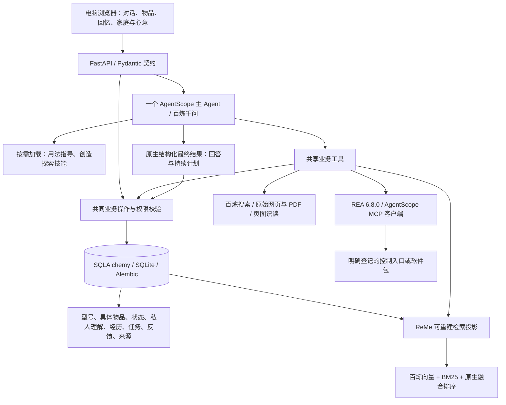

# 物间 v0.3：共同机制实施与真实验证

日期：2026-11-04。结论：共享数据、检索、持续计划、理解人和 REA 接入机制已落到真实应用中；工程检查通过，智能底座尚未通过产品验收。创造可行性、分身事实归属、耗时仍需解决。本文件记录开发证据，不授予 F1–F12 完整验收通过。

## 1. 实际架构及取舍

“世界模型”落实为关联的事实与业务对象，没有另建模拟引擎。上下文准备负责当前身份、相关资源、近期理解、任务与经历；模型可继续主动检索、读原文、调用工具。没有另立通用编译语言或一个独立 Context Compiler 服务。

JSON / Pydantic schema 传递对象、工具请求和最终结果；数据库外键表达真实关系，向量负责召回。向量不是无损事实传输格式，原始说明书、记录、版本与来源仍保留。模型可自由提出方案，程序验证实际身份、可访问资源、版本和反馈依据；schema 合法不等于方案正确。

Python 复用 AgentScope、ReMe、SQLAlchemy、Alembic 和 FastAPI；TypeScript 负责浏览器界面，类型从同一 OpenAPI 生成。REA 是 Node 工具，经 MCP 连接，与后端是否 Python 无冲突。没有因为 REA 重写应用，也没有另建微服务、消息总线、图数据库或多 Agent 编队。

## 2. 已实施的共同机制

| 机制 | 已做及适用范围 | 尚不能据此声称什么 |
|---|---|---|
| 商品型号与实例 | 型号规格精确一致时共享不可变产品引用；物品状态留在实例；未确认型号及非标物保留自己的身份线索 | 不能自动识别所有相似型号、地区版本或语义别名 |
| 认识与依据 | 原文摘录核对；型号知识、实例报告、模型推测分开；支持失效/替代 | 字面摘录正确不证明模型理解正确；没有语义裁判的保证 |
| 理解人 | 安静积累稳定偏好、物品意义与实际反馈；原话来源、期限、原子纠正；删除后抑制旧内容重学 | 没有自动解决全部语义冲突，模型也未必每次准确提取 |
| 检索 | ReMe 0.4.2.1 原生 BM25/向量/融合；索引由当前获准 SQL 数据派生，返回前再检查可见性和内容 | 没召回不能认定信息不存在；网络不可用时关键词降级不等于同质量 |
| 连续任务 | 主 Agent 原生最终结果携带持续计划；与反馈在同一事务写入；版本保护；新会话读取接续 | 模型仍可能误解反馈性质或漏选相关资源 |
| 经历与分身 | 主动照片文字记录、多物关联；成长笔记需实际用户原话或获准经历；赠礼副本保留原作者和来源 | 分身仍有虚构与错认主体，不能认定真实经历表达可靠 |
| REA | 固定版本、懒启动、真实 MCP 握手、目标登记、受控工具入口、保留观察/操作证据 | 尚未连接显示屏；未观察任何实物改变 |

SQL 是唯一业务事实来源。ReMe 不自动写另一份记忆，不运行 dream 或第二个理解人 Agent。历史对话可检索，但助手给的旧建议标记为历史建议，不能算实际成功。遗忘来源涉及的旧会话从检索投影中保守排除；这不是完整数据擦除服务。

当前主体隔离已有必要保护；更细用途授权、家庭组织、导出、自动归档、移动端完整体验等仍按原计划后置。

## 3. 成熟组件与实际复用边界

| 组件 | 交给它做什么 | 物间自己承担什么 |
|---|---|---|
| AgentScope 2.0.11 | 单 Agent 推理/工具循环、原生 Skills、上下文压缩、状态、结构化最终输出、MCP 客户端 | 业务对象、允许操作、结果提交与任务语义 |
| ReMe 0.4.2.1 | 分词、BM25、向量、融合排序、原生健康检查和恢复 | 可访问数据投影、来源/权限重新核对 |
| 百炼千问及 text-embedding-v4 | 实际推理、多模态、搜索能力和向量 | 型号适用性、原文保留、实际效果验证 |
| SQLAlchemy / Alembic | 事务、关系与版本迁移 | 最小共享领域与数据不丢失约束 |
| FastAPI / Pydantic / OpenAPI | API 校验和类型契约生成 | 用户流程、权限、错误含义 |
| React / Ant Design / X Sender | 页面、成熟交互控件、对话输入 | 安静且连续的四价值体验 |
| REA 6.8.0 | 已登记目标的探索工具 | 目标授权、能力证据、真实执行与结果区分 |

官方依据：[AgentScope 源码](https://github.com/agentscope-ai/agentscope/tree/v2.0.11)、[ReMe 源码](https://github.com/agentscope-ai/ReMe)、[百炼向量文档](https://help.aliyun.com/zh/model-studio/embedding-rerank-model/)、[REA MCP 元数据](https://github.com/morluto/rea/blob/main/server.json)。本地安装源码也逐项核对了实际构造参数和调用行为。

## 4. 失败实验与删掉的冗余

1. AgentScope 的 ReMe 记忆中间件启动时遇到 dream 组件注册问题，旧版中间件的中文召回也不够。改用 ReMe 公开的最小检索组件组合，不启动自动记忆写回。没有自研另一套向量搜索。
2. ReMe 0.4.0.6 的 5 秒向量健康探针曾超时，导致该会话持续只有关键词检索。新版保留嵌入组件并原生恢复；升级到 0.4.2.1，15 秒健康超时，真实语义查询已验证为 hybrid。未自建重试后台或复制库内恢复逻辑。
3. “保存任务”作为可选工具时模型经常漏调；两个真实旅程都没有形成任务。已移除重复的模型任务写工具，改用 AgentScope 原生 `structured_schema=TurnResult`，统一最终计划及反馈提交。API 与模型继续复用同一领域实现。
4. 额外的回答审查模型在玩具探针上能挑错，在真实旅程里仍放过违背用户约束和虚构经历的回答，并增加调用。已删除该审查层，没有继续叠审查 Agent。
5. 实际供应商流式传输出现中途 APIConnectionError。当前主模型使用非流式传输，由 SDK 处理模型请求重试；工具与任务进度仍经 SSE 显示。已执行的业务工具不会因整轮重跑而重复执行。此选择是本轮实验结果，尚未证明所有网络条件下更优。
6. 赠礼副本的保存账号与经历作者原先混在一起。已新增 provenance 并迁移历史记录，接收时保留作者；**真实复测显示仅靠此元数据与主 Agent 指令仍不足以消除错认和虚构**，不再补第三轮提示词。下一切片需研究来源明确的故事呈现和分身叙述边界，以新的真实案例验证。

## 5. 真实开发旅程证据

样本是明确虚构的两位用户、26 件物品与生活条件。标准商品提供中国大陆对应型号，不预置操作答案。不同问题会新建会话，实际经过应用 API、数据库、AgentScope、百炼及搜索，不是直接给模型一段完整答案。数据位于独立 `var/evaluations/`，不使用用户历史私人记录。

完整旅程原始结果：[20261104-214230/results.json](../var/evaluations/20261104-214230/results.json)。这是加入原生最终契约后的开发复测；后续 ReMe 升级与故事来源字段有各自针对性验证，没有把这些复测合称一次最新全量验收。

| 步骤 | 实际结果 | 质量判断 |
|---|---|---|
| 普通分享租房条件、偏好、纪念意义 | 18.86 秒，安静保留 3 条理解，没有发布回忆墙或擅自查说明书 | 本例符合低打扰要求；今天眼累未写成长期偏好 |
| 两种窗边阅读/拍照玩法 | 208.94 秒，发现已有资源，提出方案并保存任务 | 未通过创意验收：对镜子等未经确认的物理效果过于肯定；响应过慢 |
| 新会话报告支架滑落、今天排除石头 | 56.55 秒，读回原任务，改为手持静物拍摄，记录反馈，任务仍为同一 ID，version 3 | 本例接续和约束调整成立；模型把混合反馈标为 unknown，语义仍可改进 |
| 主动记录《窗边的小太阳》 | 178.36 秒，保存指定文字并关联台灯与向日葵 | 内容正确且单次保存；耗时明显不适合此操作 |
| 新录入 Sony WH-CH720N 配对新手机 | 69.38 秒，自主搜索并读取精确型号官方指南，回答约 5 秒和蓝色重复双闪 | 本例主要操作与原文一致；只是一个开发型号，不能外推为陌生商品验收通过 |
| 选定故事赠礼、接收后聊天 | 接收方拿到所选故事和人格，私人记忆未转移；聊天完成 | 叙述仍虚构交付细节、错认经历主体，未通过分身事实验收 |
| REA | 真实连接，发现 229 个工具，targets 为空，device_effect_verified=false | 只证明传输与目录发现，不证明设备探索或修改成功 |

WH-CH720N 参考：[大陆型号商品页](https://www.sonystyle.com.cn/products/headphone/wh_ch720n/wh_ch720n_p_feature.html)、[Sony 官方配对指南](https://helpguide.sony.net/mdr/2966/v1/zh-cn/contents/TP1000777286.html)。操作测试由应用自己查找资料；不把开发者查到的答案塞进测试提示。

赠礼来源专项复测：[20261104-220323/results.json](../var/evaluations/20261104-220323/results.json)。17.91 秒完成，数据库 provenance 正确保留小林为作者，但模型仍说“后来你在窗边安顿下我”，没有可靠区分所收到故事与接收者的真实经历。此结果保留为失败证据。

ReMe 新版真实向量探针：[retrieval-probe-result.json](../tmp/retrieval-probe-result.json)，改写后的查询找回租房限制与不可改造纪念石头，返回 hybrid。该探针使用明确构造的测试理解，不能代替模型自主学习的评测。

之前的真实失败与复测均保留在 `var/evaluations/`：204227、205401、205510、212208。包含供应商连接失败、漏存任务、创意条件违反和分身虚构，不删除以美化成功率。

本轮记录主 Agent token 与总耗时，统计口径明确排除嵌套搜索/视觉/嵌入调用；未得到完整账单，不能据此声称总费用。额外审查层已移除。自动审批曾拒绝使用已有记录作云端评测；之后用全新硬编码虚构输入完成探针，目前没有待用户批准的阻塞。

## 6. 工程验证与数据保留

- `python -m unittest discover -s tests -v`：29/29，通过实际 SDK 协议、领域事务、来源核对、纠正/到期、撤权/遗忘、赠礼与迁移检查；模型替身仅验证工程，不评智能质量。
- ReMe 无密钥回归使用真实成熟库的关键词路径；真实嵌入另做上述云端探针，两者不混报。
- Ruff 静态检查通过。OpenAPI 导出、TypeScript 类型生成和生产构建通过；仍有约 996KB 前端 JS 分块警告，尚未做加载优化。
- 真实旧库迁移到 0004，先备份再逐条比对旧列：8 物品、6 经历、2 用户、4 附件、9 会话、9 私人档案、3 记忆、3 来源、19 消息、11 运行、1 礼物、1 好友关系均保留；外键检查通过。新增来源元数据单独添加。
- 备份示例 `var/backups/pre-v03-20261104-220332.sqlite3`，没有删除 `var/` 重新建库。
- Edge 隔离浏览器核对登录、读取原物品、物品更多菜单与设备连接弹窗，无页面脚本错误；没有点击真实设备执行。截图 `tmp/device-entry-smoke.png`。

## 7. 工作方法如何实际采用

完整阅读用户补充的 `D:/Download/物间_产品工程研发与Codex工作方法_完整版.md`，文件中的方法是参考，产品范围以用户对话为准。

- 第一性原理：四价值都需要同一人、物、状态、经历和反馈，因此只建一份业务事实和写入路径；不因画图好看增加服务或数据库。
- [Google Small CLs](https://google.github.io/eng-practices/review/developer/small-cls.html)：按迁移、检索、持续任务、REA 分别落地并验证；没有初始化 Git 仓库或冒充已提交代码审查。
- [Google SRE Simplicity](https://sre.google/sre-book/simplicity/)：删掉无收益的额外审查调用和重复任务写入；能用 ReMe 原生机制解决的失败不另造恢复框架。
- [Anthropic Building Effective Agents](https://www.anthropic.com/engineering/building-effective-agents)：一个可观察的 Agent，按需用工具与技能；复杂结构须以实际效果证明必要性，不按功能数量增加 Agent。
- 按用户方法保留首答与失败；针对性复测只说明修正后的范围；工程回归和独立产品验收分开。同类失败反复出现时改查机制，不继续堆提示词。

## 8. 接下来做什么

1. 优先解决创意的现实条件与来源证据、分身的作者/亲历归属、过长响应；分别以具体用户任务检验，不能靠工程绿灯放行。
2. 今晚有具体控制入口后，完成最小可撤销的屏保/显示改变并在真实屏幕观察；当前接入层不作实机完成承诺。
3. 机制稳定后，冻结独立型号和创造案例，执行原计划 18 个操作问题、12 个创造任务与跨会话理解案例；未执行前不报达标。
4. 队友沿 OpenAPI 与共享领域操作接入功能；共同模型、迁移和检索投影由一个负责人统一集成。完整家庭、通知、养成视觉和社交边角按计划后置。
