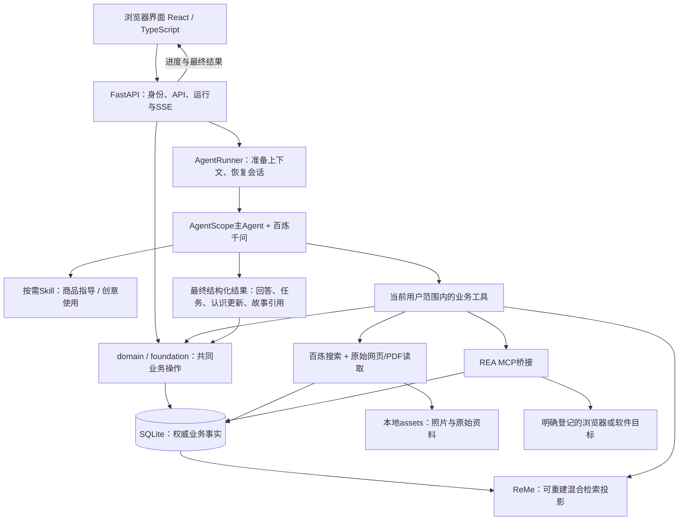
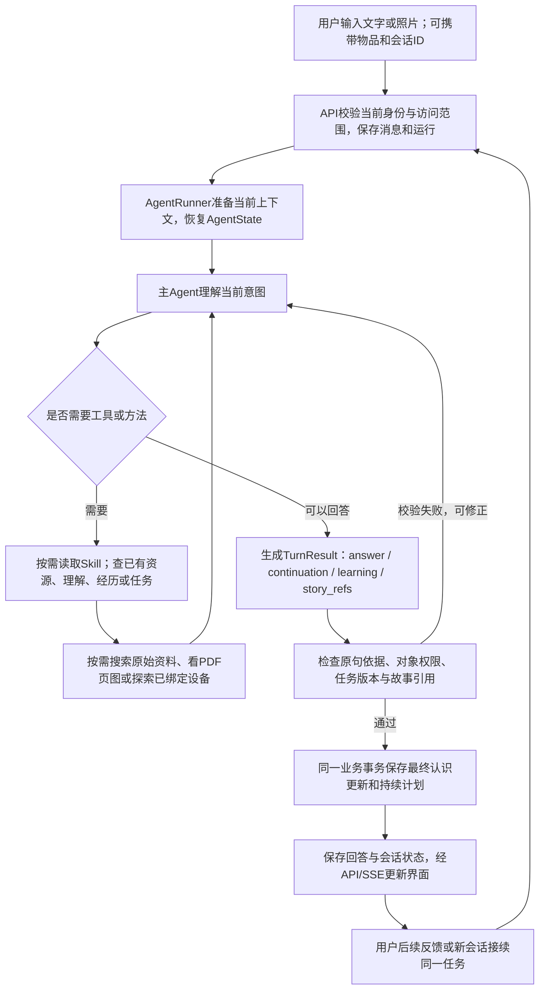

# 物间技术交流 架构 功能实现与优化问题

日期：2026 年 11 月 5 日。以本地实际代码与已安装依赖为准。已提交代码基线为 `21e3e11`，本地另有尚未提交的移动端设计与研究文档。本次整理未修改应用代码或数据库。

技术评审详图见[物间技术架构详图与接口说明](2026-11-05_物间技术架构详图与接口说明.md)，包含10张可编辑图、API载荷、真实外键、提交边界和现有/待补区分；可视版为[可缩放图集](architecture/2026-11-05/index.html)。

物间通过理解人和物，连接兑现、创造、延续、传递。产品形态是应用，内部由一个主 Agent 协调多项能力。技术讨论应评估如何增强真实任务效果与团队协作；现有共享机制已接通，智能底座仍为 NOT_ACCEPTED。

## 1 当前架构与技术

采用模块化单体：一个 Python 后端应用、一个 React 前端、一份权威业务数据库，模型和专门工具通过后端调用。

| 部分 | 当前技术与版本 | 职责 |
| --- | --- | --- |
| 界面 | React 19.3.1、TypeScript 5.9.3、Vite 8.3.5 | 页面、表单、对话、图片上传、结果展示 |
| UI组件 | Ant Design 6.7.0、Ant Design X 2.10.0、Lucide | 复用交互组件和图标；现有图标占位不等于分身角色资产 |
| API服务 | Python 3.12.14、FastAPI 0.162.0、Uvicorn 0.54.0 | 登录、业务请求、对话运行、SSE进度、文件读取和构建后前端服务 |
| 类型契约 | Pydantic 2.14.2、OpenAPI、openapi-typescript | 后端输入输出定义，生成前端类型；内部模型结果也有结构化Schema |
| Agent运行 | AgentScope 2.0.11 | 一个主Agent、工具循环、会话状态、按需Skill、MCP接入、结构化最终结果 |
| 模型 | 阿里百炼，代码默认 `qwen3.6-plus`；PDF页图默认 `qwen3-vl-plus` | 推理、工具选择、照片与原页理解；具体模型可由本地配置覆盖 |
| 语义检索 | ReMe `reme-ai==0.4.2.1`、BM25、百炼 `text-embedding-v4` 512维 | 对当前用户可用物品、理解、经历、知识、资料、任务与历史交流做混合召回 |
| 业务持久化 | SQLAlchemy 2.1.8、SQLite WAL | 身份、事实、关系、状态、版本、来源、任务、运行记录 |
| 结构升级 | Alembic 1.20.1，当前迁移0005 | 维护数据库结构；升级保留既有数据 |
| 联网与文档 | 百炼Responses `web_search`、httpx 0.28.1、BeautifulSoup、pypdf 6.21.4、pypdfium2 5.14.0 | 发现网址、读取HTML/PDF、按页取文、渲染原页再交视觉模型理解 |
| 设备探索 | REA 6.8.0、Node.js、AgentScope MCP stdio | 连接明确的浏览器调试目标或授权JavaScript/Electron包，保留探索与执行证据 |
| 环境与协作 | uv/uv.lock、npm/package-lock、GitHub、离线CI | 锁定依赖、分支审阅、类型与回归检查 |

版本来自本机应用环境与前端包定义；不代表各依赖的最新版本。研究用MediaCrawler独立环境不属于应用依赖。

Python承担业务与AI，是为了复用AgentScope、ReMe和文档生态；TypeScript承担浏览器交互与类型检查。REA自身运行在Node，通过MCP与Python通信，不要求整个应用改用JavaScript。

## 2 整体架构图



直接操作物品、记录经历、赠礼等业务可由界面调用API完成，无须都经过模型。对话中的工具操作复用同一业务函数。

此前提出的“世界模型”当前体现为人、型号、实物、状态、能力、经历、任务与关系等共享数据，不是另一个训练好的预测模型或独立服务。“上下文编译”当前是AgentRunner中的上下文准备，不存在独立Compiler服务。也没有十二个功能Agent、微服务集群、业务图数据库或消息总线。

## 3 一次对话的实际流程



当前初始上下文包含关注物、最多100件资源摘要、12条个人理解、5条近期经历、4项近期任务，以及当前问题和日期。相关信息不在摘要中时，模型可以继续调用`search_world`、`read_item`、`read_task`等工具。上述固定数量是当前实现选择，不是最优上下文策略的证明。

主循环当前最多10轮工具推理，整体运行超时240秒。运行由进程内`asyncio`任务承载，状态写入数据库；服务重启会将未结束运行标为中断，不会自动重放外部操作。这还不是具备持久恢复能力的后台工作流系统。

最终认识与计划一起提交，不表示整次运行的所有动作均原子化：此前的资料保存、主动记录等工具调用可能已经独立完成。停止运行不自动撤销这些已完成操作。

## 4 数据与知识怎样存取

默认数据库是本地 `var/wujian.sqlite3`，不需要独立数据库服务器。照片和下载原始资料在`var/assets/`，检索投影在`var/retrieval/`，隔离评测在`var/evaluations/`，备份在`var/backups/`。SQLite文件不能通过Git或网盘作为多人共享数据库使用。

| 数据组 | 当前表与内容 | 重要区分 |
| --- | --- | --- |
| 型号与实物 | `products`、`items` | 型号共性和某一件实物分开；非标物允许没有型号 |
| 私人描述与分身 | `item_profiles` | 同一物品对不同人的个人意义与设置 |
| 可复用物品认识 | `knowledge_claims`、`sources` | 能力、边界、步骤、观察、案例；保留原文与条件 |
| 理解人 | `memories` | 偏好、限制、能力、关系、意义、目标等；情境、期限、依据和有效状态 |
| 主动回忆 | `experiences` | 用户主动留下的照片文字；一段经历可关联多物 |
| 持续任务 | `tasks` | 目标、真实资源ID、条件、方案、反馈和版本 |
| 关系与传递 | `item_grants`、`friendships`、`gifts`、`reminders` | 共享、好友、选择性赠礼和基础事项 |
| 对话与行动证据 | `conversations`、`messages`、`runs`、`device_targets`、`device_observations` | 会话接续、运行状态、明确设备目标和实际观察 |

主键、外键与版本字段维护主要身份关系；一些资源列表、经历关联、条件与计划仍用JSON，不能声称所有关联都由数据库外键保证。型号知识当前受用户归属限制，不是一个已建成的跨账号公共商品知识库。

### 检索是否属于RAG

整体采用检索增强与工具调用，但不是“把所有说明书切成向量后一次问答”的单一路径：

- 内部世界：SQL记录转为按用户隔离的可重建投影，ReMe做关键词与向量混合检索，返回前重新核对当前内容和可见范围。
- 外部知识：模型按需搜索、下载原文，按关键词或页码读取；图示问题可以查看PDF原页。
- 认识沉淀：主Agent将本轮有依据的认识提交到业务库，下次可以复用。

当前检索主要以业务对象为单位；原始资料投影只包含短摘录，详细正文由读取工具补取。尚未实现成熟的说明书章节级语义检索、视频字幕与关键帧案例管线。

### 内部“程序语言”是什么

API和工具使用JSON，Pydantic/JSON Schema约束字段和结果；对象ID与版本精确定位；SQL维护事实和事务；向量用于模糊意义召回。模型仍通过自然语言字段理解问题、证据、条件和故事。

向量不是无损信息编码，也不承担精确事实、授权或状态传输。精简JSON、按需读取与检索可以减少冗余，但不能为了省token删除影响结论的条件。Skill是按需加载的方法说明，不是微调、专用模型或确定正确的算法。

## 5 各项功能怎样实现与当前差距

| 功能 | 当前实现路径 | 后续拟补与未验收部分 |
| --- | --- | --- |
| F1 录入与身份 | 照片上传/手工信息 → 建立实物 → 千问认识 → 允许修正品牌型号；标准商品关联型号，非标物独立保存 | 相似型号确认、照片识别准确率、订单导入未完成；照片不能保证精确型号 |
| F2 用法与排障 | 商品指导Skill → 型号与当前状态 → 原始资料/PDF页图 → 具体步骤 → 沉淀知识 → 接续反馈 | 陌生商品正式验收未完成，仍可能误读条件；逐步可视化排障与售后整理还需产品实现 |
| F3 目标资源组合 | 统一对话 → 检索已有物品、偏好和任务 → 读取必要能力 → 形成资源与约束明确的持续方案 | 资源召回、条件遵守和替换机制未稳定；可勾选协作清单界面未完成 |
| F4 开放创意玩法 | 创意Skill → 物品特征/能力与人的目标 → 按需找公开案例 → 条件适配 → 候选方案 → 试用反馈 | 生活案例质量、视频细节获取、可行性判断是主要缺口；MediaCrawler仅隔离试跑，访问未通，未接入应用 |
| F5 REA能力扩展 | 已有物品知识＋明确控制入口 → MCP探索 → 保存证据 → 后端动作提案与显式执行API | 真实显示屏效果、完整执行与恢复界面尚未验证；不能因型号已知就直接控制硬件 |
| F6 个性化分身 | 私人档案里的昵称/性格/颜色＋获准经历＋同一主Agent；有依据的成长笔记 | 宠物式形象、动画、声音与视觉成长未实现；拟采用稳定角色资产和少量状态，经历逐渐影响细节；故事归属仍有错误 |
| F7 回忆墙 | 一次照片文字经历关联多个实物，物品页与生活页读同一条记录；聊天明确要求记录也走同一操作 | 编辑、删除、相册、照片自动匹配已有物品待做；未来可用视觉匹配形成候选关联并可纠正 |
| F8 维护生命周期 | 当前状态＋维护知识＋基础事项＋用户完成报告 | 耗材周期、到时通知、维修历史、状态影响后续提醒未闭环 |
| F9 家庭关怀 | 独立账号、按件共享、基础事项分配和完成 | 尚无完整家庭组织/角色、接手交接/已读状态、通知送达及大字版；需补身份关系和事项状态，继续复用共同物品知识 |
| F10 好友赠礼 | 好友确认 → 选择物品、寄语、分身设定和故事快照 → 接收 → 变更归属和建立独立记录 | 后续心意、借还、拒收/取消、实体物流等未完整；接收时照片/状态清空仍需修正 |
| F11 统一持续任务 | 同一Agent与业务工具、AgentState、任务ID/版本、反馈、历史交流检索 | 新计划误沿用旧成功反馈、耗时、跨功能长旅程仍未通过；需要当前方案与实际结果更严格对应 |
| F12 身份证据与信任 | 登录会话、访问校验、来源依据、版本与部分上下文失效 | 已复现来源访问、语义遗忘与情境覆盖缺口；不是只改界面即可解决，需在共同机制修复 |

理解人是所有功能共用的基础：主Agent从当前用户表达中提出结构化理解，程序核对当前原话、旧记录身份与有效性，再保存；支持新增、替换、遗忘与期限字段。当前没有训练专用用户模型，也没有直接采用ReMe自动记忆整理。ReMe只负责查找。

拟补分身机制也应读取这份理解和经历，不另建一套人物记忆。主动回忆与安静积累的理解有不同的产品语义，不能把每段聊天都发布成回忆墙。

## 6 四栏与四种价值如何互通

新手机版四栏为物伴、物品、回忆、朋友，目前属于产品设计，尚未整体落地。家庭用品/我的物品放在物品栏；大字版是同一业务的简化呈现。

四种价值不对应四套数据库。例如：

1. 拍照录入朋友送的杯子，建立稳定实物ID、私人意义与可用知识。
2. 询问清洁方法，读取适用资料并保留认识，兑现原有能力。
3. 想拍一张好看的杯子照片，复用已有台灯、手机和个人偏好，找贴近资源的组合方法，形成持续任务。
4. 用户主动记录拍摄照片和当时的心情，同一经历关联杯子、台灯等物品；可选分身只读取获准内容。
5. 用户选择故事和寄语送出礼物，接收后对方建立自己的私人经历，旧主人不能读取或改动这些新记录。

这是要验收的贯通体验，不能因每个表或接口存在就宣布整条旅程通过。

## 7 给技术人员的重点问题

| 问题 | 当前可具体检查的位置 | 期待的优化证据 |
| --- | --- | --- |
| 上下文是不是相关且足够 | 初始100件资源/12条理解/5条经历/4个任务；`search_world`召回 | 更少无关内容、更少漏物、跨会话少重问，不能只看token下降 |
| 检索随规模增加是否有效率 | 每次检索扫描授权对象、比较哈希；进程重新初始化时重建用户索引 | 在扩大库存后比较延迟、更新可见性与撤权，不急于换库 |
| 物品认识是否足以支撑创意 | `KnowledgeUpdate`的能力/边界/步骤/案例与条件；来源段落读取 | 对同一物的差异、未知参数、禁止动作给出正确判断 |
| 案例检索是否改善创造力 | 现有`kind=case`与尚未接入的视频来源 | 对无案例/只有标题/足够细节案例做对照；测新意、适配和真实可行性 |
| 理解人能否被纠正且不误用 | `MemoryUpdate`情境/期限/替换/遗忘，以及上下文与检索重建 | 语义改写不会复活遗忘；不同情境不误合并；不把一时心情当永久偏好 |
| 类型检查之外怎样保证结果语义 | `TurnResult`、计划版本、反馈引用、故事作者与设备观察 | 新方案不继承旧完成结论，收到故事不变亲历，提案不变已执行 |
| 怎样降低长任务耗时 | 主循环最多10轮/240秒；搜索、视觉与embedding额外调用；已有计时事件 | 按真实旅程定位耗时，比较首个有效结果时间、总时长、调用和效果 |
| 团队多人/多请求并行会怎样 | 进程内运行、SQL条件更新、共享对象及JSON关联 | 冲突可解释，重启不误重放，新增功能仍走共同业务操作 |
| REA怎样完成一个真实切片 | `devices.py`的绑定、探索、提案、执行与证据 | 指定目标上真实改变展示内容并恢复；只按实际控制通道宣称能力 |
| 家庭与分身需要哪些最小机制 | 事项当前只有基础分配/完成；分身只有设置/文字成长 | 家庭明确收到/接手/完成，角色有稳定视觉与正确记忆归属 |

当前架构的模块化单体、共享事实、单主Agent方向可以作为保留候选。是否增加专用Agent、图数据库、后台队列或其他记忆工具，应针对上述真实失败验证收益，不因名词先进而先引入。

## 8 代码位置 GitHub与历史

仓库：`https://github.com/Starry-Curry/ProductAgent`。本地`origin`指向该仓库，本地main/develop与已有远端跟踪引用均指向`21e3e11`。既有同步记录确认该提交当时已同步到GitHub两条主线。本轮远端连接返回404/仓库不可访问，本机Git HTTPS又遇到schannel凭据错误，因此没有重新确认远端当前HEAD。

当前代码直接位于仓库根目录：

```text
ProductAgent/
  wujian/              Python服务、业务、检索、模型和设备桥接
  frontend/src/        React/TypeScript页面与调用
  agent_skills/        商品指导和创意使用
  migrations/          Alembic迁移
  contracts/           OpenAPI与契约
  fixtures/            开发样本
  tests/               离线工程回归
  scripts/             开发与真实评测脚本
  docs/                架构、审计、产品设计与研究
  pyproject.toml       后端依赖
  uv.lock              后端锁文件
```

旧Next.js/TypeScript实现已从main/develop当前文件树中替换，不与新Python运行时混放；旧提交历史保留。旧主线恢复点为`archive/2026-11-05/main`和`archive/2026-11-05/develop`，其他旧分支按原HEAD归档。这里的archive是Git标签命名，不是当前主线里的实体备份文件夹；未合并旧分支也有对应标签保存。

本地`.env`、数据库、照片、日志、依赖和缓存不在GitHub源码中。近期移动端方案和研究文档还有本地未提交部分；给技术人员时可直接提供本文件及对应产品设计稿，不能默认其已在远端。

## 9 交流与验证入口

- 先看本说明，再按问题查看`wujian/agent_runtime.py`、`retrieval.py`、`learning.py`、`turns.py`和`database.py`。
- 完整已知问题见`docs/2026-11-05_物间代码数据库与技术架构审计.md`，产品目标见`docs/2026-11-05_物间手机版整体产品与交互设计稿.md`。
- 既有审计记录34项工程回归通过，并保留4项隔离失败；这些是已有结果，本次整理没有重新执行工程或模型验收。
- 采用模拟人物与拥有关系、真实国内型号和真实资料。开发样本、回归、独立陌生物验收和实机验证分开；用自然说话的任务评价效果。
- 团队从develop分功能分支，公共对象、迁移、授权和主循环由底座负责人维护，其他成员沿类型契约接入；不要分别实现自己的记忆、任务或物品库。

## 10 智能底座是否已经实现

当前判断：共同骨架已经实现，认识、检索、接续与更新机制部分实现，尚未达到所约定的稳定智能效果。四种价值能够引用共同对象，但共同存储和可调用接口本身不能证明系统理解正确、功能自然贯通。

最直接的缺口是：

- 理解物：已能取得原文并保存认识，仍可能误读步骤、方向或条件。原文中存在引用不保证解释正确；实例适用性和能力判断还需验证。
- 理解人：已有情境、期限、替换和遗忘字段，但已复现同文不同情境覆盖、同义改写绕过遗忘。需同时处理记录身份、提取、召回与会话失效。
- 创造：已有方法Skill、案例认识和持续任务，尚缺足够细节的稳定案例输入、作用机制与当前实物的匹配，以及能改变判断的实际结果。
- 持续任务：已复现旧成功反馈放行未试新方案完成，需把反馈绑定实际尝试的方案版本，明确变化影响范围。
- 系统性：来源访问资格有已复现缺口；工具部分成功、最终提交失败与中断后的呈现尚需更一致。分身也仍会混淆故事作者和亲历者。
- 效率：现有固定初始上下文、检索扫描与多轮外部调用还有优化空间；复杂任务曾达到数分钟，不能称为低延迟体验。
- 现实闭环：完整家庭交接、提醒送达、角色视觉成长和真实屏幕改变均未完成。它们需要专项实现和真实旅程，不能由底座接口代替验收。

当前没有证据要求推翻单体、共享事实、单主Agent方向。下一步重点应是让认识和结果在真实变化中保持正确，并减少重复工作。

## 11 分身与创意路径的现有记录

| 文件 | 已记录内容 | 状态 |
| --- | --- | --- |
| `docs/2026-11-05_生活创意来源物品深度认识与宠物式分身修订.md` | 物品性质/部件/能力；Skill、数据、反馈的分工；案例独立身份与适用性；Finch、拓麻歌子、Habitica参考；稳定形象、可选拟人、真实经历驱动细节成长；向日葵占位问题 | 当前主要研究与候选路径；未完成相关实现 |
| `docs/2026-11-05_B站多类型创意案例与MediaCrawler试跑.md` | 用途迁移、摄影、音乐、空间、设备联动等多方向；可读内容的证据范围；采集试跑和访问失败；案例迁移与对照验证 | 有公开来源研究与实际探针结果；采集管线未接通 |
| `docs/2026-11-05_物间手机版整体产品与交互设计稿.md` | 四栏入口、物品详情、分身与回忆关系、多物经历、家庭与赠礼如何连接 | 开发前产品设计稿，具体界面仍待实现 |
| `docs/2026-11-05_创造力理解人与数字分身开源研究.md` | 理解人、记忆及表达工具候选和历史研究 | 阅读时以生活创意修订和用户后续意见为准；科研创意不再是主路线 |

这些文件在本地保留，其中部分尚未提交GitHub。文件存在、来源读过、工具试跑、已接入和效果验收应分别表述。

## 12 值得验证的技术创新候选

以下为面向物间的机制与应用创新，借鉴成熟研究和工程方法；并未证明优于当前基线，也不宣称相关基础思想为独创。优先复用现有SQL、类型契约、ReMe与主Agent，按收益决定结构细化。

### 12.1 从物品名称走向有条件的作用机制

把来源中的能力和生活案例组织成“目标效果—物品承担的作用—关键条件—依据—未知”。检索时既能找到某种物品，也能找到可起同类作用的现有物品。模型仍能提出开放的新可能，程序核对已确定的资源、状态与用户硬条件；没有证据的物理性能保持未知。

例如书挡可在不同案例中承担分隔或支撑作用；迁移到当前书挡时，需看尺寸、连接方式和目标物，不因为同名或相似外观就保证效果。案例阅读深度决定能学到什么；标题不能自动变成步骤。

Google的[SayCan原始项目](https://say-can.github.io/)将语言模型的任务判断与环境中的可执行能力结合。可借鉴的是“有用且在当前条件下可行”的判断思路；其机器人执行模型不直接用于物间，也不能当作任意生活创意可行性的验证器。

最小验证：相同自然问题下，对比仅商品描述、普通案例检索、加入作用与条件的案例适配。盲评有趣程度、条件适配、未确认属性编造、材料开销与可实施性，使用未见过的物品或组合。

### 12.2 让物的认识与人的情境一起决定方案

在适用性中保留人的目标、技能、时间、审美和情感意义。某件纪念物不愿破坏是这件物与这个人的关系；某次临时不愿做手工不直接推成永久人格。

同一批物品，对于“想和孩子一起玩”和“想安静地拍张照片”应该形成不同方案。当前要求与明确纠正优先；既有偏好作为可修正依据。分身、使用帮助、创意和赠礼共用这份有情境的理解。

最小验证：固定同一批实物，变化一项真实人类条件，再改变或撤回该条件。评估是否产生必要差异、是否过度贴标签、是否遗忘后从旧聊天复活。这里的收益是更合适，不能只以记录数量或画像详细度衡量。

### 12.3 记录判断依赖，按变化更新

方案中的关键判断可引用实际物品、知识、案例、个人条件与对应版本。物品借出、状态改变、知识纠正或访问撤回时，定位受影响的步骤、检索投影和上下文。保留仍成立的部分，重新判断受影响内容。

先用现有对象ID、版本和少量依赖引用验证，不预建全世界的关系。例如拍摄方案中的灯被借走，应更新照明部分；不必把杯子的来历和整份说明书重新学习。反馈同时引用实际试过的方案版本，避免旧成功变为新方案完成。

轻量初始上下文与按需读取可借鉴[Anthropic上下文工程](https://www.anthropic.com/research/effective-context-engineering-for-ai-agents)。其原文同时指出纯运行时探索会增加延迟，因此应比较“少量相关信息预取＋必要时再查”的组合。

[百炼Context Cache](https://www.alibabacloud.com/help/en/model-studio/context-cache)可复用请求公共前缀，值得针对实际模型、API和SDK验证。服务端前缀缓存与应用层事实有效性是不同机制；缓存不能代替撤权和版本核对。本轮没有配置显式缓存，也未证明节约比例。

最小验证：同一旅程先修改一个资源，再纠正一条知识，最后撤回一个共享资格；比较答案正确性、重新读取范围、模型/工具调用、输入token和P50/P95时延。减少调用但漏改方案不算优化。

### 12.4 让分身通过真实相处形成可解释的外观与行为细节

初始形象保留物品特征和统一美术风格，用户可选择拟人程度。模型可从获准经历中提出有来由的称呼、表达习惯或小配饰；应用记录其经历来源，更新稳定角色状态。用户设定和后续修改有优先级；未经用户要求不自动改写回忆原文。

表现层先用少量自然表情和动作，通过状态切换复用角色资产。重大外观成长低频发生，避免每次聊天重新生成图片导致形象漂移与额外调用。赠送者选中的设定与故事保持来源，接收后由接收者掌握后续变化。

最小验证：先比较少量实际角色样稿，再用自然日常对话、真实经历、赠礼后新记录和用户纠正检验连续性。评价好看、自然、可辨认与记忆归属，不能用动画数量代替相处体验。

### 实施优先级

先修当前已复现的来源资格、情境覆盖、遗忘和计划结果对应；随后把能力/案例适配与依赖更新放进一条完整创意旅程验证。分身可以先做视觉样稿验证审美，成长读取同一套正确的经历与个人理解。

每项候选都应保存现状基线与变更后结果。功能效果、真实约束、用户低打扰和效率共同达标后再推广，不一次把所有候选变成新架构层。
