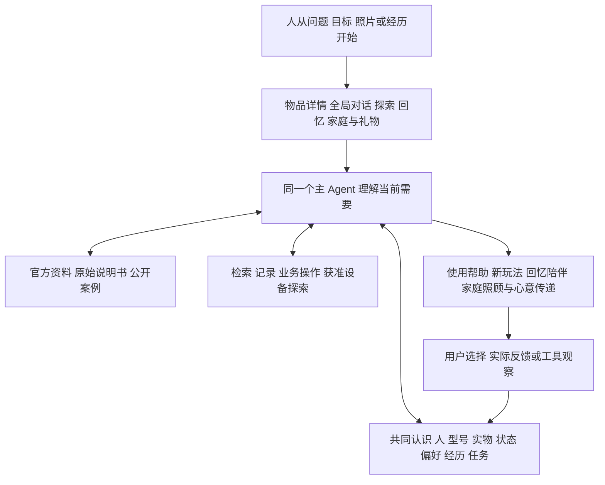

# 物间 产品功能交互与总体架构审计

本文记录主线同步前的审计或比对快照；后续 Git 状态与恢复入口见[主线同步与分支归档](2026-11-05_主线同步与分支归档.md)。

版本日期：2026 年 11 月 5 日。审计对象：`D:\D盘桌面\wujian_final` 当前本地实现。面向产品负责人、设计、开发与验收成员。

本文固定截至目前的产品共识，说明各项能力应带来什么体验、现有界面如何组织、共同底座如何连接四类价值，并列出尚未达到的用户结果。配套的[代码与技术架构审计](2026-11-05_物间代码数据库与技术架构审计.md)解释具体实现、数据维护、调用链和代码缺陷。

**当前结论：可以把现有工程作为继续共同开发的基础，但不能宣布智能底座或完整产品已经验收通过，也不具备直接对外发布的条件。** 主架构与愿景基本一致；使用指导的条件准确性、创造方案对约束的遵守、个人理解的更新、分身经历归属、家庭完整流程及真实 REA 效果仍需解决。本轮还发现了现有测试未覆盖的数据与权限问题。

本文中的“目标”表示已讨论的产品深度，“已有”表示存在实际代码，“验证”只覆盖明确列出的证据；这三者不能互换。后续聊天中的明确约定优先于历史参考资料。本文不修改产品代码，也不把审计意见自动视为已批准的实现方案。

## 1 产品价值与定位

### 1.1 物间是什么

物间是一款由 Agent 驱动、围绕现实中的人与物持续服务的应用。对用户，它是可以打开、拍照、聊天、查用法、找玩法、留回忆和连接家人的产品；内部 Agent 负责理解开放意图、寻找信息、选择工具与接续任务。

核心价值是：**理解物是为了更好地服务人，理解人是为了更好地发挥物的价值。** 物的价值既包括功能，也包括个人意义和人与人之间的心意。一块石头即使没有实用改造需求，保存着与外婆有关的经历，也已经有充分的存在价值。

“数字分身”是同一件物的个人化交互身份。它不必对应一个独立运行、独立维护记忆的 Agent；目前采用同一个主 Agent，按具体物品加载身份、设定与获准经历。

### 1.2 四类价值

| 价值 | 用户想获得什么 | 有价值的结果 | 不能用什么冒充 |
|---|---|---|---|
| 兑现 | 把已有的物用好 | 找到准确说明、完成操作、解决问题、减少闲置 | 给出搜索摘要或链接就算解决 |
| 创造 | 发现和实现新的可能 | 单物新用、多物组合、任务安排、支持范围内的个性化改变 | 同质点子、漂亮文案、无条件移植教程 |
| 延续 | 保存效用、经验与意义 | 维护经验可复用，照片故事可重见，分身随相处形成特点 | 把聊天全部发布到回忆墙，或只加昵称和头像 |
| 传递 | 让物继续帮助和陪伴别人 | 家庭共同照顾、使用知识接续、精选故事和寄语随礼物传递 | 只有共享按钮，或把数字接收写成实物已交付 |

四类价值可以在一次任务里同时发生。家庭维护也可能同时体现兑现、延续和传递，不必强行归入唯一栏目。

### 1.3 认知逻辑

“理解物 → 物与物 → 物与人 → 人与人”说明认识逐渐丰富的方向。用户可以从任何一端进入，例如先讲一段关于礼物的故事，再问如何保养；也可以先问净水机用法，随后邀请家人共同维护。

这不是四个必须依次完成的页面，也不是要求系统每次跑完四阶段。产品要保证进入方式不同，仍然认识同一个人、同一件物和同一段经历。

## 2 已确认的体验原则

1. **实用帮助随时可达。** 查询怎么用是日常基础需求，不被创意内容遮挡。
2. **探索由人自然开启。** 创意有容易发现的入口，但不靠连续通知、占满首页的信息流或广告式推送吸引打开。
3. **轻量进入，逐步认识。** 主要录入方向是照片，也允许名称、准确型号和手工描述。用户不必先维护完整库存。
4. **商品与纪念物平等成立。** 标准商品需要准确型号；手作、画、石头、旧物允许没有商品身份。
5. **日常理解安静积累。** 不频繁询问“要不要记住”；聊天中有用的信息可以保留为可纠正的理解。
6. **回忆墙由用户主动记录。** 上传照片、写文字和明确要求留下一段经历，才形成可见的生活记录。
7. **当前需要优先。** 长期偏好不能覆盖今天的明确要求；一时情绪不自动变成永久性格。
8. **接收者决定礼物的新生活。** 赠送后原赠送者不能悄悄修改分身或读取接收者的新私人经历。追加心意等细节后续再完善。
9. **事实与想象可辨。** 官方资料、用户报告、模型推断、软件观察和设备效果分别表达。
10. **成熟工具按缺口引入。** 只有能改善具体用户结果的依赖、结构和调用才值得保留。

首版以电脑浏览器为主，手机辅助拍照和基本浏览。完整移动体验、语音、精细养成动画不是当前底座完成的前提。

## 3 贯穿产品的共同概念

| 概念 | 产品含义 | 典型区别 |
|---|---|---|
| 人 | 独立使用者与其当前需求 | 家人身份不自动获得所有私人信息 |
| 商品型号 | 某市场、版本的标准商品身份 | 说明书说它支持什么 |
| 具体物品 | 现实中的这一件物 | 用户这台设备缺件、借出或损坏 |
| 人与物的关系 | 拥有、获准使用、赠送，以及个人意义 | 同一件物对不同人的意义不同 |
| 资料与认识 | 原始信息，以及从中形成的能力、步骤、条件和未知 | 有原文依据不等于解释一定正确 |
| 个人理解 | 关于偏好、能力、限制、意义和目标的可更新认识 | 阅读喜欢暖光，不意味着做手工也喜欢暖光 |
| 经历 | 用户主动保存的照片文字事件 | 一次野餐可以同时关联相机和野餐垫 |
| 任务与反馈 | 正在做什么、用什么、选了什么、试后怎样 | 给出方案与实际成功不同 |
| 分身 | 物的身份、表达、知识与共同经历的交互呈现 | 用户设定的性格与系统成长笔记不同 |
| 授权与流转 | 谁能读、谁能改、哪些内容随礼物走 | 公开说明书与私人记忆不同 |

“个人世界模型”目前指这些相互关联、可更新的认识。没有独立的世界模拟服务或通用物理引擎。

## 4 总体架构与价值连接

### 4.1 用户体验与共同底座



图中是职责与信息关系，不表示每个方框都要部署为一个服务。当前用一个后端应用组织这些职责，模型按需要选择路径。

### 4.2 一次认识怎样跨功能发挥作用

以台灯为例：准确型号帮助取得调光说明；实例状态说明它当前能否正常工作；个人理解说明用户读书喜欢暖光、做手工喜欢白光；创意据此安排拍摄或阅读；用户主动留下照片成为经历；分身可以引用真实经历；赠礼时选择的故事与适用公开资料继续帮助接收者。

**当前已有数据和业务连接，但智能使用还不稳定。** 公开资料接续、跨会话纠正与同一任务更新分别有验证；最新整条长旅程尚未全部成功。系统性验收必须看连续行为，不能只看这些数据存在于同一个数据库。

## 5 当前信息架构和交互

### 5.1 主界面

当前侧边栏有四个入口：“我的物间”“一起的回忆”“发现新可能”“家人与心意”，底部有“物间对我的理解”。右侧为可收起的统一对话区。

首页展示意图输入入口、物品搜索和物品卡片；创意位于可主动进入的探索区。目前探索页的四张卡片只是发起对话的示例入口，不是已经生成的个性化灵感推荐流。

```text
侧边导航             当前内容区                       统一对话区
我的物间             我的物品 / 某件物品详情            当前关注的物
一起的回忆           同一份经历的生活视角               用法 / 灵感 / 日常
发现新可能           主动进入的灵感入口                 照片输入与历史对话
家人与心意           好友 / 事项 / 礼物                 进度 / 停止 / 接续
对我的理解           查看与移除安静积累的理解
```

切换物品会改变下一次请求关注的物品，不一定自动新建会话。当前没有每件物一套完全独立的聊天历史；这有助于连续任务，但需要继续验证焦点变化会不会让用户误解对话身份。

### 5.2 物品详情

当前详情包括实物照片或图标、名称和型号、个人描述、归属状态、用法和新玩法按钮、记下一刻、性格与成长笔记、关联回忆。

拥有者可通过更多菜单修改物品与分身、共享、赠礼、连接设备。共享用户获得的不是拥有者的私人分身设定。物品图像目前是上传照片或按名称选择的通用图标，尚无生成式角色形象与自然视觉成长。

详情尚未提供完整能力档案、来源阅读面板、任务看板、状态编辑与生命周期管理。部分后端能力只能通过对话或 API 使用。

### 5.3 对话与状态

用户可以输入文字、附加最多四张照片、切换历史对话、新建对话、停止运行。工具进度使用面向用户的短语显示。当前最终正文通常需要等待结构化结果完成，不能按逐字流式回答评价等待体验。

失败、中断和完成有独立状态；但界面尚未完整展示已保存的持续任务、资料变更或所有中间结果。断线后不会重新发起同一次外部操作，自动恢复观察能力仍需完善。

### 5.4 编辑与控制

当前编辑弹窗覆盖录入、物品/分身修改、记录经历、送礼、事项、好友、共享和个人理解。多数复杂能力仍通过同一个对话推进。

“物间对我的理解”可查看与移除，尚无直接编辑情境、期限或逐条修订的专门界面；可通过聊天纠正，但模型提炼质量仍需验证。

## 6 完整功能设计与当前落地

### F1 物品录入与准确身份

**目标体验。** 用户从照片、名字、型号或来历开始；标准商品逐步核对品牌、地区、版本；非标物保留独特身份。允许相同型号多件实物，昵称不改变客观型号。录入后立即进入帮助或记录。

**已有交互。** 添加物品可上传照片，选择标准商品或独特物品，填写名字、品牌型号、个人描述与分身设定。照片录入先建立档案，再发起模型认识；不确定视觉识别可以标记为暂定。准确型号也可手工补充。

**未完成。** 相似型号候选的清晰确认流程、重复录入处理、版本核对、条码/订单导入、完整生命周期。天猫自动下单录入仍是生态设想。照片识别尚未通过成组准确率验收。

**验收结果应表现为。** 第一次用户能为一个国内标准型号和一个非标物轻量建立可用档案；错误身份能纠正；两个相同型号实物不合并；未知参数不会被补造。

### F2 可信知识与使用指导

**目标体验。** 给出准确型号后，物间自主找适用资料，从用户当前状态给出动作、时序和成功标志；追问与失败后继续排查。图示、按钮方向、地区和固件条件需要核对。

**已有交互。** 物品详情“问问用法”和统一对话进入相同处理路径。系统可联网、读原始网页/PDF、按页或关键词重读、查看 PDF 页图，并保存带原文依据的知识。

**未完成。** 真实开发测试仍出现原文未充分支持的附加条件；没有完成独立陌生型号验收。当前不支持把用户上传 PDF 当作通用附件直接导入；已有工具主要获取公开网址资料。

**验收结果应表现为。** 从自主取得说明书到正确操作、追问、反馈和新会话复用全部成立。合法引用不能抵消错误步骤；未找到资料应明确未知。

### F3 目标驱动的已有资源组合

**目标体验。** 用户说“我要野餐”“想布置摄影角”，物间发现未点名但有用的已有物品，说明各自作用、缺口、步骤与前提；拿走一件物后只修改受影响的部分。

**已有交互。** 全局对话和探索示例启动目标；模型能够查库存、按意义检索、读取物品、形成持续任务并接续反馈。

**未完成。** 大库存召回、新旧状态优先级与资源替换还未稳定验收；计划中的具体动作和条件仍较自由，程序尚不能可靠检查每一步有没有违反限制。没有专门的可视化组合编辑器或任务面板。

**验收结果应表现为。** 多资源任务能发现用户未点名物品，不虚构材料；资源不可用、目标变化或一次试验失败后，建议确实发生合理变化。

### F4 开放新玩法与创造

**目标体验。** 既支持明确目标，也支持“我无聊了，看看这些东西还能怎么玩”。单物、多物、跨用途和审美/情感体验都成立。先提供不同原理的方向，选中后深化条件、试法与反馈。

**已有交互。** 物品“发现新玩法”、探索页或自由提问进入同一个 Agent。项目有创造方法 Skill；已真实搜索、读取教程并沉淀案例认识。

**未完成。** 尚未形成稳定的案例搜集与适配能力，更没有保证取得小红书/B站完整内容。真实测试将教程移植到库存时仍建议剪不能剪的窗帘，并给出未经证实的灯布距离保证。这是明确失败。

**验收结果应表现为。** 方案有非平凡增益、尊重实际资源与禁止项；解释为什么可能成立及哪里未知；选择、尝试、否定与再次建议形成闭环。不能为提高通过率退化成常规摆放模板。

### F5 REA 与能力扩展

**目标体验。** 复用已有型号与资料，判断用户希望改变什么，找到具体控制路径；需要时指导用户逐步操作，或在明确选择后执行可核对的动作。显示屏首个切片可以是屏保/展示内容改变。

**已有交互。** 物品更多菜单可登记本机浏览器调试入口，或授权目录内的 JavaScript/Electron 软件包；能发起探索。后端已连接 REA，保存目标和观察，提供操作提案与显式执行 API。

**未完成。** 没有真实屏幕修改证据，没有完整执行与恢复界面，没有通用固件、Android或任意设备控制链。物品型号可减少前置认识工作，不能替代协议、认证和控制通道。

**验收结果应表现为。** 真目标 → 对应能力证据 → 明确动作 → 实际执行或明确失败 → 目标屏幕观察 → 能恢复。发生在电脑或投屏源端的改变按该范围表述。

### F6 个性化与数字分身

**目标体验。** 用户能设置名字、形象、性格，也能让分身随着真实相处逐渐形成特点；能聊日常、情绪和记忆，也能利用物品知识帮助实际任务。纪念物不需要先拥有实用功能。

**已有交互。** 设置昵称、性格和颜色；对话加载物品个人档案；有依据的成长笔记可以更新；礼物带有赠送者寄语与所选设定。已有故事引用由程序标出原作者。

**未完成。** 形象自然生长、声音、电子宠物/盲盒式养成未实现。正文仍可能把赠送者经历说成接收者亲历，或虚构交付现场、人物心理；引用正确不代表自由叙述正确。

**验收结果应表现为。** 分身对实际帮助产生个性化差异，能引用正确经历并接受纠正；收到的故事有明确来处；保留心意但不假装赠送者实时本人。视觉养成可以分期。

### F7 回忆墙与生活故事

**目标体验。** 人主动留下照片、文字、日期和相关物品；同一事件从生活回忆墙或任一相关物品看到。即使物品丢失，记忆仍可保存。普通聊天不自动成为墙上内容。

**已有交互。** 记录一次经历并关联多物，生活页与物品页读取同一份记录；聊天明确要求记录时也可创建。赠礼副本保留原作者与来源信息。

**未完成。** 经历修改/删除、专门详情、完整多图相册、自动照片关联、按人物组织，以及“仅本地保存、不供模型使用”的独立用途开关。当前可用经历可能进入模型上下文或检索，不应对外承诺这些开关已存在。

**验收结果应表现为。** 记录、浏览、修改、关联与选择性传递准确；用户掌握智能使用与分享边界。非标物和已失去的实物都能留住意义。

### F8 维护与生命周期

**目标体验。** 结合型号说明、实际使用和已知状态帮助保养、换耗材、排障；用户报告维护结果后更新状态和下一次建议。丢失、赠出、停用后不继续无意义提醒。

**已有交互。** 可查维护知识、记录用户状态、建立相关事项并手动标记完成；底层任务和知识可复用。

**未完成。** 耗材周期、使用量、保修凭证、完整维修历史、状态对提醒的自动影响、延后/关闭与真实到时通知。归档 API 保留回忆，但没有完善的归档浏览/恢复体验。

**验收结果应表现为。** 一次真实维护经历能改变下一次指导和提醒，而不只是多一条日历事项。

### F9 家庭空间与关怀协作

**目标体验。** 家庭像小型协作空间，有共同物品和独立身份。围绕净水机、空调、花草等形成“需要照顾 → 合适的人知晓 → 接手 → 处理 → 报告 → 确认 → 更新状态”的流程；长辈能看懂并少操作。

**已有交互。** 独立账号、好友邀请与接受、按件共享、给本人或好友分配事项、完成按钮。共享用户可读公共物品信息，不能直接编辑拥有者物品。

**未完成。** 家庭组织、共同所有/多角色、成员退出、求助交接、接手与已读状态、真正通知送达、长辈简化视图。当前不是完整家庭管理产品。药物等提醒可作为用户自设事项讨论，但没有剂量决策或医疗管理能力。

**验收结果应表现为。** 两个独立身份实际完成求助与接续，准确区分收到、接手、报告完成和已验证；共享与撤权作用于真实请求。

### F10 好友赠礼与价值流转

**目标体验。** 送的不只是实物，还可以是选定故事、创作寄语和有赠送者影子的分身；接收者预览后接受，随后独立决定修改并建立自己的私人经历。

**已有交互。** 选物、好友、寄语、分身与已有故事；接收前预览；接受后数字归属变更；原主人保留原故事；接收者建立独立记录；匹配的公开商品资料能够继续使用。

**未完成。** 直接在送礼流程创作并保存新故事、追加心意通知、拒收/取消/到期、借还、实体物流与维护历史的完整流转。接收时物品照片与状态被清空，尚未提供完整的接收状态核对。

**验收结果应表现为。** 双方只能读各自和明确转交的内容；对方接受不表示实体已送达；旧主人不能暗改或读取新故事。

### F11 统一智能任务体验

**目标体验。** 任意入口开始，从用法自然转向创造、记录或家庭帮助；关闭、换话题和新会话后能继续；用户不必重讲已确认信息。

**已有交互。** 共同主 Agent、对话状态、任务记录、资源引用、反馈与版本；对话历史和任务可检索；撤权和部分纠正会使旧上下文失效。

**未完成。** 最新长旅程未全部成功；简单任务也可能被不必要的检索拖慢；缺少任务管理界面。审计还确认：历史成功反馈未绑定计划版本，新的未尝试方案可能被标完成。

**验收结果应表现为。** 至少两条跨三类以上能力的旅程包含反馈和新会话，当前结果与状态都能解释。完成必须对应当前方案，不能只因历史上曾有一次成功。

### F12 身份证据与信任

**目标体验。** 独立身份、正确归属、用途授权、来源性质、纠正和遗忘贯穿所有功能。知识、故事和实际控制分别有合适边界。

**已有机制。** 登录会话、拥有者与共享判断、来源摘录、模型推断标识、版本检查、部分上下文失效、私有资产访问与选择性赠礼。

**审计缺口。** 历史来源绑定物品后可能越过公开来源筛选；语义改写可以绕过相同文字遗忘；相同记忆文字不同情境会覆盖。完整用途许可、导出、账号删除、已发内容的撤回说明及公网加固未完成。

**验收结果应表现为。** 直接请求接口和工具也符合权限，不只隐藏按钮；删除/纠正不会被其他入口恢复；敏感结果与实际动作不被误导描述。完整度可分期，已经接入能力上的明确越权必须先修复。

## 7 贯穿四类价值的验收旅程

| 旅程 | 应完成的连续体验 | 当前证据及不足 |
|---|---|---|
| 陌生商品 | 录入准确国内型号 → 自主找资料 → 指导 → 追问 → 反馈 → 新会话复用 | 有真实搜索和知识记录；附加条件准确性与独立泛化未过 |
| 创造与经验 | 未点名资源发现 → 不同方向 → 选中 → 条件核对 → 试用反馈 → 修改同一任务 | 曾验证反馈更新；最新创意仍违反限制，最新长旅程有回退 |
| 纪念物 | 石头或画 → 个人意义 → 安静理解 → 主动照片文字记录 → 分身正确引用 | 记录和理解基础存在；自由叙述归属与成长未成熟 |
| 家庭关怀 | 共享净水机 → 维护依据 → 提醒 → 长辈或家人接手 → 报告 → 下一周期 | 只有共享和事项基础，后半流程未实现 |
| 心意赠礼 | 选故事与人格 → 预览接受 → 公开知识接续 → 新主人私人故事 | 数据流成立；分身仍有错认经历，社交细节后置 |
| REA | 既有物品理解 → 登记真实入口 → 探索 → 选择可撤销改变 → 执行 → 实屏观察与恢复 | MCP 连通；真实显示改变尚未完成 |

## 8 共同底座应达到的智能标准

底座的完成标准是行为改善：认识同一件物不反复从零开始；明确条件变化后方案随之改变；用户纠正跨会话有效；不同人的经历不混淆；任务和实际结果能够接续；共享或换主后读写边界正确。

当前最重要的四项改进是：

1. **认识能约束具体行动。** 不能只在档案里保存“不可剪”，而在步骤里仍建议剪。
2. **个人理解能独立更新。** 情境、临时条件和纪念意义不能挤进一条无法分别维护的总结。
3. **经历有正确主体。** 收到故事、亲身经历、想象创作与当下感受需要稳定区分。
4. **实际结果与当前方案绑定。** 模型提出、用户反馈、工具返回和现实验证保持不同性质。

这些需要通过实际任务推进共同机制，不宜先建设庞大的通用智能平台，再等待功能证明它有用。

## 9 本轮审计发现与发布判断

| 编号 | 发现 | 证据 | 处理顺序 |
|---|---|---|---|
| A01 | 共享物品可能开放绑定的未分类历史资料 | 本轮隔离复现，来源含虚构私人附注仍可读 | 发布前阻断 |
| A02 | 遗忘仅拦截相同文字，改写仍可保存 | 本轮隔离复现 | 完整个性化发布前修复或明确收窄承诺 |
| A03 | 相同文字的不同情境偏好互相覆盖 | 本轮隔离复现 | 理解人核心机制修复 |
| A04 | 旧成功反馈可以放行新方案完成 | 本轮隔离复现 | 任务状态可信性修复 |
| Q01 | 创意违反已知物品限制 | 真实百炼与教程读取结果 | 当前智能验收阻断 |
| Q02 | 合法原文引用之外仍补写条件 | 真实耳机开发测试 | 当前知识验收阻断 |
| Q03 | 分身错认人物经历并补造过去 | 真实赠礼后聊天 | 分身验收阻断 |
| Q04 | 多步任务耗时过长且最新旅程有回退 | 真实运行记录 | 随上述机制一起定位 |
| P01 | 家庭关怀与真实设备改变未形成闭环 | 代码与现有实测覆盖 | 保留完整范围，按切片补齐 |

本轮 34 项工程回归和前端 TypeScript 检查通过；它们没有覆盖 A01–A04 的这些反例。通过数量不能抵消新发现。技术文档附有复现证据、代码位置和进一步审查项。

**共同开发可以开始，完整对外发布暂不放行。** 并行工作必须沿已有共享对象和接口开展；现有访问与状态缺陷应由底座负责人先处理，避免其他功能继续依赖错误机制。

## 10 下一阶段开发与验收安排

### 10.1 按共同问题推进

| 顺序 | 工作 | 交付判断 |
|---|---|---|
| 1 | 修复来源访问、理解情境、遗忘与计划结果对应关系 | 四个反例不再成立，相关旧流程不回退 |
| 2 | 结合真实用法和创造任务深化能力、条件、案例适配 | 拿走资源、增加禁止项、报告失败后，回答正确变化 |
| 3 | 修复分身的经历归属，稳定连续旅程与耗时 | 正文与引用都不误认人物，不主动追加无关计划 |
| 并行插入 | 有真实入口时完成 REA 可撤销切片 | 控制端、目标屏幕与恢复证据一致 |
| 4 | 家庭公共物品维护与求助接手 | 两个账号实际完成维护/关怀接续 |
| 5 | 回忆整理、视觉成长、细化赠礼及移动体验 | 按实际缺口扩展，不重建第二套底座 |

### 10.2 测试口径

- 标准商品使用中国大陆适用的具体型号；人物、拥有关系和故事可以明确虚构，商品操作事实必须由真实来源支撑。
- 开发、回归与独立验收样本分开。首答与复测分开保存；失败不能从分母里删除。
- 候选门槛仍沿计划：6 个陌生型号、至少两个品牌、共 18 道操作题；12 个创造任务；6 个跨会话理解案例；两条跨能力连续旅程；REA 单独验收。
- 15/18、9/12、6/6 是内部候选目标，尚未执行成正式成绩。明显错型号、严重约束违反或实质越权不能由平均分抵消。
- 创意看用途增益、新颖性、资源适配、机制、条件和个人意义，人工复核为主；不以关键词或模型自评分代替。
- 要声称优于直接千问，必须提供等价有效信息和工具条件，另测物间自动发现资源的增益，并比较完整延迟与费用。

### 10.3 协作责任

底座负责人维护共享对象、数据迁移、检索投影、身份与结果语义、模型运行机制。功能开发者通过共同接口接入，不另建一套物品、个人记忆或任务。前端负责入口、状态与交互；产品负责人审阅实际价值、独立样本与实物效果。第三位队友职责按技能确定，不假定所有成员都写代码。

“同意继续开发”表示接受当前基础和修复顺序，不表示所有功能完成或允许跳过发布门槛。

## 11 当前权威材料

- [产品愿景](../01_物间_产品愿景价值逻辑与智能底座能力.md)：价值和长期能力目标。
- [工程工作方法](../02_物间_产品工程研发与Codex工作方法.md)：研究、复用、决策、验证与协作原则。
- [沟通边界](../03_Codex_回答表达与沟通边界.md)：事实与表达要求。
- [产品深度与阶段计划](../05_物间_产品深度对齐与智能底座任务计划.md)：历史任务与候选验收。
- [最新既有修复记录](2026-11-04_底座缺口修复与验收状态.md)：2026 年 11 月 4 日真实开发证据。
- [代码与技术架构审计](2026-11-05_物间代码数据库与技术架构审计.md)：本轮技术事实与新增审计结论。

历史“已搭通”应理解为对应范围内的工程链路成立；涉及本轮新反例的完成表述，以本轮审计收窄后的结论为准。
