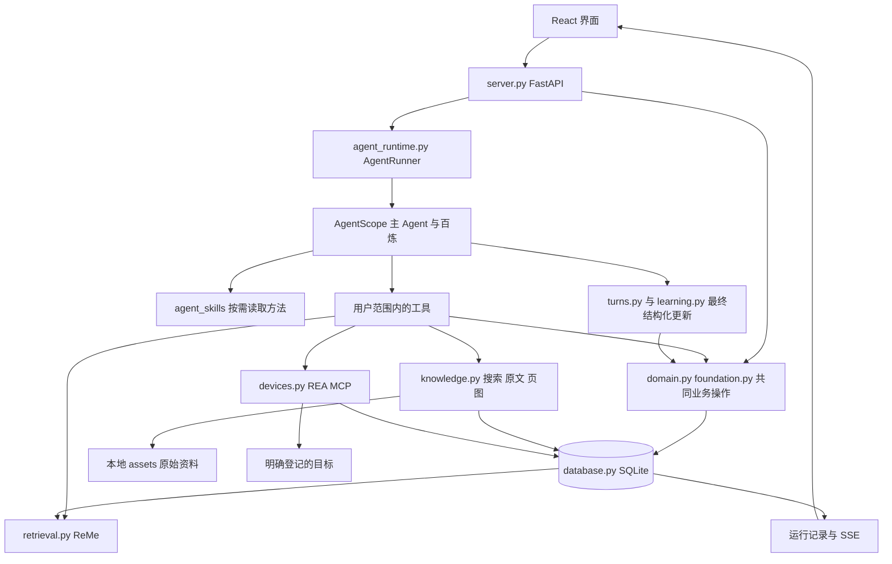
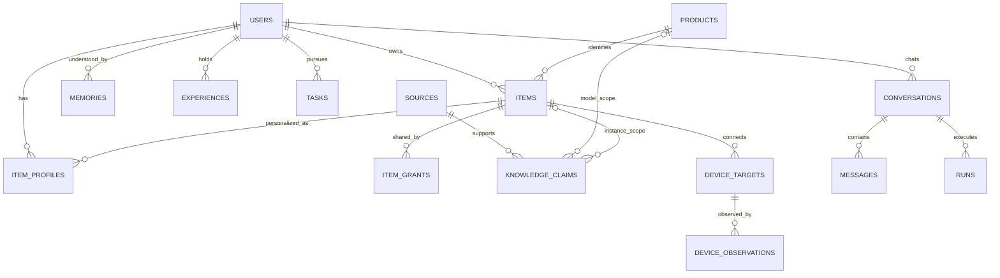
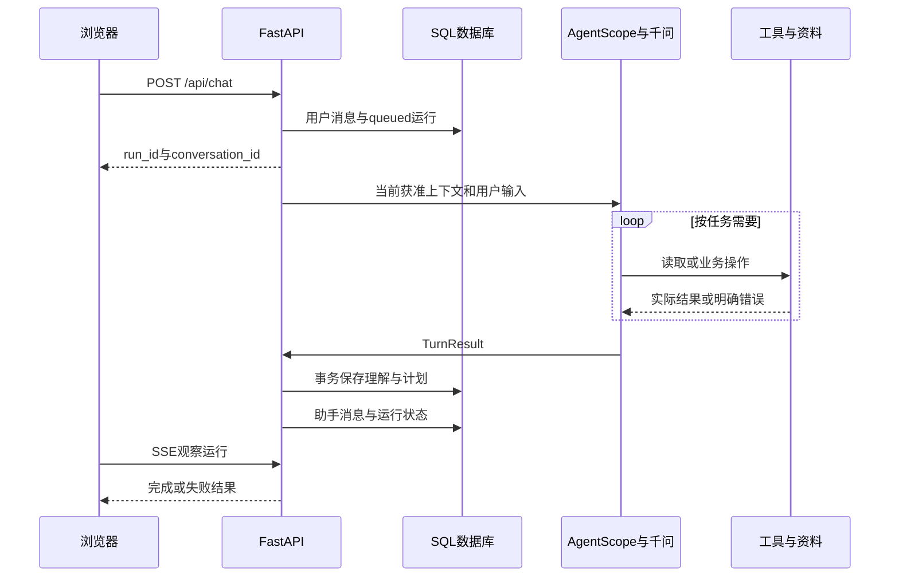

# 物间 代码数据库与技术架构审计

本文记录主线同步前的审计或比对快照；后续 Git 状态与恢复入口见[主线同步与分支归档](2026-11-05_主线同步与分支归档.md)。

版本日期：2026 年 11 月 5 日。审计对象：`D:\D盘桌面\wujian_final` 本地代码、当前数据库结构、测试、依赖与开发记录。面向维护底座、实现功能和验收的成员。

配套的[产品功能交互与总体架构审计](2026-11-05_物间产品功能交互与总体架构审计.md)说明价值、完整功能和交互目标；本文说明这些目标目前由哪些代码承担、调用怎样发生、数据怎样维护，以及哪些地方仍不可靠。

**审计结论：模块化单体、单一业务事实来源、一个主 Agent 与按需工具的方向可以保留。工程检查通过，但智能效果未验收；本轮还复现了四项旧测试未覆盖的权限和状态缺口。当前实现可以继续开发，不能直接作为完整产品发布。**

阅读顺序：了解本地数据库看第 4、17 节；了解 RAG 和 Skill 看第 7、8 节；了解物品个性化与偏好记忆看第 9、10 节；了解 REA 看第 15 节；决定下一轮先修什么看第 19、22 节。

## 1 审计范围与证据

### 1.1 本轮检查

已逐项检查后端模块、前端主要组件、两份应用内 Skill、迁移、工程测试、真实评测脚本与关键原始结果；读取本地 SQLite 的结构、计数和完整性，不读取或披露用户密钥。

本轮执行：

| 检查 | 结果 | 证明范围 |
|---|---|---|
| `python -m unittest discover -s tests -v` | 34/34 通过，约 10 秒 | 已覆盖的工程规则与 SDK 集成 |
| 前端 `tsc --noEmit` | 通过 | 当前前端类型成立 |
| 当前源码生成的 OpenAPI 与已存文件比较 | 一致，38 个路径、46 项操作 | 后端现有契约文件未漂移 |
| 主库只读 `quick_check` | `ok` | SQLite 当前基本完整性 |
| 主库只读 `foreign_key_check` | 无违规 | 当前已声明外键关系 |
| 四项隔离反例 | 全部复现 | 来源权限、遗忘、情境、计划结果仍有缺口 |

没有在本轮重新执行付费模型验收、实机改变、完整浏览器旅程或生产构建。真实智能结果引用此前保存的原始开发记录；已有构建记录仍有约 996KB 主分块警告。

复核证据位于：

- [工程测试日志](audit-evidence/2026-11-05/audit-unittest.txt)。
- [隔离反例记录](audit-evidence/2026-11-05/isolated-findings.json)。
- [OpenAPI 比较记录](audit-evidence/2026-11-05/contract-check.json)。
- [45 个核心文件的 SHA-256 清单](audit-evidence/2026-11-05/source-manifest.json)。

代码快照指纹为 `eee52f098965f677fae717ea901f1f33184b91170ea4195f1e41a0234391329c`，按清单中排序后的路径和文件哈希计算。它不是 Git commit，不代表全目录、前端样式或所有文档的哈希。本轮只新增审计文档与隔离检查产物，未修复业务代码。

### 1.2 本地代码与 GitHub 的关系

本轮开始时当前目录没有 `.git`，本地成果没有可引用的提交 SHA。已通过 GitHub 工具核对 `Starry-Curry/ProductAgent` 存在，默认分支为 `main`，当前连接具备读取和推送权限。

仓库可访问、本地配置了远端、代码已提交、代码已推送、已合入 main 是五种不同状态。本文审计的是这个本地实现，不把远端旧实现当作同一版本，也没有进行旧项目的全面代码审计。实际本地关联状态见文末交付记录。

## 2 实际技术选择及职责

| 组件 | 当前版本或形式 | 实际承担什么 | 当前未承担什么 |
|---|---|---|---|
| Python | 本机 3.12.14；项目声明至少 3.11 | 后端、业务、模型、文档与评测 | 浏览器交互 |
| FastAPI | 锁文件固定实际依赖 | HTTP、登录、API、SSE、静态前端 | 分布式后台任务平台 |
| Pydantic | 2.14.2 | 输入输出类型、工具与最终结果 Schema | 语义真实性和物理可行性判断 |
| SQLAlchemy | 2.x | 数据映射、查询、事务、条件更新 | 自动解决业务冲突 |
| SQLite | 本地文件，WAL | 业务事实持久化 | 跨电脑共享数据库服务 |
| Alembic | 1.x；head 为 0005 | 结构和历史数据升级 | 自动完整备份、通用可逆回退 |
| AgentScope | 2.0.11 | 主 Agent、工具循环、状态、上下文、Skill、MCP、结构化结果 | 物间的实际业务规则 |
| 百炼千问 | 默认 `qwen3.6-plus` | 主推理和照片理解 | 已被实测保证任意任务正确 |
| 单独视觉模型 | 默认 `qwen3-vl-plus` | PDF 原页的模型识读 | 无误差的原厂图示结论 |
| ReMe | `reme-ai==0.4.2.1` | 本地关键词/向量检索与融合 | 自动个人记忆管理、自动知识提炼、梦境整理 |
| 百炼 embedding | `text-embedding-v4`，512 维 | 语义召回 | 无损事实传输、权限判断 |
| REA | 6.8.0；本机 Node 26.13.0 | MCP 目标分析和受限浏览器操作 | 通用硬件控制、当前实屏验证 |
| React / TypeScript / Vite | React 19.3.1、TS 5.9.3、Vite 8.3.5 | 浏览器界面与构建 | 独立业务事实存储 |
| Ant Design / Ant Design X | 6.7.0 / 2.10.0 | 表单、弹窗、对话输入等 | 独立智能机制 |
| httpx / BeautifulSoup / pypdf / pypdfium2 | 依赖锁定 | 公开资料下载、正文/PDF解析、页图渲染 | 登录社区全站采集、通用视频理解 |

Python 与 TypeScript 的分工服务于成熟工具复用和浏览器体验。REA 自身使用 Node，经 MCP 与 Python 通信，不要求整个后端改成 JavaScript。

后端项目与 API 标记 0.3.0，前端包仍标 0.2.0；功能并非按这个包版本独立验收。对外发版前应统一版本与提交标识。

## 3 总体代码架构



这是一个模块化单体。不存在独立“世界模型服务”、独立“上下文编译服务”、十二个功能 Agent、消息总线或图数据库。世界认知由共享业务对象和关系表达；上下文准备是主运行模块里的少量代码；模型保留继续检索与探索能力。

### 3.1 主要代码导航

| 入口 | 职责 |
|---|---|
| [server.py:69](../wujian/server.py#L69) `create_app` | 构造应用、认证、路由、生命周期与前端服务 |
| [database.py:37](../wujian/database.py#L37) | 业务表与约束 |
| [domain.py:77](../wujian/domain.py#L77) | 物品访问、档案、经历、共享、赠礼 |
| [foundation.py:22](../wujian/foundation.py#L22) | 理解纠正、知识、任务、反馈、实例状态 |
| [agent_runtime.py:79](../wujian/agent_runtime.py#L79) | 模型可以使用的真实工具 |
| [agent_runtime.py:289](../wujian/agent_runtime.py#L289) | 上下文准备与一次 Agent 运行 |
| [learning.py:25](../wujian/learning.py#L25) | 型号/实例知识与个人理解的更新契约 |
| [turns.py:118](../wujian/turns.py#L118) | 最终学习、计划和故事引用提交 |
| [retrieval.py:66](../wujian/retrieval.py#L66) | 当前获准数据的检索投影 |
| [knowledge.py:19](../wujian/knowledge.py#L19) | 百炼搜索与原文获取 |
| [source_access.py:7](../wujian/source_access.py#L7)、[continuity.py:8](../wujian/continuity.py#L8) | 共享/赠礼中的来源和公开证据接续 |
| [devices.py:92](../wujian/devices.py#L92) | 项目内 REA 桥接 |
| [App.tsx:41](../frontend/src/App.tsx#L41) | 前端状态、导航、请求与运行观察 |

`contracts.py` 主要用于开发样本的身份、引用与 JSON Schema 校验；真实 API 契约在 `api_models.py`，内部最终结果在 `turns.py` / `learning.py`。它们有不同用途，当前并非所有内部 JSON 都已严格类型化。

### 3.2 对外业务接口地图

下面按实际路由分组，完整参数以 `contracts/openapi.json` 为准。表中路径均带 `/api` 前缀。

| 接口组 | 主要实际路径 | 写入和访问性质 |
|---|---|---|
| 身份 | `/auth/register`、`/auth/login`、`/auth/demo/{persona}`、`/auth/logout`、`/me` | 建立或结束当前会话；体验入口受配置控制 |
| 物品 | `/items`、`/items/{item_id}`、`/items/{item_id}/archive` | 创建、读取、版本化修改、归档 |
| 共享 | `/items/{item_id}/shares`、`/items/{item_id}/shares/{recipient_id}` | 拥有者授予或撤销只读访问 |
| 经历 | `/experiences` | 列出或新增；没有修改/删除路由 |
| 个人理解 | `/memories`、`/memories/{memory_id}` | 查看有效理解、逻辑移除；没有直接编辑路由 |
| 知识 | `/items/{item_id}/knowledge`、`/sources` | 读取获准认识或本人来源目录 |
| 持续任务 | `/tasks`、`/tasks/{task_id}/feedback` | 列表/保存任务、提交版本化反馈 |
| 对话 | `/chat`、`/conversations`、`/conversations/{conversation_id}/messages` | 发起处理、读取本人对话 |
| 单次运行 | `/runs/{run_id}`、`/runs/{run_id}/events`、`/runs/{run_id}/cancel` | 状态、SSE和停止 |
| 附件 | `/assets`、`/assets/{asset_id}` | 上传处理后照片、按权限读取文件 |
| 好友 | `/friends`、`/friends/{sender_id}/accept` | 请求/查看好友、明确接受 |
| 礼物 | `/gifts`、`/gifts/{gift_id}/accept` | 创建、双方列表、接收转移 |
| 事项 | `/reminders`、`/reminders/{reminder_id}/complete` | 建立/读取事项、报告完成 |
| 设备 | `/devices/status`、`/items/{item_id}/device`、`/devices/{target_id}/explore` | 状态、绑定、实际探索 |
| 设备动作 | `/devices/{target_id}/proposals`、`/devices/operations/{operation_id}`、`/devices/operations/{operation_id}/execute` | 提案、读取证据、显式执行 |

API存在不表示已有对应完整界面。例如任务看板、设备动作审阅和执行、归档管理仍没有完整前端流程；提醒写入和赠礼也没有作为通用模型工具开放。

## 4 本地数据库是什么形式

### 4.1 物理文件和目录

默认数据库是一个文件：

```text
D:\D盘桌面\wujian_final\var\wujian.sqlite3
```

SQLAlchemy 通过数据库连接读写它。SQLite 不需要另外启动数据库服务器。模型没有拿到数据库密码或任意 SQL 执行器，而是调用已经注册的业务工具。

主要数据目录：

```text
var/
  wujian.sqlite3          业务记录与关系
  wujian.sqlite3-wal      运行期间可能存在的 WAL
  wujian.sqlite3-shm      运行期间可能存在的共享内存文件
  assets/                上传后的图片和下载的原始网页/PDF
  retrieval/<哈希>/      按用户和模型配置分开的可重建检索投影
  device-artifacts/      明确用于探索的软件包目录
  evaluations/<时间>/   每次真实开发测试的独立数据库和资料
  backups/               已执行备份留下的数据库副本
  session.key            本地会话签名秘密，不应上传
```

路径可通过 `WUJIAN_DATA_DIR` 改变；`DATABASE_URL` 可指定连接。当前 SQLite 路径是已验证路线；仅能填 PostgreSQL URL 不表示驱动、迁移和多人部署已验收。

上传照片会转换为 RGB、最长边不超过 2000 像素的 JPEG，质量 88；**没有保留上传前照片的无损原文件**。公开资料下载则保存原始响应字节和解析文本。必须区分这两类“原始资产”的含义。

### 4.2 SQLite 的运行设置

[database.py:263](../wujian/database.py#L263) 创建引擎并配置：

```python
connection.execute("PRAGMA foreign_keys=ON")
connection.execute("PRAGMA journal_mode=WAL")
connection.execute("PRAGMA busy_timeout=10000")
```

外键约束被开启；WAL 改善本机读写并存；锁等待最多约 10 秒。这不把 SQLite 变成可跨电脑同步或任意并发写入的服务。数据库和附件目前没有应用层加密，依赖本机文件访问边界。

### 4.3 数据表全景

当前共有 20 张表，包含 Alembic 版本表。

| 表 | 主体和关键内容 | 在产品中的作用 |
|---|---|---|
| `users` | ID、用户名、显示名、密码哈希 | 独立身份 |
| `products` | 稳定型号 ID、规格 JSON | 型号共性身份 |
| `items` | 具体物 ID、拥有者、型号引用、原规格、状态、照片、版本、归档 | 同一件实物跨功能保持身份 |
| `item_profiles` | 用户与物品联合主键、私人描述、分身 JSON | “这件物对我是什么” |
| `item_grants` | 物品与获准用户联合主键 | 当前按件只读共享 |
| `assets` | 文件 ID、拥有者、磁盘路径、媒体类型、名字 | 图片与原始资料权限入口 |
| `experiences` | 保存账号、标题、正文、日期、多物/照片 ID、来源与原作者 | 主动记录的回忆墙 |
| `memories` | 用户、可选物品、内容、依据、当前用户消息、有效状态、替代/期限/情境 | 安静积累的个人理解 |
| `knowledge_claims` | 用户、型号或实例、认识、条件、依据、原文、来源、状态 | 可复用能力、边界、步骤、案例 |
| `tasks` | 用户、目标、物品、条件、方案、反馈、状态、版本 | 跨会话持续任务 |
| `sources` | 用户、可选物品、来源性质、标题、URL、全文、页文本、文件引用 | 能回到原文的资料 |
| `device_targets` | 用户、物品、入口类型和地址 | 明确控制目标 |
| `device_observations` | 目标、用户、工具、参数、证据与阶段 | 探索和操作记录 |
| `conversations` | 用户、标题、关注物、SDK状态、上下文版本和重置时间 | 对话接续 |
| `messages` | 对话、角色、文字、运行、照片、时间 | 原始交流记录 |
| `runs` | 用户、对话、运行状态、正文、事件、错误、用量 | 一次异步处理 |
| `friendships` | 发起人与接收人、是否接受 | 好友关系 |
| `gifts` | 双方、物品、选择内容快照、状态 | 数字赠礼流程 |
| `reminders` | 创建者、负责人、可选物品、事项、时间、完成布尔值 | 简单家庭事项 |
| `alembic_version` | 当前迁移编号 | 当前为 `0005` |

这里的 JSON 仍是 SQLite 中的业务数据，不是额外的 JSON 文件数据库。精确身份和主关系用字段、主键与外键；开放条件和故事关联使用 JSON。`experiences.item_ids`、任务资源列表等 JSON 内的引用主要靠业务校验，不能声称全部由数据库外键保证。

### 4.4 主要关系



图省略好友、礼物、提醒和资产细节。经历到多件物、任务到资源是 JSON 列表，不是图中遗漏的实体关联表。

### 4.5 主库与评测库不要混淆

本轮只读快照显示主库有：2 个用户、8 件物、3 个型号、6 条经历、3 条个人理解、3 份历史来源、2 项任务、14 个对话、40 条消息、22 次运行、1 份礼物；物品知识记录为 0，设备目标和观察均为 0。

此前真实测试中保存的那 1 条耳机认识和案例认识，位于各自 `var/evaluations/<时间>/data/` 的隔离库。**测试证明过的能力，并不会自动把测试知识灌入主库。** 这也是打开应用没有看到评测里那批物品的原因之一。

## 5 型号身份与具体物品

[identity.py:7](../wujian/identity.py#L7) 使用以下字段构成型号身份：

```python
IDENTITY_FIELDS = ("brand", "model", "market", "edition", "firmware_version")
```

值做 Unicode NFKC、空白和大小写规范化，再用 SHA-256 得到稳定 ID。来源链接、商品宣传名和个人描述不参加 ID。完整录入规格留在每个物品的 `identity_notes`；型号表存身份字段。

[domain.py:118](../wujian/domain.py#L118) 仅在标准商品同时具有品牌和型号时建立型号引用。非标物或待确认型号可以 `product_id=None`，避免所有“未知商品”共享一个错误型号。

知识的 `product` 范围复用于同一用户持有的同型号实物；`item` 范围只描述该实例。`owner_id` 仍限制知识归属，**不是不同账号自动共建一个全局知识库**。跨人复用走共享或赠礼的明确路径。

局限：没有品牌语义别名与地区版本的智能合并；固件参与身份可能使未知固件与已知固件成为不同记录；型号文本匹配只是基础条件，不证明整段操作适用。硬件修订在开发样本中存在字段，但运行时产品规格没有完整承接这个维度。

## 6 一次用户请求怎样完成

主要路径：[server.py:278](../wujian/server.py#L278) → [AgentRunner._execute:289](../wujian/agent_runtime.py#L289) → [commit_result:118](../wujian/turns.py#L118)。

1. 浏览器提交文字、可选会话 ID、关注物品 ID 和照片 ID。
2. 后端验证用户、物品和照片权限，保存用户消息与 `queued` 运行。
3. 同一会话用部分唯一索引限制一个活跃运行，重复提交返回冲突。
4. `AgentRunner` 在当前进程创建异步任务，把运行改为 `running`。
5. 从数据库准备当前身份、关注物、库存索引、个人理解、近期经历和持续任务；恢复 SDK 状态或有限历史。
6. 构造一个主 Agent，按需要读取 Skill、检索、查原文或调用业务工具。
7. 主 Agent 通过原生 `GenerateStructuredOutput` 返回 `TurnResult`；业务校验错误反馈给同一个 Agent修正。
8. 保存这轮知识、个人理解与持续计划；按真实记录追加有作者的故事引用。
9. 保存助手消息、运行结果与符合版本条件的 SDK 状态；界面通过 SSE 观察更新。



### 6.1 初始上下文有多大

当前加载关注物档案、前 100 件物的简要索引、最近 12 条有效个人理解、最近 5 条经历、最近 4 项任务。无 SDK 状态时最多补最近 16 条历史消息，并跳过重置时间之前的内容。原始照片引用按当前请求传入，旧照片不会在重建历史时全部重新上传。

这仍包含固定的近期窗口与数量限制，不是已经成熟的任务相关性“编译器”。模型可以用 `search_world` 和其他读取工具补全；初始没有看到不等于不存在。大库存与长历史下的召回、隐私最小化及上下文成本需要继续测试。

### 6.2 运行与流式状态

默认主模型启用思考、供应商流关闭，最多输出约 3500 token；SDK 最大 10 次迭代，主请求超时 90 秒、最多一次重试；整轮约 240 秒。上下文配置触发比例 0.75，工具结果上限 18000。

应用仍用 SSE 发送运行与工具进度，约每 0.4 秒检查一次；这是进度流，不等于最终正文逐字输出。正文通常在最终结构校验后出现。

`runs` 有 queued/running/completed/failed/interrupted；任务目标状态另在 `tasks`，不能混为一谈。服务重启把活跃运行标中断，不自动重放操作。运行调度是进程内 `asyncio.Task`，没有持久队列、多进程归属、分布式恢复或生产任务服务。

## 7 用法说明如何生成

### 7.1 是否是 RAG

可以把当前方式称为**带主动检索与工具的生成**：模型根据任务决定查已有知识、召回相关资料、搜索网络、读取原文，再生成解释。它具有 RAG 的检索增强特点，同时包含实时搜索、按需工具和持续知识写回。

但当前不是“预先把所有说明书切块、向量化，然后固定检索几块拼接答案”的完整文档 RAG 流水线：ReMe 索引的是业务实体投影，来源只放前 1200 字摘要；原文细节靠关键词/页码读取和模型主动探索。全文语义切块、成熟重排、复杂版式 OCR、大规模知识库摄取尚未接入。

### 7.2 真实路径

1. `read_item` 获取准确身份、实例现状、个人档案与已有认识。
2. `list_sources` 或 `search_world` 寻找已保留资料。
3. 不足时 `search_public_web` 调用百炼 Responses 的 `web_search`。
4. 程序要求服务返回真实完成的搜索调用记录；搜索摘要明确标为摘要。
5. `fetch_document` 下载原网页/PDF，保存文件和全文，返回有限片段、来源 ID、页数与链接。
6. `read_source` 按关键词或 PDF 页重读，返回带全局行号的原文，通常最多 12000 字。
7. 必要时 `view_source_page` 渲染原 PDF 页，交给单独视觉模型识读，结果标为模型解释。
8. 主 Agent 结合适用前提生成步骤和来源，最终把值得复用的认识放入 `learning.knowledge_updates`。

网页下载限制约 12MB，每次跳转重新验证公开地址，最多约五轮跳转；PDF文字最多前 160 页、每页约 16000 字，HTML正文截取约 300000 字。当前不是任意大文档的完整摄取。

### 7.3 项目中确实有哪些 Skill

| Skill | 文件 | 具体作用 |
|---|---|---|
| `product-guidance` | [SKILL.md](../agent_skills/product-guidance/SKILL.md) | 核对型号/条件、阅读原始说明、核对图示、只给有依据的步骤、沉淀认识 |
| `creative-use` | [SKILL.md](../agent_skills/creative-use/SKILL.md) | 发现资源、借鉴原理与真实案例、核对条件、形成可继续方案、利用实际反馈 |

它们通过 AgentScope `LocalSkillLoader` 注册，按需提供给主 Agent。Skill 是复用的方法说明，不是某款商品的答案模板，也不是模型微调；其是否被读取、读取后是否遵守，需要观察真实轨迹。没有导入一个现成的“全商品理解引擎”。

这些 Skill 是物间自己的领域方法，运行、加载与工具机制复用 SDK。它们与 Codex 开发时可用的技能是两个不同层面。

### 7.4 认识怎样被保存和核对

[learning.py:25](../wujian/learning.py#L25) 的知识更新有：

```text
item_id
kind = capability | boundary | procedure | observation | case
content
conditions = requirements + limits + unknowns
basis = document | user_report | inference
scope = product | item
source_id
source_line_start / source_line_end 或 source_quote
source_model
supersedes_id
```

程序把连续原文行号转换成真实摘录，最长 40 行；引用只容忍排版空白变化，不容忍改写。`product` 级文档认识要求资料文字中出现匹配型号；用户报告只进入实例范围。文档认识标 `source_backed`，用户报告标 `user_reported`，推断保留 `provisional`，被替代记录标 `superseded`。

**`source_backed` 仅意味着原文摘录存在，不等于内容经过专家验证。** 目前程序不会验证一条“长按 5 秒”的原文是否真的支持回答额外补写的“必须开机”；也不保证原文属于正确地区、固件或操作分支。条件列表本身仍主要由模型判断。

模型可以返回空知识列表，所以“有这个字段”并不保证每次有效认识都沉淀。此前模型在反复引用校验后撤掉知识更新的结果已保留。

## 8 ReMe 检索怎样工作

[retrieval.py:66](../wujian/retrieval.py#L66) 从当前获准 SQL 数据构建投影，包含物品、有效个人理解、主动经历、任务、知识、来源摘要和历史问答。共享知识只提供经过相应路径筛选的内容。

每个用户、embedding 模型、端点和维度配置对应独立哈希目录。ReMe 使用 BM25、可选 512 维 embedding 和原生融合；没有密钥或 embedding 不健康时返回 `keyword_only`，成功可返回 `hybrid`。

每次检索会：

1. 重新读当前获准业务数据。
2. 比较内容哈希，删除消失实体，更新变化实体。
3. 由 ReMe 召回候选，默认约 8 条，内部限制最多 30。
4. 外部等待结束后再查一次当前可见性与哈希，防止返回已经撤权或改变的旧投影。
5. 返回业务对象、性质和评分，不把向量本身当作事实答案。

每个业务实体当前只有一个 `FileChunk`，不是长说明书的细粒度分块索引。首次进程内使用会清空该用户的派生索引再重建；清除的是检索存储，不是 SQL 业务记录。

收益是复用成熟召回和向量机制，同时保持 SQL 单一权威来源。代价是每次生成全用户投影、首次索引与 embedding 可能较慢；同一用户检索由进程内锁串行，多进程并发尚未验证。无向量时中文关键词效果也需实际比较。

历史问答以 `historical_exchange` 保存投影，助手建议明确不是实物成功。一条已失效记忆对应的会话会整体跳过索引，这是保守抑制：能减少旧内容复活，但可能让该会话中无关、有用的内容也难以召回。它没有提供语义遗忘保证。

## 9 物品个性化如何识别存储和调用

### 9.1 三种不同信息

| 信息 | 从哪里来 | 存在哪里 | 怎样进入服务 |
|---|---|---|---|
| 明确设定 | 人填写来历、昵称、性格、颜色 | `item_profiles.description/avatar` | 关注物档案、物品读取和检索 |
| 自然形成的理解 | 当前用户表达的偏好、限制、意义，或有依据的暂时推断 | `memories` | 最近有效理解或按需检索 |
| 共同经历与成长 | 用户主动记录，或当前原话/获准经历支持的成长笔记 | `experiences` 与 `avatar.growth_*` | 关联回忆、检索、故事引用和分身表达 |

照片可辅助认识物品外观和候选身份，不能仅凭照片认定用户性格或纪念意义。主观意义主要来自用户描述与经历，不是商品说明书推出来的。

### 9.2 私人档案的访问

[domain.py:86](../wujian/domain.py#L86) 依据 `(user_id, item_id)` 读取当前用户自己的 Profile。共享物品时不会直接把拥有者的私人描述和分身设定交给对方。物品公共 `state` 则共享，因此不应把私人心理或无关位置等内容随意塞进这个自由 JSON 字段；目前没有完整字段级用途授权。

### 9.3 分身如何成长

[agent_runtime.py:158](../wujian/agent_runtime.py#L158) 的 `evolve_avatar` 要求拥有者权限，并提供当前用户原话或本账号持有、与该物有关的经历 ID。程序保留昵称/性格等原设定，只更新成长笔记、来源消息和依据。

当前是覆盖一段成长笔记，不是有版本的长期人格演进系统；对来源的存在性检查不等于理解正确。收到故事的保存账号也可能是接收者，原作者需要看 provenance，不能只看 creator_id。目前没有生成形象、动画状态、声音或电子宠物生命周期。

## 10 个人偏好与记忆怎样维护

### 10.1 识别与写入

主 Agent 在最终 `learning.memory_updates` 决定 add/replace/forget。类型包含偏好、限制、能力、关系、意义、目标和事件；每条带当前用户原话、情境、可选物品、依据与可选到期时间。

程序检查引用确属本轮用户消息，旧记忆属于当前用户且仍有效；不是每轮另开一个记忆提取模型，也没有启用 ReMe 自动 writer。模型仍可能漏记、混写或推断过度，因此当前不能称为成熟个人世界模型。

### 10.2 存储例子

以下为结构示意，不是主库中的真人信息：

```json
{
  "content": "读书时喜欢暖黄光",
  "basis": "user_report",
  "item_id": null,
  "source_message_id": "某条当前用户消息ID",
  "active": true,
  "expires_at": null,
  "attributes": {
    "kind": "preference",
    "context": "夜间阅读",
    "source_quote": "我晚上读书喜欢暖黄光。"
  }
}
```

短期条件应带有时区且尚未过期的 ISO 时间；调用时过滤过期项。当前模型对“今天暂时不用石头”的独立维护还不可靠。

### 10.3 更新与纠正

[foundation.py:22](../wujian/foundation.py#L22) 创建新理解；replace 指向旧 ID，在同一事务将旧项改 inactive，并记录 supersedes 关系。旧项活跃状态通过条件更新检查，避免两个纠正盲目覆盖。部分纠正会清空旧 SDK 上下文并提高上下文版本。

读取有两条路径：近期有效记忆直接 SQL 读取；较远或换一种表达的信息经 ReMe 检索。回忆墙单独保存，不因静默理解而自动新增。

### 10.4 遗忘的实际边界

删除当前是 `active=False`，不物理擦除内容、来源消息、聊天或备份。相同文字的再次写入会被内容哈希墓碑拦截；历史投影也有来源抑制。

**本轮复现：相同文字被拦截，同义改写仍可保存。** 这只说明工程层没有语义遗忘保障；不表示已经观察到真实模型在所有场景都会重学。对外不能承诺完整语义删除、全副本清除或备份擦除。

**另一个复现：** 记忆 ID 由用户、物品和 content 组成，不含 context/kind/期限。连续保存相同“喜欢白光”、不同情境“做手工”和“阅读”，会得到同一个 ID，后者覆盖前者的情境。应调整可独立维护的语义单位或身份契约，不能只继续提醒模型写清楚。

## 11 任务计划反馈与事务

### 11.1 两种任务

`runs` 是一次模型处理是否执行完；`tasks` 是用户的持续目标是否取得实际结果。一个 run completed 可以只代表方案写好，目标仍处于 ready。

`ContinuingPlan` 包括目标、真实资源 ID、条件、方案、原任务 ID、版本、状态、用户反馈原句和结果类别。字段有结构，但 `plan` 与 `constraints` 仍是自由 dict，具体步骤和能力依赖没有严格契约。

### 11.2 统一最终结果

[turns.py:42](../wujian/turns.py#L42) 当前契约：

```python
class TurnResult(BaseModel):
    answer: str
    continuation: ContinuingPlan | None
    learning: Learning
    story_refs: list[str]
```

同一个主 Agent 同时给出回答、计划和认识。动态 Schema 核对当前引用、资源权限、任务版本和故事可用性，错误交回 SDK 同一循环修正；没有第二个审查 Agent。

`commit_result` 将理解与持续计划放在同一数据库事务，某个关键部分失败时回滚这一组更新。工具已经独立完成的记录、资料下载、身份/状态更新或成长笔记不在这组事务内。最终助手消息和 SDK 状态也在后续写入，**不是整轮所有动作的全局原子事务**。

### 11.3 版本与完成的缺口

物品和任务更新用 expected_version 检查，遇到冲突需重读。反馈带用户消息 ID，重复同消息反馈不会无限追加。

新任务不能直接 completed；既有任务要求至少一条 success 反馈。但当前反馈没有绑定具体方案版本。本轮复现：先让旧方案有一次成功，再把方案替换成未尝试的新方案并标 completed，程序允许。需要把结果对应到当前方案，而不是只检查历史上出现过 success。

当前反馈只代表用户报告的成功，不等同设备回读。HTTP 明确反馈与模型提炼反馈的来源校验强度也不同：API 本身接受登录用户提交的 text/outcome；模型最终结果另外要求本轮原话。

## 12 创造能力怎样落地

主 Agent 通过库存、个人理解、经验、资料和创造 Skill 形成方案。`search_world` 有助于找到未点名资源；搜索可围绕预期效果、材料或原理寻找案例；案例认识与真实出处可以保存为 kind=case。

目前没有额外创造模型、训练、自动爬取平台内容的持续学习服务或通用物理仿真器。系统增强主要来自更合适的信息、检索、方法和反馈；“持续学习”目前不改变千问权重。

当前最困难的部分是案例到用户物品的迁移：原教程的材料、尺寸、支撑、温度或供电条件，不能自动等同用户现有资源。当前自由方案与自然语言自查没有解决这个问题。

下一步宜验证一份能对应实际步骤、资源与已知禁止项的最小方案契约，并保留模型探索未知用途的空间。程序可以检查明确禁止与资源引用；复杂物理效果仍需证据和最小现实试验。这里不建议为尚未证明的收益先引入新框架。

## 13 经历故事赠礼与共享

### 13.1 一份经历的多个视角

[domain.py:183](../wujian/domain.py#L183) 保存一次经历，关联多个物品和照片。生活回忆墙与物品详情按同一记录过滤，不复制多个私人版本。

`creator_id` 表示当前保存账号；`provenance.author_id/author_name` 表示原作者，`origin_id` 关联赠礼前记录。不能仅凭接收者持有副本就把它当成接收者亲历。

`story_refs` 由程序读取真实文本并按原作者引用，降低引用内容被改写的风险；但模型自由正文仍有虚构与错认。需要同时审阅正文和引用。

### 13.2 共享

[domain.py:226](../wujian/domain.py#L226) 仅允许给已接受好友关系的人按件共享。共享 grant 当前是只读，没有角色、用途、到期时间。撤权会移除 grant、失效上下文并将有关用户活跃运行中断。

[continuity.py:8](../wujian/continuity.py#L8) 对公开型号证据要求来源为 public_web、认识有原文、型号文字匹配；对方获得原文摘录，不获得拥有者自由解释、私人记忆或失败总结。

但 [source_access.py:11](../wujian/source_access.py#L11) 的提前返回分支只检查来源绑定的物品是否可访问，**没有检查 origin**。本轮已复现绑定到共享物品的 legacy 资料可整份读取。历史文档中“legacy 不自动提升为公开”的描述只覆盖了公开证据筛选，未覆盖这条实际读取路径，必须收窄并修复。

### 13.3 赠礼

[domain.py:245](../wujian/domain.py#L245) 创建选择内容快照；[accept_gift:272](../wujian/domain.py#L272) 通过拥有者条件更新转移同一个 item，清除旧共享，建立接收者档案，复制选定故事、资产记录与公开证据。

接收时当前状态清空、物品照片清空；原拥有者的私人档案与故事保留在原账号，不能再编辑已转让实物。已接收礼物的重复接受保持幂等。

附件“复制”主要是新建接收者 Asset 行，磁盘 path 指向同一份字节文件，不一定复制物理文件。未来删除资产要做引用检查，不能删掉还被另一位用户使用的文件。

公开资料接续只按每来源选取的摘录继续，不是对全部型号认识、维护历史和所有案例的完整迁移。实际邮寄、借还、追加心意与取消/拒收未实现。

## 14 家庭事项与维护的技术深度

当前 `reminders` 只有 title、due_at、assignee、item 和 completed。时间是字符串，没有统一时区和强日期校验；没有调度器、推送通道、送达回执、已读、接手、延后、重复周期或完成后的维护状态联动。

给好友分配关联物品事项前检查双方都能访问该物。创建人与负责人都能标记 completed，返回 `user_reported_complete`；这不等于设备已修好或家人已核实。

模型工具有 `list_reminders`，**没有直接创建、改派或完成提醒的工具**；当前这些写操作由界面/API完成。对话可以建议维护，却不能宣称已自动创建提醒。

家庭还没有组织/成员/公共物所有权表。当前是独立账号加好友与物品共享的基础。下一条完整切片应明确责任、接手、报告与确认，再决定通知或定时工具，避免把通知系统接上就称家庭能力完成。

## 15 REA 接入的实际范围

### 15.1 生命周期

[devices.py:99](../wujian/devices.py#L99) 从本地指定入口或项目缓存找到 REA 6.8.0，使用 Node 启动 MCP，复用 AgentScope `MCPClient`，懒连接并在应用关闭时清理。真实开发记录发现过 229 个工具；不是把所有工具交给模型。

项目实际放行三种底层调用：

- `list_browser_targets`：枚举明确浏览器调试入口的目标。
- `analyze_javascript_application`：分析授权目录内软件包。
- `capture_browser_scenario`：按明确请求执行浏览器场景。

### 15.2 两类目标

`browser_cdp` 要求本机 HTTP、明确端口、无账号密码/查询/片段，不能把任意局域网管理页直接填进来就获得控制。`javascript_artifact` 要求存在的绝对路径，位于授权根目录，支持目录或 JS/MJS/CJS/ASAR 文件。

具体物绑定后，探索会附带型号、状态、实例版本、已有认识与最近观察摘要；不把私人回忆墙和个人理解整批发送给 REA。具体底层工具参数仍受工具自己的协议限制，附带业务上下文不表示它已经自动理解所有说明书。

### 15.3 探索与执行分离

模型工具目前可读取连接状态和发起探索，不能直接调用提案/执行接口。前端现有弹窗提供绑定和“先看看能做什么”，尚无完整的动作审阅、执行、恢复界面。

后端提案要求绑定的浏览器 endpoint、实际 target_id、起始 URL 和具体 actions；执行使用 compare-and-set 从 proposed 改到 executing，避免自动重复。结果分 observed 或 outcome_unknown；所有路径仍保持 `device_effect_verified=False`，没有把工具返回冒充屏幕已改变。

没有真实显示屏目标、实屏观察或恢复证据。通用原生、Android、固件与耳机控制不在现有接入范围。REA 可用不代表某设备协议已知，也不代表去广告、换路线或改屏幕都已经具备能力。

## 16 前端与后端如何共同落地

| 代码 | 当前行为 | 值得注意的边界 |
|---|---|---|
| [App.tsx:154](../frontend/src/App.tsx#L154) | 四入口与共享对话区 | 不是四套后端 Agent |
| [App.tsx:116](../frontend/src/App.tsx#L116) | 发送聊天、当前关注物、SSE | 切物不一定换会话，需验证焦点体验 |
| [EditorDialogs.tsx:52](../frontend/src/EditorDialogs.tsx#L52) | 建档/编辑、照片后识别 | 商品市场固定 CN，版本等没有完整 UI 字段 |
| [Views.tsx:6](../frontend/src/Views.tsx#L6) | 实物照片或名称规则选图标 | 是表现规则，不是商品能力识别逻辑 |
| [Views.tsx:22](../frontend/src/Views.tsx#L22) | 回忆墙与多物标签 | 当前主要显示第一张图，没有完整编辑/相册 |
| [Views.tsx:30](../frontend/src/Views.tsx#L30) | 四张探索起始卡片 | 静态提问示例，不是自动推荐结果 |
| [DeviceConnection.tsx:6](../frontend/src/DeviceConnection.tsx#L6) | 设备绑定和先探索 | 没有动作执行 UI |
| [EditorDialogs.tsx:112](../frontend/src/EditorDialogs.tsx#L112) | 查看/移除个人理解 | 无情境与到期的专门编辑器 |
| [Views.tsx:40](../frontend/src/Views.tsx#L40) | 好友、事项、礼物预览与接受 | 尚非家庭组织管理 |

前端类型从 OpenAPI 生成到 `frontend/src/generated/api.ts`，再由 `api.ts` 导出业务类型。但 `request<T>` 只是泛型断言，**不会在浏览器运行时校验响应，也不保证每个请求路径和参数都受生成类型约束**。部分 API 输出、设备请求、方案和条件仍是 dict。

## 17 数据维护升级与恢复

### 17.1 日常变更

物品修改走 `domain.change_item`，状态报告走 `foundation.update_condition`；认识走最终结果和共同操作；经历、赠礼和共享走已有业务入口。不要让功能模块直接改数据库字段并另建第二套写入逻辑。

SQLAlchemy JSON 字段当前通常通过重新赋值更新。维护者不应假设对任意嵌套 dict 的原地修改都会被 ORM 自动侦测。

### 17.2 结构升级

启动创建引擎后调用 `upgrade_database`，应用 Alembic head：

| 迁移 | 内容 |
|---|---|
| 0001 | 旧版已有业务结构基线 |
| 0002 | 型号、知识、任务、设备等共同机制 |
| 0003 | 未知/非标身份保留在实例，不形成错误共用型号 |
| 0004 | 经历原作者与来源 provenance |
| 0005 | 稳定型号身份、实例原规格、记忆 attributes 与来源 origin |

无版本库仅在表集合和已知旧字段符合预期时自动接纳为 0001，其他未知旧结构拒绝自动升级。迁移后做外键检查。

**启动迁移本身不自动备份。** 现有 `scripts/verify_local_migration.py` 是另行执行的备份与旧字段比较脚本；此前执行留下备份，不等于以后每次启动都会新增恢复点。该脚本也不覆盖所有新表与全部新语义，需要针对新迁移增加验证。

0003 与 0005 的 downgrade 为 pass，0005 的身份规范化没有完整反向恢复。不能把 `alembic downgrade` 当作可靠生产回滚。当前可信恢复方法是已核验的数据库/附件备份配合对应代码版本，或验证过的向前修复。

### 17.3 怎样备份

先停止业务写入和设备操作，保留当前代码版本与配置说明。SQLite 使用 WAL，不能在运行期间只随意复制 `.sqlite3` 而忽略尚未合并的写入。可使用 SQLite 在线备份 API得到一致的数据库副本，再复制对应资产；资产和数据库的一致点也要控制。

下面是维护者可采用的数据库备份示意，本文没有执行它：

```python
from pathlib import Path
import sqlite3

source_path = Path(r"D:\D盘桌面\wujian_final\var\wujian.sqlite3")
backup_path = Path(r"D:\D盘桌面\wujian_final\var\backups\manual-before-change.sqlite3")
if backup_path.exists():
    raise RuntimeError("Use a new backup filename; do not overwrite an existing backup")
backup_path.parent.mkdir(parents=True, exist_ok=True)
with sqlite3.connect("file:" + source_path.as_posix() + "?mode=ro", uri=True) as source:
    with sqlite3.connect(backup_path) as target:
        source.backup(target)
```

完整备份至少还需要 `var/assets/` 及业务依赖的设备证据；`retrieval/` 可重建。`.env`、`session.key` 如需备份，应作为私密配置单独保管，不进入公开 Git 仓库。恢复前验证 schema、`quick_check`、外键和关键用户旅程，不覆盖唯一旧副本。

### 17.4 索引维护

检索投影可以重建，SQL 和资产不能随意删。删除检索目录应在关闭相关进程后进行，并先确认目标只是检索路径；不能用清空整个 `var/` 解决检索或依赖问题。重新生成向量可能调用百炼并产生现有账号用量。

### 17.5 多人开发

每位成员拥有自己的 `.env`、本地数据库和派生索引，共享源码、迁移、契约和明确虚构样本。不要把同一个 SQLite 文件通过网盘同步当作多人数据库；也不要提交本地用户库到 Git。

一人维护共同对象和迁移，其他人通过接口开发。在真正共享部署需要出现前，没有依据先换数据库或增加服务；出现需求后再验证驱动、迁移、并发、任务调度和文件存储。

## 18 测试体系与真实证据

### 18.1 工程回归

| 测试文件 | 项数 | 验证什么 |
|---|---|---|
| `test_contracts.py` | 8 | 样本身份、引用、国内型号、非标物与模拟标记 |
| `test_agent_loop.py` | 4 | 真 SDK + 离线脚本模型；工具、最终结果、状态恢复、取消与迭代耗尽 |
| `test_foundation.py` | 10 | 理解修正/期限、知识范围、持续任务、真实 ReMe 关键词路径、撤权与迁移 |
| `test_journeys.py` | 7 | 实际 HTTP 业务边界、故事关联、赠礼、共享、资产和版本 |
| `test_learning.py` | 5 | 真实引用、型号、事务、公开证据接续与 REA 上下文 |

测试中的模型替身用于检验协议与程序状态，不给真实创造力打分。ReMe 工程回归的关键词路径不等于真实向量验收。现有测试也没有覆盖所有网络获取、运行中撤权竞争、REA执行、并发与浏览器交互。

### 18.2 真实开发测试

`scripts/evaluate_foundation.py --real` 使用新隔离目录、虚构人物与明确国内商品，通过真实应用/AgentScope/百炼运行。它记录首答、数据库结果、工具事件和错误，但没有自动完成专家评分，**程序成功退出不等于智能验收通过**。

| 原始记录 | 实际结果 |
|---|---|
| `var/evaluations/20261104-232808/results.json` | 自主搜索 WH-CH720N 官方资料，保存 1 条认识，主运行约 62 秒；“开机状态下”等条件仍未充分由引用支持 |
| `var/evaluations/20261104-233309/results.json` | 三个新会话接续并纠正偏好，约 12–16 秒；多主题混写和临时条件问题仍在 |
| `var/evaluations/20261104-233320/results.json` | 真实搜索和两次文档获取，约 104 秒；建议裁剪不可剪窗帘并给出未经证实的距离保证，创造失败 |
| `var/evaluations/20261104-232820/results.json` | 长旅程发生空理解、超时、反馈校验失败；记录经历成功，但追加了无关旧方案；未完成最新整条复测 |
| `var/evaluations/20261104-231843/results.json` | 原文故事引用有作者，自由正文仍错认经历与猜测赠送者心理，分身失败 |
| `var/evaluations/20261104-232808/public_continuity_retest.json` | 应用 API复用真实公开资料，修正后共享可取得依据；不是新一轮模型验收 |

历史更早的运行、供应商连接错误与失败记录仍保留。统计 elapsed_seconds 和脚本端到端计时可能相差少量时间，不能混成同一精度。

### 18.3 独立验收

尚未完成的候选门槛见产品文档与 05 计划：18 道陌生型号操作、12 个创造任务、6 个理解人案例、两条跨能力旅程、独立 REA 实机切片。陌生必须排除已经反复开发的索尼/米家/爱普生样本；冻结首答和裁判口径，不能针对答案写分支。

没有新独立样本或独立评审时，只能称开发复测。没有等价资料、工具和模型配置的直接千问对照时，不宣称底座已经增强了基础模型的总体智慧。

## 19 新增审计发现与修复建议

### 19.1 本轮隔离复现

以下反例在临时数据库中执行，没有使用私人生活数据或真实模型，也没有修改主库。它们是真业务操作的工程反例，不是智能评分。

| 编号 | 触发与实际行为 | 影响 | 修复方向与回归 |
|---|---|---|---|
| A01 | A 的 legacy 来源绑定物品；A只共享物品；B 的 `readable_source` 返回整份含虚构私人附注的来源 | 未分类资料越过公开来源筛选 | 统一来源读权限，明确共享的证据资格；覆盖绑定/未绑定、legacy/public、撤权和赠礼 |
| A02 | 移除“喜欢安静地读书”；同文重写被拦，同义改写被接受 | 不能承诺语义遗忘 | 定义被撤回的理解与适用范围，控制所有提取/召回路径；回归同义、历史摘要和新明确表达 |
| A03 | 同一用户对同一物或全局，content 同为“喜欢白光”，context先手工后阅读 | 相同 ID覆盖原情境 | 可独立更新的偏好/情境身份；保留可共存与替代关系，测试情境和期限冲突 |
| A04 | 旧计划成功后，在同一任务换为未试的新计划并标 completed | 计划完成状态失真 | 反馈关联实际计划版本，变更后按受影响范围失效；验证旧成功不能放行新方案 |

### 19.2 静态审查确认的限制

| 编号 | 代码位置与事实 | 需要处理的结果 |
|---|---|---|
| S01 | `agent_runtime.py:91` 的 document_match 核对来源所有者/物品范围，但没有要求新型号文字出现在该来源 | 不能把这个标记当作可靠型号确认；需与知识适用性检查统一 |
| S02 | `migrations/versions/0005_product_identity.py:90` 等 downgrade 无反向操作；启动不自动备份 | 明确恢复策略，不能宣称通用可回滚迁移 |
| S03 | `knowledge.py:48` 先 DNS校验再由普通 HTTP客户端连接 | 有基础内网拦截，但未做完整 DNS重绑定/代理绕过验证；公网资料读取边界需进一步审查 |
| S04 | `agent_runtime.py:247` 把 fetch_document 放入 read_only/concurrency_safe 列表，但函数会写资产和来源 | 工具元数据与副作用不一致；需定义并发、去重与撤销语义 |
| S05 | `foundation.py`、`turns.py` 与运行最终保存是不同提交点 | 中断或部分失败后的用户呈现，应反映实际已经保留的操作 |
| S06 | `server.py:178` 归档无完整恢复接口；提醒和设备未统一随生命周期关闭 | 归档不等于所有后续行为正确停止 |
| S07 | `.gitignore` 未排除 logs 和部分工具缓存；公开仓库写入前需要检查待提交文件 | 日志可能含原始交互；不要直接 git add 整个目录 |
| S08 | 默认 demo_mode 开启、会话用于本地原型、无登录限流和完整公网部署方案 | 对外部署前关闭体验入口并完成实际部署审查 |

S03 是静态边界审查，未实施网络攻击或证明已经可利用；不要把待验证风险写成已发生泄露。S01–S08 本轮没有修复。

### 19.3 与第一性原理的一致性

保留一份业务事实、同一个主执行机制、共享资料和经验，符合四类价值连续的目标。当前不需要为这些反例新增多 Agent 编队、图数据库或通用工作流平台。

需要调整的共同机制是来源授权、情境化理解、撤回语义、计划与结果依赖，以及步骤对现实条件的对应关系。它们应服务实际使用、创造、分身和家庭任务，不能只增加一套格式而不验证行为。

## 20 团队协作与接口维护

### 20.1 已有条件

共享业务操作、API模型、OpenAPI、生成的前端类型、迁移、Python/npm锁文件和虚构样本已经具备。功能开发者不必各自造物品表、记忆工具或任务状态。

### 20.2 还缺的条件

尚未完成共享分支流程、CI、PR审核和多人集成演练；部分 dict 需要根据实际协作失败细化；多人同时改迁移和公共 Schema 的责任需要统一。当前不应把“接口存在”描述为“多人协作已经验收”。

建议底座负责人维护共同数据和契约，界面与功能成员在稳定接口内实现，产品/验收成员保管独立案例与评判。具体职责按三人的技能安排。

### 20.3 常规检查命令

在项目根目录使用已安装环境：

```powershell
.venv\Scripts\python.exe -m unittest discover -s tests -v
.venv\Scripts\python.exe -m wujian validate fixtures/development/catalog.json
.venv\Scripts\python.exe -m wujian openapi contracts/openapi.json
npm.cmd --prefix frontend run types
npm.cmd --prefix frontend run build
```

本轮实际只重跑工程回归、TypeScript和内存 OpenAPI比较；上面导出、类型生成和构建属于后续改契约时的操作说明，不是声称本轮全部重新执行。真实模型测试另行使用 `--real`，会调用已配置百炼账号。

## 21 工作原则与成熟实践的实际采用

| 原则 | 在当前代码中的体现 | 仍需改进 |
|---|---|---|
| 第一性原理 | 围绕同一人、实物、经历、任务建立共同对象 | 用真实反例检验，而不是认为共享数据库就等于理解 |
| 简洁与成熟组件复用 | AgentScope原生循环/Skill/MCP/最终Schema，ReMe原生检索，SQLAlchemy/Alembic | 审查自建业务机制的必要性与准确性，避免重复 writer |
| 小批可审查变更 | 按身份、来源、事务、检索分别验证 | 尚未真正形成 Git提交与PR的审查证据 |
| 契约与单一事实来源 | Pydantic/OpenAPI生成类型，SQL权威、索引派生 | 泛型请求和自由dict的边界仍需细化 |
| 真实结果与评测分离 | 原始开发记录保留，工程与模型效果分别报告 | 最新全旅程、独立样本和直接模型对照未完成 |
| 从失败改机制 | 已去掉重复模型写工具与额外审查调用 | 创意限制、情境与语义遗忘不能继续只补提示词 |

本轮核对了 Google SRE Simplicity、Google Small CLs 和 Anthropic Building Effective Agents 的原文；AgentScope、ReMe 的具体接入以已安装版本和本地代码为准。引用这些成熟原则不代表这些团队为物间架构背书，也不表示本轮已经比较所有工具的最新版本。

- [Google SRE Simplicity](https://sre.google/sre-book/simplicity/)
- [Google Small CLs](https://google.github.io/eng-practices/review/developer/small-cls.html)
- [Anthropic Building Effective Agents](https://www.anthropic.com/engineering/building-effective-agents)
- [AgentScope 官方实现](https://github.com/agentscope-ai/agentscope)
- [ReMe 官方实现](https://github.com/agentscope-ai/ReMe)

## 22 最终确认与下一步

当前可确认的是工程骨架与大部分公共机制真实存在，数据没有因为本轮审计被重建；可以沿共享对象继续共同开发。暂不能确认的是智能底座完成、四类价值均已可靠、REA能改变真实设备、个人理解已达到完整长期记忆，以及完整产品可对外发布。

下一轮先以 A01–A04 和已经保留的真实智能失败为明确目标修复共同机制，再完成最新连续旅程。真实 REA目标到位时插入实机切片；家庭公共物品与关怀接续应作为完整体验进入后续开发，视觉养成与社交边角继续分期。

本文件是可复核的审计与开发依据，不是用户已签署的发布批准。GitHub关联不会自动消除这些缺口，合并决策仍需对应版本、检查和实际行为证据。

### 交付时的 Git 状态

本轮已初始化本地 Git 元数据，当前初始分支为 `codex/wujian-audit`，没有提交；设置 `origin=https://github.com/Starry-Curry/ProductAgent.git`。真实 `ls-remote --symref origin HEAD` 验证远端默认分支为 main，核对时 HEAD 为 `dbd93cfc9f684ccac7b0f80727cdaebcea898ca9`。

没有检出远端文件、没有用旧版本覆盖当前目录，没有提交、推送或合入 GitHub main。初始分支尚未建立与远端历史的共同基线，后续整合必须先比较两个实现并形成可审查的提交，不能直接强推。当前45文件快照指纹只代表被审计的本地文件。
