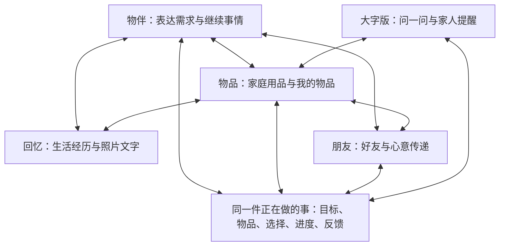

# 物间手机版整体产品与交互设计稿

版本：2026 年 11 月 5 日，开发前产品设计稿 v1，待共同审阅。

本稿统一物间的价值理念、手机版四个栏目、F1–F12 功能深度、跨功能接续和真实结果判准，供下一步整体架构、接口和团队分工使用。它描述要实现的产品，不代表当前代码已具备这些能力；本轮不修改应用代码、数据库、设备配置或公共接口。

本稿中，用户已明确的价值与本轮六张草图调整是需求依据；具体布局、按钮名称和状态组织是设计建议。阶段性实现可以调整，长期功能深度不能被悄悄删减。历史产品文档与本轮明确意见冲突时，以本轮及此前后续明确约定为准。

## 1 产品思想与用户价值

### 1.1 物间是什么

物间是一款通过理解人和物，让物品的功能、潜力、经历和心意持续发挥价值的应用。智能助手负责理解和协调，物品、经历和关系页面负责展示、管理与操作。

理解物，是为了更好地服务人；理解人，是为了让物品在这个人的生活里发挥更合适的价值。产品面向人真实拥有、使用、接触或有关系的物品，既包括标准商品，也包括手作、画、礼物、石头、卡片和已经丢失但仍值得记住的东西。

同一件物品同时具有多种价值：一个杯子可以有正确的清洁方法、特殊的新用途、毕业时收到它的故事，也可以成为下一份送出的心意。产品要容纳这些价值，不能要求用户为每一种价值重建一遍物品。

### 1.2 四种价值怎样发生

| 价值 | 用户真正得到什么 | 完成的例子 | 在产品中的分布 |
| --- | --- | --- | --- |
| 兑现 | 认识并用好已有能力 | 找到东西、学会使用、排除故障、正确维护 | 物伴问答，物品资料、位置、提醒和维护，大字版指导 |
| 创造 | 发现或形成新的用途与体验 | 已有资源组合、自由找灵感、改配置、设备新玩法 | 物伴探索，物品新玩法，持续方案，设备能力探索 |
| 延续 | 留下有效经验、关系与意义 | 下次少走弯路、保存照片故事、分身成长、实物丢失后仍能回忆 | 物品历史，回忆，安静积累的理解，持续任务和可选分身 |
| 传递 | 把帮助、责任、资源与心意交给别人 | 家人学会用、维护有人接手、借用归还、带故事赠礼 | 家庭用品协作，大字版，朋友、礼物和获准分享 |

四种价值不是四个导航，也不是必须依次完成的漏斗。用户可以只问一次用法，也可以只记录一块石头；不强求每次使用都涉及全部价值。

### 1.3 认识世界的逻辑

理解物：知道是哪件东西、型号知识、现实状态、能力、限制和未知。

理解物与物：发现互补、替代、依赖、组合与冲突，考虑实际尺寸、材料和使用条件。

理解物与人：认识当前目标、能力、习惯、偏好和个人意义，尊重用户赋予它的价值。

理解人与人：围绕具体物品、共同经历或任务，传递知识、帮助、责任和心意。

这些认识相互反馈。实际尝试可以修正物品能力，新的目标可以改变组合方式，人的偏好和边界也可以变化。

## 2 贯穿产品的设计原则

1. **入口轻，必要时再展开。** 首屏以物伴和输入为主，复杂方案在相关对话或详情中出现。
2. **先帮助，再补资料。** 不要求先登记完整库存；仅补问当前任务真正缺少的条件。
3. **已有资源优先。** 没找到不等于没有；确实缺资源再考虑替代、借用或购买。
4. **大胆探索，真实表达。** 创意概念、待核条件、实际尝试和已经验证的效果分别表达。
5. **记录与理解分开。** 用户主动记录形成回忆；日常有用理解安静积累，允许检查、更正和遗忘，减少保存确认。
6. **拟人化可选。** 全局物伴与物品分身是两个层次，不要求所有物品养成角色。
7. **连续但不混杂。** 跨页面继续同一件事，也允许另起话题；相关信息按需使用。
8. **当前事实优先。** 用户明确纠正、当前任务条件、最新有效状态优先于旧偏好或过期计划。
9. **关系与授权分别处理。** 家人、好友、赠礼方不因关系而获得全部私人内容。
10. **操作与结果可辨。** 建议不等于执行，已读不等于完成，用户报告不冒充设备测量。
11. **成熟能力按需复用。** 先明确用户结果，再选择工具；不为四个栏目各造一个智能体或数据系统。
12. **真实旅程验证。** 页面通、工具通、工程测试通都不能代替智能质量和现实价值的证明。

## 3 四个栏目与页面关系

普通版底栏建议为：**物伴｜物品｜回忆｜朋友**。物伴可按最终命名显示为助手，名称调整不影响职责。

| 栏目 | 一级职责 | 主要内容 | 稳定的进一步入口 |
| --- | --- | --- | --- |
| 物伴 | 理解需求与协调行动 | 自然问答、照片、灵感、方案、指导、任务接续 | 历史话题、正在做的事、资料与来源、相关对象 |
| 物品 | 找到、认识与管理物品 | 家庭用品／我的物品、位置、状态、用法、经历 | 录入、物品主页、维护、提醒、家庭成员、分身、设备探索 |
| 回忆 | 保存与重温生活经历 | 照片文字、时间、相关人物与多件物品 | 记录、经历详情、编辑、关联修正、选择性分享 |
| 朋友 | 围绕物品连接人 | 好友、礼物、心意、被分享的内容 | 好友主页、赠送与接收、借还、分享范围 |

账号、普通版／大字版切换、物间对我的理解、资料用途设置、通知偏好等放在头像或个人设置中，不另占一个底栏。

图中的连接表示可以在有权且相关的情况下继续，并不意味着所有页面都读取全部数据。

### 3.1 导航与任务的区别

底栏回答去哪里查看，物品回答正在说谁，任务回答正在做什么。一次任务可以涉及多件物品和多个栏目；一次对话也可以包含简单问题，不需要每句话都生成任务。

从物品页发问时携带物品身份和入口意图。仅浏览另一张物品卡片，不自动把原任务改成这件物品；用户明确选择把它加入方案或围绕它提问后，才改变相关范围。

正在做的事在对话顶部或历史入口稳定可找，物品主页也显示与它相关的进行中事项。无需新增第五个任务栏目。

## 4 全局交互与状态规则

### 4.1 手机上的共同操作

- 拍照、从相册选择、输入名称或自然描述均可开始。拍照既可能用于录入，也可能用于问问题，不能无条件把照片中的所有东西建档。
- 从卡片进入物品或经历详情，再返回时，保留原话题、输入草稿和合理的浏览位置。
- 切换底栏不自动取消任务或清空对话。另起话题有明确入口；继续旧任务可以从历史恢复，不依赖用户记住会话名称。
- 文字与语音共享同一意图和进度。语音识别文本可以检查、更正，识别失败仍可拍照或输入。
- 关键状态使用清楚文字，不仅靠颜色、角色表情或动效。
- 发送、保存、接受和执行操作反馈明确，失败可重试；重复点击不应重复创建礼物、事项或执行动作。
- 用户可停止生成或暂停操作。已经发生的外部动作须如实说明；停止显示不等于撤回设备动作或已送出的内容。

### 4.2 一段对话应让用户知道什么

通常只展示当前对象或事项的简短标题。涉及多物时可展开相关物品；涉及敏感内容时可查看使用了哪些资料或经历。普通问答无需展开后台细节。

进度反馈表达实际工作，例如正在核对型号、阅读说明书、查找相关物品、等待反馈。不能用永远的正在思考代替失败反馈，也不假装中间推测已经成为事实。

### 4.3 提醒与主动建议

事项处理、物品状态和灵感分开：需要处理的提醒可显示在首页；相关帮助在当前操作旁出现；创意和回忆以用户主动进入为主，偶尔轻量提示。提醒频率、语音播放和推送偏好可调整。

新的对外发送、赠送、共享或设备动作需要相应明确操作；日常理解与已有任务进度的保存不反复弹出确认。不能把必要的结果确认扩展成每句话都询问是否记录。

## 5 物伴栏目详细设计

### 5.1 首页

参考用户草图，主体为全局物伴、简短招呼、少量场景入口和底部输入区。物伴名字与形象可自定义或跳过；阿圆是草图示例，不绑定所有物品。

可用场景入口包括东西怎么用、记下一件礼物、准备去野餐。它们提供开头，不限制用户自由表达。具体数量、文案与排序需通过原型验证。

重要事项仅在相关时出现，例如保温壶尚未修好。历史话题与未完成事项由顶部入口查看，必要时首页轻量露出一项接续；不同时铺开任务、库存、灵感和回忆多个内容区。

### 5.2 基础问答与可信使用帮助

入口为首页输入、照片、物品页问用法、家人转来的具体问题，以及分身中的使用请求。使用同一件物品的知识和现实状态。

帮助范围包括识别、首次安装与开箱、按钮和端口、连接配对、模式与不常用设置、兼容性、限制、清洁、耗材和维护。用户提供准确型号后，应自主寻找适用资料，不总让用户先找说明书链接。

品牌、型号、地区、版本或操作前提影响答案时才补问。可以接收用户提供的链接、说明书、截图和照片作为候选资料；具体附件支持需由后续架构落实。非标物以已知外观、描述和意义为基础，不强行匹配商品。

简短问题直接回答。需要时展示动作、完成标志、失败后下一步及可核查来源。资料中的文字、图示、表格和条件都应正确理解；引用存在不等于指导正确。

### 5.3 逐步指导与排障

先确认正在处理哪件物品及现象，形成同一件持续事项。概览可展示计划排查的方向，当前界面重点呈现当前步骤。

每步包含要做什么、必要图示、成功或异常信号，以及做到了、我没找到、没有变化、拍给你看等反馈。已经确认的检查不无故重复；用户反馈改变后续分支。

暂停、换页面、换家人或新会话后仍能继续。工具失败、资料不足或需要专业服务时说明原因，保留可接手的实际记录。

### 5.4 售后问题说明

未解决时生成可编辑说明：名称与已知型号、症状与时间条件、错误代码、已做检查和结果、未做操作，以及用户选择附上的照片。

提供复制文字，图片另行选择附加。有核实的官方售后入口时提供；未知费用、保修结论和联系渠道不编造。用户自行选择发送，应用不自动联系售后。

后续售后进度回到同一事项，并影响物品状态、家庭提醒和未来指导。

### 5.5 目标规划与物物组合

用户可以直接说野餐、读书角、摄影、收纳或其他现实目标，无需先列物品清单。物伴根据获准且相关的现有资源、当前状态、空间、时间、预算和禁忌寻找方案。

方案区分已有可用、需补充、需确认、可借候选和明确不可用。不得把检索未命中当作没有，也不能默默加入并不存在的配件。解释组合为什么可能适合，以及还缺什么关键条件。

用户可换物品、变人数、取消购买、增加条件或换方向；更新受影响的部分，保留仍有效的进度。选中方案后按需要形成准备清单或执行步骤。

### 5.6 开放灵感与创造

除目标任务外，允许直接说最近无聊、看看这件物品还能怎么玩、把这些东西组合出新体验。入口为物伴场景、新玩法按钮和自然对话，进入独立的探索内容即可，不占新增底栏。

范围包括单物新用途、跨物组合、旧物再用、空间与流程安排、审美与情感表达、个性化设置、可行的设备扩展。先给少量有区别的方向，用户选中后再深化，不预定必须十条或一开始给完整施工说明。

灵感可借鉴模型知识、原理类比和合法可取得的真实案例，包括用户提到的小红书、B站等公开内容；不能承诺绕过登录、访问限制或始终取得所有内容。案例启发与用户物品的适用性分别核对。

用户可收藏、否定、换方向、组合想法、指出没用或不喜欢。明确的不剪、不粘、不买等限制必须保留。深化时说明机制、材料与尺寸等关键条件，连接尝试和反馈。失败经验影响后续建议，不把它自动升级为所有物品都不适用的普遍规律。

### 5.7 方案与准备清单

参考野餐草图，方案可以转为可继续处理的清单。每项可以引用已有实物，也可以是尚未落实的需求；一瓶待买的水不能成为已拥有的物品。

按需要记录项目内容、数量、相关物品、负责人、状态和反馈。已放进包里、已准备、待购买、待确认借用分别表达；分组计数口径一致。

点击物品回到原物品页，询问家人或朋友需明确发送，分工也需对方实际接手。更换或新增项目不沿用旧项目的完成状态。状态保存方式在原型中统一，避免勾选后仍有不明显的第二次保存。

让物伴再检查时，核对当前目标、限制、清单和物品状态，指出新发现的缺口。活动后可以主动记录回忆，不强迫发布。

### 5.8 连续对话与恢复

历史话题、持续任务与临时浏览分别保留。一件持续事情至少可恢复目标、相关物品、关键限制、选中方案、已做步骤、反馈和下一步。

用户插入另一个问题后能够返回；多个问题的请求不能只答其中一项。简单问答保持轻量，不为统一任务而强迫所有请求走复杂流程。

## 6 物品栏目详细设计

### 6.1 家庭用品与我的物品

家庭用品显示当前家庭中获准共同使用或管理的东西；我的物品显示自己持有或珍藏的东西。同一件个人拥有但共享使用的物品可以出现在两个视图，仍对应同一实物。

家庭使用权、实际保管、拥有关系和私人经历权限分别表达，不能通过切换页签改变所有权或开放私人故事。多个家庭可在需要时切换，首版不必先设计复杂组织树。

搜索覆盖名称、昵称和适用的位置等获准信息。全部、待处理、待补充、珍藏等为按需筛选，不强制用户维护复杂分类。

### 6.2 录入与身份形成

主要入口是拍照，允许从相册、名称、型号、自然描述、商品链接和说明书开始。条码、编码、订单导入保留为后续候选；天猫下单自动录入是生态设想，不能宣称已对接。

标准商品逐渐明确品牌、型号、变体、地区与版本；非商品保留独特名字、照片、可观察特征和来历。未知字段可以空缺，不虚构材质、规格或价值。

一次可以从一件物品开始，不先盘点全家。照片里有多件东西时围绕当前请求选择目标，不自动全部建档。已存在的同款给出可能重复的提示，未经核对不合并；同型号多件实物可以有不同位置、状态与故事。

主动录入结束可给可编辑预览，让用户保存或修改，并立即进入用法、故事或其他需求。录入字段不要求一次填写完整；昵称不覆盖客观型号。

### 6.3 墙上卡片

共用骨架为照片或可选分身、名称、一条最相关的辅助信息。重要状态必要时再增加一条提示，整张卡片可打开。

| 情况 | 主信息示例 | 辅助信息 | 需要时突出的状态 |
| --- | --- | --- | --- |
| 家庭普通物品 | 电饭煲 | 厨房、位置或最近常用方式 | 待检查、暂停使用、待补充 |
| 私人标准商品 | 我的耳机 | 昵称、常放位置或用途 | 已借出、待维护 |
| 礼物与纪念物 | 小雨做的杯子 | 毕业那天收到、来自小雨 | 珍藏、实物已遗失 |
| 已流转物品 | 陪我旅行的相机 | 曾经的关系与经历 | 已赠出，避免被当作在手资源 |

卡片不堆满问答、维护、分身、创意和赠礼按钮。至多保留一个轻量快捷操作，其余进入详情。完整型号可在资料中快速查看、复制，核对型号的任务中优先显示。

### 6.4 物品主页

主页按物品实际信息和用户关注调整重点，共用以下内容，而非按商品与纪念物建两套产品：

- **身份区**：实物照片、可选分身、名称昵称、已知型号、拥有或使用关系、位置和当前状态。
- **重要提示**：使用限制、临时故障或未完成事项及原因；过期信息能够纠正。
- **常用操作**：问用法、新玩法、记一刻；纪念物可把问用法调整为聊聊它。分身开启后提供和它聊聊。
- **用法与资料**：适用操作、能力与限制、说明书、来源和待核信息。
- **位置与使用说明**：具体存放位置、配件位置、家庭自定操作说明；标明提供者与必要的更新时间。
- **一起的经历**：获准的照片文字和时间线，打开原经历；可看物品来历、获取与重要变化。
- **照顾与历史**：故障、清洁、耗材、维护、维修、保修凭证与相关事项。
- **进一步操作**：提醒、共享、赠礼、借还、归档、形象性格与设备探索，按适用性和权限出现。

具体分栏或折叠布局后续原型验证。纪念物默认突出故事；家庭设备突出用法和状态；可连接设备才提供适用的连接操作。不要求所有内容在第一屏出现。

### 6.5 位置 使用说明与提醒

| 类型 | 用户得到什么 | 出现位置 | 状态要求 |
| --- | --- | --- | --- |
| 位置说明 | 东西或配件放在哪里 | 物品页、搜索、对话、步骤中 | 上次明确报告不冒充实时定位 |
| 常驻使用说明 | 家里这件物品怎样使用、有哪些注意点 | 物品页与相关指导 | 家人经验与原厂要求有区别 |
| 状态提醒 | 暂时不要使用、正在维修等 | 物品页、相关任务、必要的首页提示 | 已读不解除故障或停用状态 |
| 到时或条件提醒 | 检查、换滤芯、归还等 | 事项、首页和接收通道 | 时间与条件有依据，支持延后或关闭 |
| 家人交代 | 浇花、采购或用户自己设定的生活事项 | 接收者首页，尤其大字版 | 来源、接收者和完成反馈清楚 |

将物品出现在一张照片中理解为位置线索，不直接改写永久存放位置。维护周期结合型号、实际使用与已有记录；不能让不同型号全部同周期。

家庭用药等可以容纳用户已有的自设生活提醒，本稿不增加诊断、剂量或医疗决策能力。

### 6.6 生命周期与维护

可以按需保留取得、附件、保养、故障、维修、耗材更换、保修凭证和状态变化。维护结果供下次排查与下一次提醒使用，不只是多一条日历记录。

实物丢失、借出、赠出、回收或永久损坏时调整可用性及相关事项。结束无意义的维护提醒，保留用户希望留下的经历。数字记录归档不等于删除个人故事。

### 6.7 家庭成员与共同照顾

家庭入口放在家庭用品页顶部或管理入口，承载邀请、接受、成员、共同物品和事项。成员使用独立身份，按件物品、任务和用途授予查看、使用、协助或管理能力。

用户可从物品问我不会用，或请家人接手。转交包含必要的物品身份、问题、已经做过什么与当前反馈，不转交全部私人对话。

协作过程区分待送达、已送达、已读、待接手、处理中、报告完成及需要的结果确认。只呈现有证据的状态；各类事项使用必要子集，简单提醒不要求走完所有状态。

实时到达提醒是产品目标。应用内可见、系统通知送达、用户阅读分别检验，不能用一条事项记录冒充手机关闭应用后仍能收到通知。具体通道留待架构与真实终端验证。

## 7 回忆栏目详细设计

### 7.1 回忆墙与经历详情

以经历而非库存展示生活记录。每条可含标题、照片文字、日期、可选地点、人物和相关物品；不要求把所有字段填完。

入口包括回忆页记一刻、物品页记一段、对话中明确提出记录，以及用户主动选择记录一次活动。普通日常聊天不会自动变成墙上内容。

同一经历可以关联零件、一件或多件物品，一件物品也可以有多段经历。全局回忆墙与物品页打开同一原记录，编辑后同步；归属、可见范围和后续智能用途仍由用户控制。

支持浏览、照片查看、补充文字、纠错、移除关联、删除与必要的分享预览。可请求润色或整理，但原文和作者清楚，不擅自添加情感、人物动机或未发生的事。

按时间组织为基础，按物品、人物等查看是后续可扩展视角。共同经历可以保留不同人的不同叙述，不合成一个所有人都可改的私人故事。

### 7.2 照片自动关联多个物品

先保存用户希望留下的记录，再尝试匹配已录入且当前有权访问的物品。识别类别和确认某件具体实物是不同任务，需结合参考照片、可见特点、文字与合理情境。

经过验证可靠的关联以可更正的标签呈现，标明自动识别；不确定的保持候选，允许用户在编辑中选择，不反复打断。识别失败不阻断保存，也不创建大量陌生物品档案。

图片出现某物不能证明拥有者、拍摄时间、人物意图或故事内容；也不能把相似的量产物当作同一实物。照片里没有出现的物品也可由用户主动关联。

私人经历关联家庭公共物品后仍保持原可见范围。自动关联不自动带来对全家、朋友或赠礼接收者的分享。

### 7.3 回忆的使用与传递

用户可以仅保留记录、允许用于相关智能帮助，或选择具体内容分享给某个人。原始纪念文本、模型可用理解和已发给别人的内容分别管理。

删除、停止引用和取消未来访问的含义要说清；不能承诺收回对方已经看到或复制的内容。取消智能使用不应强迫用户删除想留作纪念的原文。

仅本地保存、不交给云端模型的完整能力保留在长期范围，后续架构必须明确实际处理路径；实现前不能展示一个并未生效的开关。

## 8 朋友栏目详细设计

### 8.1 好友与被分享内容

包括添加好友、邀请接受、好友列表，以及发出和收到的礼物、心意和获准分享。好友只看对方明确开放的内容，不自动读取库存、位置、偏好和私人经历。

好友主页可以承载已分享的物品、故事和礼物关系。完整即时聊天系统不是本稿新增的首版前提；具体求助、借用或赠礼可通过相关事项进行。

草图中的心愿单、可借物品和回应心愿有价值，记录为可扩展功能，不把全部社交细节作为智能底座前置条件。心愿是表达需求，不等于实际持有物品。

### 8.2 赠礼与数字心意

从物品页或好友页发起。可选择已有实物或明确的新礼物意向，附上寄语、所选照片故事、允许传递的知识和可选分身设定，也可以在此拟写一段新故事。

发送前预览对方将看到什么。接收者以自己的身份预览、接受或拒绝，接受后获得相应的数字关系与信息。购买付款、实体寄送、实体收到和数字接受分别表达。

赠出之后：

- 接收者控制这份礼物后续形象、性格、可见范围和使用方式。
- 赠送者保留自己的原经历，未选内容不随物品转移。
- 接收者新增的私人聊天、经历与理解不回流赠送者。
- 礼物可以保留赠送者的语言与心意，但不假装对方实时本人或知道其未提供的心事。
- 后续追加心意以新通知或待接受内容呈现，未经接收者同意不改写已属于对方的礼物。再次赠送可作为新礼物处理，首版不展开全部细节。

取消、拒收、过期与失效要有可解释结果，完整交互可分期。物品在关系过渡中不能被双方同时误当作无条件在手资源。

### 8.3 借用 归还与共同使用

借用改变保管或使用关系，不等于赠送所有权。记录借用请求、对方同意、实际交接、预计归还、结果与状态反馈；选定必要说明，不共享整份私人历史。

借用候选只来自获准共享信息。野餐方案中发现可借桌子，仍需要对方确认，系统不能直接承诺已经借到。归还更新状态并处理后续事项，不伪造现实交接。

### 8.4 选择性分享

分享对象可以是某件物品的部分信息、一段经历、一份方案或某项协作所需摘要。预览范围与接收人清楚，允许撤销未来访问；公开商品知识、私人位置和个人故事不能打包默认全选。

公开社区、交易市场、公共内容流和复杂社交运营仍属后续探索，不因此稿加入首版承诺。

## 9 理解人与个性化的共同能力

理解人不是一个独立底栏，也不只服务分身。它应该帮助问答表达、资源安排、灵感选择、提醒方式和情感互动。

| 认识内容 | 例子 | 使用范围与边界 |
| --- | --- | --- |
| 当前目标与限制 | 今天不买东西，窗帘不能剪 | 对当前任务优先，不自动永久化 |
| 较稳定偏好 | 喜欢简洁说明，不喜欢密集提醒 | 有依据、可改，当前请求优先 |
| 能力与使用条件 | 更方便语音，不熟悉某种操作 | 改善帮助方式，不武断推断年龄或能力 |
| 生活习惯与位置 | 常在书房读书，某物通常放柜子里 | 保留情境与时间，不假装实时感知 |
| 个人意义 | 杯子是朋友的毕业礼物 | 相关场景引用，尊重隐私和作者 |
| 实践经验 | 某方案在特定桌面失败 | 限定条件，不当成通用物理定律 |

日常有用理解在授权设置下安静积累，不每条询问是否记住。一次发言不能断言稳定人格；临时情绪也不成为长期标签。

个人设置提供查看、更正、删除和用途控制。明确遗忘或纠正后，后续不能从旧对话摘要、照片解释或另一个功能再恢复同一失效认识。

系统可记住原始内容存在，但不得在已停止引用的用途上继续使用。保留纪念文本与允许模型使用是两个选择，设置变化在所有入口生效。

## 10 可选数字分身与自然成长

### 10.1 全局物伴

代表整个物间助手，能够认识多个物品并协调当前任务。可以设置名字、外观和表达偏好，不要求先完成角色创建才能使用。

### 10.2 具体物品分身

用户在物品主页按需开启，也能关闭。可设置名字、形象起点、颜色、配饰、声音或表达风格；声音与复杂视觉能力可分期，不锁定本轮实现技术。

开启前后仍然是同一件物品，知识、状态与获准经历不另建一份。与物间讨论这件物品、与它的分身聊天，当前身份清楚可见，必要的任务进度能继续。

标准商品分身能帮助真实使用；纪念物可以重在陪伴与意义，不要求一定有工具功能。两者都不能编造规格、往事或人物心理。

### 10.3 成长怎样有意义

可以由用户设置，也可以选择让其在共同经历中慢慢形成特点。候选成长包括真实使用中形成的称呼、相处方式、与某次旅行有关的配饰、用户认可的表达倾向。

形象保持辨认连续性，性格不是每次随机改写；重大变化提供可检查和调整的路径，减少日常打扰。宠物、盲盒式的陪伴感是体验方向，不以积分签到或强迫养成为前提。

赠礼带来的故事与接收者自己的经历有明确来处。分身可以表达赠送者留下的关怀，不冒称实时本人，不把收到的故事说成自己与接收者亲历。

## 11 设备能力探索与 REA

入口为物品主页让它更合心意、创意方案中的设备路径和自然对话。用户目标可以是改屏保、调整支持的设置、展示回忆或形成新的软件使用方式。

沿用已知型号、资料、状态与历史，不反复询问已知前置条件；但仍需明确实际目标、控制入口、设备或软件版本及执行授权。认识型号不等于已经连接，也不能替代协议和认证。

按实际情况经历：理解目标 → 查看现成功能和可用证据 → 必要时探索软件能力 → 准备连接 → 说明拟改变范围与恢复方式 → 用户明确执行 → 获取结果与实际观察。

用户手动执行时提供逐步指导；系统可执行时显示动作状态。失败保留原因、已发生动作和恢复路径，避免重复执行。不可控的物品仍可讨论现实使用，不虚构远程控制。

界面区分发现线索、候选能力、软件观察、模拟成功、已执行与实物效果确认。屏保首个真实切片保留为目标，不因先做设计而删除；具体测试目标到位后核实可行通道。

新的可重复入口必须绑定适用目标、版本和当前授权；环境变化时重新核对。后续架构选择成熟协议或 REA 工具服务目标，不预设所有设备都走逆向。

## 12 大字简洁版

普通版和大字版可切换，用户自己选择；家人可在允许的范围内协助设置。不按年龄自动锁定或削弱用户控制权。

首页优先两部分：**问一问、家人提醒**。问一问提供明显的语音和拍照入口；家人提醒直接显示物品照片、大字说明、来自谁、听一遍与适当反馈。普通版四栏的复杂内容无需同时呈现，但仍属于同一产品和同一获准资料。

逐步指导每次重点展示当前一步，使用对应实物或准确资料的图示，提供听一遍、找到了下一步、我没找到。没找到时换解释、补拍照片或请求家人帮助，不在同一步无限循环。

语音可暂停重播，也保留非语音路径。按住说话与点击开始结束需由真实长者试用选择；文字大小、对比与触控目标随实际可访问性验证。

提醒反馈的文案对应实际意义：我知道了、我来处理、已经买好等分别记录。听完一遍不默认已完成，看到停用提醒不代表物品已恢复。

需要帮助时，可把当前物品、步骤和困难交给获准家人接续。家人无法在线时说明状态，保留后续入口，不冒称有人已接手。

## 13 跨功能共用的信息

以下为产品概念与关系，供下一步技术设计使用，不要求各自建表、建服务或建独立 Agent。

| 共用概念 | 表达什么 | 被哪些体验使用 |
| --- | --- | --- |
| 人与关系 | 独立身份、家庭、好友、拥有、使用与协助关系 | 所有栏目、提醒、赠礼、大字版 |
| 商品型号知识 | 某型号适用的公开功能、资料、版本和限制 | 问答、创造、维护、分身、设备探索、知识传递 |
| 具体物品 | 哪一件、现实状态、位置、配件和持有关系 | 物品墙、任务、回忆、赠礼与借用 |
| 来源与认识 | 信息来自哪里、何时有效、适用条件、是否为推测 | 可信指导、能力判断、纠正与结果解释 |
| 经历 | 用户留下的原始照片文字、作者、相关人和物 | 回忆墙、物品故事、获准分身与赠礼 |
| 对人的理解 | 有依据的偏好、习惯、临时条件与个人意义 | 相关帮助与表达，不自动对外分享 |
| 正在做的事 | 目标、资源、限制、方案、进度与下一步 | 物伴、准备清单、排查、维护、家庭协作 |
| 提醒与交接 | 通知对象、条件、送达、接手和处理反馈 | 家庭、大字版、借还、日常照顾 |
| 分身表达 | 名字、形象、表达偏好及有依据的成长 | 可选陪伴与物品服务，复用物品身份 |
| 设备目标与结果 | 控制对象、适用能力、授权、动作和观察 | REA、设备配置、后续重复使用 |
| 流转与选定内容 | 赠送或借用关系、已选故事、接受与交接 | 朋友、物品、回忆、接收后使用 |

### 13.1 必须一致的规则

- 型号共性不覆盖这件实物的损坏；名称相同不证明是同一实物。
- 一个记录可以在多个入口展示，只有在明确传递内容或保留历史版本时才形成有来源的副本。
- 物品共享、故事分享和设备操作分别有权限，不能互相授予。
- 同一任务的计划有变化，反馈必须对应实际被尝试的那版计划。
- 推测可保留为推测，未知可保持未知。用户报告、工具观测与现实验证不合成一个模糊成功字段。
- 删除、撤权、更正和失效对后续读取、推荐与行动生效，不能只改一处界面。

### 13.2 智能底座的目标

共用信息只是基础，智能底座还必须在用户任务中体现以下能力：

- 主动发现这次真正相关的人、物、资料和经历，必要时继续补查，而非只处理用户点名的物品。
- 准确理解具体型号与实物状态，知道操作条件、未知和冲突；需要时回读说明书图示，不用记住一个摘要代替所有依据。
- 理解人的当前意图与情境，区分临时要求和长期偏好，能接受纠正而非僵化套用画像。
- 在资源与现实条件内进行开放推理、原理类比和多方向探索，不被固定创意模板限制。
- 按任务选择合适的成熟能力与工具，简单问题直接回答，复杂问题适度查证和行动；不要求每个请求走同一条长流程。
- 理解实际反馈意味着什么，将有效经验保留在适用情境中；把失败、尚未尝试、用户报告与真实观察分清。
- 面对资料缺失、工具失败或环境变化，能解释、恢复、换路径，并继续同一件事。

个人世界模型在这里指持续、可纠正的认识目标，不预设必须建一个世界模型服务。程序应维护身份、权限、版本、来源和实际动作等可靠边界，让模型在有效信息与能力上发挥判断，不用大量特殊规则替代开放理解。

下一步接口采用可校验的共同数据表达，减少重复搬运；但说明书原文、故事和媒体仍保留必要内容与出处。检索向量可以帮助找到信息，不能代替具体物品身份或原始事实。不能为了省传输而丢失关键条件、经历主体和授权范围；具体格式在技术设计阶段决定。

## 14 功能之间怎样互通

| 起点或变化 | 带着什么继续 | 影响的功能 | 用户看到的结果 |
| --- | --- | --- | --- |
| 确认物品型号 | 具体物品与适用来源 | 用法、维护、创意、分身、REA、赠礼 | 不重复问已知型号，必要时核对版本 |
| 告知物品损坏 | 当前状态、原因与来源时间 | 组合方案、清单、提醒、使用指导 | 暂停把它作为健康可用资源 |
| 修改存放位置 | 对应实物及新的明确报告 | 查找、家庭说明、准备步骤 | 指向新位置，旧位置不继续冒充当前事实 |
| 用法转向创意 | 当前物品、能力、限制和用户意图 | 新用途与组合 | 从理解功能继续探索，不重新建档 |
| 创意选中方案 | 选中的方向、条件和相关物品 | 计划、清单、步骤、尝试 | 可以做下去，也能换方向 |
| 尝试失败 | 对应方案、实际条件和反馈 | 当前调整与未来适用建议 | 不重复失败方式，不把失败记成成功 |
| 新增或替换方案 | 变化部分及仍有效的进度 | 当前任务和协作 | 新项目待处理，旧结果不过度沿用 |
| 对话中主动记一刻 | 用户文字照片、愿意关联的对象 | 回忆墙、物品经历 | 同一经历出现在多个相关入口 |
| 上传回忆照片 | 原经历及可修改的候选关联 | 物品故事与分身 | 可找到相关经历，不擅自公开 |
| 更正或停止引用经历 | 当前有效原文与用途边界 | 分身、推荐、分享预览 | 后续不再引用失效解释 |
| 家人求助或交接 | 当前物品、必要步骤和反馈 | 协作事项、大字版、物伴 | 新人从当前困难接着帮 |
| 提醒接收者已读 | 这条提醒及阅读证据 | 提醒展示 | 显示读过，不修改故障或维护结果 |
| 报告维护完成 | 对应事项、实际反馈和时间 | 物品状态、后续提醒、未来排查 | 按证据更新，不伪造厂家验证 |
| 赠礼被接受 | 选定内容与新的接收关系 | 接收者物品、知识、分身与经历 | 获取心意，未来私人故事独立 |
| 借出或归还 | 保管关系和实际交接状态 | 可用资源、准备清单、归还提醒 | 所有权与可用性正确表达 |
| 设备能力被验证 | 目标、版本、动作条件和观察 | 后续探索与可重复使用 | 在仍适用且获准时调用 |
| 撤权或关系变化 | 最新许可和失效范围 | 所有后续读取与操作 | 不从旧页面或旧话题恢复权限 |

这不是要求所有变化都广播给所有功能。下一步架构只需让相关读取看到最新有效事实，并处理正在进行事项确实受影响的部分。

### 14.1 持续事情的状态

建议区分草案、待补信息或确认、可开始、进行中、等待反馈、暂停、失败、报告完成和必要的结果验证。各类事情采用有意义的状态，不把所有事项强制套进一条长流程。

状态与依据要能组合表达，例如用户报告完成但没有设备读回。取消也有范围：取消某项提醒不等于删除物品，关闭分身不等于删除经历。

## 15 F1 至 F12 对齐表

| 历史功能 | 本稿主入口与章节 | 保留的完整深度 | 跨栏目关系 |
| --- | --- | --- | --- |
| F1 认识物品与身份 | 物品录入，6.1–6.4 | 标准与非标、实例与型号、地区版本、重复纠正、位置与持有变化 | 物伴识别后回到物品，并服务后续全部能力 |
| F2 可信知识与使用 | 物伴问答，5.2–5.4 | 自主找资料、图示理解、操作前提、追问排查、售后接续 | 物品资料、家庭指导、维护与分身复用 |
| F3 现实目标与组合 | 物伴，5.5、5.7 | 未点名资源发现、替代互补、缺口、约束变化与准备清单 | 物品、家庭、朋友借用与活动回忆 |
| F4 开放创造 | 物伴与物品新玩法，5.6 | 单物、多物、无目标灵感、原理与案例、深化尝试和反馈 | 进入方案、REA，产生可用经验与自愿记录 |
| F5 设备能力扩展 | 让它更合心意，11 | 官方设置、合法软件探索、手动指导、明确执行、结果核对 | 复用物品认识，形成可重复能力而非通用控制承诺 |
| F6 个人化与分身 | 物品主页与分身，9、10 | 可选形象性格、真实知识与经历、自然成长、更正与关闭 | 全局理解人，回忆、使用帮助与赠礼接续 |
| F7 生活故事与记忆 | 回忆，7 | 多图文字、多物关联、修改、用途控制、选择分享及丢失后保留 | 物品页同一经历、可选分身与精选赠礼 |
| F8 维护生命周期 | 物品，6.5、6.6 | 状态、耗材、维护维修、凭证、适用周期、提醒与结束持有 | 排查、家庭责任、资源可用性与流转 |
| F9 家庭关怀协作 | 家庭用品，6.7、12 | 独立成员、最小共享、求助、接手、回报、提醒与长辈指导 | 物伴、物品、共同事项、大字版 |
| F10 赠礼借用流转 | 朋友，8 | 精选心意、接收预览、数字与实物交付分开、新旧私人边界、借还 | 物品关系、知识与故事的受控接续 |
| F11 统一任务体验 | 全局，4、5.8、13–16 | 混合意图、跨页面、跨会话、反馈、恢复、真实结果 | 贯穿四栏和大字版，不另造一个任务孤岛 |
| F12 身份证据信任 | 全局，2、9、13、14 | 来源与未知、用途授权、纠正撤权、遗忘、实际动作边界 | 所有入口与实际请求生效，不能只隐藏按钮 |

历史深度规格中每条自动推断需确认等一般表述，以本轮低打扰约定细化：常规理解安静积累且可控，不逐句索取保存同意；重要共享、执行与身份不确定仍需相应明确选择。

## 16 用完整旅程验证连接

### J1 陌生商品到持续使用

照片或准确型号进入 → 核对身份与适用资料 → 解答实际操作 → 按失败反馈继续 → 修改物品状态 → 退出后从历史或物品继续。验证陌生型号而非预置答案，包含关键图示与版本差异。

### J2 野餐目标到多人准备

说人数与时间 → 发现未点名的已有资源 → 排除故障保温壶 → 列出缺口与获准借用候选 → 选定方案和分工 → 有人接手更新 → 人数或资源变化后调整 → 按实际反馈完成。结束后可主动留下回忆。

### J3 无目标的新玩法

说有点无聊或打开物品新玩法 → 得到不同机制的方向 → 选择一个 → 核对不能剪裁等限制 → 在明确条件下尝试 → 反馈不稳或无效 → 修改方案 → 新话题后仍能参考适用经验。不能只验收准备清单替代此旅程。

### J4 家庭故障到长辈帮助

成员建立家庭用品和暂停使用提醒 → 长辈独立身份在大字版看到并听取 → 反馈知道了但物品仍停用 → 提出使用问题 → 图示一步步指导 → 没找到时家人接手 → 报告实际结果 → 更新事项与物品。另测撤权、未读与通知失败。

### J5 纪念物与可选分身

录入非标准礼物及来历 → 不强制型号或分身 → 主动开启后选择表达与形象 → 聊日常、记录真实经历 → 从物品页与回忆页重温 → 更正一次经历 → 后续分身遵循更正。另测关闭分身与实物丢失后仍保留故事。

### J6 多物照片与回忆

上传合照并记录 → 保存不被匹配阻塞 → 尝试关联既有物品 → 用户纠正一对相似杯子 → 各物品页引用同一经历 → 取消一个关联不删除原记录 → 家人不能因共享物品读到私人故事。

### J7 送出一件有故事的礼物

赠送者选定物品、故事、寄语与可选分身 → 预览 → 接收者独立身份预览接受 → 获得应有知识与心意 → 建立自己的新经历 → 赠送者不能读取 → 追加心意需接收者同意。没有实体交付就不宣称收到实物。

### J8 设备改变产生真实效果

从已录入设备提出改变 → 复用已知认识并核实目标和控制通道 → 探索适用能力 → 预览范围与恢复方式 → 明确执行 → 观察真实目标 → 如实反馈并能恢复。另有未知、不支持和连接失败的分支。

### J9 故障转售后再回来

用户报告问题 → 根据对应资料完成几步排查但未解决 → 复制真实问题说明 → 用户自行联系售后 → 后续报告维修结果 → 停用提示、家庭事项和原任务一致更新。不得补写未做检查或伪造维修成功。

J1–J9 是开发与产品检验旅程模板，不是已冻结独立验收题。具体商品测试必须使用清楚的大陆型号或国内实际版本，附真实资料条件；虚构人物、持有关系和合成反馈明确标注。

## 17 为下一步架构与接口提供的业务边界

本节只约定功能需要交换什么，不在本轮新建接口、数据表、编排框架或服务。后续应先检查现有契约与操作，复用、修正或扩展，而不是按四栏重写四套系统。

| 能力边界 | 需要的输入语义 | 返回或形成什么 | 必须影响谁 |
| --- | --- | --- | --- |
| 物品身份与状态 | 当前用户、物品或录入材料、明确变更 | 同一实物的有效身份、状态、位置与变更依据 | 资料适用性、资源发现、提醒和相关任务 |
| 知识与能力认识 | 型号版本、实际问题、允许的资料 | 来源、适用条件、能力与限制、未知或冲突 | 问答、创造、维护、分身、设备探索 |
| 对话与持续任务 | 当前意图、相关对象、已有事项和反馈 | 回答、当前方案、进度、等待项与下一步 | 所有同一事项的展示与协作者 |
| 经历与照片关联 | 用户原文媒体、作者、用途与候选物品 | 原经历及可纠正关联 | 回忆、物品页、获准智能引用与分享 |
| 个人理解与纠正 | 有依据的认识、情境、时效和用户选择 | 有效偏好、纠正与停止引用结果 | 所有后续相关帮助，不能留另一份活跃旧解释 |
| 家庭提醒与交接 | 对象、原因、条件时间、接收者和权限 | 提醒、送达证据、接手和实际反馈 | 普通版、大字版、物品状态与原事项 |
| 共享与流转 | 关系、所选内容、接收方选择和期限 | 访问范围、接受与交接状态 | 后续读取、赠礼新经历、物品可用性 |
| 分身表达 | 物品身份、用户设定、获准知识与经历 | 连贯的表达或可检查的成长变化 | 同一物品呈现，不另写一套事实 |
| 设备探索与动作 | 明确目标、版本、控制通道、动作范围与授权 | 候选能力、动作状态、观察与恢复结果 | 原事项、物品能力与后续可重复使用 |

### 17.1 共同契约需要回答的问题

谁在请求、对哪个具体对象、为了哪件事情、当前有何权限；输入基于哪个有效版本；输出是什么性质的认识或结果；动作是否已发生；哪些关联内容需要更新；失败如何恢复。只在相关能力需要时携带这些信息，不为简单问答套一份庞大表单。

界面按钮与助手调用应产生同一种业务效果。聊天里完成的状态变更要能在物品页看到，物品页修改后助手读取最新值；不能依赖用户人工搬运摘要。

### 17.2 能独立变化与必须统一的部分

界面布局、卡片样式、分身视觉、案例检索方法、设备适配和通知通道可以按清晰边界演进。人、实物、经历、事实来源、有效权限、同一任务与结果含义必须统一。

任何成熟工具的引入需对应实际失败和可验证收益。没有证据时不预设世界模型服务、编译层、多 Agent、消息总线或额外数据库；需要的认知与接续职责可以由最简单可行机制承担。

### 17.3 下一阶段分工所需交付物

先形成页面与状态清单、现有接口复用差距、共用对象与关键操作契约、迁移影响、纵向旅程和验收样本，再据此分工。不要按每人一个底栏，让每人各自实现底座。

建议底座负责人维护共同对象、事实更新、权限、持续事项与模型工具接入；体验工作围绕普通版和大字版完成真实旅程；其他成员可承担有明确输入输出的专业能力或验证。具体人员分配与代码归属留待架构和成员情况确定。

Mock 可用于界面并行开发，但结构、状态与错误必须符合共同契约；它只能证明交互，不代替真实模型、跨账号通知或设备效果。

## 18 实现次序与长期范围

本稿没有把全部细节设为同时上线前提。下一阶段优先检查现有智能底座缺口，再以最小纵向旅程落地，避免只搭空框架或一次性重写整个应用。

建议先保障：同一对象和任务的接续、有效知识和状态、理解人的情境与纠正、创意约束与实践反馈、真实权限和结果表达。同步用普通版核心页面证明这些能力；REA 保留一项明确真实效果目标，不能用介绍页替代。

回忆的主动记录与多物关联、家庭提醒到接手、大字版问答、选择性赠礼均是整体设计中的明确位置，不能只留下按钮。更丰富的分身视觉成长、自动图片匹配准确度、更多设备和高级流转细节可以分期，但需标记未完成。

候选延伸包括心愿单和可借列表的完整社交流程、电子宠物或盲盒玩法、全部通知通道、天猫订单导入、社区与交易、复杂视觉生成和任意硬件控制。它们不成为本轮已承诺开发项；其中任意硬件通用控制不作能力保证。

## 19 验证与交付判准

### 19.1 产品设计与交互

用可操作原型检查普通用户能否找到四栏、区分家庭与私人物品、从卡片发问并返回、记录一段多物回忆、理解分身身份、看清任务进度。大字版须由真实长辈或对应使用者观察测试，团队成员代演只算原型检查。

检验首页是否简洁、普通聊天是否被保存询问打断、错误关联是否容易修正、需要时能否发现进一步功能。具体点击和耗时目标在原型后事先确定，不凭空给出合格率。

### 19.2 智能与现实结果

知识问答检查首次回答的实际步骤、图示和条件；创造检查有用性、新颖性、资源适配、机制与约束；分身检查事实与经历主体；任务检查计划版本和结果对应；通知检查真实接收；REA 检查明确目标的实际效果。

开发样本、回归样本和独立留出样本分开。保存首次结果，复测不得回填。真实模型、真实来源、模拟账号、合成生活情景、真人操作与实体效果分别标注。

历史的 9/12、15/18 等保留作参考，本轮没有自动冻结为新发布门槛。明确越权、错误型号确定性指导、危险执行和模拟冒充现实等重大问题不能用总分抵消。

### 19.3 跨功能变化专项

至少验证：型号纠正后重新判断资料；故障影响准备清单；替换物品不继承旧成功；临时偏好不永久覆盖；遗忘后不复活；相似实物不乱合并；共享物品不公开回忆；接收礼物后双方新经历独立；取消和失败后状态一致。

这份设计稿的完成表示产品范围、入口、接续和判准已整理供审阅，不表示设计已获得最终确认，也不表示当前智能底座已验收。

## 20 尚需下一阶段明确的具体选择

以下保留为决策点，采用本稿默认建议即可继续产品原型，不要求用户现在逐项作技术选择：

- 物伴或助手的最终名称、四栏排序、角色视觉和具体排版。
- 大字版语音交互、通知与实际手机运行形态，需真实终端验证。
- 物品与经历的字段及现有接口差距，分身、照片关联和设备能力的适配边界。
- 仅本地保存、不供云端使用等用途控制的实际处理路径与交付批次。
- 原型后的正式验收样本、阈值、执行顺序与团队代码归属。

## 21 资料依据与文档定位

- [产品愿景与价值逻辑](../01_物间_产品愿景价值逻辑与智能底座能力.md)：价值目标，非技术方案。
- [产品工程研发工作方法](../02_物间_产品工程研发与Codex工作方法.md)：第一性原理、成熟复用、系统性、独立验证与协作原则。
- [回答表达与沟通边界](../03_Codex_回答表达与沟通边界.md)：需求、方案与事实状态分别表达。
- [本轮六张手机草图与需求补充](2026-11-05_手机版交互草图与需求补充.md)：本稿的最新移动体验输入。
- 用户提供的 `D:/Download/01_物间F1-F12完整功能深度与体验规格_纯产品版.md` 与 `D:/Download/02_物间产品功能验证与历史验收标准_纯产品版.md`：完整功能深度与历史判准；本稿保留 F1–F12，具体实现不照搬。
- [产品功能交互与总体架构审计](2026-11-05_物间产品功能交互与总体架构审计.md)及[代码数据库技术审计](2026-11-05_物间代码数据库与技术架构审计.md)：对应审计时点的实现事实与缺口，不由本稿重新声明已完成。

本稿作为接下来讨论手机版整体产品的统一主稿；草图记录保留输入过程，历史审计保留实现事实。用户后续明确调整继续更新此稿，不让多个互相矛盾的产品稿同时作为开发依据。
