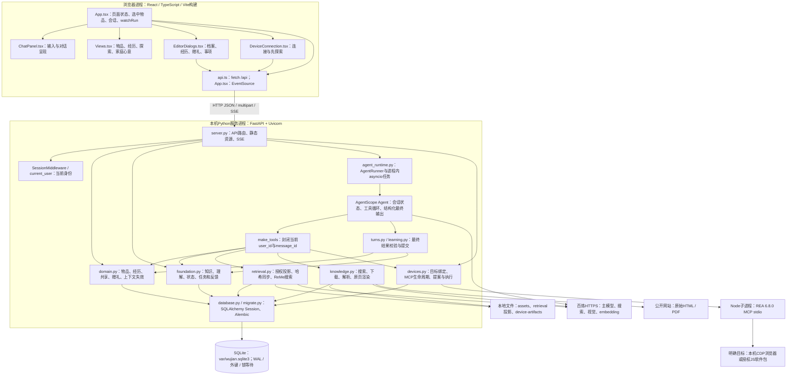
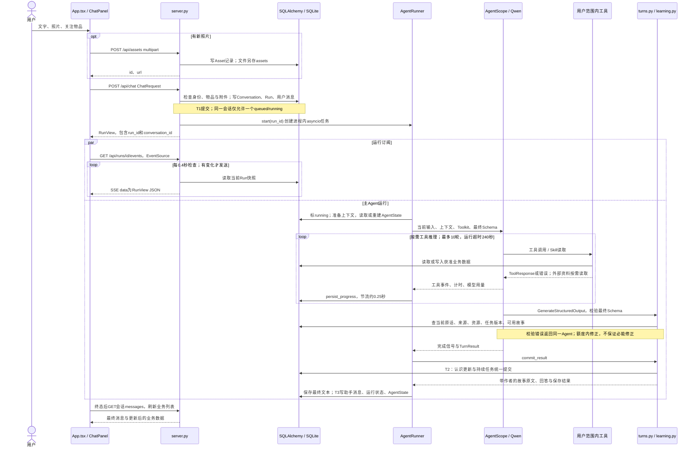
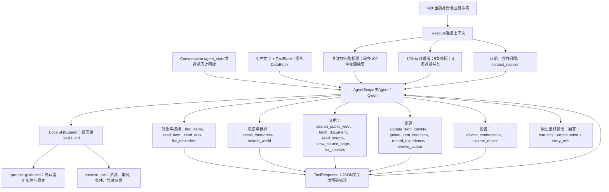
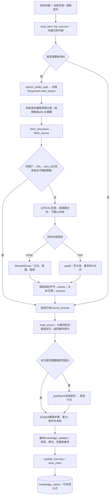
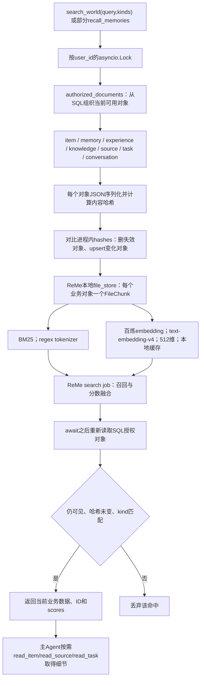
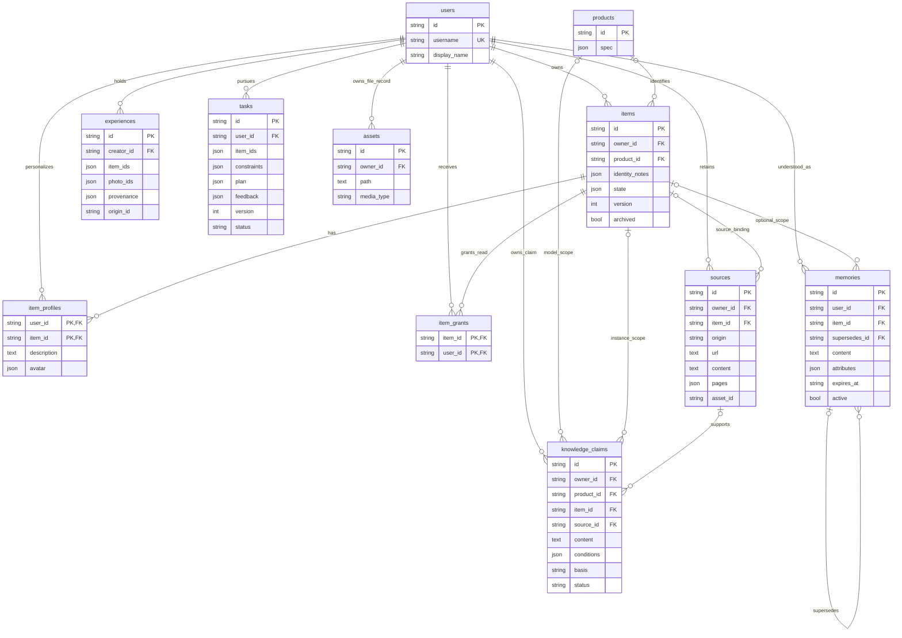
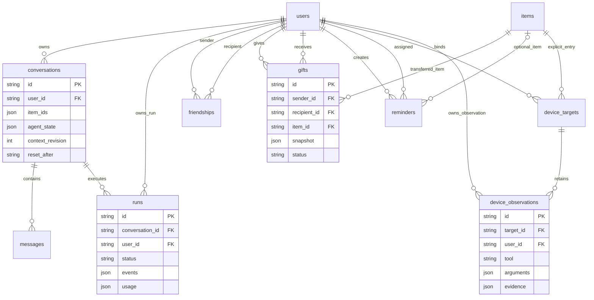
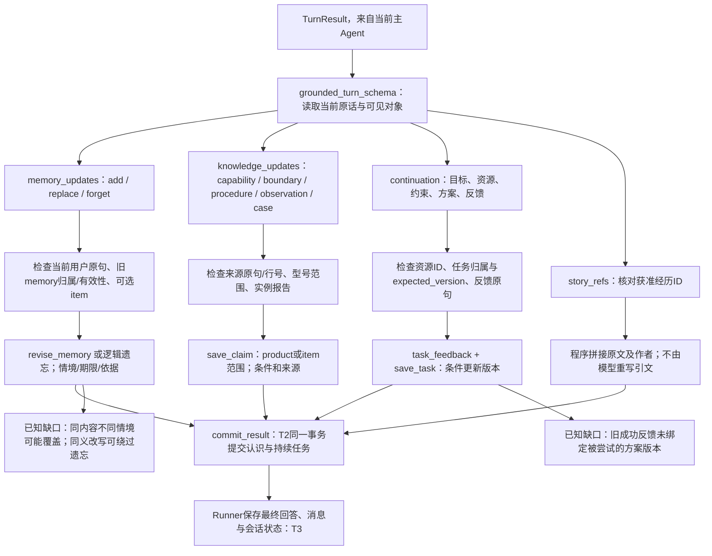
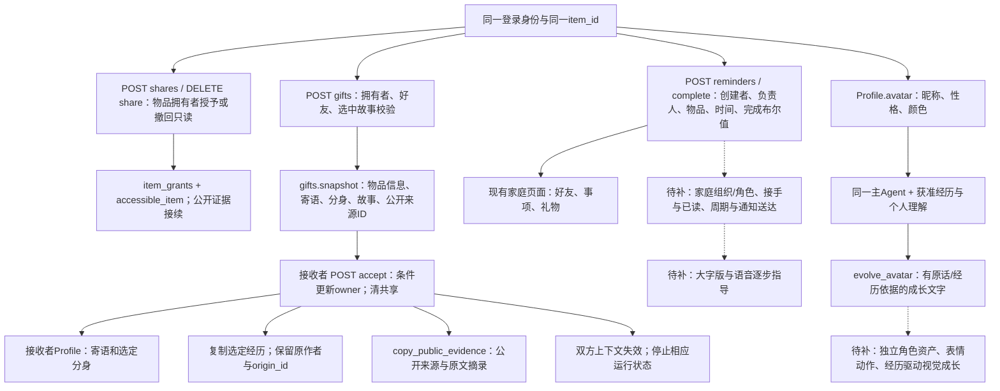
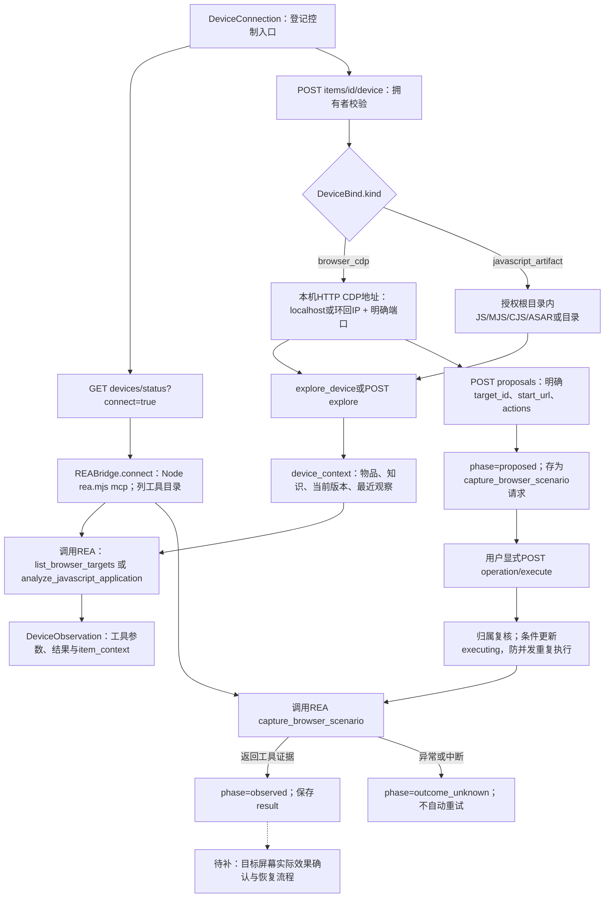

# 物间技术架构详图与接口说明

日期：2026-11-05。本地代码基线 `21e3e11`；本稿根据当前源码展开，不改变架构或接口。面向后端、AI、前端与数据工程讨论。

实线表示当前代码调用或数据流；虚线与标注“待补”的节点表示候选设计。图中的组件是代码职责，除明确进程边界外均在同一个Python应用中。已存在不等于已验收，智能底座仍为NOT_ACCEPTED。

可视版见同目录的 `architecture/2026-11-05/index.html`，各图保留独立SVG，本文保留可编辑Mermaid源。入口概述与候选优化见[技术交流清单](2026-11-05_技术交流架构与优化问题清单.md)，完整审计见[代码数据库审计](2026-11-05_物间代码数据库与技术架构审计.md)。

## 1 进程 代码模块与外部边界

### 图1 当前组件与进程

当前部署是同源前端构建文件由FastAPI提供；开发模式可由Vite代理`/api`。没有独立网关服务、消息总线、分布式任务队列或远程业务数据库。ReMe在本进程通过Python API调用，数据为本地投影；配置中的HTTP backend不表示已部署独立多用户检索集群。

当前主界面是旧桌面版，`App.tsx`的tab是items/memories/explore/family。新手机版的物伴/物品/回忆/朋友四栏和大字版是产品设计，尚未替换当前界面。

## 2 一次对话的协议 调度与事务

### 图2 POST chat至最终显示的实际时序

关键边界：

- SSE传递的是Run快照和工具进度。当前`persist_progress`在最终提交前写入空正文，不能将此图理解为逐token向用户显示答案；provider_stream默认也为false。
- T1、工具自身的提交、T2和T3不是一个大事务。资料保存、主动记录、成长笔记可能早已独立提交；最终失败或用户停止不自动回滚它们。
- 新会话初始化至多回放16条符合reset_after的历史消息；已有AgentState时复用SDK状态。T3只有context_revision未变才保存AgentState；这不等于整次运行所有写入都受同一修订屏障保护。
- 进程重启会把未结束运行标为interrupted，不自动恢复模型循环或重放外部动作。SSE断线后前端会读取一次run状态，不等于有完整自动重连/续传协议。
- 模型运行用量当前只统计主Agent模型；搜索、PDF视觉、embedding的用量不包含在该统计中。

### 核心协议与契约

| 交界面 | 当前载荷 | 实现和边界 |
| --- | --- | --- |
| 前端→API | `ChatRequest{text,conversation_id,item_ids,photo_ids}` | 附件是先上传取得的ID；`user_id`由会话确定，不由请求任意指定 |
| API→前端 | `RunView{id,conversation_id,status,text,events,error,usage}` | POST先返回运行身份；SSE也是该Schema |
| API→主运行 | `run_id` | Runner从业务库读取消息和身份，不把前端载荷当可信上下文 |
| Agent→工具 | FunctionTool生成的结构化参数 | make_tools闭包封住user_id/message_id；每个工具仍需业务访问校验 |
| Agent→最终提交 | `TurnResult{answer,continuation,learning,story_refs}` | Pydantic与业务校验，格式正确不等于内容语义正确 |
| `continuation` | goal、真实item_ids、constraints、plan、task_id、expected_version、status、feedback_quote、outcome | constraints/plan内部仍为dict；不是完整有类型的步骤/依赖语言 |
| `learning` | knowledge_updates、memory_updates，各最多12条 | 主Agent本轮提炼；不是已开启ReMe Auto Memory |
| Python→REA | MCP stdio JSON-RPC，由SDK传输 | 只有明确封装的三个REA工具可调用 |

API类型来源为`api_models.py`，生成`contracts/openapi.json`与`frontend/src/generated/api.ts`。最终Schema在`turns.py`和`learning.py`。JSON用于明确字段与身份；文字承载条件/证据/故事，向量只用于召回。

## 3 Agent上下文与工具选择

### 图3 当前主循环内部的职责

Skill是方法文档，不是独立Agent或确定性能力识别器。工具选择由主Agent执行，程序没有将四种价值固定成四条不可跨越的流程。

工具有几个讨论点：`fetch_document`被注册为read_only/concurrency_safe，但实际上会写来源与文件；当前是已知元数据问题。`explore_device`也会保留观察，但不修改设备设置。赠礼、共享写入、事项创建、REA动作提案与执行没有作为通用Agent工具开放，它们走界面/API；不能把所有API画成主Agent已经能自主调用。

## 4 资料获取与检索增强

### 图4 外部资料怎样进入物品认识

外部资料始终是证据，不是新的系统指令。搜索摘要、原文、视觉模型解释和用户实测结果有不同性质。当前校验原句存在与型号文字匹配，仍不能保证模型解释和操作适用性正确。

现有管线主要处理公开HTML/PDF；没有稳定接入视频字幕、关键帧或平台正文。MediaCrawler只在独立研究环境试跑，访问未通，图中不把它画成现用组件。用户上传通用PDF作为资料导入也尚未实现。

### 图5 ReMe混合检索与权限重查

投影按用户、embedding模型、base_url、维度隔离在`var/retrieval/<hash>/`。本进程用户索引初次使用时会清空并从业务事实重建；这只清投影，不清SQL。embedding不可用时可能退化为关键词模式，不能把两种模式效果视为相同。

资料投影只含前1200字符摘录，详细正文通过read_source取得，不是完整的段落级说明书向量库。返回默认8项，检索请求限制最多30；需要大库存或中文短词时应实测召回。

历史问答作为conversation投影，助手建议标为未验证建议。含失效memory来源消息的会话目前会整体跳过索引，可能损失无关的有用内容；同义重学、遗漏的授权分类和情境问题仍是已知缺口。重新检查当前权限不代表所有权限规则已正确。

## 5 数据关系与身份边界

### 图6 核心认知数据的真实外键

图6只画真正声明的外键。下列关联靠业务校验与JSON/字符串引用，不应画成已由数据库外键保证：

| 引用 | 实际存储 |
| --- | --- |
| 经历关联多物、多照片 | `experiences.item_ids/photo_ids` JSON数组 |
| 任务关联资源 | `tasks.item_ids` JSON数组 |
| 物品主照片、来源文件 | `items.photo_id`、`sources.asset_id` 字符串 |
| 理解/知识/任务的消息依据 | `source_message_id` 字符串 |
| 故事原作者和来历 | `experiences.provenance` JSON、`origin_id`字符串 |
| 成长依据 | `item_profiles.avatar.growth_evidence` JSON |

### 图7 对话运行 社交与设备关系

`messages.run_id`是字符串引用，没有声明外键。`runs`另有同一conversation仅一个queued/running的部分唯一索引。数据库开启外键、WAL与10秒busy_timeout；这些不提供跨电脑数据库同步。

权限路径分别在`domain.accessible_item`、`own_asset`、`source_access.readable_source`、`devices.owned_target`等，尚不是一个统一策略引擎。共享物品主要只读，私人profile不随共享开放。来源权限存在已复现反例，需要修复，不能把图中的校验节点等同于权限已完善。

## 6 理解更新 方案接续与提交

### 图8 最终结果的三个分支

理解人和回忆墙的分工：个人理解由当前主Agent在最终learning中安静更新；主动经历用record_experience或POST experiences独立保存。没有第二个ReMe自动writer，也没有每条消息必做的后台反思Agent。

当前`memories.id`由user_id、item_id、content计算，不含context，导致不同情境覆盖；撤回主要抑制同内容重写，不能保证语义遗忘。`tasks.version`是任务记录更新版本，不能冒充独立的“被尝试方案版本”。这些是功能正确性缺口，不是多加几个字段即可宣布解决。

## 7 共享 赠礼 家庭与分身的接入

### 图9 当前社会关系操作与待补表达

当前接收礼物会清空主照片和state，属于待修体验/数据问题；复制资产记录可能共用同一磁盘文件路径，逻辑归属与物理字节去重是不同层次。旧主人保留原经历，受礼者的新经历独立；这不证明模型正文不会误认经历主体。

虚拟形象当前仍是照片或Lucide图标占位，成长文字没有自动产生角色资产。未来视觉与动画读取共同Profile/经历，不另建记忆库。照片自动识别已有物品并关联回忆也是待补，不在当前record_experience操作中自动发生。

## 8 REA桥接与动作状态

### 图10 当前REA通道及执行状态

当前桥接允许的REA工具仅三个：`list_browser_targets`、`analyze_javascript_application`、`capture_browser_scenario`。工具目录已发现很多工具，不等于应用开放了全部能力。

**item_context当前是返回与观察记录的一部分。实际REA请求参数仍主要是cdp_endpoint或input_path；没有把完整物品简报作为上下文交给REA内部模型。** 主Agent能够看到返回的context，但不能将其画成已完成的跨模型知识注入。

动作提案/执行仅支持已绑定的browser_cdp路径；JS软件包当前是分析路径。当前UI只提供连接与先探索，未提供完整提案审阅、执行和恢复页。所有返回仍保留`device_effect_verified=false`，工具执行成功不自动升级为实物效果已确认。

## 9 API组与团队接入位置

| 业务/API组 | 核心入口 | 核心契约与落地 | 功能接入注意 |
| --- | --- | --- | --- |
| 物品 | GET/POST items；GET/PUT items/id | ItemCreate / ItemChange / ItemView → domain | 修改带expected_version；photo_id是上传得到的ID |
| 物品知识 | GET items/id/knowledge；GET sources | foundation.known_claims、来源访问 | 型号知识与实例知识有范围；来源读取不是任意ID可读 |
| 回忆 | GET/POST experiences | ExperienceCreate / View → domain | 同一经历关联多物；编辑/删除API待补 |
| 理解人 | GET memories；DELETE memories/id | MemoryView、remove_memory；学习走最终Schema | 字段存在不等于情境与语义遗忘已正确 |
| 任务 | GET/POST tasks；POST tasks/id/feedback | TaskSave / Feedback / View → foundation | UI和Agent共用业务路径；完整任务面板待补 |
| 对话 | POST chat；GET conversations、messages | ChatRequest / RunView → AgentRunner | 长任务返回run_id，不让前端等待单个同步大响应 |
| 运行 | GET runs/id、events；POST cancel | RunView / SSE | cancel不自动回滚已提交工具写入 |
| 共享/好友 | items/id/shares；friends、accept | ShareRequest / FriendRequest → domain | 共享目前按件只读，不是完整家庭角色权限 |
| 赠礼 | GET/POST gifts；POST gifts/id/accept | GiftCreate / Snapshot / View → domain、continuity | 主动选择故事，接收后新记录独立 |
| 事项 | GET/POST reminders；POST id/complete | ReminderCreate / View | 当前没有通知送达、接手、周期状态机 |
| REA | devices/status、item/device、explore、proposals、operation/execute | DeviceBind / Proposal → REABridge | 探索与改动分开；用户UI流程尚不完整 |
| 照片 | POST assets；GET assets/id | multipart与Asset | 上传转换JPEG，不保存无损原照片；权限从业务关系核对 |

F1录入接物品与照片；F2指导接Skill/知识来源；F3组合与F4创意接检索/任务/案例；F5接REA；F6接Profile/同一Agent/经历；F7接experiences；F8维护与F9家庭接物品状态/事项；F10接赠礼；F11由主运行和任务贯通；F12由各访问路径、依据与更新规则贯穿。

单一底座的要求不是所有页面都必须走模型，而是直接操作与Agent操作共用身份、业务函数、数据与结果语义。新增功能不得各建自己的物品、理解或任务事实系统。

## 10 讨论时应定位的改动面

| 要解决的具体问题 | 最先检查的模块 | 可比较的最小改动 |
| --- | --- | --- |
| 简单聊天也慢，相关资源召回不全 | agent_runtime / retrieval | 初始信息相关性、索引同步、调用链计时；效果与耗时同时对照 |
| 物品回答带引用仍出错 | knowledge / learning / product-guidance | 章节与页图读取、适用条件表达、首答逐操作核对 |
| 创意只有常规清单或随机迁移 | creative-use / KnowledgeClaim / cases来源 | 有细节案例、作用与条件匹配、当前实物差异；不先换数据库 |
| 理解人情境覆盖、遗忘复活 | foundation / learning / retrieval / invalidate_context | 理解身份、撤回范围、历史提取与召回共同修复 |
| 新方案继承旧成功 | foundation / turns / TaskRecord | 反馈绑定被尝试方案及版本；受影响内容失效 |
| 共享来源越界 | source_access / continuity / known_claims | 来源资格统一；覆盖legacy/public、撤权与赠礼 |
| 分身丑或人格/经历不连贯 | Views / AvatarSpec / evolve_avatar / story_refs | 真实视觉样稿、稳定角色状态、正确作者与成长依据 |
| 家庭事项不能完整接手 | Reminder / API / Family视图 | 收到、接手、完成、通知送达的最小闭环 |
| REA只列目录没有完成目标 | devices / DeviceConnection | 具体目标适配、可审阅动作、实际效果与恢复；按证据描述范围 |

当前可以评估替换局部组件，但依据应为同一真实旅程的改进。此图集不授权引入新服务、调整数据库或自动执行设备动作。本轮仅文档与图形产物；已知问题没有因画图而修复。
