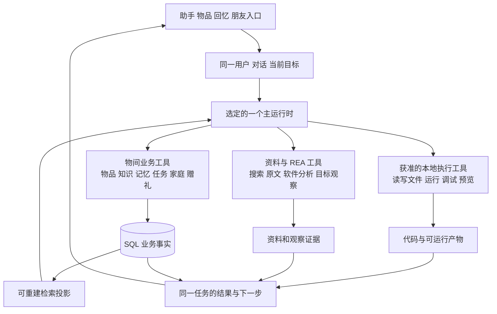

# 物间今日功能与 Codex 接入前置审计

审计日期：2026 年 11 月 6 日。供今晚负责人集中集成和团队技术交流使用。

**今天的新能力有共同接入的基础，但尚未形成一个已集成、已验收的版本。应保留现有共同业务数据与结果语义，把教学、视觉、创意、记忆、家庭能力接入同一用户目标；不能用某个分支整份覆盖另一个分支。** 本轮已复现数据库版本不兼容、共享照片用于教学时被错误拒绝、已有案例复用被新搜索门槛阻断三个问题。

用户随后提供的桌面／手机参考快照已补审，详见第 11 节。两者共用源码，实际仍调用百炼，未发现 Codex SDK、exec 或 app-server 运行时接入。A 分支中的 `Codex-authored / Three.js` 是预制素材的作者标记。用户在 Codex 中完成的耳机实验说明路线有可行性，不能直接算作物间自身执行通过。本文对 Codex 接入的部分仍为候选设计。

本轮只作审计、隔离复现和设计梳理，没有修改业务实现、合并分支、更新主线或接触实机。工作区原有的活动清单未提交修改保留原样。

## 1 今日版本范围

仓库为 [Starry-Curry/ProductAgent](https://github.com/Starry-Curry/ProductAgent)。以实际提交固定审计范围，不以分支名称或提交时间判断已经集成。

| 分支 | 固定提交 | 北京时间 | 本轮定位 |
| --- | --- | --- | --- |
| `codex/creative-memory-rea` | [ec5eb14](https://github.com/Starry-Curry/ProductAgent/tree/ec5eb14986f95140d1bcd8611c780ed44da25769) | 11 月 6 日 20:52 | 首轮固定的创意、记忆、家庭与共同实现，下文称 B；用户后续提交见第 12 节 |
| `feat/as2-guided-demo` | [b1bf2cc](https://github.com/Starry-Curry/ProductAgent/tree/b1bf2cc024386a4a076592cf87c10f1b60aa6532) | 11 月 6 日 20:04 | 首轮固定的教学、照片、三维、相机与本地检索实现，下文称 A；新版见第 12 节 |
| `feat/a-natural-guidance` | `40d404c` | 11 月 6 日 13:00 | 已被 A 包含，不再作为另一个独立成果重复合并 |
| `demo/a-review` 及相机、三维、记忆教学前序分支 | `2e12a65` 等 | 11 月 6 日凌晨 | 已沿祖先关系进入 A，保留历史即可 |
| `codex/item-profile-and-creative-entry` | `73b3c89` | 11 月 6 日 01:34 | 单独的物品名片和创意入口修正线；集成时核对行为覆盖，不机械整支叠加 |
| `develop` | `f167344` | 11 月 5 日 22:36 | 团队旧集成基线，不包含今天全部成果 |
| `main` | `21e3e11` | 11 月 5 日 17:34 | 已批准的更早基线，不是今日成品 |
| `reference/desktop-20261106` | [45cd5b0](https://github.com/Starry-Curry/ProductAgent/tree/45cd5b09846f1f31ca898e1ccf37fa8ed61e112c) | 11 月 6 日 22:20 | 用户补充的完整桌面参考快照，独立 Next.js 应用 |
| `reference/mobile-20261106` | [7b3156e](https://github.com/Starry-Curry/ProductAgent/tree/7b3156e7a6797f0381b73d709adbc83d55db9dd5) | 11 月 6 日 22:20 | 同一应用的手机参考说明与响应式布局 |

A 和 B 互不包含。模拟合并出现 **20 个冲突文件**，涉及主循环、领域写入、任务、检索、知识、API 模型、前端主要页面、生成契约和依赖锁。模拟只生成 Git 临时合并树，没有执行工作区合并或产生合并提交。

契约比对还发现 A 独有 7 个路由操作、B 独有 10 个路由操作，8 个同名 Schema 有变化。A 新增逐步教学、图解、相机与本地 AI；B 新增社区会话、照片匹配、家庭行动卡、清单条目维护等。差异不只是增加接口：A 的回忆日期仍必填，B 已允许未知日期；B 还有家庭回忆范围、分身成长控制与赠礼心意字段。仅复制最新前端或只把路径取并集，会丢失这些产品语义。

## 2 从用户目标确定共同底座

物间需要持续回答五件事：这是哪件物、现在是什么状态；这个人此刻想完成什么；已有资料和经验能支持什么；下一步可以做什么；实际发生了什么，以及它会怎样影响下次帮助。

这五件事需要稳定的数据与权限，并不要求增加一个名为“世界模型”的服务，也不要求先造通用“上下文编译器”。现有型号、实物、状态、知识、经历、个人理解、任务和来源，可以构成产品所需的个人物品世界认知。上下文准备仍需存在，但其责任是让模型按需看到可用事实，并允许继续读取细节。

| 必须一致的内容 | 现有基础 | 今晚集成时的约束 |
| --- | --- | --- |
| 人、型号与具体实物 | SQLAlchemy 业务记录、共同领域操作 | 商品共性不覆盖实物现状；非标礼物不强造商品型号 |
| 用户目标与接续 | Conversation、Run、TaskRecord、任务条目 | 一个目标可以跨多轮、入口和工具；不因打开图解或切换物品名片另起一套任务 |
| 资料与依据 | SourceRecord、知识声明、读取记录 | 区分标题摘要、原文、字幕、采样画面和实际反馈；保留来源与适用条件 |
| 理解人 | 有情境和依据的个人理解、可纠正与遗忘的检索投影 | 当前指令和纠正优先；分身只用它获准使用的经历 |
| 记录与传递 | 回忆墙、物品关联、家庭与好友授权、赠礼快照 | 聊天积累与主动发布回忆分开；共享物品不自动开放私人故事 |
| 实际结果 | 条目进度、用户报告、设备观察、行动回执 | 提议、已执行、用户报告成功、观察验证分别表达 |

SQL 继续是业务事实源；ReMe 和可选本地向量检索是可重建的检索投影。向量帮助找到资料，不能取代型号、版本、拥有关系、权限或操作结果。结构化 JSON、ID、版本和必要原文足以在接口间准确传递信息，不必为了“模型语言”发明新协议。

## 3 四类价值怎样贯通

| 价值 | 今日能力可以怎样连接 | 仍需补齐或统一的地方 |
| --- | --- | --- |
| 兑现 | 物品名片进入阿圆问答；读取已知型号和实物状态；按需取得说明书；同一任务逐步指导；照片、三维、相机辅助当前步骤 | 通用陌生型号理解仍需独立验收。AS2 的校核课程不能代表对任意商品自主学会 |
| 创造 | 用户目标或“新玩法”入口进入同一对话；检索本地灵感及外部分享；核对实际物品、边界和缺少的普通材料；形成待尝试方案；把失败与调整留在原任务 | A 的新搜索门槛与 B 的本地灵感复用冲突。REA 的资料理解与创建、运行、调试控制面板尚未成为同一执行闭环 |
| 延续 | 从物品卡片或独立回忆墙主动记录；同一经历关联多个物品；允许的经历参与个性化对话和有依据的性格成长；遗失实物仍保留意义 | 合并不能退回旧版分身自由摘要，覆盖已停止的特点；照片关联已有基础，本阶段不再深化 |
| 传递 | 同一实物状态影响家庭提醒和使用指导；成员接续同一事项；礼物带有选择的故事与心意；接收后由新主人控制改变 | 共享物品照片与教学的权限需统一；不能把朋友的故事写成接收者亲历；提醒、接手、实际完成分别记录 |

四个底栏是入口，不是四套智能系统。助手负责自然表达目标；物品名片承载这件物的身份、状态、经历与操作入口；回忆墙承载以经历组织的记录；朋友承载关系与传递。家庭用品与我的物品仍在物品内分开呈现。家庭大字版复用同一事项和事实，只简化显示与操作。

例如，用户从家用设备的“怎么用”进入指导，报告仍未修好后，同一状态应让家庭成员看到暂停使用提醒，也让野餐方案避开它。用户主动写下共同修理的经历，可以关联这件物；只有获准使用的部分才影响后续分身表达。这里的连接依据是同一物、同一实际状态和真实经历，不能只靠提示词要求“记住全部”。

## 4 应保留的今日设计

**教学辅助围绕同一任务。** A 的照片、三维和相机引用当前步骤，普通文字仍是主回答。辅助界面按需打开，符合首页简洁、功能不割裂的方向。三维是有界示意数据交给 Three.js／Bygga 渲染；不必让模型输出并执行任意脚本。

**校核课程适合确定的商品操作。** A 的 LOKLiK AS2 包校验品牌、型号、教程版本与来源原话，具体面向大陆 220V HPA01 实体按键版；预备素材和简短的步骤确认减少不必要的模型调用。它是可信的已知知识复用，后续应保留通用探索路径，不能把预置课程包装成自主研究所有陌生物品。

**语义定位和连续追踪分开。** A 用视觉模型处理必要定位帧，再用 OpenCV Zoo ViTTrack 与 ONNX Runtime Web 在浏览器追踪，加载失败可回退已有光流。追踪框不自动代表操作完成。这种职责划分值得保留；作者记录的车辆基准和合成遮挡结果不代表所有真实家电场景通过，本轮未重做实机视觉验收。

**个人理解与回忆墙有共同来源但不同用途。** B 保留主动记录、未知发生日期、录入回执、家庭分享和单独 AI 使用范围；分身成长使用有依据、可停止的特点，避免另建不可解释的人格记忆。这里的收益是更贴近人的帮助，不是积累更多未经确认的标签。

**行动与完成有明确回执。** B 的家庭行动卡、准备清单和来源观察记录，可为跨能力连接提供基础。软件完成一次调用、用户接受任务和现实物品已经发生变化，需要继续分开。

**本地推理应按收益保留。** A 的可选 OpenVINO 多语言 MiniLM 排序有设备与推理记录，并在业务读取时回查权限。它解决的是语义检索，不能据此认定模型新增了工程执行能力。集成时保留可选性，以实际召回和运行成本决定是否启用。

## 5 已复现的问题及代码风险

下表的“阻断”针对今晚合并或对应旅程，不表示当前独立分支的所有功能都不可用。

| 编号 | 问题 | 证据强度 | 影响与处理方向 |
| --- | --- | --- | --- |
| I01 | A 迁移只到 0006，B 已到 0009 | 隔离空库实测：A 打开 B 的 0009 库报 `Can't locate revision identified by '0009'`，库版本仍为 0009 | 集成阻断。保留新迁移链和相关模型，增量接教学模块；不删除真实库、不降级旧运行时覆盖 |
| I02 | 可查看共享物品照片，但教学照片接口拒绝同一照片 | 隔离 HTTP：照片 GET 200；受分享者创建自己教学任务成功；picture POST 404“无权使用这份文件” | 家庭指导旅程阻断。默认物品照片应复用物品读权限；另行上传的私人照片仍单独检查，不放宽成可读所有文件 |
| I03 | 已有案例可读且有读取记录，仍因没有搜索记录拒绝创意方案 | 对 A 的实际校验函数隔离复现，返回“还没取得可读取的公开案例” | 本地灵感复用冲突。按当前方案的证据充分性与适用条件检查，不按是否再次上网判断。视频帧和其他来源类型也需兼容 |
| I04 | 展示缓存参与业务结果签名 | 函数实测：A 顶层 visualizations 不改变签名，但嵌套 guidance.pictures 会改变；B 顶层图解也会改变 | 打开图解可能被视为改方案，影响原结果有效性。已证明签名不一致，完整用户失败旅程待复测。应区分方案内容与纯展示缓存 |
| I05 | 教学与 B 的进度报告使用不同契约 | 源码确认：A guidance 观察和 LessonAction；B progress_reports、task_progress 与准备清单合并规则 | 合并前统一状态转换和原话依据；教学保留专用字段，但共同完成规则只有一处。不以模型输出状态覆盖用户真实进度 |
| I06 | A 的运行中情境更新保护弱于 B | 源码确认：A 工具包装不带 B 的 TurnContext 前后检查，最终 revision 检查主要约束 agent_state 保存 | 不能整体替换主循环而丢掉撤权、纠正、遗忘后的失效处理；需专门并发回归，不能只看页面是否隐藏 |
| I07 | 超时恢复回答与业务结果可能不一致 | 源码风险，未复现完整用户旅程：A 可在已有工具写入后调用无工具回答恢复；事件标注 no_business_writes 仅描述恢复调用 | 保留已发生写入回执，回答恢复不能暗示前面什么都没发生。非教学恢复还需沿用来源和结果边界；不能把一轮已完成当目标已达成 |
| I08 | 提供的参考快照未包含 Codex 执行运行时 | A、B 和两份参考快照源码均未发现 Codex SDK、exec 或 app-server 接入；实际模型调用为百炼 | 参考快照可借鉴产品和工作流，但不能据此宣布已有自主编程和耳机控制闭环；候选接法见第 7 节 |

I02 的根因是 [lesson_assets.py](https://github.com/Starry-Curry/ProductAgent/blob/b1bf2cc024386a4a076592cf87c10f1b60aa6532/wujian/lesson_assets.py#L53) 对默认物品照片使用 own_asset；同分支三维图接口已有默认物品照片和用户额外照片的不同处理，可复用其业务边界。

I03 位于 [creative.py 的 require_research](https://github.com/Starry-Curry/ProductAgent/blob/b1bf2cc024386a4a076592cf87c10f1b60aa6532/wujian/creative.py#L46)：要求同一对话中同时有搜索和 public_web 读取收据。这个门槛本身也不校验收据与当前方案的关联，具体引用仍依赖其他校验。它需要与 B 的本地案例、字幕／视频采样证据兼容，不能继续叠加两套互不相认的门槛。

I04 对应两侧 [A plan_signature](https://github.com/Starry-Curry/ProductAgent/blob/b1bf2cc024386a4a076592cf87c10f1b60aa6532/wujian/foundation.py#L22) 与 [B plan_signature](https://github.com/Starry-Curry/ProductAgent/blob/ec5eb14986f95140d1bcd8611c780ed44da25769/wujian/foundation.py#L22)。修正时仍应让真正的目标、约束、步骤变更使旧结果失效，不能简单删除所有版本检查。

I06 对照 [B TurnContext](https://github.com/Starry-Curry/ProductAgent/blob/ec5eb14986f95140d1bcd8611c780ed44da25769/wujian/agent_runtime.py#L167) 和 [A 工具包装](https://github.com/Starry-Curry/ProductAgent/blob/b1bf2cc024386a4a076592cf87c10f1b60aa6532/wujian/agent_runtime.py#L269)。两个分支各自测试通过，不证明交叉组合保留了这些保障。

## 6 回答问题与完成目标应怎样连接

不需要先用另一个模型给每句话分类。主 Agent 可以根据目标选择工具；程序统一检查来源、权限、版本和实际结果，界面根据已有结果呈现。

| 用户在做什么 | 该轮应产出什么 | 不应误判成什么 |
| --- | --- | --- |
| “这个怎么用” | 直接解释；需要型号专用信息时读取对应资料，未知处明确 | 找到相似型号的资料等于当前型号已核对 |
| “做了还是没变化” | 当前步骤的真实反馈、必要的核对和后续动作，保留同一任务 | 复读旧步骤，或直接升级成复位等更大动作 |
| “有点无聊，家里这些能怎么玩” | 少量有区别的方案、来源和机制、现有物品匹配、最低尝试条件 | 堆清单，或要求把纸杯细绳等全部登记才提供灵感 |
| “帮我做一个耳机控制面板” | 可创建和修改文件、运行与调试、可预览的产物；真实控制还需接口证据和设备反馈 | 只写教程，或者运行了前端就声称耳机已被控制 |
| “今天看到这个杯子想起她了” | 自然对话，按范围安静更新有用理解；明确要求记录时才形成回忆 | 每轮都问保存吗，或未经记录意图发布回忆墙 |
| “告诉家里人这个先别用了” | 明确对象与家庭范围，真实提醒／共享写入与接收状态 | 在聊天里说“已通知”但没有业务记录 |

一轮模型调用结束、一个操作成功、用户目标完成，需要三种不同判断。Task 是持续目标，Run 是一次执行；辅助图、研究资料和生成代码都是可供该目标使用的产物。用户反馈可以使方案调整，也可以形成获准复用的经验，不应自动成为商品通用事实或公开回忆。

## 7 Codex 版本的最小候选接法

官方资料把模型能力和执行 harness 分开，并提供 exec、SDK、app-server 等接入形式。对物间应复用哪一种，需要结合实际待审版本；不能仅更换 model 字符串就声称获得 Codex 的完整文件、终端和执行能力。[Codex as a platform](https://developers.openai.com/blog/codex-as-a-platform)

如果今晚确认以 Codex 作为执行运行时，优先保持一个主执行循环。物间负责产品身份、可用事实、业务权限与真实结果；成熟运行时负责已有的代码编辑、命令执行、事件与会话机制。不要默认在外面再套一个千问总控循环，重复计划、重试和总结。若比赛仍必须使用百炼，则需要单独决定其与 Codex 的分工，不能静默更换已经约定的模型要求。

图中的本地执行工具是待核查／接入能力，已审查的物间运行时尚未向模型提供完整的文件编辑、终端构建、启动和调试闭环。当前 REA 桥仅对登记目标开放有限浏览器与 JavaScript 软件分析／操作，不能由“已安装 REA”推导出任意硬件控制能力。详见 [当前设备桥](https://github.com/Starry-Curry/ProductAgent/blob/ec5eb14986f95140d1bcd8611c780ed44da25769/wujian/devices.py#L165)。

接入时真正需要明确的边界只有以下几项：

1. **会话与任务对应。** Conversation 对应运行时会话，Run 对应一轮执行；Task 保留跨轮目标、版本、用户报告与实际结果。不把 SDK 会话存储变成第二套物品或个人记忆库。
2. **业务通过共同操作写入。** 通过明确的工具接口调用现有领域操作，避免执行工具直接修改私人业务库。MCP 或运行时工具扩展可作桥接，不必另建业务规则引擎。
3. **执行有实际工作区和回执。** 明确产物目录、命令退出结果、运行地址和可恢复状态。代码生成成功、预览成功、耳机接口调用成功分别记录；一次终端输出不能证明物理效果。
4. **模型需要可继续研究。** 让它自己检索、下载可访问资料、分析和验证，而不是由 Codex 人工先把关键答案塞给物间。运行时原生搜索的结果也要与物间来源记录相认，不能只在最终回答留一个链接。
5. **权限覆盖真实调用。** 物间账号权限与操作系统／运行时权限分别生效；已授权的常规动作不反复询问，超出范围时才按实际需要处理。切换到能力更强的运行时不能绕开撤权、私人记忆与目标绑定。

运行时会话还必须属于正确的账号和可见范围。赠礼不能把赠送者的旧会话、工具轨迹或执行工作区一并移交给接收者。遗忘、撤权和人物纠正发生后，需要处理已存在于运行时历史中的旧资料；只过滤下一次检索结果仍可能让旧上下文继续影响回答。可沿用现有情境版本的失效机制，在必要时重建获准上下文，不另造永久人物档案。

app-server 提供会话、轮次、流式事件、工具与审批交互，但仍需应用自己映射业务状态；不能把收到某个结束事件直接写成现实任务成功。工具扩展中的实验能力应按当前协议验证。[App Server 官方说明](https://learn.chatgpt.com/docs/app-server)

## 8 今晚集成的建议顺序

| 顺序 | 自成一批的交付 | 通过条件 |
| --- | --- | --- |
| 1 | 再次固定最新远端提交，核对两份参考快照及本地未提交活动清单修改 | 清楚知道每份成果来自哪里；不丢队友工作 |
| 2 | 共同数据库、API 模型、任务转换和来源语义 | 保留 0009 链；先消除 I01、I05；统一共享照片读权限 |
| 3 | 将 A 教学和视觉模块接入共同业务实现，保留 B 记忆、家庭、行动和来源能力 | 不整份覆盖 domain／foundation／turns／runtime；I02、I03、I04 有针对性回归 |
| 4 | 核查实际 Codex 接入；按目标决定主循环与业务工具桥 | 能证明模型自己读取、写入、运行和观察；不靠作者标记、静态模板或幕后手工代做 |
| 5 | 从源模型生成 OpenAPI 与前端类型，解决锁文件，校验入口和事件 | 不手工拼两份生成文件；普通问答、创意和教学不互相覆盖入口 |
| 6 | 连续用户旅程与对抗性审查，再提出集成／发布建议 | 功能、权限、版本、失败恢复和代码重复一起检查，main 仍需负责人明确授权 |

合并后优先用以下自然表达跑完整旅程；这是后续验收安排，不是本轮已通过样本：

- **陌生物品到逐步使用：** 一个没有校核课程的国内型号，用户说“这个按钮我没找到”“按了还是没变化”；物间自行获取资料并调整指导，再在共享成员身份打开照片辅助。
- **本地创意复用到真实反馈：** 用户说“别让我买一堆东西，就用家里这些弄个能玩的”；已有灵感足够时不强制新搜索，未登记普通材料按需询问；反馈失败后改变同一方案，不编造成功。
- **家庭状态到跨功能避让：** 一个设备标为待修，家人打开简化指导能看到实际状态；另一个活动方案自动避开不可用设备。提醒接收与实际处理分开。
- **物品卡片到回忆与个性对话：** 主动记录一段故事，退出后从同一物品继续聊天；人物归属、日期和分享范围正确；纠正或停止特点后不从旧聊天恢复。
- **耳机控制面板：** 使用用户真实耳机型号与已授权电脑环境，让物间自主取得公开资料、分析实际软件或接口、生成并运行面板；若缺协议或连接，准确停在该步骤并保留产物，不能把演示按钮冒充实控。

## 9 第一性原理和工程方法的具体取舍

**保留能承担必要责任的共同机制，减少重复控制。** 单一业务事实源、跨功能任务、来源与实际结果不可省；重复的总控 Agent、第二套记忆 writer、每个功能自己的完成状态、新搜索的形式门槛应避免。Google SRE 把可理解和可预测的实现视为可靠性的基础，这里对应减少互相矛盾的状态与控制路径。[Google SRE Simplicity](https://sre.google/sre-book/simplicity/)

**先看失败，再决定抽象。** 本轮以可复现的迁移、照片权限和案例门槛冲突决定集成工作，不因新框架名字而重构。Anthropic 关于简单、可组合模式的经验支持这一工作方法；其文章发布于 2024 年，本文采用原则，不照搬其中旧工具清单。[Building effective agents](https://www.anthropic.com/research/building-effective-agents)

**小批完成可工作的改变。** 先统一一个责任及调用者，再做下一个；接口改动带实际使用与必要回归。这样每批都能审查和恢复，比把 20 个冲突一口气“全部接受”更可控。[Google Engineering Practices Small CLs](https://google.github.io/eng-practices/review/developer/small-cls.html)

本阶段不继续扩展照片自动关联或分身视觉成长，不大规模爬取社区，不先做通用多 Agent 平台。这些取舍来自当前主要矛盾是合并语义和执行闭环，并不缩减长期产品愿景。

## 10 本轮验证与交接

- 今日 A 固定快照重新运行离线工程测试：**103 项通过，38.152 秒**。从 A 的 Pydantic 应用重新生成 OpenAPI，与该提交的契约一致。
- 今日 B 固定快照重新运行离线工程测试：**500 项通过，206.027 秒**；未使用工作区未提交修改。两侧各自通过不等于组合通过。
- 隔离复现使用虚构用户关系、合成图片和合成资料；只验证程序契约，不证明智能质量、资料真实性或实物效果。
- 本轮未重新执行付费模型、摄像头、耳机实控、前端生产构建或整条跨分支用户旅程；作者既有实测记录与本轮复现分开看待。
- 原始快照、版本清单、API 差异、测试日志和复现结果保存在本机 `D:/D盘桌面/wujian_final/tmp/2026-11-06-latest-audit/`，不含生产数据库或 API 密钥，不作为源码上传。

今晚开始时先更新版本清单。未关闭的原有智能验收项仍然有效；本轮的前置审计不把底座状态提升为 ACCEPTED。

## 11 桌面手机版参考快照补审

### 11.1 两端实际是一套响应式应用

逐文件 SHA-256 比对：两份快照各 496 个文件，没有单侧新增或缺失；只有 README.md、REFERENCE_VERSION.md、reference-version.json 内容不同。产品源码、依赖和测试完全相同。因此不应分成两支长期维护的桌面产品和手机产品。

参考快照使用 Next.js 15、React 19、TypeScript、Zod、Node SQLite 和 LangGraph。首页由 CompanionApp 渲染，聊天通过 `/api/assistant` 进入 respond 和 executeGraph；业务动作分布在 `/api/workspace`、`/api/life`、`/api/companion` 等接口。模型配置使用百炼 compatible-mode，默认示例为 qwen-plus。可从 [首页](https://github.com/Starry-Curry/ProductAgent/blob/45cd5b09846f1f31ca898e1ccf37fa8ed61e112c/src/app/page.tsx)、[聊天接口](https://github.com/Starry-Curry/ProductAgent/blob/45cd5b09846f1f31ca898e1ccf37fa8ed61e112c/src/app/api/assistant/route.ts)、[运行图](https://github.com/Starry-Curry/ProductAgent/blob/45cd5b09846f1f31ca898e1ccf37fa8ed61e112c/src/lib/agent/graph.ts)核对。

实际工具主要是取得官方知识、搜索产品知识、读取获准个人记忆和列出可访问物品。存在模型原生工具往返，但没有通用编辑文件、执行命令、构建面板或控制耳机的工具闭环。代码由 Codex 编写、复用了某种 harness 理念、运行时使用 Codex，是三种不同事实。

### 11.2 可以直接借鉴的体验

- 阿圆作为普通文字主入口，提供照片与语音；给出少量场景起点，不把首页变成能力清单。
- 物品区分家庭与私人，详情连接使用帮助、状态、放置位置、经历、处理事项和售后说明。
- 排查保留步骤与已尝试反馈；无法处理时把物品、现象和尝试整理成可复制说明，方便交给售后。
- 活动准备先按目标规划、复查，再匹配库存，并支持日期、负责人、缺少项目和进度。这一顺序值得保留，但固定每次两轮模型不应成为所有任务的强制规则。
- 朋友的心愿、礼物赠言、借还与选择性故事分享，比只放一个好友列表更贴近传递价值。
- 大字关怀版减少信息密度、放大问答与提醒，并支持语音朗读；不需要老人学习另一套业务操作。

上述能力的具体校验、真实数据与权限还需要接入后的旅程验证；界面齐全不代表业务已经等同于当前 Python 主线。

### 11.3 与共同理念不匹配或容易误判的地方

| 问题 | 已核查事实 | 集成取舍 |
| --- | --- | --- |
| 日常理解积累关闭 | CompanionChat 发出的请求固定为 memoryPolicy=off；service 据此将 capture 设为 false，ambient 路径也跳过积累 | 保留聊天隐私控制，但接回我们已有的安静理解机制。不能因为有记忆页面就认为日常聊天已让 Agent 更懂人；显式记住及其他记录路径另论 |
| 独立回忆入口缺失 | 手机底栏为物伴、物品、朋友、我的；stories 有页面，但嵌在物品等入口中，桌面也未独立一级呈现 | 按先前约定统一为物伴、物品、回忆、朋友；我的与设置放在头像中，大字版继续简化 |
| 演示回退与真实智能容易混在一起 | 默认 companion 启动器设置 WUJIAN_DEMO_ANSWERS=true；服务会把部分 unavailable／needs_info／referred 转成校核或演示回答，客户端错误也可走演示回退；页面确有来源标签 | 保留有用的本地建议与明确来源，真实验收关闭演示回退，分别记录模型、资料、规则与演示结果。不能把“仍有回答”计为模型完成目标 |
| 前端关键词分流压过自然表达 | 实际函数测试：“明天去野餐，帮我看看带什么”为 true；加入“昨天约好了”后为 false；“上次没去成，这周末去露营，帮我列个清单”也为 false | 这是前端活动快捷路径不一致，不代表服务端绝无其他规划能力。避免让历史时间词硬性排除当前目标；复杂意图交给共同 Agent，明确按钮保留显式入口 |
| 参考版具有自己的事实与工作流结构 | workspace JSON、life 表、companion_records、会话和 LangGraph checkpoint 共同组成参考实现；并非当前 SQLAlchemy 模型和迁移链 | 它们不是可直接接到现库的插件。逐项映射到当前实体，明确哪些是事实、视图、会话和投影，避免双重维护状态 |
| 手机发布仍有现实可达性问题 | 快照最新说明明确：现有固定入口在用户手机网络下需要 VPN，访客空间默认 72 小时有效 | 响应式源码可借鉴，公网入口与持久账号另作部署验收。访客隔离不等于家庭成员长期协作 |

memoryPolicy 的依据见 [Chat 请求](https://github.com/Starry-Curry/ProductAgent/blob/45cd5b09846f1f31ca898e1ccf37fa8ed61e112c/src/components/companion/Chat.tsx)及 [service 写入](https://github.com/Starry-Curry/ProductAgent/blob/45cd5b09846f1f31ca898e1ccf37fa8ed61e112c/src/lib/agent/service.ts)。前端分流探针结果保存在本机审计目录的 reference-route-probe.json，没有使用模型，也没有改变产品代码。

### 11.4 风格统一建议

已查看两份快照内的桌面和手机首页截图。建议延续它们共有的暖白背景、蓝灰主色、低饱和粉与燕麦色辅助色、真实物品照片和阿圆形象；以现有 companion.css 中的设计变量为参考，统一字体、留白、圆角、按钮、状态与来源标签。最终取色和组件细节仍以整体设计确认后的规范为准。

统一的是同一个任务的含义、视觉组件和操作顺序，桌面与手机不必强行同样排版：

| 场景 | 手机 | 桌面 | 两端共同规则 |
| --- | --- | --- | --- |
| 主入口 | 四个底栏，头像进入我的／设置 | 同样四个主栏目置于侧栏 | 导航名称和目标一致，回忆不藏成物品筛选 |
| 阿圆问答 | 单栏对话，资料和辅助按需展开 | 主对话加可收起的任务／资料区 | 不把所有能力常驻首页；接续同一任务 |
| 物品名片 | 点开后为完整详情页 | 主内容区充分展示详情 | 首屏说明物品身份、状态、位置；创意玩法是入口，回到阿圆继续 |
| 照片／三维／相机 | 当前步骤下按需打开，保持返回位置 | 可用较宽辅助区 | 不同时塞入多套视觉面板；来源、示意和实际结果标签一致 |
| 回忆与分身 | 独立回忆墙和物品内经历共享同一记录 | 同样可按经历或物品浏览 | 录入一次、关联多物；分身可选；赠送者故事有来处 |
| 关怀模式 | 主要显示问答和家庭提醒，支持逐步操作与朗读 | 复用相同简化规则 | 模式不改变权限、事实和实际完成状态 |

### 11.5 接回当前项目的最小路径

先将参考版的页面、组件和交互逐项映射到当前 FastAPI 契约；已有的领域操作、迁移、权限与任务继续复用。优先移植用户体验和可复用展示代码，不为了搬界面把整套后端换成 Next.js，也不同时保留 LangGraph 与 AgentScope 两套主控来处理同一个目标。

先完成一条代表旅程：物品名片 → 阿圆问答 → 当前步骤及按需辅助 → 用户反馈 → 同一状态影响家庭提醒／创意方案 → 主动记录经历 → 从原物品继续对话。贯通后再批量迁移其他页面。参考版的多个接口可以暂由前端适配到共同契约；适配层只转换数据，不另写一套事实与权限规则。

本次补审没有安装该快照依赖、启动另一套服务或运行其完整测试；当前可用 Node 为 26，而快照明确要求 Node 24。上述结果来自固定源码、文件比对、截图检查和一个纯函数探针，不借用它历史报告中的测试数字作为本轮验收结论。

## 12 用户补交与教学新版的功能对齐记录

用户明确确认 `03b7bf7` 为自己上传的部分。四组成果来源应分别记录：本聊天之前形成的共同实现；用户继续补交的改动；同学的问答教学实现；桌面／手机参考设计。代码上前两组已经位于同一条分支，不能当作两个独立后端重复合并。

下列为 Git 作者及提交者记录的北京时间，两者在这三项提交中相同；不是已证实的 GitHub 上传时间。三项都记录在 11 月 6 日晚间，并非下午；不能仅按时间猜测具体由谁完成。

| 成果 | 分支与提交 | 提交时间 | 相对先前快照新增内容 |
| --- | --- | --- | --- |
| 用户确认的补交 | `codex/creative-memory-rea`／[03b7bf7](https://github.com/Starry-Curry/ProductAgent/commit/03b7bf700d19de38aff40561a921a71ed6f8fe5a) | 23:49:12 | 基于 ec5eb14，修改准备清单校验、turns、针对性测试并留存交付证据；保留旧条目 ID、数量／备注变化后的进度有效性、批量反馈校验问题 |
| 教学自适应新版 | `feat/as2-adaptive-lessons`／[de41b63](https://github.com/Starry-Curry/ProductAgent/commit/de41b6342778bb3a7f92ce63795cafb769a83086) | 23:07:13 | 基于 b1bf2cc，支持分轮材料报告、插入或调整核对步骤后回到主流程、模型只提意图而程序绑定当前任务与原话；状态更新被拒时保留有用回答；保留并调整图解 |
| 教学图解恢复修正 | `fix/as2-reviewed-demo-restore`／[666e758](https://github.com/Starry-Curry/ProductAgent/commit/666e75824bf21f0cbd2c2f9da25087cbd4b7ac45) | 22:05:36 | 基于 b1bf2cc，防止普通 continuation 覆盖校核教学；跨会话恢复已审核图解；修正前端图解调用方式并增加测试 |

两条新教学分支互非简单的先后合并关系：restore 不是 adaptive 的祖先。不过 adaptive 的 teaching_diagram 已含相同的图解恢复处理，并增加使用当前教学变体的逻辑。功能重叠需要逐项确认，不能把两个分支都按独立完整功能机械叠加。

### 12.1 与产品要求的匹配

| 用户要求 | 新代码对应机制 | 当前判断 |
| --- | --- | --- |
| 自然反馈，不能把用户锁在固定问答脚本 | adaptive 允许正常解释、分轮材料输入和补充核对步骤，不要求一次说完预设材料句式 | 方向符合；仍主要是 AS2 校核课程内适配，不能据此宣布任意商品都能自主学会 |
| 底座服务模型，不用格式错误毁掉有用回答 | 模型提交 LessonIntent，程序绑定任务、步骤、版本和用户原话；部分状态冲突保留自然回答并记录拒绝原因 | 方向符合；需验证用户看见的回答与实际未推进状态始终一致 |
| 真实反馈驱动方案，不假报完成 | 03b7bf7 保留条目身份，资源／数量／准备说明变化时重新核对进度，保留责任人与报告者 | 符合共同结果语义；上传文档仍记录真实模型超时、分类不稳定，不能把工程通过写成智能稳定通过 |
| 视觉辅助随任务接续，不抢占主界面 | restore／adaptive 保留校核图解，并按当前步骤／变体恢复显示 | 符合；不应把生成或显示图解等同实际操作完成 |
| 理解人、记忆、分身与家庭贯通 | 以上新增提交没有独立补齐这一整条能力 | 继续复用已有共同实现；参考版的 memoryPolicy=off 不能覆盖我们安静积累理解的目标 |
| 统一界面、完整物品名片、独立回忆、创意回到阿圆 | 参考快照有多数界面与交互；新增教学提交并未重做全站导航 | 仍按第 11 节统一；这些入口要求不得在后续技术合并中遗漏 |

此处为代码差异审阅，尚未重新执行 de41b63、666e758 的全量测试或真实模型验收。第 5 节旧快照复现的问题，应在选定最新教学提交后逐项复测，不能假定新版全已修复，也不能未经核查一概认定新版仍失败。

### 12.2 桌面侧栏三个入口的定位

参考界面左侧下部实际是“活动准备”“家人交代的事”“发现新用法”。它们应是共同任务与能力的快捷入口，不是三个新 Agent 或三套业务库。

- 活动准备可扩为“做件事”：野餐、聚会、读书角等目标，都回到阿圆澄清和规划，保存后从这里接续清单、步骤、分工与结果；活动准备仍可作为其中一类。
- 家人交代的事：呈现与当前人有关的家庭事项、提醒、接手和进度。物品当前状态仍写回同一实物，不能在家庭页另存一个真假不一致的状态。
- 发现新用法：按现有物品、用户限制和已有案例获得灵感，选择后交给阿圆继续。新玩法不固定为旧物改造，也不强制用户录入全部日常材料。

“回忆”适合面向用户的栏目名称，承载主动记录、照片、文字、人物、时间与关联物品；“记忆”保留作内部统称，包含对人的持续理解及获准经历。回忆墙与物品卡片上的经历读取同一记录，数字分身只使用获准部分。不要因名称不同再建两套记录。

本次只理解、记录和提出方案，不启动页面开发或集成。
