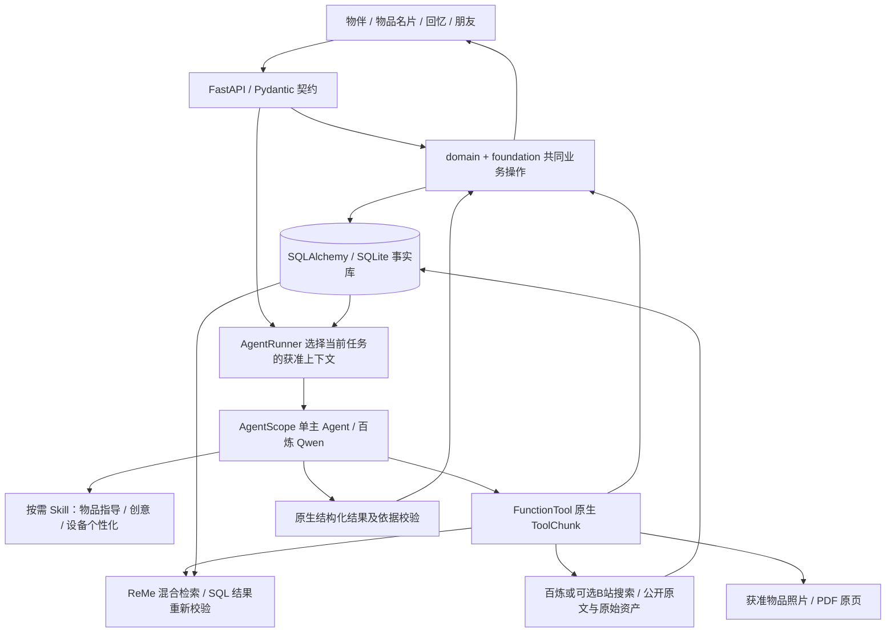
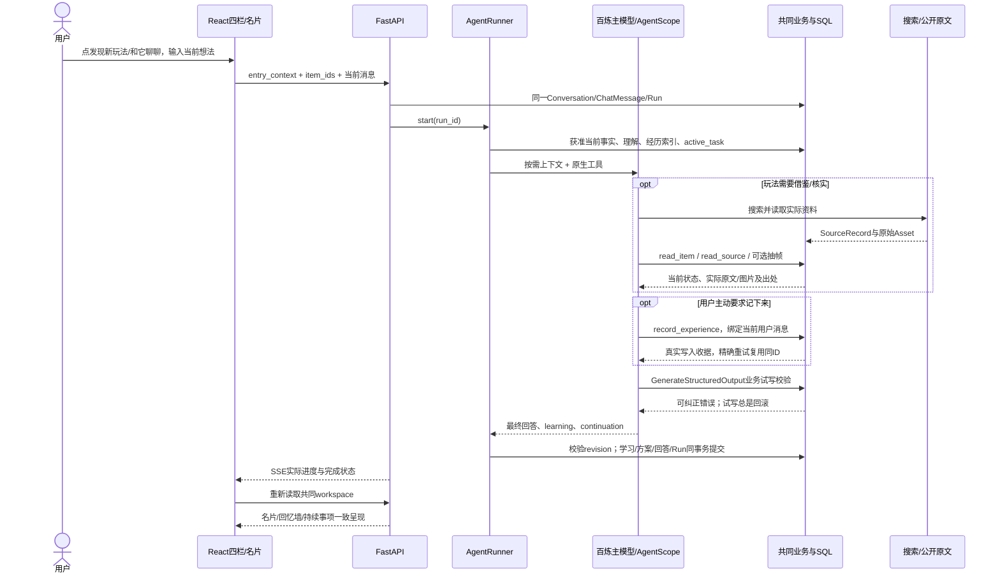

# 创意、回忆、分身与物品名片实施记录

日期：2026-11-06。分支 `codex/creative-memory-rea`，起点为远程 develop 的 `f16734400370f7b420c02e9eb7c53100f5b2d1ed`。本文记录本轮实际实现，后续真实复测结论另补；旧审计的未验收项没有因此自动关闭。

## 交付范围与真实体验

| 用户场景 | 本轮实现 | 尚不能宣称的效果 |
|---|---|---|
| 点开一件物品 | 名片占主要内容区；照片、状态、位置、经历与功能入口；列表退回上一层 | 不能由外观自动确定隐藏材质、额定参数 |
| 想找点新玩法 | 从名片或物伴进入同一创意对话；统一来源读取、库存、知识和持续事项；可选B站公开搜索，方案可从对话打开并继续选择 | 创意新颖性、具体效果和引用支持程度仍未全面通过；新后端只验过自主发现线索 |
| 用过后再调整 | 同一 TaskRecord 保留约束、反馈和计划；方案展示每项说明、关联物品与来源 | 建议完成不等于物理效果成功 |
| 想让电视更合心意 | 无需绑定就可进入资料研究与逐步指导；由 Agent 自己搜索、取得原文；真实连接另走已有 REA | 未连接真实电视、没有去广告或屏保改变的实机成功证据 |
| 想和礼物聊聊 | 可选开启分身、昵称、性格、颜色与稳定 SVG 插画；专属头像、标题与对话；再次进入恢复对应会话 | 当前不是训练好的专属模型，未实现根据经历自动生成复杂动画资产 |
| 主动留下片段 | 聊天中打开记录表单，预关联同一物品；可上传照片、写文字、选择日期和 AI 参考许可 | 不自动把聊天发布到回忆墙；自动识图关联尚未实现 |
| 想回看共同经历 | 同物品回忆墙与名片共用 ExperienceRecord；由回忆可回原聊天，保留草稿 | 收到的故事不变成亲历，分享物品不共享私人理解 |
| 希望逐渐被理解 | 主 Agent 安静提交有来源、情境和期限的理解；当前纠正、任务约束优先；可更正和遗忘 | 有界的字面/来源抑制不是任意语义彻底遗忘 |

本轮真实 Chrome + 实际 FastAPI + 实际百炼的开发旅程，已完成专属聊天、主动记录、勾选 AI 参考、按物品回看并返回聊天。没有拦截 API，没有使用前端固定模型回复。账号、拥有关系和生活经历为明确模拟。原始证据保留在本地 `tmp/browser-real/` 与隔离评测库中，不作为个人数据提交。

## 共同底座怎样连接这些能力

这里没有新建独立“世界模型服务”“上下文编译微服务”或四个功能 Agent。共同事实和关系承担产品所需的个人物品世界认知；`AgentRunner` 中的选择和检索承担按任务装配上下文。若未来拆分服务，需要用实际规模和失败证明收益。

### 一次对话怎样接上名片、方案与回忆

图中`record_experience`是用户明确要求后的独立持久工具写入，已完成记录不会因后续回答失败而消失；最终学习、方案和回答则统一提交。两者有不同的恢复语义，不冒称整个模型运行是一个可回滚事务。

### 数据关联的实际形式

| 同一对象 | 当前业务表示 | 使用它的功能 |
| --- | --- | --- |
| 人/拥有关系 | User、ItemRecord.owner_id及显式家庭/Grant关系 | 四栏权限、赠礼控制、个人理解 |
| 型号与实物 | ProductRecord；ItemRecord.product_id、identity_notes、state | 用法、创意、维护和REA资料适配 |
| 个人理解 | Memory，attributes中的kind/context/lineage，source_message_id、expires_at | 陪伴语气、创意偏好、纠正与遗忘 |
| 主动回忆 | ExperienceRecord，item_ids JSON、provenance、allow_ai、version | 墙、名片、获准分身与精选赠礼 |
| 资料与认识 | SourceRecord/Asset；KnowledgeClaim的source_id/quote、conditions、basis/status | 知识问答、组合机制、视频观察、REA指导 |
| 连续目标 | TaskRecord的constraints/plan/feedback/version；参与者关系 | 排障、创意选择与重试、共同准备、REA步骤 |
| 交谈与写入联系 | Conversation.entry_context、ChatMessage.recorded_experiences | 入口接续、跨会话找回、写入精确重放 |

这些是关系数据库、受Pydantic校验的JSON、原文与可重建向量检索各自承担的职责。`item_ids`等JSON关联由共同业务层校验，并非每一项都有SQL外键；向量负责找到候选，不承担事实真伪、归属或最终写入。模型不必先生成供人阅读的冗长中间报告才能调用接口，也没有采用会丢失原文出处的私有压缩语言。

## 具体机制和代码

- `wujian/domain.py`：`agent_item_view` 明确向模型暴露 `item_id`，避免把商品表 `product_id` 当实物；公共 API 保留既有形态。
- `wujian/agent_runtime.py`：单 Agent、任务上下文、按需工具和学习。分身初始上下文优先本物品经历和相关理解，其它获准资料仍可检索；不另建分身记忆库。
- `view_item_photo`：按当次物品权限读取已经保存的照片，返回 SDK 原生 DataBlock，由已具备多模态能力的主模型观察。不是实时传感，也不借照片推定承重/耐热。没有照片时返回真实限制。
- `wujian/turns.py`：回答、统一 TaskRecord 和学习同一业务提交；生成阶段复用同一个计划校验，避免前面都成功而提交时才发现条目无效。实际来源链接由程序从获准 SourceRecord 生成，明确视频简介未观看视频。
- `wujian/learning.py`：个人理解来源必须对应当前用户原话；商品共性须匹配实际型号原文。错误一次聚合反馈，减少整份结果反复生成。行号可由程序复制原文；语义是否充分支持结论仍需验收，行号正确不代表结论正确。
- `wujian/memory_lifecycle.py`：同文不同情境分开，重复证据保留；纠正、遗忘、再表达区分；检索不把已撤回理解的历史问答重新用作当前认识，同时保留无关历史。
- `wujian/source_content.py`、`public_network.py`、`knowledge.py`：真实原文取得、可读正文、资料层级和公共地址约束。详见本轮来源读取说明。
- `frontend/src/features/ObjectCompanion.tsx`：杯子、石头、花朵和纪念物的原创 SVG 形象，无付费图片服务；与实物照片分开。
- `Items/Editors/Conversation/Memories/TaskBoard`：名片、设置、专属聊天、主动回忆与持续方案共用既有 API；上传/发送/导航的异步结果归属原草稿，不跳转劫持其它话题。

### SDK 接入根因修复

独立首测发现：业务拒绝的外层工具事件仍报 success。核对安装的 AgentScope 2.0.11 源码后，确认 `FunctionTool` 只直接识别 `ToolChunk`；原实现返回 `ToolResponse`，被二次转换成 Python 文本表示，原始 JSON、状态和 metadata 未按预期到达模型。

本轮改为返回原生 `ToolChunk`：成功/错误状态明确、JSON 正文保持直接可读、来源 metadata 传递。先用真实 SDK 适配器复现 3 项失败，再修到通过；同时检查已授权照片的原生多模态返回及撤权后拒绝。这是具体接入修复，没有增加 Agent、外部依赖或审核模型。修复前首测结论仍原样保留，之后复测分别记录。

### 家庭状态变化与最终提交连续性

可重复反例：B 已读到米家台灯1S MJTD01SYL 可用，模型正在生成阅读角方案；A 在另一个真实聊天中报告故障。修复前家庭 B 连上下文 revision 都没有更新；普通 Grant B 虽然 revision 更新，仍收到旧“可用”答复并保存旧计划。

现在复用 `domain.item_readers` 覆盖家庭与普通共享。物品变更使其它在途运行失效，原始报告 Run 保留；`TurnContext` 在工具调用和最终提交前检查 revision，本轮身份/状态工具只承认自己产生的精确一次递增。SQLite 最终短事务在检查前 `BEGIN IMMEDIATE`，随后将理解、计划、最终答复和 Run 状态一次提交；模型和联网等待期间不锁数据库。没有新增队列、状态表或模型。

七项离线实际 HTTP/AgentScope/SQLite 旅程通过，包括家庭/Grant、界面编辑、自己的状态/身份报告、最终理解纠正；在已 flush 计划、理解与知识之后注入回复保存失败，三类业务数据全部回滚。这里验证了指定交错与失败恢复，不等于所有数据库方言或多进程压力测试通过。详见 `tests/test_state_continuity.py`。

## 数据库与迁移

事实仍在同一 SQL 数据库，ReMe 是可重建投影。新增 Alembic `0007`：`experiences.occurred_on` 允许 null，表示未知发生日；记录时间仍独立保存，不再把毕业等旧事默写成今天。

迁移由既有启动流程先备份再升级。临时 SQLite 的验证覆盖旧记录、共享外键、赠礼快照和未知日期。不得删除 var 重建；0007 不通过编造日期做 downgrade，需要恢复验证过的升级前完整备份。OpenAPI 与 TypeScript 类型从 Pydantic 重新生成。

随后新增`0008`：`messages.recorded_experiences`是内部JSON写入收据，键为规范化完整请求的SHA256，值为实际经历ID，不复制墙正文、媒体或私人对话。`record_experience`的同一原用户消息、同一参数只写一次；不同消息或不同记录内容仍可分别记录。记录与收据同一短SQL事务，覆盖并发与注入提交失败；删除原回忆不使旧请求重新生成。后来撤回AI许可的重试仅返回小回执，不泄露后来编辑的私人文字。

历史聊天检索可以带上所属写入回执，建立“那次聊天→那条真实回忆”的联系；回执不是墙正文读取许可，`allow_ai=false`仍不进入story_refs。墙记录被删后不再向模型投影其ID，原收据仍阻止旧调用复活。没有增加记忆库、工具调用或公共HTTP字段。

现有本地主库已在停止8000服务后备份SQL、6项引用资产与会话密钥，再从0007升级0008；13件物品、6条经历、46条消息等全部表计数保持一致，资产哈希、integrity_check及foreign_key_check通过。升级前完整恢复点为`var/backups/before-recording-receipts-20261105-202925/`；原始评测库保持各自冻结版本，不跟随主库升级。重新启动后，真实Chrome390×844四栏、回忆详情、名片与分身入口只读走查通过，无模型调用或业务写入。

## 验证与边界

候选冻结时101项离线测试通过，后续阶段为136/137项；视频与引用机制补齐后156项通过，来源链接与收据补齐后170项通过，身份依据修复后179项通过；照片方向与PDF原生观察补齐后190项通过（56.392秒）。这些是阶段结果，不能把后续实现视为首次智能验收的条件。25组Chrome的API模拟交互通过，验证页面行为；真实浏览器旅程另外执行。

保留检索重启授权正反例后，最新完整回归192项通过（57.123秒）。提交`3ad210b`的190项版本也已由[GitHub Actions](https://github.com/Starry-Curry/ProductAgent/actions/runs/42108368040)在Linux后端与前端任务通过；后续提交的CI结果须另看对应SHA，不能继承旧绿灯。

补充有效运行条件与分身焦点后，本机完整回归197项通过（58.024秒）。192项的`9f61531`也已由[对应CI](https://github.com/Starry-Curry/ProductAgent/actions/runs/42109613733)通过Linux后端与前端；197项候选的远程CI以随后提交SHA为准。

可选社区后端及取消补齐后，最新完整回归219项通过（71.245秒）。不装可选yt-dlp的独立空环境同样运行219项（73.964秒），208项通过、11项可选SDK用例明确skip；没有把skip算作已验证视频能力。最新前端28组浏览器fixture通过，TypeScript/Vite构建通过。随后提交的远程CI仍按对应SHA核对。

随后补齐诊断进度与售后交接，完整回归222项通过（69.410秒）；再补混合场景后4项诊断HTTP/SQL定向回归通过，新增1项未倒填到此前222项全量结果。另有4项针对售后摘要的Chrome API fixture检查及无key实际FastAPI/SQL/Chrome旅程。上述219项空环境结果保留为当时版本结果，当前远程CI仍以提交SHA为准。

遗忘重试修复阶段，本地完整回归243项通过（86.265秒）；完整型号边界补齐后的当前回归253项通过（87.748秒），含8项对话恢复、1项写入后失败回执恢复、2项原生观察轨迹、5项未答历史检索、4项遗忘重试与10项型号边界。真实HTTP取消只验证一个明确等待点，不扩大为所有内部时刻。开发样本契约有效，重新生成的OpenAPI与已提交版本逐字节相同。先前7d4eea0的后端、OpenAPI和前端[远程CI](https://github.com/Starry-Curry/ProductAgent/actions/runs/42125451151)通过；新提交须核对自己的CI，不能继承旧绿灯。

另按锁文件在独立空环境进行`uv sync --offline --frozen`，未安装可选yt-dlp，190项同样通过（62.124秒）；前端重新生成类型无差异，TypeScript/Vite生产构建通过。这里只验证本机Windows的新环境，不冒称远程Linux CI已运行。Vite仍有约924KB主JS的体积提示，没有为清掉提示更改用户功能或抬高阈值。

独立验收由另一位 Agent 在不读开发答案的情况下准备，四组十二轮，冻结实现后运行：Redmi K70 + 国内宜家 SKÅDIS、国内 VARIERA 501.777.27、非标陶猫分身、小米电视 L55MA-EA。只给物间物品信息和自然用户话语，评审判据与参考 URL 不进入模型。

首测确认：分身的陪伴→主动记录→应用重启→新会话找回原话链路能够运行；记录日期正确留空。该例 AI 参考关闭，续聊通过独立获准的原聊天检索，而不是越权读取回忆墙。

首测也保留明显失败：创意可能误认结构、引用不足；REA 将旧社区报告升级为当前官方保证；分身会补写未告知的天气；响应仍偏慢。底座总体仍为 NOT_ACCEPTED，不能以 completed、HTTP 200、引用有效或测试数量替代产品质量。

### 真实调用口径

`python -m scripts.real_creative_eval --real ...` 才启用付费开发探测；CI/普通回归不调用模型。隔离目录在 `var/evaluations/2026-11-06-creative-memory-rea/`。计量覆盖实际 HTTPX 与 HTTPX2 请求，包括 SDK 重试、搜索、视觉与 embedding，跨进程 SQLite 硬上限 600。

早期两次探测漏测了 SDK 实际使用的 HTTPX2，已保守预留 200 次并保留更正说明；不能把这 200 次说成实测用量，也不能把模型生成轮数当全账户费用。之后按实际传输请求计数。原始失败、首答、复测和实际资料资产均保留在隔离本地目录，不提交私人数据库或日志。

该阶段账本为596/600，其中200为上述保守预留，旧send边界有395条记录，另有1次初始探针。后来可选社区后端跑通后，在剩余额度内追加一轮主Agent自主发现线索的限定开发题，2次逐跳计量模型请求，当时到598/600，随后用最后两次完成下文的新纸鲸鱼单轮，现为600/600并停止新增付费探测；200预留未释放。0008收据及后续身份边界仍只有真实SDK/SQL/HTTP离线验证，不宣称模型已稳定利用这些机制。

`thinking_budget=2048` 的开发对照没有证明整体更快或更好，因此默认保持原设置；可选配置仅供后续实测。不引入新的付费服务。

### 后续失败推动的机制改进

- **先检查、可纠正、再统一提交**：到期时间和未执行方案误标completed，曾在SDK最终工具成功后才被业务库拒绝。现在原生验证在全新Session的显式SAVEPOINT中复用真实 `commit_result(commit=False)`，最后始终回滚；实际业务仍在最终短事务里写一次。删除了漂移的重复预检，没有新增校验Agent。原生SDK测试确认错误能反馈给同一模型修正，试写不留下多余计划、理解、版本或上下文失效。此路径仅允许纯SQL/只读资料呈现，禁止日后把网络、设备、通知或检索写盘放进试写。
- **分身上下文按需展开**：本人新盲测仍编造“手心里的汗”，说明温暖提示与引用存在还不够。回忆全文不再总是预塞给模型，先给同物品索引及作者，已知ID可经 `recall_memories(experience_id=...)` 直接取得获准原文；其它资源仍可主动查找。没有另建分身记忆库。历史助手文本明确标记为模型生成，不是用户生活证据。
- **形象与手机入口**：可显式选杯子、石头、花朵、猫和纪念物等稳定插画，默认auto，关闭不删除资料；轻微呼吸动画服从减少动态设置。真实390×844走查发现分身入口原在首屏外，已移至名片标题下；普通“问问这件物”和“和它聊聊”区分。空回忆墙只保留轻量记录动作，草稿及关闭/重开分身通过实际HTTP/UI检查，没有发送模型请求。
- **身份依据与便捷改名**：实际SDK反例中，模型未见用户提供型号却可写成user_report，正文没有型号也可写成document_match。现在新增/改变的精确型号须能在当前实际用户原话或匹配资料中找到；来源归属仍复查。原型号不变只改昵称/位置不用反复报SKU；已有视觉推测也不会因改昵称被悄悄升级为确认。9项实际HTTP/SQL/SDK回归通过。字符串出现只是最低边界，尚不解决否定、多型号手册、地区固件适用或指代确认；visual_inference的所有下游处理也仍须验证，不能写成身份智能已验收。
- **手机照片方向**：实际multipart JPEG上传复现EXIF 6/8的纵向照片保存后仍横放，且原方向标签已被去掉。复用已安装Pillow的`ImageOps.exif_transpose`，在缩放/转JPEG前校正像素；不新增图像服务。3项上传→保存→实际GET回归核对尺寸和四角位置，普通正向照片保持；没有把合成色块fixture声称为真人照片或模型看图验收。
- **原始PDF观察**：`view_source_page`复用主模型原生图片输入，删除中间视觉RPC，渲染后重新核对资料许可和原件。真实SDK验证PNG原样到达formatter、没有额外模型调用，宜家原始页回放保持同一图像。官方指出的PDFium线程限制由唯一渲染入口的锁处理，大页有界；见来源读取说明。核对发现队友3D教学分支仍依赖`Settings.vision_model`，因此保留配置兼容，只删普通页图的额外调用。没有声称这项简化已通过新付费智能验收。

### 随手记录与陪聊焦点的后续补齐

实际隔离FastAPI/SQL与手机浏览器走查复现：用户写完一句日常还必须额外想标题，空标题被浏览器挡住；同挂载窗口切换话题后旧语音仍显示正在听。现在仅新回忆允许标题空，由正文首句截取最多60字作标题，正文原样保存、AI许可仍默认关闭；编辑已有/收到的故事不改变原文规则。语音在草稿身份变化或分身关闭时停止并清理回调，迟到结果不进新话题，已得到的文字留在旧草稿。另复用已安装Ant Design TextArea的autoSize，输入区随正文展开至多5行，超过后滚动；不增加包或改发送/草稿流程。实际390×844与1440×1000长自然段走查，发送按钮可见、无横向溢出。28组浏览器API fixture通过，另有无key真实HTTP/SQL的主动记录→回忆→同分身草稿回访；语音由可控浏览器fixture验证，未声称真人麦克风识别通过。

另复现长期账号的上下文问题：先取最近100条个人理解再筛物品，会使其它物品的新记录挤掉这只杯子的旧理解；persona还无条件预载最新4个完整无关任务。现有单物品分身在SQL查询的recency limit前应用已有item_id筛选；任务也先选与当前物品有交集的，再取最近4项，多物组合保留。全局物伴不变，明确active_task仍完整注入，其它获准任务仍可read_task/search_world查找。没有新记忆库或分类器。

这三项新增回归使用真实SQL/HTTP/AgentScope（仅替换外部模型边界），核对旧相关任务、多物组合、general原逻辑、显式无关active_task与105条其它物品历史下的当前理解。只证明上下文按预期选择；杯子窗口突然转聊电视需要模型主动检索，尚未用新付费回合证明自然度、检索稳定性或速度收益。

### 新分身边界首测保留

另两组各三轮新自然对话，先冻结fixture和候选文件哈希，再通过实际HTTP准备本人车票回忆与双账号赠礼。礼物副本先确认默认AI关闭，再由接收者明确开启；评审规则没有传给物间。

默认模型本人组首测6/10且硬失败：编造“手心里的汗/温度”；真实原文和作者虽正确，不能抵消。礼物组9/10，作者、归属、接收者许可、未知日期与受邀想象保存语义正确，但有过强心理推断。两组都能讲明确受邀的新故事，未自动写入回忆墙。后续改进复测另存，不覆盖这些首测结论。

同provider的qwen3.8-max文本对照在本人组减少了具体往事捏造，但礼物首轮触发了后置到期校验失败；上述共同校验修复后才跑通。其商品图片任务分别在非流式、限定思考与流式对照中超时，不能因模型更新就换默认，当前 `.env` 默认模型未变。所有这些是特定案例与配置观察，不是统计性A/B收益证明。

### 视频观察、知识引用与后续真实复测

提交 `3b10cf0` 增加可选yt-dlp与现有FFmpeg的B站公开抽帧能力，同一主Agent可自行取得原网页后读取真实画面，换会话也可用read_source重开同一资产。原文、少量帧和模型解释保持不同性质；模型推测可关联实际来源，仍为provisional，不升级为已验证能力。详见[来源读取说明](2026-11-06_来源读取与生活创意证据改进.md)。没有生成教学动画或连接真实电视。

真实得力8553开发试验已完成读网页→抽帧→解释→同一任务继续讨论。修复后更准确指出实际帧中的结构，但仍夸大观看范围与型号适用性。机构件摆法仍需用户可开始的小试与反馈，不以引用ID合法替代可行性判断。实际已保存帧不代表每轮都已观察，故read_source对抽帧来源重新返回原生图片，而非仅返回manifest。

电视L55MA-EA的默认模型复测仍把2023年媒体报道升级为当前永久关闭与保修保证，未验收。qwen3.8-max同题文本对照更能区分官方FAQ、旧媒体和旧型号ADB案例，但两轮208.0/120.5秒，未证明体验可接受；其相同B站画面任务195.8秒后超时。保留原默认模型与失败证据，不因某个文本对照较好就全局换模型。

分身数字视角两轮开发复测11.7/9.7秒，减少“数字形象当年感受到手汗/温度”的具体捏造，能直接读取对应原文；仍有过强的感官比喻和替用户断言当前记忆，需要自然度评估。实际SQL保持原回忆、NULL日期、没有新增虚假个人事实/成长。文学拟人与受邀想象不一律判错，重点检查有没有把未知真实往事和他人当前心意说成已知。

真实探测脚本修正Windows输出编码：模型emoji曾使GBK控制台中断后续轮次；此前已保存的UTF-8首答仍保留，未把未运行的第二轮算作完成。脚本现在显式UTF-8输出，原始业务结果仍独立保存。

关闭思考的三轮分身对照6.6/7.6/10.2秒，但首轮又添了没有记录的牵手、温度与天气，未采用为提速方案；不能只比较速度。B站来源链接另实际剔除导航/推荐噪声，正文与原资产保留，不增加压缩模型；详情和受测边界见来源说明。

对已保存14轮实际events做[运行剖析](2026-11-06_真实运行耗时与后续优化依据.md)：44次模型阶段累计793.375秒，回合elapsed累计960.83秒；工具可能并行，两者不能简单相加为墙钟。现有样本主要等待在模型往返与搜索，没有支持换数据库可解决当前等待的证据。错误后额外模型步骤144.108秒也不是已证明全可省的时间；后续应针对选源、重复上下文与可避免修复做受控验证。

### 新生活题的独立首测

新两组输入和判据在首答前冻结，实际候选为`9337890`；现已将原字节保存于`fixtures/acceptance/2026-11-06_fresh_life_*`，状态文字保留冻结当时原样，已不再是未见题。人物、拥有关系和现场反馈明确虚构；商品为国内Sony SRS-XB100，另一组为非标钩织鲸鱼。

- **安静玩法，两轮128.70/112.39秒、10/6请求**：同一任务保留新约束，停止外放和粘墙、控制占地，没有把方案当实测；方案可开始但普通。Agent取得的是功能、商城和应用介绍，没有搜到支撑所提玩法的原始生活分享；未完成用户要求的真实借鉴。两个有情境但无期限的个人理解仍有过度概括风险。
- **鲸鱼分身，三轮6.11/44.72/36.23秒、1/4/4请求**：先以用户设定的慢半拍冷幽默陪聊；用户要求后才准确保存一句烤红薯回忆；真实重启、新会话后找回原句，用户新要建议时没有被旧“别做计划”束缚。新墙记录默认AI关闭，找回来自独立获准的历史聊天，因此“跨重启找到原句”成立，严格“读回新建同一Experience”没有成立。不能为达标自动开AI或复制一份Memory。收据衔接是首测后的机制修复，未重复付费验证。

两组均为部分实现，未改冻结判据抬为通过。原始SQL与结果仍在本地隔离目录；不得用后续170项回归或合法引用抵消这些体验缺口。

另一次L55MA-EA协议研究开发题113秒/7请求，Agent自行取得小米开发文档、区域FAQ和公开开源项目；仍夹带未经证实的具体按键次数与可恢复保证，未成为当前固件适配或实机去广告成功证据。

### 新社区后端的主Agent限定实测

候选`cc65e17`、fixture SHA256 `c88d703efcdad09f295d1afe75ccec019399eabb6864db7c247ac4757d96ef96`，明确开发题、不是独立验收。模拟拥有真实国内得力8553，用户自然要求先找三条B站作者视频线索，不讲做法。主Agent实际自行选择`search_public_web(community="bilibili", read_limit=0)`，随后原生最终结果返回；11.23秒、2次模型请求，没有百炼responses搜索/embedding调用。最终三条BV、标题与作者逐项匹配持久AgentState中的实际五条搜索返回，没有创建SourceRecord、KnowledgeClaim、回忆或任务。

这只证明新路径在该真实模型轮次能自主选择并忠实呈现搜索线索，没有观看视频，没有验证8553的摆法/承重、完整创意、跨场景质量或提速A/B。原始报告在本地`bili-discovery-final-development-bounded-native-discovery-20261106-053718`隔离目录，旧首答与失败没有覆盖；账本当时增加2到598；随后用余下两次完成下文的新纸鲸鱼单轮，原始开发题结果保持。

## 分工接续

### 纸鲸鱼新单轮独立首测

候选`4c770f1c697a080f8e1654ca223472ba39071330`，默认qwen3.6-plus与thinking配置保持；另一评审先冻结全新自然场景与独立判据，再由现成harness执行。原字节归档于[场景](../fixtures/acceptance/2026-11-06_paper_whale_single_cases.json)与[判据](../fixtures/acceptance/2026-11-06_paper_whale_single_criteria.md)，SHA256分别为`d03da22ada1f2f33c5276e346acdc9fb0efcbdd15050d85bd3c1f027ee9bc961`、`42541bdb80c926dd2fa0c82bb4a8921227501331b421b1ebf6407b785c936bbf`，UTC冻结时间2026-11-05 22:40:31.980391，早于实际请求。人物、拥有关系和折纸经历均为虚构，非标纸鲸鱼无商业型号；已存本人主动回忆明确允许AI参考、日期未知。没有给模型传评审判据或标准答案。

用户想再看看朋友原话，询问未记载的蛋糕，也想分享今天的烦闷。物间实际自行调用recall_memories读取对应原记录，再提交最终回复；15.25秒、两次主模型HTTP请求，没有embedding/search调用。最终呈现同一Experience的原文与作者，蛋糕保持未知，接住当下分享，没有自动布置任务或发布回忆。独立评审按冻结四项均满足、无硬失败，判该单轮通过；“你那句”的开头稍含混，紧接明确是阿岚的原话，仍记录这一文风不足。

评审只读核对实际AgentState、HTTP结果与隔离SQL：原回忆ID、正文、本人作者、NULL日期、allow_ai=true与version=1一致；只有原先一条墙记录，没有新增Memory、Task、成长或故事。34个实现文件有效哈希与结果记录一致，Git文本换行差异另按规范化核对。原始结果在本地`holdout-persona-paper-whale-09-single-first-independent-first-4c770f1-20261106-064048`，审查在`tmp/acceptance/persona-paper-whale-single-first-review.md`。

这一新题证明该条件下能够忠实读回与陪伴；不同题目不能构成修复收益A/B，不能撤销旧分身捏造失败，亦未证明长期理解、人格自然生长、未知照片自动关联或总体分身质量已验收。追加前账本598，最后两次使其达到600/600（含早期200次保守预留，不声称600次均实测）；本轮之后不再发起付费探测。创意、实机REA及整体底座仍为NOT_ACCEPTED。

### 真实答复的手机回放与无照片名片

将上述已完成首测的明确虚构业务库复制到独立本地目录，API key置空，关闭REA与demo；浏览器只允许读取和登录既有虚构账号，不重跑模型或写业务数据。390×844的实际FastAPI/Chrome回放确认：保存的真实Qwen答复与署名回忆可阅读，名片→分身旧会话→同一回忆墙→回去聊天能保留两条历史及未发送的生活片段；原评测文件哈希保持。它是已保存真实答案的界面验证，不是新的模型首测。

截图同时暴露体验缺口：无实物照片但已启用分身时，名片主图仍是通用Box占位，而用户选的形象只在下方小条。现仅在此条件下复用既有ObjectCompanion作为主图，并标明“物品分身”，小条不重复头像；有实物照片时照片仍优先，关闭分身时沿普通物品展示。没有生成新资产、增加依赖或把插画当作实物证据。隔离真实数据副本的同一断言先红后绿，构建通过；对话、回忆、草稿仍可接续，无新增模型调用、任务或墙记录。本地原始与红绿截图在`tmp/last-persona-ui/`，不随源码提交。

可运行后另由独立评审核对三态在390×844及1440×1000的六个组合，检查主图选择、无重复小头像、聊天入口可见、横向溢出与减少动态设置；完整29组实际Chrome/API fixture回归通过，无pageerror。测试照片为明确1像素媒体夹具，只验选择逻辑，不称实物照片审美已验收。新增检查保存在既有`tests/browser/creative_memory_ui.py`，原证据另存`tmp/persona-hero-independent/`。未修改公共API、后端、迁移或真实模型提示词。

### 失败后的连续对话恢复

扫描本地51份保存报告的105回合，8个failed主要是超时及先前已修复的格式/期限问题；这不是新执行的模型验收，也未据此判断数据库为等待瓶颈。继续核对恢复路径，复现新的共同断点：已有成功SDK checkpoint时，失败/取消轮次的用户消息已在SQL，但“接着说”只恢复旧checkpoint，漏掉刚补充的“邻居睡了，别外放、别粘墙”等限制。首次失败的照片也只有ID，没有实际像素。

现以SQL最后成功助手消息为边界：有checkpoint只补其后未答消息；没有时保留最多16条已答历史及其后全部未答消息，不用旧历史窗口裁掉这批用户输入。仅未答附件按现有own_asset权限重放实际原件；明确reset_after仍排除旧内容。未保存失败SDK推理，不生成虚假的成功答复，不新增数据库字段、记忆writer或补偿模型。

若record_experience已经成功而最后回复失败，恢复同时投影原消息0008回执；与ReMe历史检索共用同一record_write_receipts函数，只含仍存在且属于当前账号的记录ID和AI许可，不复制墙正文、不打开allow_ai。实际重启后，新默认AI关闭的墙记录仍以关闭状态传入小回执。

除当前工程回归外，将修复前66f8095源码用git archive导入隔离目录，以当时同8项新测试复现7失败/1通过，再在当前代码跑相同冻结测试，8/8通过（12.359秒）；后来另加一个真实HTTP取消等待点用例。人物、拥有关系、图片传输夹具和上游故障均明确模拟；真实SDK、HTTP、SQL和重启不能代替真实模型是否忠实利用这些信息的后续验收。原始证据在本地tmp/acceptance及tmp/failed-recovery-*，不随源码提交。

### 换会话后找回未答原话

同一恢复问题还有跨会话一面：ReMe原先只索引成对的用户/助手消息；即使失败前已经写入回忆，换个聊天也搜不到这条请求及回执。只读核对前述8个真实失败回合，8个都有SQL用户消息且没有同run助手消息；这是已有失败数据的结构核对，不是新模型测试。

现有conversation投影补入当前账号failed/interrupted且没有匹配答复的原话，明确标记historical_unanswered_user_message和run_status，assistant_text为空。复用同一回执函数，不新增Memory、任务或事实writer；queued/running、无run草稿及遗忘策略排除的内容不进入该路径。搜索等待完成后仍按最新SQL重新校验。失败前说过什么可被找回，不代表请求已执行、用户状态仍未变化或助手曾答过。

5项实际FastAPI/AgentScope、临时SQL与真实ReMe关键词模式测试先复现4失败/1通过，修复后5/5通过（3.054秒）：失败后新会话及索引重启、真实HTTP取消、遗忘后撤出检索、在途与非失败排除、AI关闭墙记录只返回写入回执及账号隔离。人物、拥有关系与上游故障明确模拟，商品为国内Sony SRS-XB100；没有付费模型/embedding调用，不宣称跨会话语义检索或模型使用质量已通过新真实验收。证据在本地tmp/acceptance/unanswered-history-retrieval-*。

### 遗忘重试不打断后来的聊天

只读核对团队新A提交27fbef6时，发现当前B也有同一体验问题：用户第一次遗忘已成功，网络重试却再次改退休时间、重置上下文并中断后来新开的聊天。以真实HTTP/AgentScope等待点和临时SQL先复现两项失败；仅增加Python active判断后，顺序重试通过，但第二个Session先读到active=true的交错仍失败。没有直接复制A的retired_at实现或覆盖B的证据与历史策略。

最终复用SQLAlchemy，在同一业务事务里按当前账号和active=true条件转为失效；只有实际转变才调用原retire与invalidate_context。RETURNING取得数据库最新attributes，防止旧Session覆盖另一请求新积累的证据；重复请求不重写已退休记录，不新增数据库字段、写入器或依赖。首次有效遗忘照常中断旧运行、阻止旧上下文继续提交，账号核对仍在快捷返回前。

四项实际HTTP/SDK/SQL回归通过（2.127秒），包括顺序重试、预读旧状态、并发新证据和旧superseded ID；独立复跑4/4通过（2.183秒）。另独立空key SQL探针核对首次遗忘仍中断旧run、他人已失效ID仍404、替换链不被旧删除改变，以及新evidence/custom属性与两条历史来源抑制保持。这里验证明确交错，不扩大为所有数据库或分布式并发验收。证据在`tmp/acceptance/forget-retry-*`与`tmp/research/forget-transition-independent-results.json`；新A整合边界另见A分支核对文档，没有执行合并。

### 完整型号证据不再按子串确认

后续核对同类物品证据，复现四处实际差异：用户只提供较长标识却被确认为短型号；来源只含邻近数字却可document_match；邻近型号资料能写成当前商品共性；实例通用案例的identity_match也会错误标为model_text_matched。国内真实目标是Sony WH-CH720N和得力8553，WH-CH720N2、85530等是明确合成的负例字符串，不宣称真实商品或真实手册。最初SDK fixture缺formatter的准备错误另存，未计产品失败；有效首测7项4失败/3通过（3.067秒）。

现由同一model_mentioned词法检查服务user_report、document_match与learning的共性校验/分类；NFKC、大小写和型号内常见分隔排版可归一，中文紧邻可识别，ASCII续接字符、连字后缀及跨标题/正文拼接不作为完整型号。使用标准库，不增模型、依赖、数据库或别名白名单。实际SDK仍可给出明确型号错误让同一Agent修正；通用item参考和inference正常保留，视觉候选仍是provisional。这样避免把错误型号知识带入后续创意、维护和REA认识，但没有改变非标物与个人故事入口。

原7项修复后通过，独立扩展到10项实际HTTP/SDK/SQL回归全部通过（4.331秒），涵盖前缀/后缀/较长数字拒绝、全角/排版连字符、宜家501.777.27点分货号与精确商品共性正例。原9项身份和5项学习回归也通过；初版完整回归253项通过（87.989秒）；去掉重复全文扫描后的当前完整回归253项通过（87.748秒）。证据在`tmp/acceptance/exact-model-evidence-*`；新增测试为`tests/test_exact_model_evidence.py`，无provider调用。

本地合成的重复邻近SKU文本还暴露旧实现逐候选复制并扫描全文的问题；现只检查候选相邻前缀，并在正则中检查后缀。独立复核14个词法边界结果保持，12万字符约0.003秒，仍拒绝邻近SKU并能找到末尾真实完整型号；当前10项业务回归独立通过（4.187秒）。这仅证明所测本地CPU路径改善，不是模型耗时或完整应用性能A/B；原始结果在`tmp/acceptance/exact-model-repetitive-*.json`。

完整型号在文本中出现仍不证明其肯定此实物身份、某动作属于该型号、或固件/地区适用；否定句和多型号手册语义仍待验证。本次修复AI写入链路的明确子串假匹配，没有批量回写历史SQL或宣称旧知识全部重新验收；通用业务调用方仍需保留各自依据，不能只用一个布尔匹配授予操作权限。旧真实模型失败保持，整体NOT_ACCEPTED。

### 诊断进度与售后交接

实际HTTP复现：台灯已标暂停且不可用时，用户连“我核对过外部电源，还是不亮”的步骤都无法完成，接口返回409。现仅对已存条目的`group=step`区分动作报告与资源准备；物品读取权限照常检查，`owned/buy/borrow/confirm`资源仍须可用。报告完成步骤不改物品状态/版本，全部步骤完成也只使事项ready，不证明修好。复用同一TaskRecord，无新增字段、迁移或写入器。新增四项HTTP/SQL回归用国内米家MJTD01SYL和明确模拟拥有关系，含可用毛巾与故障台灯的混合指导；另独立复核旧版本冲突、赠后权限及原14项协作旅程。

界面走查另复现：售后说明曾把未执行的`entry.note`操作指令归入“已做检查与实际报告”，却漏掉实际task.feedback。现在区分已标记进度与历史反馈，资源备妥和动作完成分别表达；反馈优先使用source_quote原话，仅有text的历史条目标为未保留原话的反馈记录。指令不作为观察结果。用户仍可编辑并复制，不自动向售后发送。隔离无key FastAPI/SQL与390×844 Chrome实际完成暂停洗衣机→报告第一步→复制说明，物品仍paused/unavailable，0次chat调用；剪贴板目标为受控测试替身，不声称已向真人售后交接。

混合界面反例还暴露：指导图原先固定取事项首件物品，使毛巾条目也显示洗衣机。现按当前条目item_id取获准物品，未绑定时不放任意实物图。fixture改用独立可用毛巾、暂停洗衣机与相应真实关联，再保留红绿截图，未靠重排事项首件物品掩盖错误。聊天输入提示也同时容纳提问和分享日常，不把陪伴限定为安排任务。

A的排障、B的创意/REA指导、C的事项协作均沿现有条目与反馈接入；这次只修进度和转交语义，不证明具体检查内容或实机操作正确。红绿证据在本地`tmp/after-sales-ux/`，不随源码提交。

### 工作方法在本轮的实际取舍

| 一手方法 | 本轮采用的具体做法 | 没有照搬的部分 |
| --- | --- | --- |
| [Google SRE简洁性](https://sre.google/sre-book/simplicity/) | 删除普通PDF页图的额外模型转述；校验复用正式业务，不加第二套writer或通用critic | 不以删行数为目标；发现队友真实依赖后保留视觉配置，产品必需的关系/状态不是冗余 |
| [Google Small CLs](https://google.github.io/eng-practices/review/developer/small-cls.html) | 来源、底座、界面、视频、收据、身份、照片和PDF分别提交，附同一问题的复现/回归 | 部分阶段仍偏大，未宣称全符合小改动；集成可逐提交/文件审阅，不强制改写已推送历史 |
| [DORA小批交付](https://dora.dev/capabilities/working-in-small-batches/) | 先跑通真实浏览器旅程，再针对失败修改；独立首答与修复复测分开，新空环境验证队友安装路径 | 本地交付不是生产发布；没有为了套用持续交付流程擅自合main或公网部署 |
| [Anthropic工具设计](https://www.anthropic.com/research/writing-tools-for-agents)与[上下文工程](https://www.anthropic.com/research/effective-context-engineering-for-ai-agents) | 修正SDK原生工具语义，按需看原图/全文，组合可选搜索读取，给模型可修复业务错误 | 默认自动读1条、关闭思考和额外物理critic未证明收益，均未固化为必经流程 |

这些方法服务用户场景与可核查结果，不作为给架构贴名词的理由。源码、实际运行、一手文档与用户反馈有冲突时，保留证据重新决定；工程通过也不自动撤销智能质量的失败结论。

例如，本轮还评估过取消ReMe首次检索的投影clear，以期减少重启后的重复工作。核对实际版本源码发现embedding有独立的持久LRU缓存，clear并不清掉它，因此不能声称现实现每次重启会重新付费计算全库。真实SQL“记住钥匙位置→遗忘→重启检索”的两项回归，在仅替换外部embedding边界时未复现旧文外发；仍授权的正例也可检索。取消clear没有已证明的付费/耗时收益，还会改变后台恢复与授权同步的顺序，故不修改生产路径，也不另建索引预热/缓存层。这里是有边界的检查，不升级为所有调度与故障恢复均已证明。

A 的物品理解、视频和教学沿同一物品/来源/知识/任务接入；B 的创意、REA 指导、记忆与名片复用这些认识；C 的社交、家庭与提醒复用权限与状态。公共对象、迁移、主循环和生成契约仍由底座负责人集中维护。

本轮公共变化：未知日期null、消息写入收据、统一计划与真实业务试写验证、物品ID的模型投影、身份依据最低边界、原生工具返回、照片与视频帧观察、推测来源引用、理解生命周期与家庭并发失效。队友不应直接复制旧记忆写入器或另建任务库。main未更新；待成员审阅和develop集成后，再由负责人明确批准main基线。

代码已推送同名功能分支，[草稿PR #6](https://github.com/Starry-Curry/ProductAgent/pull/6)指向develop，未合并；接口交叉及队友3D分支隔离回归见[A分支集成核对](2026-11-06_A分支接口集成核对.md)。GitHub连接器最初无创建PR权限，最终通过同仓库已有Git认证创建；没有新增密钥/权限或修改main/develop。

## 追加60次授权后的真实验收

用户追加授权已单独记入原账本，最终660/660（含旧200次保守预留），新增60次均实际计量。新的三组首测、开发复测、任务契约/竖屏修复及最后记录回归见[追加验收与修复记录](2026-11-06_追加60次真实验收与修复记录.md)。当前完整回归259项通过（101.908秒），HTTP契约无变化，重新生成前端类型无差异且生产构建通过。真实Agent已自行取得竖屏原视频并把三张实际帧送入同一主模型；玩法的观察归因与机制推断仍有失败，不把素材成功当作创意验收。新许可表达和重启找回回归未完成，整体NOT_ACCEPTED。
