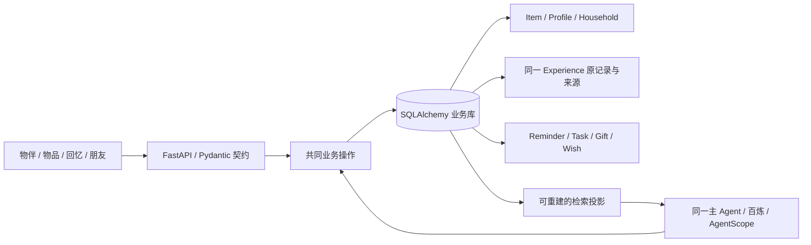

# 家庭、共同回忆与数字赠礼交付记录

日期：2026-11-06。本轮延续现有 Python/FastAPI、SQLAlchemy、React/TypeScript、AgentScope 与百炼，不更换技术栈、不增加收费服务。本文件只描述本轮实际工作；原底座 NOT_ACCEPTED 的结论没有自动关闭。

## 用户要求与当前体验

| 场景 | 本轮落地 | 边界 |
| --- | --- | --- |
| 我的物品 / 家庭物品 | 我的物品显示本人持有且未放入任何已加入家庭的物品；家庭物品按当前家庭展示共同用品 | 共享物品不自动公开个人介绍、聊天和私人回忆 |
| 家庭共同回忆 | 在家庭物品卡上“留下一刻”，预选该家庭；各成员在同一物品下追加各自署名记录；总回忆墙也能查看家庭记录 | 不替别人修改原文；原私密回忆不会因物品共享而公开；用户可以撤回记录的家庭范围 |
| 家庭提醒 | 给当前家庭成员设置关联物品或家庭事项的提醒，显示谁给谁、哪件物品、内容、位置、时间及反馈状态 | 已收到、已接手、已报告完成分别记录；报告完成不自动证明物品修好或可用 |
| 大字版 | 首页直接显示给本人的家庭提醒，支持朗读、确认收到、报告完成及带物品进入逐步问答；保留文字、拍照、语音入口和回答朗读 | 隐去复杂物品、回忆、社交与任务管理；直接输入这些链接也不能展开复杂界面。浏览器语音能力仍取决于设备与权限 |
| 数字赠礼 | 赠送者准备物品形象、昵称、性格、留言和选择的故事；可将选中故事设为带线索的聊天彩蛋；接收者拆开心意，选择是否开启故事对话 | 数字接收与实物交付分开；赠送者只能携带明确选中的故事，不能传送自己的整个个人记忆 |
| 礼物持续相处 | 接收后是同一物品 ID，进入“我的物品”；从礼物与物品名片都可进入同一分身会话；可继续记录自己的新生活 | 接收者控制之后的形象、故事 AI 许可和相处；其新聊天不回传赠送者。礼物不冒充赠送者实时本人 |
| 心愿 | 朋友入口明确展示“想收到的礼物”；本人编辑心愿及是否向已接受好友开放；好友只看到公开心愿 | 心愿不算已经拥有，不创建订单、不付款、不标成赠礼已交付 |
| 活动规划 | 沿用已有活动清单演示与共同任务入口 | 本轮不做金融规划，不新建另一套规划引擎或完整好友/借物系统 |

## 共同底座与实现位置

- `wujian/domain.py`：物品、回忆读取、选择性赠礼快照与接收归属转换。接收故事保留 `origin_id`、原作者与赠礼来源，接收者的照片资产获得自己的引用。
- `wujian/family_memory.py`：对同一回忆做实时家庭范围判断。仅当读者与作者均为当前正式成员、关联物品仍在该家庭时，其他成员才能读取；本人保留自己的原记录。
- `wujian/interactions.py`：回忆编辑/撤回、家庭状态、提醒反馈、心愿操作。撤权使相关旧任务上下文失效。
- `wujian/agent_runtime.py`：主 Agent 的回忆读取和提醒工具复用上述业务规则；提醒工具补齐作者与接收者名字。`list_households` 取得实际已加入家庭；用户本轮明确要求分享时，`record_experience` 携带家庭 ID 和当前分享原话，仍复用同一回忆 writer，默认私人。回执说明实际可见范围。没有另建家庭 Agent、礼物 Agent 或私人记忆数据库。物品读工具与写工具的返回都经过同一 Agent 投影，避免写入回执带回已撤回 AI 许可的故事线索。
- `wujian/turns.py`：展示收到故事时，以 `story_refs` 读取获准原文、作者和照片，并在同一最终事务更新该分身的“已在聊天展开”进度。失败与预校验回滚不会留下假进度。
- `wujian/memory_lifecycle.py`：删除的故事不再留下无效彩蛋入口；关闭 AI 许可的提示保留给主人，但不进入 Agent 与检索投影。
- `frontend/src/features/FamilyMemories.tsx`、`Care.tsx`、`GiftExperience.tsx`：家庭共同回忆、提醒、大字版与数字礼物展示。`Editors.tsx` 复用原表单与分身控件，`App.tsx` 连接入口和会话恢复。

家庭与个人回忆仍是一张 `experiences` 表。新增可空 `household_id` 表示用户明确选择的家庭范围；不是给每个家庭复制一套回忆。日常安静积累的 `Memory` 不随此字段自动共享。

## 契约及数据更新

| 契约 | 语义 |
| --- | --- |
| `ExperienceCreate/Change.household_id` | `null` 为个人范围；家庭范围要求至少关联一件该家庭物品，且所有关联物品均在该家庭。旧 PUT 省略此字段保留原范围 |
| `GiftCreate.surprises` | 最多六个指向本次明确选中故事的线索；不另存一份故事正文 |
| `POST /api/gifts/{id}/accept` 的 `GiftAccept` | 接收者明确选择 `wake_avatar`、`allow_story_ai`。重复接受不扩大许可，不复活删除记录或重新开启分身 |
| `AvatarView.gift_memories` | 指向接收后的 Experience ID，含线索、主题词、已展开状态、当前聊天许可；主题词不是必须精确匹配的密码 |
| `PUT /api/wishes/{id}` 的 `WishChange` | 同一心愿做带 `expected_version` 的更新；公开范围可撤回，不把想要转换成拥有 |

迁移 `0009` 只增加回忆的家庭范围列及索引。SQLite 使用原表直接增加可空外键列，避免重建父表时误删旧分享子行。已有迁移流程先备份后升级；真实旧库测试检查原文、照片引用、分享关系和录入回执保留，并验证备份复制恢复后可重新升级。没有删除 `var/` 或重建用户库。

OpenAPI 与前端类型从 Pydantic 生成；没有手改生成文件掩盖契约差异。数据库、密钥、日志、评测与浏览器会话均不作为源码发布。

## 采用的方法与删减

先跑通真实用户旅程，再做独立对抗性审查，检查体验、权限、状态、代码冗余和查询成本。采用小批可验证变更、单一业务事实源、事务原子性、权限在读取时复核、开发样本与验收分开；相关依据延续项目工作方法文件中的 Google SRE Simplicity、小批交付与 Agent 真实轨迹评估。

彩蛋曾设计额外解锁工具，真实测试出现“工具失败、原文已显示、状态却没变”。独立审查后删除这一步，复用实际故事展示的最终事务：只有实际提交展示才更新进度，既减少一次模型动作，也减少不一致状态。

家庭回忆审查实测 30 条记录触发 158 条 SQL；改为单次读取内批量取得当前成员、家庭物品及分享范围后为 4 条，AI 读取获准记录为 3 条。不引入跨请求缓存，撤权仍在新读取中生效。

百炼 Function Calling 文档说明思考模式与强制 `tool_choice` 存在兼容边界，当前 DashScope SDK 也会将 `required` 转为 `auto`。因此未凭猜测强加 `required`，也未用提高重试次数掩盖对话循环。[阿里云官方说明](https://help.aliyun.com/en/model-studio/qwen-function-calling)

## 实际验证与未关闭问题

工程最终集成回归 **426/426 通过**，记录在 `tmp/family-social-final-integration-tests.txt`。随后补充空可选家庭 ID 的规范化与回归，本轮相关测试 **45/45 通过**，记录在 `tmp/family-social-targeted-final.txt`；不将未再次整跑的总数写成新全量验收数字。前端类型检查及生产构建通过，仍有约 956 KB 主包提示。

真实测试使用现有百炼账号、实际应用 HTTP 与主 Agent。人、持有关系、故事与用户话语为明确的模拟开发样本；家庭实物身份为国内米家台灯 1S `MJTD01SYL`，另有非标手工礼物。没有操作真实设备，也没有把 HTTP 成功当作智能验收。

| 测试 | 实际结果 |
| --- | --- |
| `all-first-20261106-173730-908700` | 22 次真实请求。彩蛋状态不一致；第三轮询问未知细节时 15 次模型响应、167 秒后 `exceed_max_iters`。首轮失败原样保留 |
| `gift-atomic-display-trace-20261106-175423-332400` | 修复后的五轮开发复测均完成，9 次请求，总 72.078 秒；实际展开状态为真，未知细节未编造，明确偏好形成带原句依据的特点，随后仍执行当前要求的三个待办 |
| `family-family-care-copy-20261106-181426-800500` | 两轮开发复测均完成，4 次请求，总 18.499 秒；提醒不再猜动机，共同回忆署名原文只展示一次 |
| `family-record-family-write-first-20261106-184613-185100` | 6 次请求。实际家庭回忆写入正确范围且 AI 许可关闭，妈妈回忆墙可见、AI 投影不可见；私人记录最终正确，但空家庭 ID 曾触发一次工具拒绝 |
| `family-record-family-write-normalized-20261106-185859-381100` | 规范空可选 ID 后两轮复测均完成，5 次请求，总 44.657 秒，无工具错误。模型实际再次传空字符串，一次写入为 SQL null；私人记录未向妈妈的回忆墙或 AI 投影开放 |

完整原始结果、工具轨迹、实际请求计数与隔离 SQLite 位于 `tmp/acceptance/2026-11-06_family-social/`。合计 46 次真实请求，原始首答与复测分开保存；不是冻结独立验收或长期用户研究。

权限/事务测试覆盖家庭明确分享与撤回、跨家庭同物不能延续原家庭提醒权限、成员退出、照片权限、非好友家庭互提醒、两种接收选择、重复接受幂等、故事删除/许可撤回、最终展示与进度同时回滚、原作者及双方新聊天隔离。

手机浏览器使用隔离测试库核对大字版首页、提醒回执、提醒到问答上下文、链接降复杂度、拆礼、接收许可、分身与同一物品名片。好友主页只出现公开心愿，私密样本未出现。另实际建立同一台灯共享两个家庭的场景，从第二家庭提醒打开物主自己的名片，URL、共同回忆与编辑器均保留第二家庭，没有误落入私人或第一家庭。Windows 缩放校准后检查 CSS 视口为 390×844，页面宽度无横向溢出。未将语音接口可调用声称为已经验证所有手机的实际播音与识别质量。

仍未关闭：首次真实测试出现的长循环风险，后续成功不证明该机制问题消失；整体底座验收、长期分身成长质量、真实设备 REA 和跨机浏览器语音可靠性仍需分别验证。本轮不把这些问题写成已完成。

当前同一工作目录另有用户授权的创意/REA 并行开发。本轮保留其修改，不单独改写共享 Git 分支历史、不把混合工作区自动合入 main。

本地 8000 开发服务已升级到 0009 后端；升级前无进行中任务，已生成 `before-0008-to-0009-*.sqlite3` 备份。接口核对确认家庭回忆范围、接收许可及心愿编辑已存在；隔离 UI 测试库与用户实际数据库分开。
