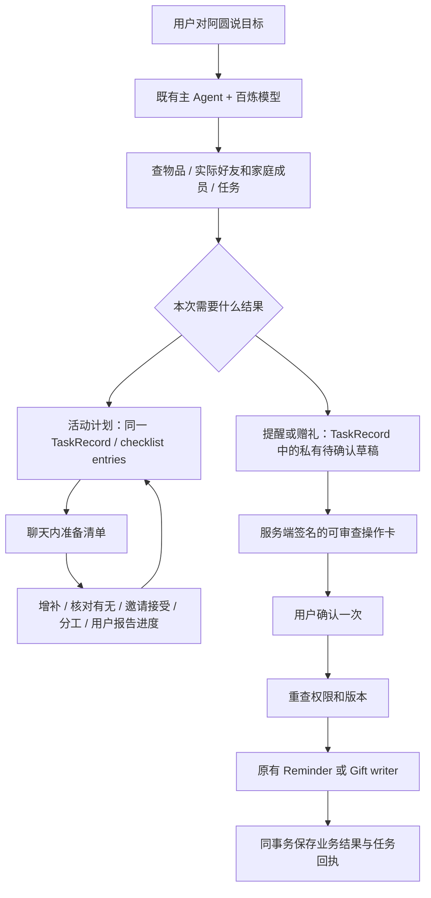

# 总管家操作与活动准备交付记录

日期：2026-11-06。范围：本轮 90 分钟内的总管家提醒／赠礼与活动准备，不替代之前的家庭、回忆、创意、REA 验收，也不把工程回归视为整体智能底座已验收。

## 用户可以怎么用

在物伴聊天里直接说「明天上午九点提醒奶奶看看净饮机滤芯，先别自己拆，等我回来」，主 Agent 查实际家庭成员和物品，生成待确认操作卡。用户核对接收人、内容、物品与时间后确认一次，才写入原有 Reminder，进入接收人的家人提醒待办。创建不代表老人已阅读、已换滤芯；本轮没有增加手机系统推送服务。

说「把我的手工杯送给小雨，写一句忙的时候也记得喝水，别附私人回忆」，Agent 查实际好友与自己的物品，生成赠礼确认卡。确认后调用原有 Gift 业务流程；仍需接收者接收，实物交付另行约定。默认只继承分身外观、昵称，不复制自用性格、学得的私人理解或成长控制；可明确为赠礼另拟 `gift_personality`，全文进入确认卡。选送故事默认空，不能擅自附上私人回忆墙。

说「周六四个人去公园野餐，帮我看看带什么，尽量别买新东西」，Agent 查已有资源，保存 `interaction/1` 的 checklist 任务。清单生成后直接显示在当前聊天的回复下方。用户能逐项核对有无、补充或修改项目、勾选实际准备情况、邀请朋友并分工。创意／指导任务保留原来的入口和展示，未重写另一聊天的创意界面。

## 共用底座与实现路径

没有另建活动数据库、第二个 Agent、第二套任务或记忆系统；没有新增收费服务和第三方依赖。

- `wujian/butler_actions.py`：待确认操作、审查内容、签名、确认／取消及路由。复用 `TaskRecord.plan.pending_action`，不新增表或迁移。
- `wujian/agent_runtime.py`：`list_action_recipients`、`prepare_reminder`、`prepare_gift` 和 `action_proposed` 事件。模型能提出操作，不能调用确认接口替用户确认。
- `wujian/domain.py`：原有 `create_gift` 新增可选 `commit=False`，供确认事务复用；原调用默认行为保留。
- `wujian/server.py`：原提醒入口与 Agent 确认复用同一提醒 writer。
- `wujian/interactions.py`、`interaction_routes.py`、`api_models.py`：沿原任务补条目新增和详情更新。
- `frontend/src/features/App.tsx`：聊天内操作卡、活动清单自动载入与展示；任务切换后拒绝旧异步响应。
- `TaskBoard.tsx`、`ButlerActionCard.tsx` 及局部 CSS：实际清单和确认交互。移除右侧第二份重复清单及重复进度摘要。
- `agent_skills/activity-preparation/SKILL.md`：活动物品安排规则，复用既有 Skill 读取机制。
- OpenAPI 与前端类型从源契约重新生成，没有手改生成文件掩盖差异。

SQL 仍是业务事实来源。签名使用项目已安装的 `itsdangerous` 和既有服务端 session secret，不新建秘密；签名绑定用户、任务、来源消息、标题、实际 payload、审查说明、状态与结果。确认前重新检查好友／家庭／物品权限与关联版本，业务结果和任务回执同事务提交。SQLite 用 `BEGIN IMMEDIATE` 串行化并发确认；重复确认返回原回执，不重复发礼物或提醒。非 SQLite 路径有行锁代码，但本轮没有实际 PostgreSQL 验收。

## 清单与协作契约

| 操作 | 接口 |
| --- | --- |
| 读取 | `GET /api/tasks/{id}/board` |
| 增补 | `POST /api/tasks/{id}/entries` |
| 修改详情 | `PATCH /api/tasks/{id}/entries/{entry_id}/details` |
| 准备进度 | `PATCH /api/tasks/{id}/entries/{entry_id}` |
| 分配 | `PATCH /api/tasks/{id}/entries/{entry_id}/assignee` |
| 邀请／接受 | `POST /api/tasks/{id}/shares`、`POST /api/tasks/{id}/accept` |
| 审查操作 | `GET /api/tasks/{id}/action` |
| 确认／取消 | `POST /api/tasks/{id}/action/confirm`、`POST /api/tasks/{id}/action/cancel` |

写入带 `expected_version`。有物品和已备好分开；新增条目从 pending 开始。自报家里有水可以不关联库存 ID，不制造虚假实物。改名称、有无或实物关联时，手动详情接口重置准备进度；只改备注保留进度。

发起者可编辑与分配；待接受者只读，接受后可新增自己负责的项目、编辑及报告自己负责的项目。清单共享不自动共享私人库存、回忆或聊天。服务端给参与者过滤不可读的物品 ID 与私人计划元数据；清单标题和备注本身属于明确分享的内容。参与者修改隐藏关联的备注时省略 `item_id`，不能误清发起者的真实关联。

客户端刷新失败不冒充写入失败；确认响应丢失先重新核对真实状态，避免盲目重试。旧读取响应不能把新确认状态退回 pending。

## 借鉴的方法及删掉的冗余

参考 [Microsoft To Do 官方任务管理](https://support.microsoft.com/en-us/todo/managing-tasks-in-microsoft-to-do) 与[共享清单分配](https://support.microsoft.com/en-gb/todo/assign-tasks-in-shared-lists)，将清单成员、责任人、步骤与实际完成分开。只借用适用的交互机制，不接入另一套任务服务。

按第一性原理，需要的是「理解目标、看到准备项、实际协作、可信执行」；已有 SQL、TaskRecord、共享权限、Pydantic、Agent 工具和签名库可以承担这些职责，因此没有引入新的 Agent 框架、工作流引擎或外部待办服务。小批实现后再做新鲜对抗审查，检查功能、权限、事务、竞态、隐私与重复 UI，而非先堆审查架构。

独立审查复现了赠礼默认携带私人性格的问题，已改为安全外观继承和显式赠礼性格，并增加两条回归。界面审查修复了任务切换竞态、草稿串场、隐藏关联误清、旧 GET 覆盖新确认状态等问题。

## 实际验证

- 全量离线回归：**479 项通过，247.415 秒**，原始日志 `tmp/butler-outing-full-tests.txt`。最后一次缩小分身继承字段并修复旧部分字段兼容后，总管家专项 **15 项再次通过**。
- 已从 Pydantic 导出 OpenAPI、生成前端类型，最终 TypeScript／Vite 生产构建通过。仍有约 966 kB JS bundle 的体积警告，未为消除警告扩大本轮改造。
- 双账号实际浏览器与 SQLite 验证：增补、修改、进度重置、邀请接受、朋友负责、私库存隔离；390×844 手机补充表单及页尾操作可见；DOM 仅一份准备清单。
- 浏览器实际确认提醒，刷新后同一回执且 SQL 恰一条；实际取消赠礼，SQL gifts 为 0。此处是明确标记的模拟人物，不向真实好友发送测试内容。
- 本轮真实百炼请求合计 **20 次：18 chat + 2 embeddings**。使用实际主 Agent／工具链；人物、拥有关系为模拟，商品型号为国内 ADD6910、PLM13ZM，普通垫子餐盒等明确为非标物品。没有由 Codex 替 Agent 填入答案或后台改写失败结果。
- 首轮提醒约 21.4 秒、赠礼约 18.4 秒，均先草稿后模拟用户确认，实际待办／礼物目标正确，重复确认不重复写入。
- 最后赠礼隐私修复后的真实复测约 **25.0 秒、4 chat 请求**：原自用性格有内容，草稿和实际礼物性格为空，外观昵称正常继承，私人故事未传递。非空定制性格通过离线契约测试，本轮未冒称经过真实自然措辞验收。

本机主服务已重新加载当前代码，`http://127.0.0.1:8000/`、health、OpenAPI 均返回 200，新接口存在。8000 运行不等于全部智能质量通过。隔离 8013 浏览器测试服务已停止，数据证据保留。未提交或合并 Git；工作区含另一个聊天的并行改动，不整体暂存。

## 尚未通过的真实智能质量与交接

活动首答约 50 秒；加 Skill 后首答约 48.9 秒，纠正追问约 84.9 秒。这些延迟仍偏长。

1. **未知不等于缺少，仍未稳定**：模型实际读了 Skill，仍把未登记的食物、纸巾或垃圾袋列为购买。出现待确认分组、餐盒不再机械按人头补是改善，但不是整体通过。
2. **自然语言改清单可能重复和残留旧备注**：同一事项追加纠正后，旧饮用水 buy/ready 仍在，又出现 owned/pending 的水；餐盒标题纠正了，旧备注仍说四人不够；冰袋数量变了，旧备注仍待核对。用户手动编辑路径通过，不等于这条模型续接路径通过。
3. **真实进度硬约束有效但修订语义有冲突**：模型尝试将新增条目标 ready 被拒绝并修复为 pending。`wujian/task_progress.py` 强保留已有备注和有进度的旧条目，与合理的用户当前纠正存在矛盾。`foundation.py`、`turns.py`、`task_progress.py` 属另一聊天的共用底座工作，本轮遵守冲突时让另一边优先的约定，没有修改它们来掩盖验收失败。
4. **操作草稿批量与修订边界**：当前同一消息每种动作仅一个草稿；跨轮重新准备不自动取消旧草稿。不能宣传任意批量指令及跨轮撤销已完整实现。待确认卡始终展示具体接收人、内容与状态。
5. **赠礼个性化**：默认不传私人性格；要获得赠礼者拟定的陪伴特点，应显式拟定赠礼人格。未完整实现通过一句话自动设置全部彩蛋等复杂配置。

下一批底座修改应先拿上述真实失败写成独立回归，明确「完成事实不能迁移到新动作」与「当前用户可合法纠正数量、有无、备注」的边界，再统一修订机制，避免再加一套任务 writer 或靠替换词表补丁维持。模型应复用稳定条目身份；条目是否缺少需要明确证据或用户核对，不能把检索未命中当成物理世界不存在。

### 原始证据

证据目录均在被忽略的 `tmp/`，包含本地会话秘密和模拟数据库，不提交 Git。

- `tmp/acceptance/2026-11-06_butler-outing/all-first-20261106-194607-618300/`：首次三场景，含首答失败和验收脚本误匹配水杯的单独纠错说明，原结果未覆盖。
- `tmp/acceptance/2026-11-06_butler-outing/outing-activity-skill-followup-20261106-200530-483800/`：同会话活动复测与自然纠正，含真实失败、plan、SQL 和独立 review-notes。
- `tmp/acceptance/2026-11-06_butler-outing/gift-safe-gift-personality-20261106-201849-780600/`：隐私修复后真实赠礼复测。
- `tmp/butler-outing-ui/ui-verification.json`：实际浏览器操作与 SQL 对照。
- `scripts/real_butler_outing_eval.py`：真实场景脚本，显式 `--real` 才运行付费调用；普通回归和 CI 不跑它。

更细的界面说明见同目录 `2026-11-06_活动清单交互实现.md`。本轮可交付的是已验证的核心操作和协作路径；整体智能底座仍为 NOT_ACCEPTED。
