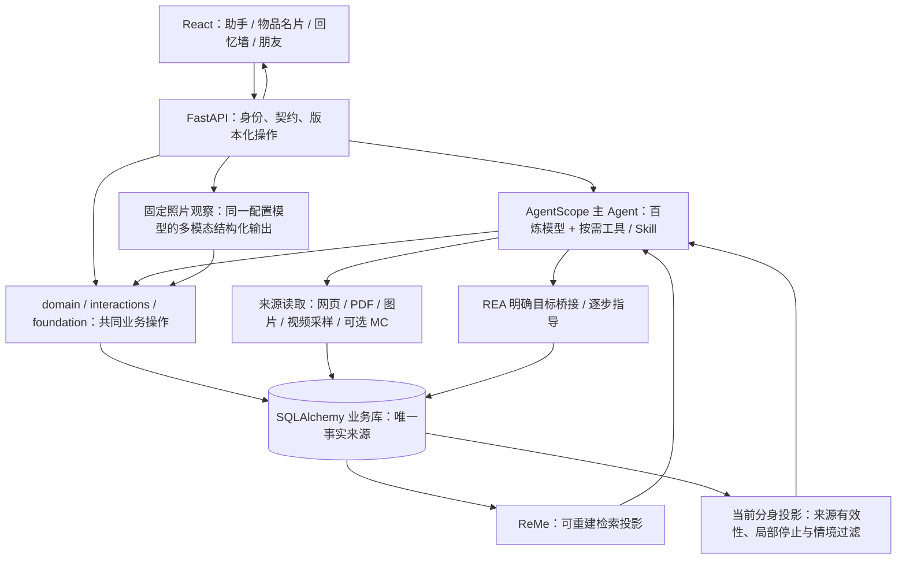

# 物间：照片回忆、分身与创意共同底座交付说明

日期：2026-11-06。本文记录本轮工作区实际实现、独立审查和真实验证，供负责人集成、队友接入和验收核对。最终完整离线回归344项通过，OpenAPI/前端类型已重新生成、生产构建通过。真实验证的有限结果与失败分别列在第8节，不以工程绿灯宣称整体智能验收通过。

产品依据依次为根目录 `01_物间_产品愿景价值逻辑与智能底座能力.md`、`02_物间_产品工程研发与Codex工作方法.md`、`03_Codex_回答表达与沟通边界.md`，以及用户后续明确约定。产品主稿第 22 节和团队交接文档描述体验目标；源代码和本轮证据说明实际达到哪里。发生冲突时，不能通过缩减愿景来解释当前技术缺口。

**本轮整体底座仍为 NOT_ACCEPTED。** 已经跑通的局部链路、工程回归、实际 SDK 工具调用和真实模型案例具有不同证明范围。没有实机修改与恢复证据，就不能称电视去广告、换屏保或通用硬件逆向已经实现。

实现提交：`f60902e`，分支`codex/creative-memory-rea`；文档单独提交。远程develop本轮核对仍为`f167344`，未合并main/develop。日常本地预览已用该实现重启至`http://127.0.0.1:8000/`，先确认在途任务为0；主库仍为0008，未删除、重建或导入隔离测试物品。8011联调服务和临时账号会话已结束。

## 1. 本轮解决什么用户问题

用户希望留下生活照片后，物间能发现其中出现的已有物品，把同一段回忆放到相关名片底下；希望物品分身逐渐懂得怎样和自己相处；也希望创意和 REA 能复用这种理解，而不是每个入口从头询问。

本轮围绕五个具体结果补充机制：

1. 保存一条照片或图文回忆，识别已有物品，自动关联有实例依据的结果；拿不准的候选可轻量纠正。
2. 回忆墙、物品名片、分身聊天读取同一个 `ExperienceRecord`，编辑、许可和关联保持一致。
3. 将分身的相处特点写成有情境和来源的表达方式，用户能看懂来处、停止某个特点，并保留珍贵故事。
4. 日常理解继续沉淀在共同 `Memory`，当前请求、临时状态、个人偏好、用户往事及模型提议分别处理。
5. 为创意提供可选的社区资料取得渠道；为 REA 指导保留同一物品、来源、知识和持续任务，诚实记录实际未完成的步骤。

四种价值因此可以接续：认识一件物品及其限制，找到合适玩法，用户实际尝试后主动留照片，回忆关联到物品，获准经历影响分身表达，再选择分享其中一段。用户可以在任何一步结束，不强制经过四个入口。

## 2. 共同底座与代码边界

当前主线仍为 Python/FastAPI、SQLAlchemy、AgentScope、百炼模型、ReMe，以及 React/TypeScript/Vite。没有因为这些功能另建用户画像库、灵感事实库、分身记忆库或任务引擎。



图中的框表示代码职责，不要求各自成为服务。照片观察是一项有界请求，复用已有多模态 SDK 和配置模型；它不是另一个长期运行、拥有独立记忆的产品 Agent。

| 代码入口 | 负责的事实与操作 |
| --- | --- |
| `wujian/database.py` | 人、型号、实物、Profile、Experience、Memory、Task、来源、授权及设备操作的 SQL 映射 |
| `wujian/domain.py` | 物品访问、创建/更新、回忆创建、回忆投影、个人理解读取、赠礼等共同操作 |
| `wujian/interactions.py` | 回忆编辑/删除/分享、物品展示状态、任务条目/协作等界面与工具共用操作 |
| `wujian/foundation.py` | 有来源和范围的个人理解、商品知识、状态、持续任务与反馈 |
| `wujian/learning.py` | 主 Agent 最终输出中的 `memory_updates`、`knowledge_updates` 及依据校验 |
| `wujian/turns.py` | 原生最终结构、同一业务事务、来源/原文呈现与持续任务提交 |
| `wujian/retrieval.py` | 从获准 SQL 事实构建 ReMe 投影；检索后按当前授权重新取得结果 |
| `wujian/memory_lifecycle.py` | 遗忘/纠正的历史抑制、成长依据检查、当前分身表达投影与局部来源过滤 |
| `wujian/agent_runtime.py` | 主循环、上下文、原生工具和 Skill，调用上述共同业务 |

型号知识与实例状态分开。`ExperienceRecord` 是用户主动留下的照片/文字记录，`Memory` 是安静积累、可纠正的个人理解，`KnowledgeClaim` 是带条件和来源的物品认识，`TaskRecord` 是可继续的方案与实际反馈。它们能互相引用，但不能互相冒充。

## 3. 一张照片怎样进入多个物品的回忆

### 3.1 保存与识别分开完成

前端 `Editors.tsx` 先经 `POST /api/experiences` 保存原回忆，再调用 `POST /api/experiences/{experience_id}/photo-matches`。后端入口在 `photo_matching_routes.py`，核心在 `photo_matching.py`。

`ExperienceCreate` 允许文字为空但至少有一张照片，或有正文但没有照片；只有照片时界面可以给出普通标题。保存不要求先识别成功。模型超时、不可用或判断失败，已经保存的回忆仍在，用户可以稍后识别或手动关联。

识别请求为：

```json
{
  "expected_version": 1,
  "apply_confident": true,
  "exclude_item_ids": []
}
```

代码只处理本人主动记录的回忆。收到的故事不被当作本人现场重新识别；照片必须属于当前账号，候选只来自当前有权查看的物品。不从照片自动创建新物品，不识别人物关系或情绪。

### 3.2 判断“同一件实物”，不能只判断“同一种东西”

`observe_photos` 通过 AgentScope `DataBlock` 直接传入生活照片和候选物品参考照。模型返回 `VisualMatches`，每条含 `item_id`、实际 `photo_ids`、判断、参考细节、照片细节和歧义对象。

- `same_instance` 需要两处可见的独特花纹、损伤、贴纸、刻字或可辨识唯一身份等实例依据。
- 同品牌、同型号、同色或同类别通常只支持 `possible`。
- 没有有效参考照、存在相似候选、重复参考图片、相同商品型号的多个实例，都会限制自动关联。
- 程序还要求有效照片编号、非空比较细节、无歧义和一致判断。这些条件限制自动写入，但不能证明模型说出的视觉细节一定真实。

单次最多同时比较 24 件候选，最多 8 张生活照片。生活图和参考图使用不同的有界缩图规格；上传/识别处理包含 EXIF 朝向纠正。更多物品通过 `examined_item_ids`、`remaining_items` 和下一次 `exclude_item_ids` 继续比较。**分次比较不代表所有相似实例已经共同观察，因此不做自动关联，改为供用户核对的候选。**

### 3.3 只更新同一条回忆

模型调用期间不保持数据库写事务。返回后重新检查回忆版本、照片列表、物品授权、归档状态、参考照及物品版本；晚到结果不能覆盖用户的新编辑，也不能复活已删除记录。

符合条件的关联在同一 `ExperienceRecord.item_ids` 中添加，仍调用 `interactions.change_experience`。名片“它的经历”和回忆墙按同一个 ID/关联读取，无需复制故事。

`provenance.photo_associations` 保存模型比较的原照片、参考照和细节，标明它是视觉模型比较。手工取消关联或换照片时，共同 writer 清理不再有效的比较依据。向朋友分享或随礼物传递故事时，使用来源白名单，不能带出私人参考照 ID、比较细节或未来新增的未知私字段。

`PhotoMatchReview.tsx` 提供继续比较、候选勾选、取消自动关联和保存。手工保存仍是 `PUT /api/experiences/{id}` 加 `expected_version`。识别与关联不改变 `allow_ai`，也不自动向家人朋友分享照片。

## 4. 从安静理解人，到分身的可感知相处方式

### 4.1 共同个人理解

主 Agent 在最终结构的 `learning.memory_updates` 中提交必要理解。`MemoryUpdate` 包含操作、内容、人/物范围、种类、情境、当前原话和可选期限；新增、替换与遗忘仍经 `foundation.revise_memory` 等共同机制处理。

用户“今晚室友睡了”只应限制当前安静玩法，不能变成永久不喜欢音乐；“这只杯子不想留痕”只支持该物品的无损边界，不能扩成拒绝所有改造。模型自己的玩法、昵称或下一步尚未被用户接受时，留在方案中，不能记为用户选择或亲历。

普通聊天不自动出现在回忆墙，也不反复询问是否保存。主动记录经 `record_experience` 写墙；有用个人理解安静更新；获准原故事仍从正式记录读取。

### 4.2 聊天中的自然许可已接正式入口

`record_experience` 新增 `allow_ai` 与 `ai_consent_quote`。用户明确说以后聊天可以提起这条记录时，工具可把当前肯定原话交给 `domain.create_experience`。默认仍为 `false`，正式 writer 验证当前账号/消息和原句，保留许可来源；重放旧保存请求不能覆盖后来撤回的许可。

这减少无必要确认，但并未给程序增加通用语义判断器：原句存在不等于任何否定、引用或复杂指代都被准确理解。此类含义仍需主模型和自然案例验收。

`story_refs` 引用获准 `ExperienceRecord`，应用按原作者呈现原文。`creator_id` 表示保存账号，`provenance` 表示原作者与来历；收到的故事不能成为接收者亲历。未获准 AI 读取的故事可以存在于本人回忆墙，检索无结果不能说它不存在；当前 `wall_storage_view` 仅提供本人已存记录的有限存储提示，不开放正文或私人照片。

### 4.3 显式设置、成长和当下表达分别发挥作用

`Profile.avatar` 继续保存用户选择的名字、形象、颜色和主干性格。新增成长仍放在同一 JSON 字段中，通过 `persona_models.py` 的严格类型表达：

| 字段 | 作用 |
| --- | --- |
| `dimension` | `pace`、`humor`、`support`、`relationship`，分别是节奏、玩笑、支持和专属关系表达 |
| `behavior` | 一项具体怎样说、怎样回应的方式，不是抽象人格评分 |
| `context` | 适用情境，避免把一时心情扩大为永久特点 |
| `evidence` | 当前用户原话，或获准且与该物品关联的回忆及其版本 |
| `id` | 同一维度/情境的稳定身份；独立新来源恢复时保留旧停止记录 |

`GrowthTraitProposal` 不允许模型任填真实证据 ID 或 `lineage_id`。`evolve_avatar` 在正式工具中验证原话、用户身份、实例归属、分身开启状态和来源许可，程序构造 `GrowthEvidence`，再用共同投影判断可否写入。它保留用户显式设置，不为每个特点另建用户画像。

`ObjectCompanion.tsx` 的 `PersonaGrowth` 在名片呈现“我们相处的样子”、具体特点、适用情境和依据。用户可停止自然成长，或选择“不再作为这个分身的特点”。名字、外形和珍贵故事仍保留。

### 4.4 停止一个特点必须跨读取入口生效

独立 SDK 审查先复现了一个缺陷：同一用户原句形成的支持特点被停止后，改写 `context` 就能生成新 ID。修复后不再仅凭 ID/文字判断：

1. 原始 stopped trait 仍留在 `Profile.avatar`，作为来源控制记录。
2. writer 与 `current_avatar` 共用“原始来源谱系＋维度”规则。同一消息截取另一段原话、同一回忆换版本、给旧来源再混入一条新依据，都不能恢复该维度的停止特点。
3. `stamp_growth_evidence` 从 SQL 计算只读 `lineage_id`。收到故事的原始根 ID 可在该副本后来删除后继续识别；模型不能自行指定它。已经删除且从未留存谱系的历史副本，无法事后凭空恢复映射。
4. 新的独立当前用户消息可重新表达偏好；新特点使用独立来源和新 ID，旧停止记录继续保留。程序不声称已经判断任意改述是否在语义上等价。
5. 有 raw typed traits 或停止记录时，不再投影旧自由文本 `growth_note`，避免界面/模型回退显示过期摘要。

后续真实模型又复现：trait 已隐藏，旧共同 `Memory` 仍注入这个分身，模型继续使用被停止的问候。为此补了两个**只作用于当前分身上下文**的投影函数：

- `filter_persona_memories(db, user_id, item_id, rows)`：检查 `Memory.source_message_id` 及 `attributes.evidence`，遮挡同源个人理解。
- `filter_persona_retrieval(db, user_id, item_id, result)`：对 ReMe 再取得的结果应用相同规则，同时遮挡同源历史对话入口；原始故事仍可显式读取。

主运行时在初始 `personal_context`、普通 `recall_memories`、其 ReMe 分支和 `search_world` 统一使用。它不删除 SQL，不改变全局理解和其他物品的分身。同一条长消息中多个偏好可能在该分身一起被保守遮挡，这是明确的来源级边界。

`wall_storage_view`只向本人提供整体及当前物品的保存/可读数量，不提供关闭AI许可的标题、正文或照片。初始上下文与两个检索工具共享该状态，避免把“我不能读取”说成“你没保存”。共享实物不会取得原拥有者的私人墙计数。

`growth_stopped_traits` 给模型少量当前分身的负向表达约束，不带原始引用或账号/来源 ID。全局遗忘或故事撤权后，具体负向描述也移除，避免用“不要这样说”把已撤回的私密内容再次带回上下文。

这套机制保护当前表达和可控成长，不代表自然陪伴、长期习惯、拟人形象成长或任意语义遗忘已经全面通过。

## 5. 创意资料取得：可选 MediaCrawler 接现有来源库

### 5.1 实际接入的位置

`community_search.py` 提供 B 站发现入口，主 Agent 使用现有 `search_public_web(community="bilibili")`；取得具体原页仍使用 `fetch_document`/`read_source`。`community_sources.py` 将取得的公开元数据写成同一 `SourceRecord`，按当前用户和物品授权读取。

MediaCrawler 不是新的灵感事实 writer。`mediacrawler_adapter.py`、`mediacrawler_worker.py` 复用其 B 站客户端，只开放有界关键词搜索和一个 BV 公开视频详情；不运行其完整多平台采集、评论、媒体下载或持久登录流程。

可选独立环境由本地维护者配置 `WUJIAN_MEDIACRAWLER_PYTHON`、`WUJIAN_MEDIACRAWLER_SOURCE`；`WUJIAN_COMMUNITY_PROVIDER` 可选择可选取得路径。模型只提供关键词或公开 BV 标识，不能选择可执行文件、路径、Cookie 或任意请求。

### 5.2 临时登录生命周期

当前会话接口为 `GET /api/community/bilibili/session`、`POST /api/community/bilibili/session`、`DELETE /api/community/bilibili/session`。`mediacrawler_session.py` 按物间用户隔离会话，返回阶段、是否连接、剩余时间和等待扫码时的二维码。

临时扫码在非持久浏览器上下文中完成，不自动读取用户现有浏览器 Cookie。会话有不超过 1800 秒的 TTL；取消、退出和到期均需清理实际 worker 与其拥有的浏览器后代进程。清理失败不能当作已经关闭，应保留可重试状态。`CommunityConnection.tsx` 是前端连接入口。

用户先前单次账号试跑的授权与结果保留在旧研究记录中。本轮另经用户扫码并确认登录，物间主Agent实际完成了MC搜索、详情取得和视频观察接续，见8.2；验证后已主动关闭会话。界面另实际验证准备→显示二维码→结束→二维码消失，不要求用户重复扫码。

本轮独立审查还修了取消关闭时丢失清理任务、清理重试丢失孤儿进程身份、运行环境缺必要系统路径和二维码加载时序。复用psutil按创建身份回收所属进程树；异常回收保留句柄可重试，应用退出仍清除认证并如实报错。QR helper使用现有Playwright重试断言读取实际渲染PNG，不复用用户浏览器配置。错误仅传固定阶段/原因枚举。

### 5.3 元数据与学会做法分开

目前 MediaCrawler 来源明确标记标题、作者、简介、时长和分 P 目录。返回的 `case_evidence` 明示未观看视频、未转写音频、未验证机制和实物结果。分 P 目录不是教程步骤。

主 Agent 可进一步使用现有 `sample_video_frames`、`view_source_image` 或网页正文取得实际做法，按 `creative-use` Skill 核对支撑、连接、材料、当前资源和未知条件，再提出适配方案。沉淀在同一 `KnowledgeClaim`，模型观察或新组合保持 `inference`，不能因附上真实链接就升级为作者已演示或用户已成功。

现有 yt-dlp/FFmpeg 负责有界视频取得和采样；局部静态画面不等于完整视频或音频理解。字幕/ASR/完整连续动作理解仍需具体取得路径与真实验证，本文不将候选工具写成已经接入。

## 6. REA：自主研究、持续指导与实际执行分开

`device-personalization/SKILL.md` 要求先复用准确物品型号、地区、版本、状态和既有资料，再由物间 Agent 自己搜索、获取、分析公开资料。通用 ADB 或开源项目说明不等于某个国内型号的专用协议或兼容证明。

当前 REA 相关路径是：

| 路径 | 代码与接口 | 可表达的结果 |
| --- | --- | --- |
| 资料研究和一步指导 | 主 Agent 来源工具、共同知识、`continuation` | 取得了什么、适用范围、还缺什么、下一项可观察步骤 |
| 指导任务接续 | `TaskRecord`、`foundation.save_task/task_feedback`、任务 board/entry 接口 | 同一目标、当前条件、待做步骤及用户实际回报 |
| 明确目标绑定 | `POST /api/items/{item_id}/device`、`devices.bind_target` | 当前用户明确绑定的工具目标；录入照片不代表已连接 |
| 工具观察/提案/执行 | `/api/devices/{target_id}/explore`、`/proposals`、`/api/devices/operations/{id}/execute` | 软件观察、待批准提案、真实工具回执；不能代替实物效果 |

`plan.schema="interaction/1"`、`kind="guidance"` 使用共同 `TaskEntry`，新动作是 `pending`。模型提出计划不是用户完成步骤；接续要保留原任务 ID/版本，反馈来自当前原话。官方普通设置能查看信息时优先推进一个只读步骤，调试开关等配置变化不能包装成只读。

本轮把任务/学习契约在原生最终输出中提前展示，并给工具/校验错误提供剩余时间，帮助模型及时交付下一步。这些变化仍需以真实回答证明，不能用合法 JSON 或 HTTP 200 当作指导正确。

`ContinuingPlan.constraints`在Agent续接时采用patch：遗漏保留、null显式移除，修改已有值需要当前原话反馈；界面完整编辑不改变原替换语义。预验证不消耗删除标记，最终提交沿同一事务。真实自然续接已确认保留“不再购买灯具/不要科学实验”，新增桌沿限制，同一Task条目仍pending。它不能证明模型已经正确提取所有初始约束，或自动解决同义键及引用的语义冲突。

目前设备桥接仅覆盖代码实际支持的明确浏览器/JavaScript 软件目标，没有由本轮自动获得电视 ADB、固件分析或通用硬件执行能力。国内 TCL 55V8E 的开发复测使用真实型号与 Agent 自行取得的来源，人物/拥有关系和物理反馈是模拟的；各次结果保持独立，不据其中一次答复认定电视去广告成立。最终型号适配、研究收敛与实机结果由负责人按最后证据补充。

## 7. 数据、契约与队友接入

### 7.1 本轮没有新增关系库 schema 迁移

本轮主要数据复用 `ExperienceRecord.item_ids/photo_ids/provenance`、`Profile.avatar`、`Memory.attributes`、既有来源/知识和持续任务字段。迁移目录在本草稿核对时仍到 `0008_recording_receipts.py`，没有为成长、照片或 MediaCrawler 新建业务表，也没有通过删除 `var/` 重建数据库。

**HTTP/模型契约有变化**：纯照片回忆、照片识别请求/结果、成长控制/typed traits/lineage、临时社区会话等均有新的 Pydantic 表达。“没有数据库迁移”不能理解为“接口与旧客户端完全相同”。发布前仍须从正式模型生成 OpenAPI 和前端类型，并核对所有调用方；不能手改生成文件掩盖差异。

业务库位置由 `Settings.data_dir` 决定，本地常规形式是 `var/wujian.sqlite3`，媒体在相同数据目录管理。`tmp/acceptance` 的隔离数据库、媒体和临时评测账本不属于产品业务库；`.env`、会话密钥、私人 SQL、Cookie、媒体和原始日志不提交。

### 7.2 接入接口

| 队友要做的事 | 复用的公共入口 | 必须保留的语义 |
| --- | --- | --- |
| 物品理解、教学与创意读取资源 | `find_items/read_item`、共同 Item/Product/Source/Knowledge | 型号共性不覆盖实例状态，来源观察不伪装实物结果 |
| 添加/修改回忆 | Experience POST/PUT、`interactions.change_experience` | 一个原始 ID、多物关联、`expected_version`、许可和作者 |
| 照片候选或人工纠正 | `photo-matches`、`PhotoMatchReview`、同一 Experience PUT | 缺实例证据只候选；迟到结果与手工更正不能互相覆盖 |
| 个性化、分身和个人理解 | `AvatarSpec/AvatarView`、`evolve_avatar`、共同 `learning.memory_updates` | 显式设置优先；局部停止不是全局遗忘；来源撤销影响投影 |
| 家庭、社交和赠礼 | 既有 household、Experience shares、Gift 入口 | 共享实物不开放私人回忆；故事作者和接收者控制权保留 |
| 创意清单、REA、家庭事项 | `TaskRecord`、`interaction/1`、board/entries/feedback | `ready` 方案不等于现实完成；真实反馈更新原事项 |
| 来源发现和社区工具 | 现有搜索/读取工具和 `SourceRecord` | 资料只是证据；平台元数据不等于观看或可行性证明 |

公共对象、权限、主循环、迁移和生成契约仍由底座负责人统一协调。队友不要直接写另一个 Memory/Task 表，不绕过 `current_avatar` 和当前分身来源过滤，不在前端自行拼一套永久用户画像。图片、动画教学或新的外部工具若需要公共字段，先提交具体消费场景、源契约与失败案例。

## 8. 截至本草稿可核查的验证

### 8.1 工程、SDK 与浏览器

- 本子任务完成的 `test_persona_traits`、`test_persona_growth_lifecycle`、`test_memory_lifecycle` 共 37 项通过；`test_companion_context` 另 4 项通过，共 41 项相邻回归。使用真实临时 SQL、SDK 工具与 ReMe，未调用付费模型。它们证明边界和数据行为，不能证明模型自然度。
- 照片独立审查记录显示 `test_photo*.py` 在该修复候选下 24 项通过；共享比较细节泄漏、取消关联后的旧依据和第 25 件候选不可达三项反例已针对性复验关闭。
- 独立 390×844 浏览器以当前 dist、隔离 SQL 和明确的视觉候选夹具完成纯照片保存、24+1 候选接续、勾选保存与名片查看同一故事；无 JS pageerror、无横向溢出。视觉观察被替换为夹具，因此这不是模型准确率验收。

最终全量离线回归344/344，170.052秒；Pydantic导出OpenAPI、生成TypeScript类型、TypeScript检查和Vite生产构建通过。JS仍约935KB（gzip约299KB），保留Vite的500KB分包提示，未调高阈值掩盖。远程CI以推送后本次提交的Checks为准。

新独立代码审查还复现并关闭两个P2：模型I/O期间新增相似库存，旧结果仍自动关联；采集清理失败导致应用退出仍保持认证。现在最终写事务重查完整库存快照，变化返回409，回忆保持原样；退出先清认证，再如实报告清理503。正式HTTP回归5项覆盖认证、Origin、双账号和异常退出。删除照片路由未使用参数，未引入替代抽象层。

性能实测：10件带成长特点物品的一次列表投影，Memory扫描由10次减到1次；无特点仍0次。`scoped_history_policy`是单次调用内惰性闭包，无跨请求或Session长期缓存；同一Session纠正、遗忘、故事撤权后的下一次读取立即生效，独立SQL计数及4项回归已复验。

### 8.2 真实模型案例与仍存在的失败

| 范围 | 已实际观察的结果 | 结论边界 |
| --- | --- | --- |
| 主动记录和自然许可 | 独立首轮实际调用 `record_experience(allow_ai=true)`，SQL 保留当前肯定原话；拒绝许可案例仍为 false | 有限自然案例通过，不代表任意否定/引用语义准确 |
| 真正重启后找回 | 关闭/重建应用、保留隔离 SQL、新会话读取同一 Experience，以原作者呈现 | 找回与许可成立，首轮有重复复述，表达仍需改进 |
| 当前要求与一时心情 | 临时坏心情未形成永久标签；明确要求三件实际动作时响应当前要求 | 这些案例成立，不证明长期懂人或人格质量 |
| typed 成长 | 独立补充案例由模型调用工具形成有行为、情境和原话的 support 特点 | 不是仅手工种字段，但有限案例不能覆盖全部成长 |
| 局部停止 | 首次SDK同源换词绕过、隐藏trait后仍从Memory复活均保留；谱系与各读取入口过滤后真实新会话16.06秒不再使用旧问候 | 原全局偏好仍在，未重建trait；该用例关闭，不代表任意语义遗忘已解决 |
| 记录存在与读取许可 | 先前真实回答错误猜测没保存；聚焦状态修后18.31秒正确说明该杯已有2条未开放记录 | 数量与SQL一致，无标题正文泄漏；不把不可读当作未保存 |
| 收到故事 | 原作者及许可字段正确但首答虚构同行/沙滩；修后同输入15.19秒保留未知并用原作者story_refs | 仅修后该用例通过，原首答未通过证据保留 |
| 照片多物匹配 | 独立真实主模型从公开桌面照片关联云朵杯/碎花本，相似眼镜留歧义，不在场白杯未返回 | 正例参考为同一照片裁切；不证明跨视角物理实例识别 |
| MediaCrawler及视频 | 本轮用户扫码后，物间自行3次MC搜索，7条真实元数据入共同来源库；接续实际下载视频，主模型收到4个DataBlock，独审查看原PNG核对主体/白纸/灯/字幕 | 采集→观察→同Task/inference知识链成立；未看完整视频/音频，未接小红书或ASR |
| 创意适配 | MJTD01SYL台灯、ABR-AL00手机及白纸/夹子/陶杯自然3轮：首答161.62秒，视频接续46.98秒，用户纠正后34.47秒，始终无假执行 | 首答微距模式无来源、支撑迁移不可靠；纠正后改为折纸支撑，但无实物验证，整体创意质量未接受 |
| REA | TCL55V8E：首次240秒超时，后两次首答219.2/198.2秒；Agent自行取资料，沿同一Task接续；官方热线有原文 | 媒体转述升级官方承诺、过早列工程菜单及知识语义过强仍未过；没有实机改变/恢复验证 |

人物、赠送关系、拥有关系、聊天和实物试用报告均明确为模拟。商品案例应使用国内可查的实际型号；非标手作或纪念石头不伪造型号。公开实拍照片的来源和裁图清单保留在本地冻结记录，不使用用户私人照片冒充公共样本。

### 8.3 本地证据索引

以下路径均在忽略目录，只用于本地审计；不得随源码提交：

- `tmp/acceptance/2026-11-06_parallel-round/persona-independent-v2/REVIEW.md`：独立 23 次实际请求的案例与失败、冻结判据、控制反例。独立案例设计在先，但执行时读过实现，不宣称源码盲审。
- 同目录 `stop-alias-probe.json`：同源同维度改变 context 被旧 writer 接受的 SDK 首次复现。
- `persona-independent-v2-repair/local-stop-repair.json`：隐藏 trait 后，模型仍从同源共同 Memory 复现旧问候的真实失败。
- `persona-independent-v2-repair3/`、`persona-independent-v2-repair4/`：修复后另存的开发复测。目录存在不等于所有案例通过，需读取具体结果和候选条件。
- `photo-independent-v2/review.md`、`http-model-result.json`、`crossbatch-model-result.json`、`frozen-manifest.json`：照片首轮、跨批与限制。
- `photo-independent-v2/offline-http-findings-afterfix.json`、`ui-result.json`、`ui-sql-final.json` 及同目录截图：修后 HTTP/SQL 和浏览器。原审查曾覆盖一个首轮 HTTP JSON，失误已在审查记录披露，不宣称原完整 JSON 仍保留。
- `additional60-rea-tcl-guidance-12-parallel-current-first-20261106-123425/`、`additional60-rea-tcl-guidance-12-convergence-retest-20261106-125022/`、`additional60-rea-tcl-guidance-12-scope-retest-20261106-131054/`：本轮 REA 开发路径，按各自 `results.json` 的代码指纹和实际结果比较，不能合成为一次独立首答。
- `community-integrated/`：新集成验证的隔离环境，MC实际扫码、三轮Agent结果、任务复读与设置页验收截图。

本轮MC整链原始记录为`community-integrated/creative-result.json`、`followup-result.json`、`correction-result.json`，独审`tmp/research/community_integrated_review_v2.md`；新constraint自然复测见`constraint-retest-result.json`及正确HTTP接口复读`constraint-retest-readback.json`。首次探针错读不存在的GET接口取得404，作为探针错误保留，不能当作任务状态缺失。代码审查、进程和查询计数复现位于`tmp/research/integration-code-review-v4.md`及其列明脚本。

本阶段独立请求账本`tmp/acceptance/2026-11-06_parallel-round/request-budget.sqlite3`截至收尾共115次实际HTTP尝试（含1次取消），与旧660账本分开。未新增收费服务。MC登录和平台请求不计入百炼次数；单组模型usage也不包含搜索/embedding，不混报。

旧 660 次额度和失败记录继续保留。本轮用户已授权不设 API 次数上限，仍需记录实际请求及重试，不新增收费服务；普通离线回归和 CI 不调用付费模型或真实设备。

## 9. 采用的方法与未采用的复杂度

| 一手资料 | 本轮具体采用 | 保持的独立判断 |
| --- | --- | --- |
| [Google SRE：Simplicity](https://sre.google/sre-book/simplicity/) | 继续共用 SQL、Memory、Experience、Task；新增的是实际失败所需的局部投影/有界适配 | 删除冗余的目标是减少失败面，不以删行数或减少产品价值作证明 |
| [Google Engineering Practices：Small CLs](https://google.github.io/eng-practices/review/developer/small-cls.html) | 作者按文件边界并行，公共 writer/契约集中接线；功能跑通后由新审查者找反例 | 本文不将工作区全部修改称为已经合并的审阅提交 |
| [DORA：Working in small batches](https://dora.dev/capabilities/working-in-small-batches/) | 从照片保存、一次识别、纠正和同卡片显示等小旅程集成，再处理真实失败 | 不等所有模块“全部完成”才联调，也不因用了小批方法就宣称用户验收通过 |
| [Anthropic：Writing tools for agents](https://www.anthropic.com/research/writing-tools-for-agents)、[Context engineering](https://www.anthropic.com/research/effective-context-engineering-for-ai-agents) | typed 工具输入、紧凑有效上下文、工具输出保留真实观察范围；停止表达覆盖所有当前读取入口 | 没有增加固定的多模型 critic 流水线，也没有把更大上下文当作更懂人 |
| [ReMe 一手项目](https://github.com/agentscope-ai/ReMe) | 复用已有检索及可重建投影，按需查找相关物与经历 | 不把项目最新自动记忆能力直接当本项目已接入；不新增第二事实 writer |
| [MediaCrawler 一手项目](https://github.com/NanmiCoder/MediaCrawler)、[yt-dlp B站实现](https://github.com/yt-dlp/yt-dlp/blob/2026.10.26/yt_dlp/extractor/bilibili.py) | 复用已有社区客户端和视频工具，通过小范围接口接进共同来源体系 | 爬取成功不等于内容理解，更不能以标题/流行度证明物理做法有效 |

当前最重要的剩余验收是：真实相处中正确使用而非机械复述个人理解；可靠识别独立照片里的具体实例；创意取得实质做法后准确迁移并控制等待；REA 对具体型号/版本交付可观察步骤，最后完成明确设备上的改变与恢复。它们需要新的用户结果证据，不能由本文、测试数量或现成工具名称代替。
