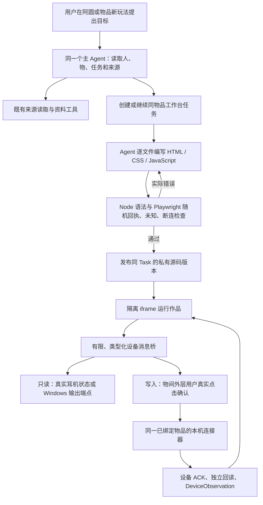

# 最后一轮集成、共同底座与真实验收

本文记录 2026-11-07 本地工作区的实际状态，取代需求收集稿中的开发前状态。实现、工程回归、真实模型结果与实物验证分别记录；历史失败保留，不用后续成功覆盖。主助手名称统一为 **阿圆**。

## 1 本轮产品结果

| 用户路径 | 本轮实现 | 共同业务连接 |
|---|---|---|
| 物伴：直接办事 | 阿圆按需读取版本化产品指南；可整理并确认家庭提醒、赠礼，直接记录照片与文字 | `product_guide.py`、主 Agent 原工具循环、`butler_actions.py`、`domain.py`；不是只用提示词声称已执行 |
| 物品：名片与新玩法 | 家庭／我的物品共用完整物品名片；新玩法回到阿圆并携带物品上下文；工作台列出同物品作品 | 原 `ItemRecord`、`Profile`、`TaskRecord` 和现有页面路由，不另建一套物品或任务 |
| 创造：参考库与接续 | 导入可检索、带原始来源与适用边界的编者灵感；方案、临时材料、改主意、试用反馈保存在同任务 | `SourceRecord`、`Knowledge`、`TaskRecord`，ReMe 仍为可重建投影；临时纸、夹子等不强迫建档 |
| 创造：阿圆自己做工具 | 主 Agent 编写 HTML/CSS/JavaScript，检查、修正、发布，用户可在物品工作台打开和继续修改 | `coding_workbench.py`、私有 Asset 源码、带版本的同一 Task；成熟 Playwright 检查，不执行任意宿主 shell |
| 延续：物品分身 | 按物品实拍生成团子风格形象，可设置昵称／性格、选用获准经历；日常偏好安静积累 | 百炼现有图像服务、原 Profile／Memory／Experience；生成图和实拍分开，不新增记忆事实库 |
| 延续：回忆盒 | 首页按日期浏览照片和短内容，全部回忆保留网格；关联物品可回到物品卡及同一段故事 | 同一 Experience 和受权照片；未知日期仍为未知；自动识别照片中的既有物品不作为本轮深化目标 |
| 传递：家人 | 妈妈、姥爷演示账号／家庭／提醒；大字版直接呈现家人交代的事 | 同一家庭成员、共享物品和 Reminder；提醒建立不等于已发送系统推送 |
| 传递：礼物与故事 | 专为礼物拟定的语气、精选故事和明确选择的物品形象可随礼物传递；接收者控制后续 | 同 item_id 归属转移，独立复制的受权图片／收到的故事保留原作者；赠者私人聊天和成长不自动移交 |

## 2 工作台究竟是谁开发的

安装好的硬件连接器和 Agent 生成的界面是两个结果。前者提供可调用的设备能力；后者由运行在物间里的千问主 Agent 自己编写，并通过真实工具保存源码、检查、发布。不能把 Codex 写的现成面板冒称为 Agent 独立开发。

本机真实开发记录位于忽略目录 `var/evaluations/2026-11-07-live-workbench/035137-676900/`：用户自然要求被提交给 `/api/chat`，没有预置面板源码，Agent 实际连接并读取 FreeBuds 4E，逐文件编写三个源文件，浏览器检查后发布，用时120.72秒。作品与耳机物品、原会话、同一个TaskRecord相连。后续三轮自然修改也更新原任务和源码历史，没有复制成互不相干的新作品；当前版本20、11次源码快照，并显示Windows真实静音状态。

现有桥限定为读取状态、读取 Windows 输出音量、设置已适配的降噪模式和输出音量。不授予作品任意文件、Cookie、网络、Python 或 shell 权限。连接蓝牙本身不证明其他耳机或任意设备可以控制。要接入其他硬件，仍须有适用协议、具体目标和相应连接能力。

源码变更、检查结果和发布版本绑定；历史文件保留。物品转赠或版本改变后，旧界面不能继续用原授权。模拟浏览器检查只证明代码与桥合同，不能代替真实设备结果。设备写入失去 ACK 或回读时显示未知，不自动重发，也不显示乐观成功。

## 3 素材与灵感库

本机小林演示账号现有 **43 件活跃物品均有图片、12 条回忆均有照片**；家庭关系、旧条目与新增物品复用同一业务库。真实商品型号与虚构拥有关系分别说明；用户允许采用近似型号的唱片机、按摩椅、茶吧机仍标为参考，不能用于肯定具体按钮或额定能力。未知品牌玻璃壶未录入。用户实拍优先，原图不放进公开静态目录。

生成形象采用现有百炼 `qwen-image-2.1-pro`，唱片机、红色 illy Y3.3、拱门融蜡灯保留各自形态，另替换旧向日葵／石头分身。早期模型形态不足的图片仍留原始评测目录；不能据此声称每一种陌生物品都已验证。持续视觉变形没有作为本轮验收承诺。

B 站临时登录后串行低频采集了 42 个查询的 204 条不同 BV 搜索线索、147 份实际详情；结束后关闭临时会话，不导出或提交 Cookie。当前目录有 **102 条启用的编者参考、2 条撤回保留历史**，覆盖摄影、游戏、布置、整理、音乐及设备改造等 12 类场景。41 条为官方机制迁移，61 条明确为标题／简介启发的编者待试设计。它们不是“看完了 100 个视频”或“100 个实物验证成功的教程”。

参考库直接导入原 SourceRecord，保留编者内容、原页及阅读深度。来源原文、适配提议和实际用户试用分开；撤回内容不能作为新推荐。结构、导入脚本、去重核对与检索证据见[编者灵感参考库](2026-11-07_编者灵感参考库交付与检索核对.md)、[跨功能独立复核](2026-11-07_灵感库与跨功能链路独立复核.md)。

## 4 已观察到的真实结果与失败

- 实际千问独立旅程验证了照片文字记录、同一创意任务多轮修改与失败反馈、当前诉求优先、没有记录的过去不编造、一次确认后妈妈可见提醒、精选赠礼／接收者新经历和私人故事隔离。具体条件见[独立生活旅程验收](2026-11-07_独立生活旅程真实模型验收.md)。
- 个人理解首测因直／弯引号被整个拒绝，回答却说已记住。修复只允许排版等价重锚为用户原文连续 span，不放宽语义或权限证据；同题从 111.7 秒八次结构输出且零记忆，改善为 14.6 秒一次结构输出、SQL 两条真实记忆，并在全新对话使用昵称和聊天偏好。可选独立学习的部分保留仍不覆盖来源／授权需要整轮拒绝的情况。
- 官方泛 FAQ 曾被错套到 Epson L3256 按钮。已统一所有展示类型内 guidance 的证据和型号边界，并修复框架页导航丢失、搜索发现标签／推荐排序丢失、PDF多关键词定位、仅metadata被当正文等共同缺口。正式回归已经找到正确CN型号入口和明确下载链接，但模型仍会转读相近型号或在结构修复中超时，不能继续归咎“没有找到链接”。该自主指导能力仍未通过，没有预塞型号答案。
- 连续性回归进一步实证：搜索内自动读取的正确来源原先入库却不回放，显式打开的错误来源反而恢复；现统一恢复受权真实原文指针，并让来源列表按新旧排序。又修复重开HTML默认不带原始下载href的合同不一致，不增加网络请求。前一项真实回归已观察到模型重新读取正确入口；后一次模型没有触发重开路径，不能把默认导航的离线绿灯说成用户任务已完成。具体条件见[来源指针修复](2026-11-07_资料指针恢复与来源排序修复.md)。
- FreeBuds 4E的实际控制已取得ACK及独立回读。生成界面验收时，轻度后关闭的回读保留了上一档位字节；旧解析误报未知，失败记录保留。依据一手实现修正为以模式字节判断关闭，独立反例回归通过。Agent自行续改到同任务版本15后及补静音显示的最终版本20，生成界面的轻度／关闭和输出音量均经外层确认及独立实机回读通过，恢复原设置、静音，零页面错误；两次实机证据分别保留，详见[阿圆工作台机制与真实验收](2026-11-07_阿圆物品工作台机制与真实验收.md)。声学听感仍需用户佩戴确认。
- 工作台独审已修复通用任务写口伪造发布、隔离页面导航外传、未核验结果被当成功、检查器非法参数假通过及同轮动作重试问题。具体范围与证据见[最终集成独立审查](2026-11-07_最终集成独立审查.md)。
- 在正式物品用法入口提出“打开现成耳机工作台，不改设置、不再建一份”，阿圆34.49秒返回原作品链接；Task、版本20、源码哈希与已发布状态均未改变，也没有新增工作台。记录见本机 `var/evaluations/2026-11-07-workbench-handoff/055124/`。回答曾将单项未知电量过度解释为未连接，现统一在桥合同及产品说明区分字段未知与真实连接错误；没有据此改设备状态。
- 共享用法工作方法已并入同一份 `product-guidance` Skill，显式用法入口预加载、通用入口按需选用，AS2课程仍用其自身实际合同，不再另外注入一份inline指导法。新增通用手册Reader只对原页实际声明的唯一手册附件多读一次，不按品牌或型号猜URL。真实复测确实触发了CN下载链接，但附件读取失败；之后取得的另一份相近型号PDF及页图不构成适用指导，240.562秒后超时且无任务/知识假写入。后续一次独立公开读取观测404，与原轮仅记录HTTPStatusError分开；现公开文档HTTP错误保留实际状态码，页码与全文行号的区别补入共享Skill。此后尚未再次进行该型号模型验收。见[物品用法入口验证](2026-11-07_物品用法入口开发验证.md)、[唯一附件Reader](2026-11-07_通用手册唯一附件读取评估.md)。
- 额外小游戏草稿暴露通用工作台检查器过拟合：仅为读取静音而调用read_volume，也被强制显示数字音量；草稿建立还曾因直/弯引号差异受阻。现在私有草稿重用同一原文排版重锚机制，并将通用代码smoke与具体控制台显示验收分开。实际设备权限、源码版本和外层真实点击确认不变；1,500ms内加载自动请求检查、非法参数、运行异常和网络隔离均经独立Chrome反例验证。它不保证任意未来timer或具体玩法已经成功，详见[检查器边界修复](2026-11-07_工作台通用Smoke与控制台专项边界修复.md)。
- 在修复检查器后，阿圆通过同一草稿真实读取、修改两份源码、检查并发布“节奏回声”到版本18，用时114.41秒；开发者未代写作品，原耳机控制台版本20和哈希均未改。真实浏览器验证了点击后才启动原生WebAudio、播放后跟敲、反馈、重玩及实际静音提示，没有硬件写入或成绩持久化请求。原先超时/空节点错误均保留，不能说首次生成已成功。证据为本机 `var/evaluations/2026-11-07-rhythm-refine/063803-868500/`；浏览器发声调用不等于用户已听到，手机页面适配也不等于手机声音转发到电脑耳机。

## 5 工程与交付状态

代码仍采用一个 Python/FastAPI 应用、一个 SQLAlchemy 事实库、一个主 Agent 和 React/TypeScript 界面；没有为本轮另建世界模型服务、编译层、灵感数据库或多 Agent 常驻集群。使用既有 AgentScope、ReMe、Alembic、Pydantic、BeautifulSoup/PDF 工具；按实际需求新增成熟 Playwright 检查与 Windows Pycaw 音量接口。选择理由是解决可复现失败，不能把依赖名称当技术创新。

最终完整离线回归 **707 项通过（329.358秒）**，日志在本机 `tmp/final-round/final-regression-v6.log`。中间659、670、674项冻结点及其日志保留；此前645项那次有1个测试夹具错误：模拟fetch返回了不存在的source_id，新增权限重检正确拒绝；更正夹具为先持久化受权来源后8项原生SDK合同及上述全量均通过，未放宽运行时权限。OpenAPI从Pydantic重新导出、88条路径与运行时契约再次比较一致，前端类型重新生成及生产构建通过。六个实际桌面／手机页面检查无页面错误或横向溢出；耳机工作台列表优先展示阿圆生成作品，再展示预装工具。底座整体仍不声称普遍智能验收通过。

另清理了一份意外嵌套的重复AS2演示素材：删除前逐文件比对16份SHA-256与原路径完全相同、确认无代码引用后只移除副本，原演示包及所有教学素材保留，减少约41MB。没有删除业务数据库或用户媒体。

另外用AgentScope官方middleware接口试验了仅压缩SDK自身重复结构输出提示。离线真实SDK循环保留用户、工具、校验错误与强制结构化时点；估算最后一次输入可少约1.7%，没有真实Qwen解题／耗时收益证据。此次不接生产，不以此冒称幻觉修复，候选代码与量化仅保留本机 `tmp/harness_review/2026-11-07/`，正式代码不留未接入模块。

## 6 保留的真实边界

这一轮耳机作品开发与有限设备控制已经实测通过，照片、任务接续、提醒和赠礼也有各自业务证据；它们不等于所有陌生物品和创意都可靠。

- 精确陌生型号自主操作指导仍不稳定：有正确入口也可能选错旧资料、用错来源或耗尽修复时限。AS2既定校核课程与自由陌生商品研究是两条不同的验收，不能相互冒充。
- 四场自然创意中有可起步的摄影／家庭互动方案，但新颖性、物理条件和直接交付仍有限；电视首次错误内置能力已保留，修复后条件投屏也没有完成真正正文核验。见[创意四场景验收](2026-11-07_独立自然创意四场景验收.md)。
- 分身的有来源特点和跨聊天偏好可以运行；长期自然相处、随对话持续改变视觉形态没有全面验收。
- 右耳不可用占位显示未知；设备ACK／状态回读不等于佩戴听感。通用电脑shell、驱动安装、任意耳机／电视自动适配不在当前工作台权限内。
- 家庭提醒为应用内记录与反馈；系统到时推送、真实实体物流仍未交付。私人演示数据库和照片不随Git checkout分发；公开AS2包、源码及灵感目录与私有本机数据分别管理。

原始请求、失败首答、SQL、私有图片、设备地址和日志都保留本机忽略目录。公开代码与可复现测试、参考目录可交付；私人 `var/` 数据和媒体不提交 Git。当前集成分支为 `codex/creative-memory-rea`，不强制改写共享 main/develop 历史。

## 7 发布后的技术实现与优化说明

负责人随后明确批准本轮已核验成果发布：PR #6正常合入develop，PR #7正常合入main；main为`539555a`、develop为`28ae74e`，两者代码树与核验提交`6c99902`一致。main自动CI的backend/frontend均成功，记录为 https://github.com/Starry-Curry/ProductAgent/actions/runs/42325151042 。未强推、未删除其他分支，工作区另有成员未提交的路演PPT文档，未纳入本次发布。

以下是当前版本的实际机制和优化，不宣称新模型、数据库或检索算法，也没有将第三方库源码修改当作未经发生的成果。

| 实现 | 具体代码和机制 | 已有收益证据 |
|---|---|---|
| 个人理解读取去重 | `domain.list_items`为一次列表调用创建`memory_lifecycle.scoped_history_policy`惰性加载器，多个物品投影复用同一份记忆策略；不跨请求缓存 | `tests/test_persona_projection_queries.py`计数相同10件带成长特点物品：旧逐件读10次，列表复用1次，输出特点相同；无特点0次。不是整个应用提速90%；纠正/遗忘后的下一次读取仍即时生效 |
| 原话证据重锚，减少无意义模型返工 | `evidence.locate_user_quote`保留原文连续片段，只容忍同类引号排版与连续空白，不改词义、数字、型号，不采用模糊相似度授权 | 同一自然偏好题：111.7秒/8次结构输出/0条记忆，修复回归14.6秒/1次结构输出/2条实际记忆。是单题观测，不是总体平均提速；原失败仍留档 |
| 推理上下文与展示数据分开 | `agent_runtime.compact_task`从推理视图移除3D几何、图片展示数据和完整课程副本，保留当前步骤、课程ID/版本/阶段/输入与最近5条观察；全文仍在SQL/资产，按需读取 | AS2显示与业务任务继续共用原数据，不为推理重复传几何。未量化全局token/延迟收益，不写虚构节省比例 |
| 单事实库与短事务提交 | SQLAlchemy存业务事实；ReMe是可重建检索投影。模型推理期间不持有长写事务，最终重新核对上下文版本，在共同写口提交回答、学习和持续计划；预检试写会回滚 | 同一任务版本接续、权限变化后旧推理拒绝、无用户结果不标完成，均有离线SDK/SQL及实际旅程证据。不是新增“世界模型服务”或第二记忆库 |
| Agent可开发的隔离工作台 | `coding_workbench`将Agent写的三份源码作为同Task的私有Asset保存，检查绑定源码hash/版本；Node查语法、Playwright查隔离运行；消息桥只开放已适配设备能力，写入由外层真实点击确认并核验回读 | 最终控制台v20与游戏v18由真实千问修改发布；通用smoke不再把所有读音量的作品强制当音量面板，修复后静音小游戏可合法运行。没有改写Playwright或AgentScope库本体，也没有开放任意宿主shell |
| 来源连续性与有界资料读取 | 搜索中实际下载的来源ID进入受权回放；仅存线索的网页不冒充已读正文。重开原HTML保留下载导航；明确手册页只有唯一实际附件时额外读取一次 | 解决“资料已入库却接续不到”“下载href重开丢失”等共同断点；PDF取得、型号适用与指导正确分别判断。该机制不等于陌生型号指导已经稳定 |

## 8 五份Skill与数据库如何服务同一Agent

这是一个主Agent按需读取的五份版本化工作方法，不是五个常驻Agent，也不是五套固定答案或微调模型：

| Skill | 如何工作 |
|---|---|
| `product-guidance` | 先核准确型号/版本与适用原文，必要时读页图；只推进当前可观察步骤，未执行保持pending；区分页码与全文行号 |
| `creative-use` | 先看实际可用资源和目标，再检索原理/案例；保留材料、结构、环境、额定边界及未知；先给可检查的小试，反馈接原任务 |
| `activity-preparation` | 把野餐等目标转成已有/待补充/可借用/待确认清单；没有登记不等于没有，不强迫把所有零碎建物品 |
| `persona-companion` | 昵称和显式设定为主，获准经历形成有情境特点；当前需求优先，支持局部停止，不编造没有记录的往事 |
| `device-personalization` | 先复用物品已有型号与连接状态，找实际接口/协议；区分研究、指导、已安装连接器、Agent生成作品及实物回读 |

Skill复用同一套工具和业务对象。明确“问用法”入口预加载同一份用法Skill；一般聊天按需选择。没有为每个入口再写一套不同规则。

本地业务库是`var/wujian.sqlite3`，当前Alembic迁移0009。`ProductRecord`存商品型号共性，`ItemRecord`存这个人持有的实物及现状，`Profile`存个人说明/分身，`SourceRecord`和`KnowledgeClaim`存原文与带依据的认识，`Experience`存主动记录的故事，`Memory`存安静积累的个人理解，`TaskRecord`存持续计划/作品版本，`Asset`存受权照片、资料和源码。赠礼、家庭、来源和权限沿同一业务操作接入。

ReMe将获准SQL记录组织成可检索投影。检索命中后按当前SQL权限重新取事实；纠正、撤权或遗忘不能靠一个旧向量结果继续生效。B站案例、商品说明、私人故事不混成无来源的一团文本，也不通过爬虫直接改变模型权重。

## 9 B站素材与设备新玩法资料储备

原始采集：42个查询、204个不同BV线索、147份实际视频详情；当前编者参考102条，关联86份原始参考，其中29份为官方/项目文档、57份为B站BV参考。102条中41条为官方机制迁移、61条为标题/简介启发的待试设计。不是147部视频均已看完，也不是102个实物成功教程。

`fixtures/inspiration/catalog.json`中的单条结构包含title/category/scene/resources/mechanism/first_step/observe/unknowns/reference_keys/tags/physical_validation/evidence_level/source_basis。原文与编者提议分别保留，导入同SourceRecord并参与ReMe检索；当前小林账号可以复用本地积累，不必每次重新访问B站。原始资料按账号授权，尚非向所有新账号自动分发的公共全网库。

| 方向 | 已有资料和点子 | 当前层级 |
|---|---|---|
| 电视/大屏 | Sunshine+Moonlight局域网游戏串流、Home Assistant Cast家庭看板、OBS聚会计分、精简电视入口 | 已有原文/编者参考；具体电视系统、软件安装与网络需另核，不保证去掉开机广告 |
| 灯光 | WLED分段/预设/声音响应、Hyperion画面联动氛围光 | 资料和迁移点子；需要兼容控制器/灯具，不能套到任意智能灯 |
| 扫地机器人 | 已支持设备的本地连接、自动化触发和地图/任务联动方向 | 先核具体型号和接口；没有宣称已实机实现Wi-Fi测绘 |
| 厨房/冰箱周边 | Grocy食材库存、Mealie菜谱与家庭共享屏幕 | 参考方向，不声称已改写冰箱内部固件或触屏 |
| 耳机/声音 | AutoEQ听音适配资料，以及本项目实际FreeBuds 4E电量、降噪和Windows音量控制 | 资料研究与已实测控制分开；现有工作台没有通用EQ/所有耳机适配 |
| 摄影/记录 | 现有17条摄影类参考；新录入EOS R5的官方遥控拍摄软件和间隔拍摄说明 | 原文已取得，当前相机未连接电脑进行控制验收 |

12类参考实际数量为：电视与大屏6、灯光与空间7、音乐与声音10、清洁与家务4、厨房与食物10、学习与阅读6、办公与设备12、摄影与记录17、出门与露营8、收纳与整理13、游戏与活动7、园艺与阳台2。

## 10 首次发布基线的成功验证统计与路演口径

统计依据是已保留的原始报告和人工业务验收，不是HTTP 200、模型自评或API调用数。只纳入已核实成功的指定验收目标；旧开发轮次和不完整结果不累加。**不计算整体智能通过率，各行计量单位不同且存在包含关系，不能相加。** 8个场景含首测和修复后的成功复测，不能称为8道全新盲题首答通过。

| 指标 | 可引用的成功数 | 含义 |
|---|---:|---|
| 最新完整离线回归 | 707项，1轮 | `final-regression-v6.log`实际707项通过；不把早期614/659/670/674等重复回归加成独立用例 |
| 已核实的真实千问场景 | 8个场景 | 照片记录、分身连续聊天、家庭提醒、精选赠礼与接收者新记录、个人偏好实际保存、最终控制台续改、最终小游戏修复、从对话打开原工作台 |
| 上述场景内成功交互 | 14次 | 分别为1/3/2/4/1/1/1/1次真实用户输入；验收依据是记录、计划、权限、源码与可见结果，不以completed独自判成功 |
| 最终版实物控制 | 1款设备、1轮完整验收 | HUAWEI FreeBuds 4E；只计最终控制台v20的`054037`轮，旧版本成功重复不累加 |
| 该轮控制核验 | 2组、3次写入 | 降噪组含轻度/关闭两次写入；音量组一次写入至61%，均经外层确认、设备/系统回读及独立读取；最后恢复原设置和静音 |
| 最终小游戏浏览器验证 | 12项断言 | 用户点击后原生WebAudio才启动、播放后跟敲、反馈、重玩、实际静音显示、390宽度及无自动写/成绩保存等；包含在游戏场景中，不另加成12个场景 |
| main的自动检查 | 前后端2个job均成功 | 发布commit539555a；后端离线/样本/OpenAPI、前端生成类型/构建全部完成 |

生活场景中的人物、拥有关系和事件为合成，使用真实国内型号、获准实拍、真实千问与真实业务库；它们是软件/Agent旅程，不能称为8个实物实验。耳机实测证明状态与控制回读，没有实际佩戴听感验收；小游戏验证了原生音源调用，未将浏览器启动声音当成人已听到。

逐条成功场景、14个run_id、原始报告路径、设备动作及文件SHA256已记录于本机忽略文件`tmp/final-round/successful-validation-manifest.json`。统计脚本只读已有证据，不调用模型或硬件。适合展示的表述为：

> 当前版本通过707项离线自动化用例；8条真实千问场景完成14次目标验收交互。Agent生成的最终耳机控制台在真实FreeBuds 4E上完成3次控制写入与独立回读；另一款自生成小游戏通过12项浏览器断言。

## 11 追加40分钟：三处有计数证据的小优化

本次于2026-11-07 10:01（中国时间）开始，限时40分钟。两名实现/量化Agent并行检查，一名新Agent独立对抗审查；产品运行时仍只有原来的一个主Agent。新工作分支`codex/harness-40min-20261107`从develop开始，未动其他成员的未提交PPT。未新增依赖、常驻服务、数据库表、跨请求缓存或第三方库fork。

采用[Google SRE Simplicity](https://sre.google/sre-book/simplicity/)的必要/偶然复杂性区分，以及[Google Small CLs](https://google.github.io/eng-practices/review/developer/small-cls.html)的小批可审查改动：先记录重复工作的基线，再局部移除，用结果等价与反例验证，不用新缓存掩盖冗余查询，不删掉权限复查来换表面速度。

| 修改 | 消除的工作 | 保留的语义与收益证据 |
|---|---|---|
| `turns.commit_result`仅有story_refs时投影故事 | 普通回答在SDK预检与正式提交各读取一次整面回忆墙 | 无故事引用的最终阶段完整投影2→0；有引用仍预检/提交各复查一次，作者和赠礼解锁不变。不是整个聊天0回忆读取，初始化的获准上下文仍可能需要回忆索引 |
| `retrieval.authorized_documents`按当前用户Conversation JOIN批量读消息 | 旧版每个会话再查一次ChatMessage | 30会话样本单次投影的消息SELECT 30→1；检索前和外部等待后仍各自重新核验，不能把第二次复验删掉。已消费组用pop释放引用；未证明初始预取峰值内存更低 |
| persona资源索引复用已授权focused视图 | 已知当前物品后，为生成一条索引再次投影整个库存 | 100件规模夹具，item_view调用102→2，Profile SELECT104→4；明确focus位于第101件时，旧索引缺失0条→正常1条。归档仍排除，普通入口仍保留原前100件与相同投影 |

量化使用合成账号和库存、真实国内型号模板、实际AgentRunner/SDK/SQL；100件是规模夹具，不是100个实物测试。查询计数可重复，不能写成整个对话延迟降低96%。两次同题真实模型的等待也受生成随机性影响，本轮未建立平均端到端提速结论。

独立审查将40个混合账号/空会话/相同时间戳的临时SQL样本投入旧、新投影函数，36份结果逐字段、正文和hash一致；另验证检索await期间转移会话归属，命中会在二次投影剔除。空story_refs仍能提交有效学习，却不能解锁赠礼故事；引用后撤权、删除、他人故事拒绝的边界保留。新18项回归分别覆盖故事5、批量消息4、persona7及新独审2；完整去重回归以最终日志为准，不把重叠定向组相加。

已有四次新增真实千问交互完成，使用隔离合成账号、真实EOS R5型号身份与原业务HTTP/AgentScope/ReMe：

- `var/evaluations/2026-11-07-harness40/100801/`：普通陪伴9.266秒，最终阶段故事投影0；请求原故事12.406秒，原文真实渲染且权限投影2；搜索旧聊天13.047秒，Agent实际调用search_world，前后两次投影的消息查询各1，正确取回灯放在右后方的原话。
- `var/evaluations/2026-11-07-harness40/100958/`：persona索引改动后，用字节相同的陪伴题再测一次，11.235秒完成，最终阶段故事投影仍0。三种路径共4次交互，含一次同题重复，不能算4个全新场景。
- 最后一行pop改动只减少已消费组的引用滞留，其完整结果等价和真实ReMe权限反例在最终离线代码上另行复查；没有将上面的旧hash记录改写成新版本结果。此次没有操作硬件，不增加第10节实机数。

本机基线/反例、SQL计数、SDK捕获和独审证据分别在`tmp/final-round/persona-resource-{before,after}.json`、`tmp/retrieval-projection-batch-{before,after2}.log`及`tmp/final-round/independent-projection-equivalence-final.json`。正式新增测试为`tests/test_story_projection_optimization.py`、`test_retrieval_projection_batch.py`、`test_persona_resource_optimization.py`和`test_optimization_independent_review.py`。

首轮完整回归725项中一项在固定8秒轮询截止时仍处于running；原日志保留为`tmp/harness40/full-regression-first-failure.log`，没有计为通过。独审确认真实SDK尚在正常执行read_item和结构化输出宽限，不是生产死循环；仅将`test_agent_loop`的loop模式等待预算改为30秒，其他模式仍8秒，仍必须断言failed及exceed_max_iters，生产迭代上限不改。该模块5项复测通过（18.556秒）。随后完整回归**725/725通过，475.125秒**，原始日志`tmp/harness40/full-regression.log`；OpenAPI生成结果与已提交契约逐字一致，88条路径。本轮无前端或API变更，前端沿用原已验证构建；最终PR仍运行仓库规定的前后端CI。

## 12 本次追加相机资料

已在小林账号录入一件“我的佳能EOS R5”，三张用户原图留在私有资产，机身标识确认EOS R5，50mm镜头外观匹配RF50mm F1.8 STM但完整镜头铭牌仍待核对。未把照片中的快门/光圈/ISO当作实时状态，没有录入或公开机身序列号文本。

6份实际原文均由共同source reader取得并关联该item：佳能中国R5规格、中文高级指南、软件说明、间隔定时器说明、RF50mm F1.8 STM中国产品页及中文镜头PDF。当前高级指南声明适用2.2.0及以后固件，实物固件未知。官方确认EOS Utility可传输影像、设定相机及遥控拍摄，但本次没有连接相机执行这些动作，也不计入上面的实物控制数。原始导入回执在`var/intake/2026-11-07-canon-r5/receipt.json`。新增的是实物档案，不自动虚构生活故事。
