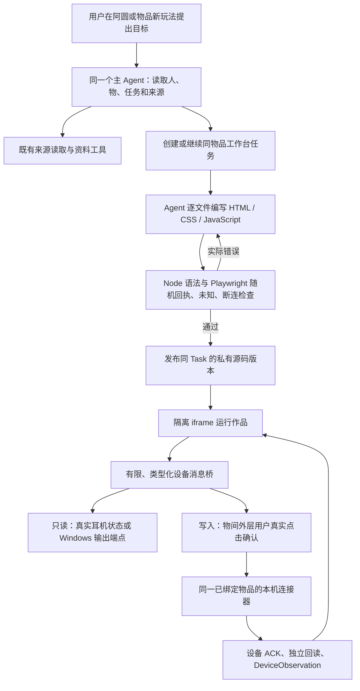

# 最后一轮集成、共同底座与真实验收

本文记录 2026-11-07 本地工作区的实际状态，取代需求收集稿中的开发前状态。实现、工程回归、真实模型结果与实物验证分别记录；历史失败保留，不用后续成功覆盖。主助手名称统一为 **阿圆**。

## 1 本轮产品结果

| 用户路径 | 本轮实现 | 共同业务连接 |
|---|---|---|
| 物伴：直接办事 | 阿圆按需读取版本化产品指南；可整理并确认家庭提醒、赠礼，直接记录照片与文字 | `product_guide.py`、主 Agent 原工具循环、`butler_actions.py`、`domain.py`；不是只用提示词声称已执行 |
| 物品：名片与新玩法 | 家庭／我的物品共用完整物品名片；新玩法回到阿圆并携带物品上下文；工作台列出同物品作品 | 原 `ItemRecord`、`Profile`、`TaskRecord` 和现有页面路由，不另建一套物品或任务 |
| 创造：参考库与接续 | 导入可检索、带原始来源与适用边界的编者灵感；方案、临时材料、改主意、试用反馈保存在同任务 | `SourceRecord`、`Knowledge`、`TaskRecord`，ReMe 仍为可重建投影；临时纸、夹子等不强迫建档 |
| 创造：阿圆自己做工具 | 主 Agent 编写 HTML/CSS/JavaScript，检查、修正、发布，用户可在物品工作台打开和继续修改 | `coding_workbench.py`、私有 Asset 源码、带版本的同一 Task；成熟 Playwright 检查，不执行任意宿主 shell |
| 延续：物品分身 | 按物品实拍生成团子风格形象，可设置昵称／性格、选用获准经历；日常偏好安静积累 | 百炼现有图像服务、原 Profile／Memory／Experience；生成图和实拍分开，不新增记忆事实库 |
| 延续：回忆盒 | 首页按日期浏览照片和短内容，全部回忆保留网格；关联物品可回到物品卡及同一段故事 | 同一 Experience 和受权照片；未知日期仍为未知；自动识别照片中的既有物品不作为本轮深化目标 |
| 传递：家人 | 妈妈、姥爷演示账号／家庭／提醒；大字版直接呈现家人交代的事 | 同一家庭成员、共享物品和 Reminder；提醒建立不等于已发送系统推送 |
| 传递：礼物与故事 | 专为礼物拟定的语气、精选故事和明确选择的物品形象可随礼物传递；接收者控制后续 | 同 item_id 归属转移，独立复制的受权图片／收到的故事保留原作者；赠者私人聊天和成长不自动移交 |

## 2 工作台究竟是谁开发的

安装好的硬件连接器和 Agent 生成的界面是两个结果。前者提供可调用的设备能力；后者由运行在物间里的千问主 Agent 自己编写，并通过真实工具保存源码、检查、发布。不能把 Codex 写的现成面板冒称为 Agent 独立开发。

本机真实开发记录位于忽略目录 `var/evaluations/2026-11-07-live-workbench/035137-676900/`：用户自然要求被提交给 `/api/chat`，没有预置面板源码，Agent 实际连接并读取 FreeBuds 4E，逐文件编写三个源文件，浏览器检查后发布，用时 120.72 秒。作品与耳机物品、原会话、同一个 TaskRecord 相连。后续自然修改也更新原任务和源码历史，没有复制成互不相干的新作品。

现有桥限定为读取状态、读取 Windows 输出音量、设置已适配的降噪模式和输出音量。不授予作品任意文件、Cookie、网络、Python 或 shell 权限。连接蓝牙本身不证明其他耳机或任意设备可以控制。要接入其他硬件，仍须有适用协议、具体目标和相应连接能力。

源码变更、检查结果和发布版本绑定；历史文件保留。物品转赠或版本改变后，旧界面不能继续用原授权。模拟浏览器检查只证明代码与桥合同，不能代替真实设备结果。设备写入失去 ACK 或回读时显示未知，不自动重发，也不显示乐观成功。

## 3 素材与灵感库

本机小林演示账号现有 **43 件活跃物品均有图片、12 条回忆均有照片**；家庭关系、旧条目与新增物品复用同一业务库。真实商品型号与虚构拥有关系分别说明；用户允许采用近似型号的唱片机、按摩椅、茶吧机仍标为参考，不能用于肯定具体按钮或额定能力。未知品牌玻璃壶未录入。用户实拍优先，原图不放进公开静态目录。

生成形象采用现有百炼 `qwen-image-2.1-pro`，唱片机、红色 illy Y3.3、拱门融蜡灯保留各自形态，另替换旧向日葵／石头分身。早期模型形态不足的图片仍留原始评测目录；不能据此声称每一种陌生物品都已验证。持续视觉变形没有作为本轮验收承诺。

B 站临时登录后串行低频采集了 42 个查询的 204 条不同 BV 搜索线索、147 份实际详情；结束后关闭临时会话，不导出或提交 Cookie。当前目录有 **102 条启用的编者参考、2 条撤回保留历史**，覆盖摄影、游戏、布置、整理、音乐及设备改造等 12 类场景。41 条为官方机制迁移，61 条明确为标题／简介启发的编者待试设计。它们不是“看完了 100 个视频”或“100 个实物验证成功的教程”。

参考库直接导入原 SourceRecord，保留编者内容、原页及阅读深度。来源原文、适配提议和实际用户试用分开；撤回内容不能作为新推荐。结构、导入脚本、去重核对与检索证据见[编者灵感参考库](2026-11-07_编者灵感参考库交付与检索核对.md)、[跨功能独立复核](2026-11-07_灵感库与跨功能链路独立复核.md)。

## 4 已观察到的真实结果与失败

- 实际千问独立旅程验证了照片文字记录、同一创意任务多轮修改与失败反馈、当前诉求优先、没有记录的过去不编造、一次确认后妈妈可见提醒、精选赠礼／接收者新经历和私人故事隔离。具体条件见[独立生活旅程验收](2026-11-07_独立生活旅程真实模型验收.md)。
- 个人理解首测因直／弯引号被整个拒绝，回答却说已记住。修复只允许排版等价重锚为用户原文连续 span，不放宽语义或权限证据；同题从 111.7 秒八次结构输出且零记忆，改善为 14.6 秒一次结构输出、SQL 两条真实记忆，并在全新对话使用昵称和聊天偏好。可选独立学习的部分保留仍不覆盖来源／授权需要整轮拒绝的情况。
- 官方泛 FAQ 曾被错套到 Epson L3256 按钮。已统一所有展示类型内 guidance 的证据和型号边界，并修复框架页导航丢失、搜索发现标签／推荐排序丢失、PDF多关键词定位、仅metadata被当正文等共同缺口。正式回归已经找到正确CN型号入口和明确下载链接，但模型仍会转读相近型号或在结构修复中超时，不能继续归咎“没有找到链接”。该自主指导能力仍未通过，没有预塞型号答案。
- 连续性回归进一步实证：搜索内自动读取的正确来源原先入库却不回放，显式打开的错误来源反而恢复；现统一恢复受权真实原文指针，并让来源列表按新旧排序。又修复重开HTML默认不带原始下载href的合同不一致，不增加网络请求。前一项真实回归已观察到模型重新读取正确入口；后一次模型没有触发重开路径，不能把默认导航的离线绿灯说成用户任务已完成。具体条件见[来源指针修复](2026-11-07_资料指针恢复与来源排序修复.md)。
- FreeBuds 4E 的实际控制已取得 ACK 及独立回读。生成界面验收时，轻度后关闭的回读保留了上一档位字节；旧解析误报未知，失败记录保留。依据一手实现修正为以模式字节判断关闭，独立反例回归通过。最终 Agent 自行续改到同任务版本15后，生成界面的轻度／关闭和输出音量均经外层确认及独立实机回读通过，恢复原设置、静音，零页面错误；详见[阿圆工作台机制与真实验收](2026-11-07_阿圆物品工作台机制与真实验收.md)。声学听感仍需用户佩戴确认。
- 工作台独审已修复通用任务写口伪造发布、隔离页面导航外传、未核验结果被当成功、检查器非法参数假通过及同轮动作重试问题。具体范围与证据见[最终集成独立审查](2026-11-07_最终集成独立审查.md)。

## 5 工程与交付状态

代码仍采用一个 Python/FastAPI 应用、一个 SQLAlchemy 事实库、一个主 Agent 和 React/TypeScript 界面；没有为本轮另建世界模型服务、编译层、灵感数据库或多 Agent 常驻集群。使用既有 AgentScope、ReMe、Alembic、Pydantic、BeautifulSoup/PDF 工具；按实际需求新增成熟 Playwright 检查与 Windows Pycaw 音量接口。选择理由是解决可复现失败，不能把依赖名称当技术创新。

最终完整离线回归 **674 项通过（294.752秒）**，日志在本机 `tmp/final-round/final-regression-v5.log`。中间659、670项冻结点及其日志保留；此前645项那次有1个测试夹具错误：模拟fetch返回了不存在的source_id，新增权限重检正确拒绝；更正夹具为先持久化受权来源后8项原生SDK合同及上述全量均通过，未放宽运行时权限。OpenAPI从Pydantic重新导出、88条路径与运行时契约再次比较一致，前端类型重新生成及生产构建通过。六个实际桌面／手机页面检查无页面错误或横向溢出。底座整体仍不声称普遍智能验收通过。

另清理了一份意外嵌套的重复AS2演示素材：删除前逐文件比对16份SHA-256与原路径完全相同、确认无代码引用后只移除副本，原演示包及所有教学素材保留，减少约41MB。没有删除业务数据库或用户媒体。

另外用AgentScope官方middleware接口试验了仅压缩SDK自身重复结构输出提示。离线真实SDK循环保留用户、工具、校验错误与强制结构化时点；估算最后一次输入可少约1.7%，没有真实Qwen解题／耗时收益证据。此次不接生产，不以此冒称幻觉修复，候选代码与量化仅保留本机 `tmp/harness_review/2026-11-07/`，正式代码不留未接入模块。

## 6 保留的真实边界

这一轮耳机作品开发与有限设备控制已经实测通过，照片、任务接续、提醒和赠礼也有各自业务证据；它们不等于所有陌生物品和创意都可靠。

- 精确陌生型号自主操作指导仍不稳定：有正确入口也可能选错旧资料、用错来源或耗尽修复时限。AS2既定校核课程与自由陌生商品研究是两条不同的验收，不能相互冒充。
- 四场自然创意中有可起步的摄影／家庭互动方案，但新颖性、物理条件和直接交付仍有限；电视首次错误内置能力已保留，修复后条件投屏也没有完成真正正文核验。见[创意四场景验收](2026-11-07_独立自然创意四场景验收.md)。
- 分身的有来源特点和跨聊天偏好可以运行；长期自然相处、随对话持续改变视觉形态没有全面验收。
- 右耳不可用占位显示未知；设备ACK／状态回读不等于佩戴听感。通用电脑shell、驱动安装、任意耳机／电视自动适配不在当前工作台权限内。
- 家庭提醒为应用内记录与反馈；系统到时推送、真实实体物流仍未交付。私人演示数据库和照片不随Git checkout分发；公开AS2包、源码及灵感目录与私有本机数据分别管理。

原始请求、失败首答、SQL、私有图片、设备地址和日志都保留本机忽略目录。公开代码与可复现测试、参考目录可交付；私人 `var/` 数据和媒体不提交 Git。当前集成分支为 `codex/creative-memory-rea`，不强制改写共享 main/develop 历史。
