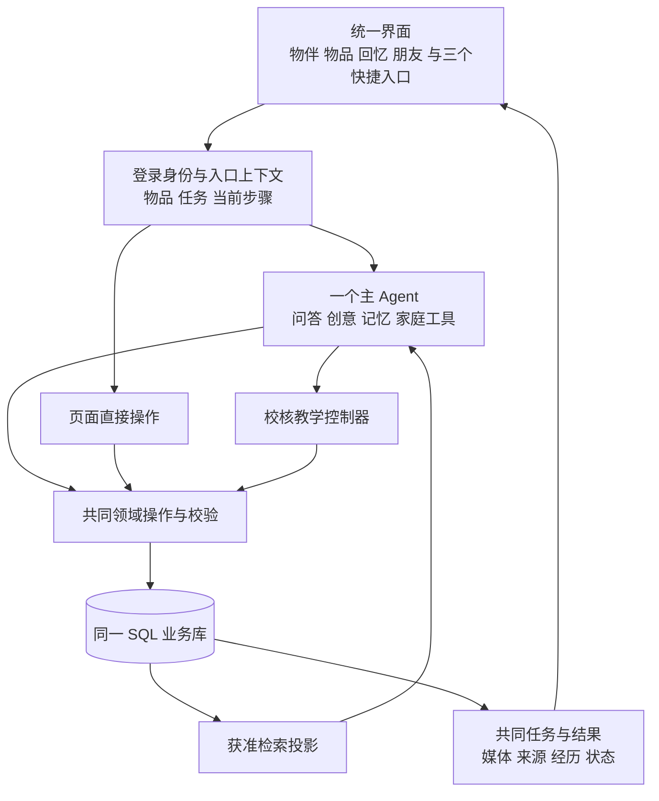

# 物间比赛集成与统一交互设计方案

2026 年 11 月 7 日。状态：方案与审计，尚未执行合并或页面开发。

**现有成果可以合在一起。建议保留当前 Python/FastAPI、React/Vite 和共同 SQL 业务库，以最新教学模块加入共同实现，以参考应用的布局、组件与交互统一界面。需要修改共同契约和少量运行机制，不需要重新建设一套智能平台。** 比赛交付以所有主要能力可进入、可运行、可接续为目标；正式产品的长期质量验收继续单独记录。

## 1 本次核对的最新成果与覆盖关系

| 来源 | 固定版本 | 集成角色 |
| --- | --- | --- |
| 本聊天形成的共同实现及用户补交 | codex/creative-memory-rea，03b7bf700d19de38aff40561a921a71ed6f8fe5a | 共同业务、创意、REA、个人理解、回忆、分身、家庭和赠礼；包括最新清单修正 |
| 同学最新讲解教学 | feat/as2-adaptive-lessons，96d68e3dc63c57b9d192221624985c24b4e3f701 | 普通问答、通用指导、AS2 自适应教学、照片、三维、相机、本地检索和可复现演示资产 |
| 图解恢复修正 | fix/as2-reviewed-demo-restore，666e75824bf21f0cbd2c2f9da25087cbd4b7ac45 | 对照功能是否保留，不默认再次整支叠加 |
| 桌面／手机参考 | reference/desktop-20261106，45cd5b0；reference/mobile-20261106，7b3156e | 统一视觉、页面布局、功能位置与交互参考；不是另一套运行时的强制迁移目标 |

最新教学提交时间为北京时间 11 月 7 日 00:12:54，新增内容主要是可复现的实拍、官方手册、预备素材、演示资源、启动与架构说明；它继承了 de41b63 的自适应教学。

已核对 guided-demo、natural-guidance、a-review 均为最新教学分支祖先。旧三维、相机和教学成果沿该链进入新版，以新版为准。图解恢复修正不是其祖先，但对照生产代码，新版保留了对应恢复处理，并增加当前教学变体的处理；TeachingDiagram 前端对应文件无差异；旧版 test_lessons.py 的测试名称均保留，新增七项自适应相关测试。因此本轮没有发现需要单独再整支接入的旧生产能力，集成仍需保留其回归用例。

参考桌面与手机版各 496 个文件，产品源码一致，只有三份说明／版本文件不同。它们属于一个响应式应用，不应长期维护成两个产品。

## 2 保留哪些能力

| 能力 | 采用的实现及合并边界 | 用户最终从哪里进入 |
| --- | --- | --- |
| 物品录入、身份与状态 | 共同业务实体保留；吸收参考版轻量录入、位置与状态呈现 | 物品、拍照、阿圆 |
| 实用问答与排查 | 最新教学的问答和反馈处理，接共同知识、来源、个人理解与任务 | 阿圆、物品名片的使用帮助 |
| AS2 深入教学 | 最新课程、材料输入、补充核对、暂停续接及预备媒体整体保留 | 对应物品名片、阿圆、继续任务 |
| 图片／三维／相机 | 最新教学模块保留，复用当前步骤；区别预备示意与通用生成 | 当前步骤下按需展开 |
| 创意玩法与目标组合 | 共同实现的来源、视频采样、本地案例和约束机制保留；借鉴参考版发现与方案展示 | 发现新用法、阿圆、物品名片入口 |
| REA | 保留目标绑定、软件分析、指导及现有行动路径；不在这次集成中宣称新增任意硬件修改能力 | 新玩法、物品名片、阿圆 |
| 活动／目标准备 | 保留 03b7bf7 的条目身份、修订、分类与真实进度规则；吸收参考版任务展示 | 做件事、阿圆 |
| 回忆与理解人 | 保留共同记录、人物归属、情境、纠正／遗忘、照片关联基础；不采用参考版固定关闭日常积累的设置 | 回忆、物品名片、对话 |
| 可选数字分身 | 保留现有形象和个性对话、可停止的性格特点；使用同一获准经历 | 物品名片、与它聊聊 |
| 家庭 | 保留共享实物、家庭事项、提醒、成员接续与行动回执，吸收参考版日期和分工交互 | 家人交代的事、家庭用品、关怀模式 |
| 好友、心愿与赠礼 | 保留共同权限和接收者控制，吸收参考版朋友主页、心愿、赠言、选择故事的界面 | 朋友、物品赠送入口 |

参考版独有的每个交互要逐项登记对应业务操作；没有等价后端的，例如某项具体借还流程，不能只搬按钮。应补最小可工作的业务接入，或明确作为待接功能；不把所有参考按钮都默认算作主线已经实现。

## 3 底座需要改到什么程度

### 3.1 保留稳定部分

继续使用同一用户、商品型号、具体实物、状态、资料来源、知识、个人理解、经历与任务。SQLAlchemy 是业务事实源，Alembic 保留已有迁移链，ReMe 是检索投影。一个主 Agent 按上下文选择工具和 Skill。

不因参考应用使用 Next.js 和 LangGraph 就替换共同后端，也不把它的 workspace JSON、life 表、companion_records 作为另一套事实库接进来。前端适配只转换请求和显示数据，不承担第二份业务规则。

### 3.2 必须统一的接缝

| 接缝 | 具体处理 | 原因 |
| --- | --- | --- |
| 数据库与模型 | 保留共同实现到 0009 的链，加入教学需要的字段；真有新结构才追加迁移 | 最新教学自身仍只带到 0006，不能整套替换现库 |
| 对话与主循环 | 保留共同运行生命周期、来源校验、情境失效保护；吸收教学的上下文、轻量输出和反馈逻辑 | 避免两个总控互相规划、覆盖回答或重试 |
| 状态建议 | 普通 continuation、教学 LessonIntent、清单 progress_reports 经各自必要校验进入共同任务操作 | 不必强行把专用数据压成一种字段，但所有路径必须尊重同一任务版本与实际结果 |
| 任务展示 | 统一 task_id、entry_id 和当前版本；教学观察、材料、辅助图作为任务相关数据 | 切换入口继续同一件事，不另建教学任务库 |
| 权限 | 默认共享物品照片沿物品读权限，额外私人照片独立检查 | 家人能看物品，不应在教学时突然无权；也不能放开其他私人照片 |
| 创意证据 | 来源读取深度与方案依据统一；本地已有案例无需为了形式重新搜索 | 避免教学分支的搜索门槛阻断已有灵感复用 |
| 结果有效性 | 纯照片／三维缓存不视为修改业务方案，实际目标、约束、资源改变仍需重新核对 | 打开辅助图不应使原进度失效 |
| 个人理解 | 日常有效理解安静积累；主动回忆和长期理解区分，继续按权限读取 | 不在迁移参考 UI 时把 memoryPolicy=off 机械带入 |

教学控制器应保留自己的责任：对校核课程维护步骤、材料和反馈。它不需要变成另一个总控 Agent。普通解释不强制建任务；课程中转向其他需求时，也不能把所有话锁成课程确认。需要家庭写操作或新玩法时，由共同运行逻辑进入对应业务能力，不能因当前教学模式只开放只读工具就永久无法转出。

### 3.3 AS2 演示资产接入

保留新版媒体、课程与摘要校验，但将其作为共同应用中的一个可复现物品和教学任务。现有 demo 启动器采用独立新数据目录、固定演示拥有者；它适合单模块复现，不能直接拿它覆盖或初始化现有家庭数据库。

集成时需要一个明确的演示导入操作：为目标账号建立或绑定物品，导入媒体和资料，关联课程，保存真实生成的 ID；重复导入不制造一排重复物品。整个应用共用一个登录、数据库和入口。原独立启动器可继续作为开发排查工具，不作为正式导航需要跳转的第二个站点。

## 4 统一后的页面设计

### 4.1 桌面

延续参考版暖白、蓝灰、真实照片、低饱和辅助色和阿圆形象。主栏目与快捷入口各有明确用途：

```text
左侧导航                 主内容区                        按需辅助区
物间                     当前页面或阿圆对话              当前任务／资料
  物伴                   简单欢迎与少量场景起点          当前步骤图示
  物品                   物品完整名片／回忆／朋友主页    不默认铺满全部功能
  回忆
  朋友

最近对话                 对话中出现可操作的结果卡

  做件事                 保存后可从原任务继续
  家人交代的事           未处理、接手、反馈分别呈现
  发现新用法             选中方向回阿圆继续

头像／我的／设置          对话页底部输入、照片、语音
```

右侧区不是每页必须占用的固定宽栏。物品点开后应让完整名片成为主内容；复杂教学辅助可以占据更宽区域或弹层，关闭后回到同一步。

### 4.2 手机和关怀模式

底栏统一为物伴、物品、回忆、朋友；设置进入头像。做件事、家庭事项和发现新用法是可找到的次级入口，不再增加三个底栏。“做件事”从物伴的次级入口进入，“发现新用法”可从物伴或物品进入，家庭事项在家庭用品中有明确入口。

普通版与关怀版复用事实和权限。关怀版首屏主要保留语音／拍照问答和家庭提醒；指导一次一个动作，提供听一遍、完成、没找到等大按钮。关怀模式不自动代表所有老人能力相同，也不因显示简化而另建用户数据。

### 4.3 物品名片

首屏：真实照片或已启用分身、名称、品牌型号／非标来源、所属范围、放置位置、当前状态。

主要操作：使用帮助、记一段。次级入口：发现新用法、相关事项、说明与资料；已启用分身才显示与它聊聊。位置和使用注意可以直接查看或更正。下方为经历与回忆，必要时展示相关维护记录。

创意方案不常驻堆在名片旁。点击新玩法后，把实际 item_id 与目标带到阿圆；助手继续利用这件物品的状态和获准经历。原名片作为可返回的来源入口。

### 4.4 三个快捷入口

| 入口 | 页面承载 | 与阿圆的关系 |
| --- | --- | --- |
| 做件事 | 目标、已有资源、待确认／缺少项、步骤、负责人、进度；活动准备是其中一种 | 新建或修改目标回对话；已有任务按 ID 接续 |
| 家人交代的事 | 当前人的提醒、受托事项、接手和反馈；可打开相关物品和使用帮助 | 需要讲解或排查时带家庭事项和物品上下文进入阿圆 |
| 发现新用法 | 已有物品的灵感、可复用案例与适用条件；允许用户直接说无聊或想达成的目标 | 选方向后继续对话，形成待尝试方案；不强制完成兴趣问卷或登记所有普通材料 |

### 4.5 回忆和朋友

“回忆”是主动记录的经历墙；“记忆”用于内部理解人的能力，不作为另一个重复栏目。一次记录可关联多件物品，独立回忆墙与名片读取同一经历。已有照片识物关联保留基本能力，本阶段不继续深化。

朋友页面包括好友、对方主动分享的内容、心愿与礼物入口。赠送时选择心意和可转交故事；接收后由接收者控制后续改变。回忆分享、实物共享与允许 AI 使用分别遵守已有范围，不能因为界面合并就自动扩大。

## 5 跨功能接续的最小契约

沿现有接口传递身份，而不是在页面之间复制一段摘要当作全部上下文。需要保留的关联如下：

| 用户动作 | 必须保留的关联 | 返回与后续 |
| --- | --- | --- |
| 从名片问用法／探索新玩法 | item_id、入口意图；已有任务时 task_id | conversation_id、run_id；必要时同一任务与版本 |
| 报告做了没变化 | task_id、entry_id、当前版本、真实本轮原话 | 更新的任务、实际记录结果、下一步；不能自动判完成 |
| 打开照片／三维／相机 | task_id、step_id、当前版本、可读媒体 | 当前步骤辅助产物；不改变实际完成状态 |
| 修改清单或分工 | task_id、entry_id、expected_version、具体变化 | 新版本及实际成功／冲突；遵守 03b7bf7 的进度规则 |
| 主动记一段 | experience_id（编辑时）、item_ids、媒体和分享范围 | 同一经历出现在回忆墙与关联名片 |
| 从家庭事项问怎么做 | 物品、事项／任务 ID、当前成员身份 | 接续指导和必要的家庭反馈，不新造一套物品现状 |
| 从分身继续聊天 | 实物 ID、persona 入口与当前用户 | 读取该分身获准经历，不扩大到全部私人生活史 |

这些是已有字段与操作的整合原则，不要求新建一个通用网关、事件总线或多 Agent 平台。用户请求由一个主执行流程接住，页面直接操作与模型工具调用复用同一业务服务。



## 6 如何集成且保持每个部分可运行

1. 固定上述提交与现有演示数据备份，建立覆盖清单。新工作在集成分支进行，保留独立原分支可运行；此文不执行这些变更。
2. 在用户 03b7bf7 的共同实现基础上整合最新教学模块，优先处理模型、来源、任务和运行时接缝。保留教学专用行为及测试，不能对冲突文件统一“全选某一边”。
3. 将 AS2 资产导入共同账号和物品库。先让旧界面下的主要能力都能从同一应用调用，确保不是外观完成、后端仍孤立。
4. 迁移参考版的视觉和页面组件，逐页改用共同 API。Next 专用路由、Node 数据库调用和重复状态 writer 不随界面搬入；有必要的缺失业务接口小批补齐。
5. 从 Pydantic 生成 OpenAPI 与前端类型，再做生产构建。跨模块字段变更从源契约修正，不手拼生成文件。
6. 按比赛旅程验收入口、动作、接续和实际落库。完成后再做针对性代码与冗余审查；不在功能尚不可运行时先引入一轮架构重做。

## 7 比赛验收尺度与优先级

比赛门槛是每个主功能有清楚入口、真实可用路径、成功／失败状态和可接续结果，并至少跑通以下跨功能旅程：

- 一个普通国内型号，从名片进入使用问答，反馈没找到／没变化后接续；同一教学中打开辅助图。
- AS2 从共同物品库进入课程，正常问问题、补材料、暂停恢复；图解与当前步骤一致。
- 一个创意从本地案例或实际取得的分享出发，匹配现有物品，尝试失败后修改原方案；REA 研究／指导保留真实工具能力边界。
- 活动目标生成清单，用户自然纠正数量或已有资源，原条目与实际进度不被错误覆盖。
- 一段主动回忆同时出现在回忆墙和物品名片，获准个性对话能使用，人物归属正确。
- 家庭成员从事项进入共享物品指导，报告处理结果；赠礼有发送、接收和故事归属的可运行路径。

数据无法迁移、越权、主要入口断链、无法保存或恢复任务、重复写入、假报实控／完成属于必须修正项。更精美动画、全面长尾设备泛化、大规模社区采集、照片关联深化和人格视觉成长不作为本轮集成阻断。延迟本身按用户此前要求不列为首要门槛，但系统性死循环或超时后无可恢复状态仍要排查。

## 8 本轮审计结果与仍待集成验证的内容

对 96d68e3 的隔离源码重新运行离线工程回归：**115/115 通过，53.411 秒**，包含演示包校验与准备路径测试；不是实物或真实模型验收。

对新版重跑旧反例：共享物品照片 GET 200，而教学 picture 接口仍 404；已有 public_web 案例和读取记录但无新搜索记录时，创意门槛仍拒绝；嵌套 guidance.pictures 仍改变任务业务签名。这三处是实际接缝，不以旧版本问题未经重测推定。

本轮未执行跨分支合并、正式数据库迁移、页面改造或真实模型／设备调用，因此结论为：**集成路径具备可行依据，尚未验证集成后的完整应用。** 不因单分支测试通过而提升原底座 ACCEPTED 状态。

隔离源码、覆盖核对与日志在本机 tmp/2026-11-06-latest-audit，最新文件包括 adaptive-coverage.json、adaptive-latest-test-summary.json、adaptive-latest-offline-tests.txt、adaptive-latest-probe-results.json。沿用小批变更、单一事实源、成熟能力复用和基于实际反例的审查方式；本阶段不增加新的框架或收费服务。
