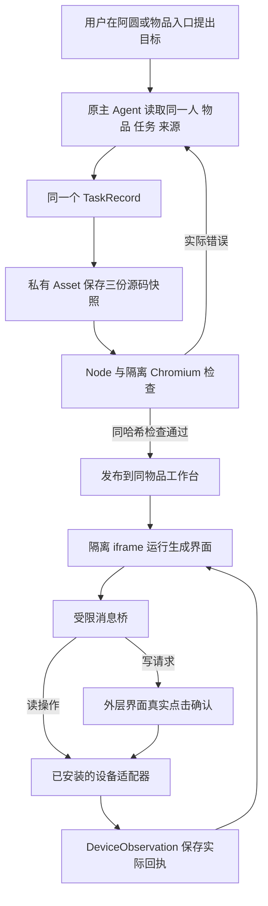

# 阿圆物品工作台机制与真实验收

2026 年 11 月 7 日，本轮已在小林演示账号的真实华为 FreeBuds 4E 物品上完成：物间里的千问主 Agent 自行连接并读取设备、生成三个界面源文件、检查、发布，以及在原任务和原会话中两次继续修改。最终作品通过实际浏览器的电量读取、降噪与 Windows 输出音量操作验收；设备写入需要界面外层确认。

这个结果的范围是**现有设备连接器支撑的小型浏览器工作台开发**。它证明了物间可以让模型真正写出、保存、修改并运行界面，而不只是回答教程。硬件协议适配器由工程代码提供；本轮没有证明模型能自动适配任意耳机、电视固件或任意本地软件。整个项目的其他功能与未关闭项见[最后一轮交付与真实验收](2026-11-07_最后一轮交付与真实验收.md)。

## 1 用户可以在哪里使用

主助手名称为阿圆。用户可以在物伴中直接提出目标，也可以从物品名片进入新玩法或工作台。工作台区分“已有工具”和“阿圆制作”：前者是安装好的适配工具，后者才是主 Agent 实际编写并发布的作品。

小林演示账号已有一份实际生成的作品：

- 物品：我的华为耳机，国内型号 FreeBuds 4E。
- 工作台任务：`eb71e1c470064c1ba5a28c648eb214c1`。
- 原会话：`3233d67338964c7198c9e62f1d7fc80a`。
- 本机入口：[打开耳机小操控台](http://127.0.0.1:8000/#items?item=1d8be5b3e93147edb725dee4dfae48f4&panel=workbench&task=eb71e1c470064c1ba5a28c648eb214c1)。

这些 ID 仅定位本机演示数据，不是其他安装环境的固定配置。点“让阿圆继续改”会接回原会话和同一个任务，不会再建立一个独立作品。

## 2 模型得到的能力

本轮继续使用百炼 `qwen3.6-plus` 和现有 AgentScope 主循环，没有新增第二个生产 Agent 或另一套任务数据库。

| 模型工具 | 实际作用 |
|---|---|
| `create_workbench` | 从当前用户原话为其拥有的物品建立工作台 Task，返回版本和桥接契约，初始没有预置面板源码 |
| `read_workbench` | 读取实际保存的源代码、当前版本、检查及历史；可按保留的 source_revision 读旧源 |
| `write_workbench` | 每次写 `index.html`、`style.css`、`app.js` 中的一份，保留其他文件，使用实际 expected_version |
| `check_workbench` | 对当前源码运行 Node 语法检查及隔离 Chromium 检查，返回真实错误供同一模型修正 |
| `publish_workbench` | 只发布当前源码哈希对应的已通过检查版本，返回同物品的实际入口 |
| `inspect_earbuds`、`connect_earbuds`、`read_earbuds` | 使用已安装连接器发现、绑定和读取实际 FreeBuds 4E；连接器本身不算模型生成的界面 |

源码编辑范围为工作台的三个浏览器源文件。模型没有任意宿主 shell、Python 执行、驱动安装、任意路径写入或修改整个物间仓库的权限。它可以根据实际任务继续查资料；已有适配器适用时直接复用，不必重新让用户下载一遍协议。

源码和主要接线分别在：

- [coding_workbench.py](../wujian/coding_workbench.py)：Task、私有源码资产、版本、检查、发布与设备 broker。
- [agent_runtime.py](../wujian/agent_runtime.py)：同一主 Agent 的五个代码工具、设备只读工具、实际运行事件及结果接线。
- [workbench_check.py](../wujian/workbench_check.py)：独立浏览器检查进程。
- [GeneratedWorkbench.tsx](../frontend/src/features/GeneratedWorkbench.tsx)：作品展示、原会话接续、隔离 iframe 和外层设备确认。
- [earbuds](../wujian/earbuds/)：FreeBuds 4E 与 Windows 输出音量适配，不由生成代码直接访问操作系统。

## 3 同一物品和任务怎样贯通



业务事实仍由 SQLAlchemy 业务库维护：

| 既有记录 | 工作台中的职责 |
|---|---|
| `ItemRecord` | 同一实物、准确型号、归属和状态 |
| `Conversation / ChatMessage / Run` | 用户原始目标、自然修改、实际工具过程和最终回答 |
| `TaskRecord` | `plan.schema=workbench/1`，保存源码资产引用、哈希、检查、发布状态和版本 |
| `Asset` | 私有 JSON 源码文件，包含 html、css、javascript；不作为可直接执行的同源网页公开 |
| `DeviceTarget / DeviceObservation` | 物品到实际设备的绑定、读取和设置的原始结果 |

每次源码写入生成不可变资产快照，Task 通过版本比较更新引用，同时撤销旧检查和发布状态。检查结果绑定源码 SHA-256，源码变更后需要重新检查。最近 12 次源快照保留资产、哈希、revision 和时间；旧源可由同一 Agent 读回，再按当前任务版本重新写入、检查和发布。

普通任务创建、修改和模型 continuation 不能伪造或覆盖 `workbench/1`。工作台使用专用业务操作，仍复用原 Task 表；现有提醒、赠礼专用任务同样不能被普通 continuation 抹掉。

## 4 设备桥怎样表达真实结果

生成代码使用注入的传输 SDK：

```javascript
const result = await window.wujian.request("read_state", {});
// Promise 直接返回实际结果，没有 result.ok / result.result 包装。
// 电量在 result.state.battery，音量在 result.state.volume。
```

SDK 只承担消息传输和结果契约，不预置控制台布局、按钮、状态渲染或业务代码。模型必须自己写这些内容。

当前桥只开放四项操作：

| 操作 | 参数 | 执行条件 |
|---|---|---|
| `read_state` | 空对象 | 读取同 Task 绑定物品的实际电量和降噪状态 |
| `read_volume` | 空对象 | 读取这副耳机对应的 Windows 输出端点 |
| `set_noise_mode` | `mode=off/light/balanced` | 外层确认后执行，再核对原生回执 |
| `set_volume` | `level=0..100` | 外层确认；后端先读取并钉住所属输出端点，保留原静音状态 |

桥不接受生成代码自报的 item_id、地址、任意 URL 或命令。前端校验发送窗口、opaque origin、桥版本、Task 与物品及版本绑定；后端再次校验账号、物品归属、发布状态、版本和参数。

生成页运行于只有 `allow-scripts` 的 iframe，不赋予同源权限；内层 CSP 限制网络和资源，父页面 `frame-src 'none'` 还阻止 iframe 自己跳往外部网址。仅依靠内层 `connect-src 'none'` 不足以阻止这种导航，这个漏洞已由独立浏览器实验发现并修复。源码中的不支持能力检查只是早期反馈，不承担安全隔离职责。

HTTP 200 不代表设备成功。broker 对读失败给出明确错误；写入只有原生 `status=verified` 且 `write_verified is True` 才成功。结果未知或未核验会被拒绝，并说明“可能已经改变，需要先刷新核对”，不会自动重试写入。原始 DeviceObservation 保留，SDK Promise 和生成页都收到失败而不是假成功。声学听感使用单独的 `physical_effect_verified`，不会从协议 ACK 推断出来。

## 5 主库真实生成和三次自然续改

全过程由正常 `/api/chat` 发起，输入只有用户自然目标、真实物品和准确选定的设备目标。测试脚本没有给模型预置面板源码，也没有替模型修生成文件。

| 阶段 | 实际路径 | 耗时与版本 |
|---|---|---|
| 首次生成 | connect 实物 → create → 分别写三份源码 → check → publish | 120.72 秒，发布版本 6 |
| 第一轮自然续改 | 读取原源，要求忙状态、显示实际回读、未知电量、雾蓝配色 | 172.24 秒，版本 6 → 11 |
| 实际复查 | 发现仍有“未知 %”，初始两个读取也会提前解锁 | 保留失败，没有把模型自述当通过 |
| 第二轮自然纠错 | 原 Task 再次读取、改 HTML 和 JavaScript、检查、发布 | 87.52 秒，版本 11 → 15 |
| 第三轮自然补足 | 用户只要求显示电脑实际静音状态，保持未知／忙状态／实际回读，不取消静音；Agent自己改三文件、检查发布 | 131.24秒，版本15 → 20 |

当前同一任务留下11次源码快照，原有8次全部保留。三轮续改各自均验证以下八项：

1. 保持原 task_id。
2. 保持原 conversation_id。
3. 未另建平行工作台。
4. 任务版本实际前进。
5. 当前源码哈希实际改变。
6. 原有保留范围内的源码历史仍在。
7. 新版实际处于已发布状态。
8. 新版源码的浏览器检查通过。

这八项是任务与产物连接的验证，不替代界面和实机验收。最终还打开了同物品的真实作品页：左耳 46%、右耳未知、充电盒 32%，Windows 输出音量 63.78%；页面无 JavaScript 错误。测试将**实际音量读取回包**延后 2 秒，电量先返回时所有按钮和滑条仍锁住，两个读取结束后才恢复。用户按 ArrowLeft 把滑条从 64 改为 63，之后保持 63，没有迟来回包覆盖。

本机私有证据：

- 首次生成：`var/evaluations/2026-11-07-live-workbench/035137-676900/results.json`。
- 第一轮续改及未完全修好时的 UI：`var/evaluations/2026-11-07-live-refine/042555-601300/`。
- 最终续改、源码、八项断言和桌面／手机宽度截图：`var/evaluations/2026-11-07-live-refine/043426-444400/`。
- 两秒真实回包延迟检查：其 `ui/busy-results.json`。
- 第三轮自然补足：`var/evaluations/2026-11-07-live-refine/053200-699300/`。实际只读界面显示“已静音”，对应真实 `read_volume.muted=true`；null／缺失值均显示未知。该轮同样复查迟来回包锁定、桌面和手机宽度，无自动设备写入。

这些目录受 Git 忽略，不随源码发布。具体设备地址、私有媒体和原始设备帧留在本地证据中。

## 6 最终生成界面的实机操作

负责人使用版本 15 的**真实生成界面**执行有界验收：点轻度降噪、在外层确认、独立读取设备；再点关闭并确认、独立读取。两次均有实际设备回读。音量通过实际滑条和外层确认调整，Windows 独立回读显示量化后的实际数值，原静音状态保持。

最后恢复初始状态：降噪关闭、Windows 输出音量 63.78%、muted=true。页面错误为零，`source_manually_changed=false`。听感没有由开发者实际佩戴验证，记录仍为 `physical_acoustic_effect_verified=false`。

最终证据位于 `var/evaluations/2026-11-07-generated-live-write/043849/results.json`，包含实际浏览器请求、回执、独立读取、恢复结果和截图。较早的 off 档解码与读音量竞态失败继续保留在原目录及 `042254/`，不以新成功覆盖。

第三轮补静音显示后，又对最终版本20执行相同的实际界面轻度／关闭及音量调整验收，仍全部通过、恢复原状态、零页面错误、未手改源码。新证据独立保留在 `var/evaluations/2026-11-07-generated-live-write/054037/results.json`，没有覆盖版本15的那次实机记录。

## 7 共用总控和理解人补充

[product_guide.py](../wujian/product_guide.py) 为阿圆提供版本化应用说明与按需读取入口。它说明现有四栏目、主动记录、家人提醒、数字赠礼、分身和工作台的实际用法；不是训练一个新模型，也不把全量使用说明重复塞进每次对话。

真实自然命令已在隔离业务库验证：提醒妈妈检查真实型号净饮机，确认后同一物品关联的 Reminder 对妈妈可见；赠礼带本次拟定的表达风格，不复制私聊和成长；照片与原话可直接形成私人回忆，不要求先登记物品，也不重复询问每句话是否保存。明确选择的形象随赠礼转移，另有资产生命周期和双账号浏览器验收。提醒当前是物间内可见记录，不承诺系统级定时推送或实体物流。

理解人的独立验收还发现一个真实 P1：用户写“‘小墨’”，模型引用成 ASCII 单引号，严格子串检查导致多轮学习失败。共享 `locate_user_quote` 现在只容忍同类引号排版和连续空白差异，返回用户原文连续片段；保留词界，不做同义、数字、型号或相似度匹配。授权与 AI／家庭共享同意规则没有放宽。

冻结同题回归中，真实模型仍提交 ASCII 引号，SQL 却正确保留用户原始弯引号；14.6 秒、一次结构输出实际写入两条理解。新的会话能使用昵称，并以陈述收尾。详见[独立生活旅程验收](2026-11-07_独立生活旅程真实模型验收.md)。

可选学习中可独立验证的有效条目可以保留，未核验条目有 rejected 元数据及极简未保存说明；同一旧 Memory 的关联更改不拆组。来源／引用、任务和授权仍整体校验：若混入不可读来源，整轮事务仍可能回滚，这是保守保留的边界，不应承诺所有无效来源混合时都能部分保留。

## 8 验证和方法

本轮先完成可运行链路，再由独立 Agent 检查代码、权限、GUI 与实际结果。发现的问题被修复并重测，包括：普通 continuation 覆盖行动卡、长 JSON 工具参数不完整、桥返回形状误读、错误检查器把有按钮当功能通过、设备业务失败被 HTTP 200 包装、iframe 自导航、未知百分号、迟来读音量覆盖，以及学习引号丢写。

工作台用[Node 的语法检查](https://nodejs.org/api/cli.html)解析 JavaScript，再复用[Playwright 的 Chrome 通道](https://playwright.dev/python/docs/browsers)做隔离浏览器验证。随机读取值、未知值、失败、实际按钮消息都与源码执行相连，检查中不用真实硬件。权限、哈希、版本、伪造 schema 与错误设备结果有独立离线回归；最后再以实际设备验证，三类结果分别保留。

小批变更与逐文件工具符合 [Google Small CLs](https://google.github.io/eng-practices/review/developer/small-cls.html)强调的独立、易审查和易恢复修改。对业务没有贡献的层不加入，这与 [Google SRE Simplicity](https://sre.google/sre-book/simplicity/)对意外复杂性和最小接口的要求一致。具体取舍是复用现有 Agent、SQL 事实库和成熟检查工具，把新增代码集中在物品成果、权限和真实结果上。

已完成的阶段工程检查包括 594 项全量离线回归；后续工作台 broker／独审定向 19 项、生产 SDK 七种 Chrome 结果契约，以及理解／学习／原生修复／生命周期／分身定向 49 项均通过。它们覆盖的提交时点不同，不可相加为一个虚构总数；负责人最终集成回归应以最后冻结源码的实际输出为准。普通回归不调用收费模型或真实设备，真实模型与实机脚本都需显式 opt-in。

## 9 最窄能力边界

当前可交付的是：百炼主 Agent 在物间内针对其拥有的物品写、改、检查并保留小型 HTML／CSS／JavaScript 工具；现有 FreeBuds 4E 适配器支持本机的电量、指定降噪模式与 Windows 对应输出端点音量，写入需要外层确认与原生回读。

准确配对、协议身份和输出端点适用性仍是前提。作品检查通过只证明所检查的浏览器行为；实机回读只证明所记录的设备结果，未证明声学听感或任意其他型号兼容。新增硬件协议、原生程序重建、驱动安装和任意电脑环境改造，需要另外获得适用工具、目标证据与授权，不能从这次成功推导出来。

## 10 另一类作品与检查器取舍

同一耳机物品另有阿圆制作的“节奏回声”，它用浏览器原生WebAudio播放短节奏、让用户跟敲并给反馈，不修改硬件状态或保存成绩。首两次开发分别遇到草稿原话引号重锚问题，以及通用检查器错误要求完整数值音量；第二次还产生了volDisplay空节点被catch吞掉的真实代码错误，失败和未发布版本14保留。

将通用smoke与具体控制台验收区分后，负责人只提供这段实际错误反馈，没有给源码或模板。物间Agent自行read原草稿、write两份源码、check、publish，114.41秒更新同Task至版本18，未新增另一任务；原控制台版本20及源码哈希保持不变。原始API、工具、源码历史与检查见 `var/evaluations/2026-11-07-rhythm-refine/063803-868500/results.json`。

同目录 `ui/rhythm-results.json` 为实际Chrome旅程：加载无音频启动，用户点击后原生AudioContext运行并出现音源start，播放完才允许敲击，敲击后出现反馈，再玩恢复初态；实际read_volume的muted=true对应页面“已静音”，无桥写请求、成绩保存或页面错误，390宽度无溢出。没有解除原静音，没有宣称佩戴听感成功；浏览器音频发生在客户端，后端读取的是本机Windows端点，二者不是手机向电脑耳机转发服务。

发布门槛只负责语法、运行错误、隔离和桥合同；不因读了一个数据对象就要求全部字段展示。完整控制台显示仍有单独专项与上述真实硬件验收；小游戏也有本节独立功能旅程。旧检查回执保留原条件，不因新检查器变更自动改写为通过。详见[通用smoke与控制台专项边界](2026-11-07_工作台通用Smoke与控制台专项边界修复.md)。
