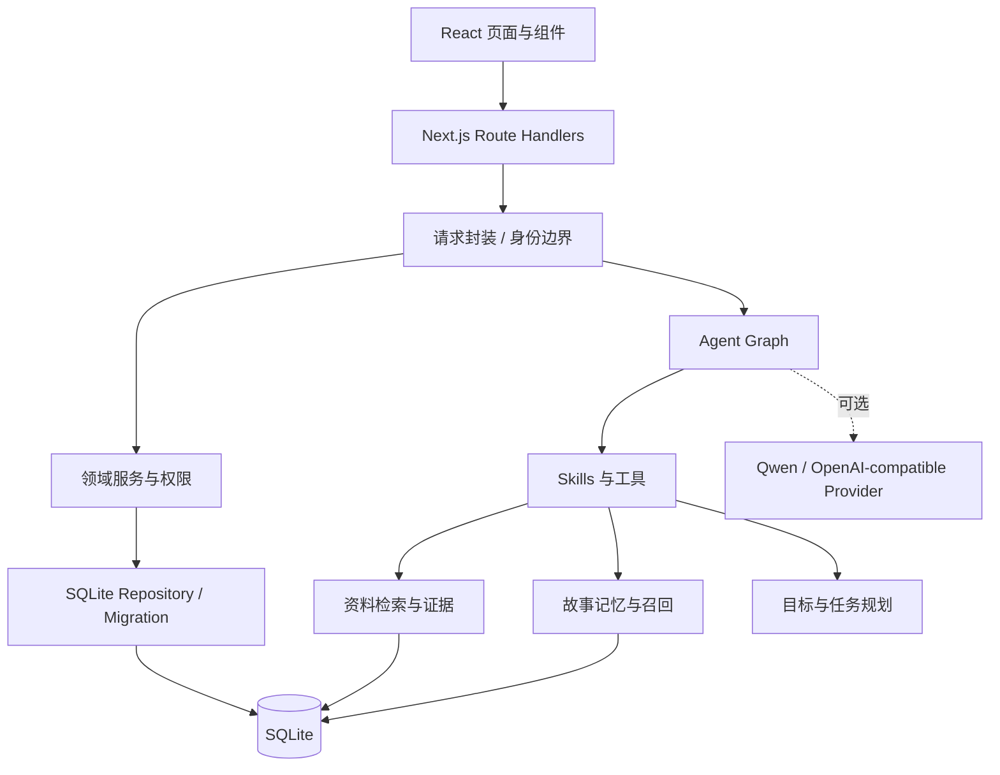
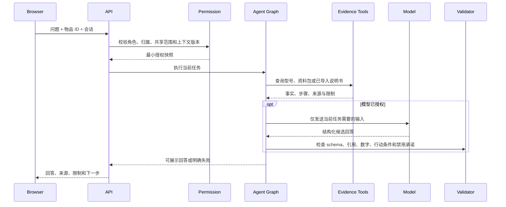

# 技术架构

## 设计目标

物间的技术重点不是把一个大模型接到页面上，而是建立一套可控的“生活上下文协议”：

1. 模型只能看到当前任务真正需要的信息；
2. 商品事实、故事记忆和行动状态各有来源与权限；
3. 模型回答需要通过证据与结构校验；
4. 写操作必须经过领域授权，不能由模型直接改数据库；
5. 本地能力在无模型、无网络时仍能完成关键体验；
6. 公开演示必须可隔离、可限额、可停止。

## 系统分层

## 关键模块

| 模块 | 责任 |
| --- | --- |
| `src/app` | 页面路由、API Route Handlers、健康检查和演示入口 |
| `src/components` | 生活首页、物品展柜、发现、故事、家庭、社交和大字模式 |
| `src/lib/domain.ts` | 物品、共享关系、任务和礼物等领域规则 |
| `src/lib/db.ts` | SQLite 打开、事务与工作区读取 |
| `src/lib/repositories` | schema、迁移、会话、生命周期和持久化 |
| `src/lib/agent` | Agent graph、工具契约、提示、校验与 SQLite checkpointer |
| `src/lib/skills` | 文档帮助、知识任务、故事整理等受限能力 |
| `src/lib/life` | 物品、资料、百科、故事、记忆、创意、任务和礼物 |
| `src/lib/cloud` | 公开访客会话、目录、Origin、配额、并发和模型费用闸门 |
| `public/demo` | 合成物品图、故事场景图及来源清单 |

## 一次物品帮助请求

这个过程解决三个常见问题：

- **越权读取**：模型不会直接拿到全屋、全历史或家庭成员的私人内容。
- **证据幻觉**：资料事实与模型生成分开表示，引用必须属于当前物品与版本。
- **静默写操作**：模型只能提出结构化行动，实际写入由服务端领域函数执行。

## 数据与记忆模型

数据被拆成不同生命周期：

- **工作区**：物品、共享关系、家庭事项和礼物状态；
- **原始故事**：用户明确保存的文字、照片、日期和关联物品；
- **派生记忆**：从获准内容提取的候选，可由用户确认、纠正或忘记；
- **会话**：为当前交流保留的有限历史，不等同长期画像；
- **资料来源**：官方页面、用户上传说明书或公开正文，保留版本与引用；
- **Agent 检查点**：恢复图执行所需的最小状态，不替代业务数据库。

私人记忆默认不进入普通商品帮助。只有当前任务与用户授权同时满足时，相关片段才能进入上下文。删除派生记忆不会自动删除原始故事。

## 证据与行动协议

说明书和商品资料会经过以下约束：

1. 绑定物品身份与资料版本；
2. 将原文切成可引用的事实或步骤块；
3. 对专属操作要求当前型号和必要前置信息；
4. 校验步骤中的数字、单位、动作与原文；
5. 拒绝模型补写的按钮、接口位置、保养周期和危险动作；
6. 资料不足时使用 `needs_info`、转人工或明确缺口，不把规格说明当作操作教程。

即使引用 ID 合法，也不代表完成了语义或实物验证。系统会继续区分“有资料支持”和“现实世界已经成功”。

## 权限模型

系统至少区分以下边界：

- 用户与演示角色；
- 物品所有者和共享成员；
- 私人故事、家庭共享事项和礼物副本；
- 本机演示、公开访问者和未来真实账号；
- 可展示内容与可发送到模型的内容。

写入接口在服务端检查当前角色和资源归属。网络 I/O 完成后还会重新检查授权与型号是否变化，防止请求期间状态漂移。

## 公开演示的隔离与成本控制

公开模式启用后：

- 入口发放随机 HttpOnly Cookie，只保存 Token 哈希；
- 每位访客写入独立目录与 SQLite；
- 校验 Origin、跨站请求和允许的数据根目录；
- 限制请求频率、并发、上传大小、单访客存储和全站存储；
- 演示空间有过期时间，可由用户主动退出；
- 模型请求只允许显式配置的 HTTPS 地址；
- 在请求发出前预留调用次数和 Token，失败与超时也计入预算；
- 可通过环境变量或 `AI_STOP` 文件停止模型费用。

## 模型边界

模型是可替换能力，不是事实来源。当前实现支持 OpenAI-compatible 文本接口，公开部署默认限制为北京百炼兼容端点并与 Qwen 配合。

模型层负责：

- 理解用户目标并选择受限工具；
- 组织自然语言；
- 在已选证据范围内生成候选；
- 根据校验错误进行一次受控修复。

模型层不负责：

- 决定用户身份或共享范围；
- 直接修改数据库；
- 创造物品型号、事实或操作证据；
- 声称已经通知真人、完成现实任务或控制设备；
- 把预置或本地规则结果伪装成在线模型输出。

## 可扩展点

- 在 `src/lib/ai/provider.ts` 增加新的兼容 Provider；
- 在 `src/lib/skills` 增加受限工具和专用校验；
- 在 `src/lib/repositories` 增加带备份的幂等迁移；
- 在 `src/lib/life` 扩展物品类型、资料协议和任务模板；
- 在 `src/lib/cloud` 扩展账号级隔离或多实例共享存储方案；
- 通过测试替身验证 Agent 协议，真实模型调用始终单独记录。

## 工程原则

- Node.js 24、严格 TypeScript、锁定依赖；
- SQLite 写入使用事务，迁移前保留备份；
- 离线测试不得依赖真实模型；
- 合成数据必须显式标记，不得进入真实画像；
- 不以 HTTP 200 代替业务成功；
- 未验证的平台、容器和实物条件必须在文档中保留为限制。
