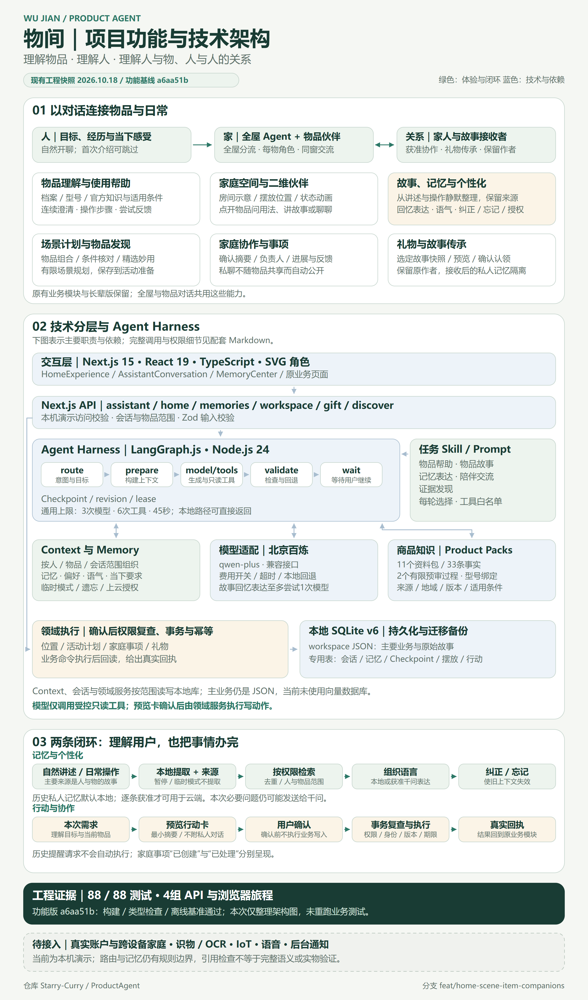
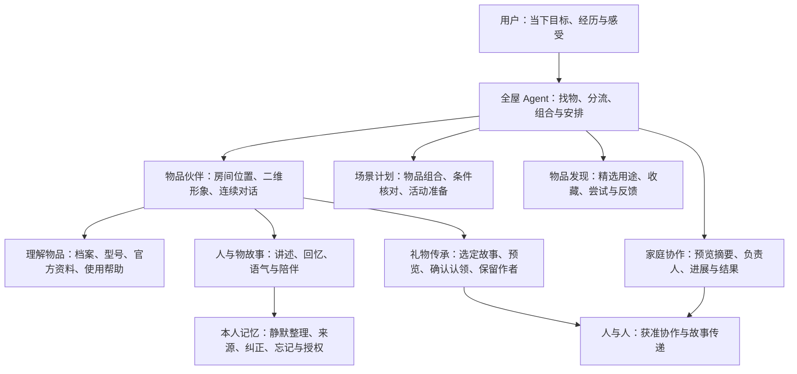
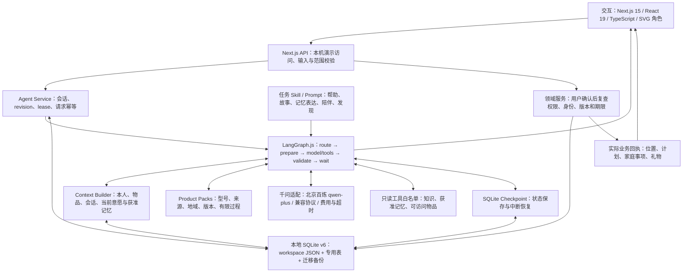
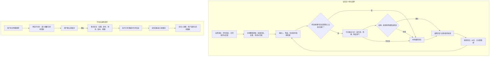

# 物间｜功能、技术与闭环架构

快照日期：2026-10-18。当前功能基线：`a6aa51b`；分支：`feat/home-scene-item-companions`。本文描述已实现工程，底部单独列出待接入能力。

**发群直接使用 [高清 PNG 架构图](architecture/project-architecture.png)**。另附 [可编辑 SVG](architecture/project-architecture.svg)、[生成与排版检查清单](architecture/render-manifest.json)。下方 Mermaid 可在 GitHub 或支持 Mermaid 的 Markdown 工具中查看和修改。

## 1. 产品功能：以人、物品和关系为中心

用户从全屋 Agent 或某件物品的二维角色进入，用同一对话窗口提问、讲述、回忆或安排事情。每个物品通过 `itemId` 隔离上下文、权限与记忆，共享同一套 Harness 和模型适配器。已有业务页面与长辈版保留。

| 功能 | 当前落地 | 边界 |
| --- | --- | --- |
| 家庭空间与角色 | 预设房间、位置保存、档案同步、类别形象与状态动画 | 位置由用户登记，动画表示交互状态 |
| 使用帮助与知识 | 型号绑定、连续澄清、官方事实、有限步骤、尝试与结果反馈 | 11 个资料包、33 条事实、2 个有限预审过程 |
| 故事、记忆与陪伴 | 正常讲述与操作中本地提取；回忆组织语言；按类别提供轻度语气 | 有限规则检索与提取；私人历史默认本地 |
| 活动准备与发现 | 可访问物品组合、条件核对、精选妙用与用户反馈 | 可保存场景限野餐、旅行、阅读角；其他可提供建议 |
| 家庭协作 | 确认摘要后创建事项，负责人处理，用户报告结果 | 本机演示身份；创建事项与完成处理分开 |
| 礼物与记忆 | 选定本人原故事快照、预览与认领、保留作者 | 私人会话和后续私人记忆不自动随物品流转 |

## 2. 技术架构：交互、Harness、领域与存储

主要依赖与职责如下。API 同时承载 Agent 入口和原业务入口，原模块可以通过自己的领域流程写入；Agent 的写动作经预览确认后执行。

| 层 / 模块 | 对应实现 | 主要职责 |
| --- | --- | --- |
| 页面与物品角色 | [HomeExperience](../src/components/HomeExperience.tsx)、[ItemCharacter](../src/components/ItemCharacter.tsx)、[AssistantConversation](../src/components/AssistantConversation.tsx) | 空间、角色、同窗对话与行动卡 |
| API 与 Agent 服务 | [API 目录](../src/app/api)、[service.ts](../src/lib/agent/service.ts)、[sessions.ts](../src/lib/repositories/sessions.ts) | 输入、角色/物品范围、连续会话、版本、租约与幂等 |
| Harness / Router | [graph.ts](../src/lib/agent/graph.ts)、[router.ts](../src/lib/home/router.ts) | 路由、上下文准备、模型/工具往返、校验、等待与恢复 |
| Skill / Prompt | [注册表](../src/lib/skills/registry.ts)、[公共 Prompt](../src/lib/agent/prompts.ts)、[记忆表达](../src/lib/skills/memory-storytelling.ts) | 每轮任务策略、工具白名单、角色表达与失败回退 |
| Context / Memory | [builder.ts](../src/lib/context/builder.ts)、[ambient.ts](../src/lib/memory/ambient.ts)、[memory/store.ts](../src/lib/memory/store.ts) | 按范围检索、来源提取、偏好/要求、纠正/忘记/暂停和云端授权 |
| 商品知识 / 模型 | [商品目录](../src/lib/products.ts)、[知识选择](../src/lib/skills/knowledge.ts)、[provider.ts](../src/lib/ai/provider.ts) | 资料约束、千问协议、费用、超时与错误处理 |
| 领域执行 | [domain.ts](../src/lib/domain.ts)、[home/store.ts](../src/lib/home/store.ts)、[planning.ts](../src/lib/planning.ts) | 权限、事务、摆放/计划/家庭事项/礼物及真实回执 |
| 存储与迁移 | [db.ts](../src/lib/db.ts)、[repositories](../src/lib/repositories)、[checkpointer.ts](../src/lib/agent/checkpointer.ts)、[migrations.ts](../src/lib/migrations.ts) | SQLite、迁移前备份、会话/记忆/Checkpoint/行动记录 |

通用 Harness 上限为 3 次模型调用、6 次工具调用、45 秒；本地指导可直接返回。记忆表达路径最多尝试 1 次模型，不开放工具，失败退回有来源的本地表达。当前只读工具是 `search_product_knowledge`、`search_personal_memory`、`list_accessible_items`，按任务开放。

注册表还有记忆采集与家庭交接契约；其实际提取、授权和事务由本地记忆/领域代码执行。它们不代表另外启动常驻 Agent 或让模型自动写数据库。

## 3. 两条闭环：记忆理解与行动执行

原始故事主要保存在 `workspace` 业务正文；派生记忆在 `personal_memories`，另有来源回执、纠正/遗忘屏障、事件与人格表。会话、请求、反馈、Checkpoint、摆放和待确认行动分别有专用表。主业务仍采用 JSON，并非所有实体都已规范化拆表。

私人历史默认不交给模型；本次必要问题仍可能送给已配置的千问。临时提问不使用/保存私人记忆，暂停停止派生整理；演示案例保持隔离。记忆中的历史提醒不是当前操作命令，助手组织过的语言也不升级为真实经历。遗忘派生记忆不等于删除原始故事作品或旧备份，具体边界见[记忆技术说明](engineering/ambient-memory-architecture-2026-10-18.md)。

## 4. 验证与待接入能力

当前功能基线的证据是 **88/88 测试、构建、独立类型检查、离线基准和四组隔离 API/Edge 浏览器旅程通过**，见[功能验收](engineering/memory-storytelling-validation-2026-10-18.json)。该轮真实模型调用为 0；历史真实千问验证见[独立记录](engineering/live-validation-2026-10-18.json)。这些不等于真实用户研究、模型语义质量保证或实物检测。

这次只生成架构资料，检查排版、文档链接以及 36 个应用源码指纹，没有重跑业务测试、读取 Key 或日常数据库。

| 当前限制 | 后续方向，尚未接入 |
| --- | --- |
| 本机演示角色与本地库 | 真实账号、跨设备家庭、同步与可靠备份恢复 |
| 图片仅作档案 | OCR、识物、说明书导入与更完整来源验证 |
| 预设房间、人工登记位置 | 更灵活的空间编辑与物品定位 |
| 有限中文路由、检索与提取 | 更强语义召回、人工评分与真实用户评测 |
| 文本对话与登记状态 | 语音、IoT、可靠后台通知与主动提醒 |

## 5. 文件与维护方式

- 发群：发送 `docs/architecture/project-architecture.png`，尺寸 **2400 × 4080**。
- 修改图形：编辑 [SVG](architecture/project-architecture.svg)；需要持续维护时修改[生成脚本](../scripts/render-architecture.mjs)，重新生成 SVG、PNG 和清单。
- 修改关系：同步本文件中的 Mermaid 与脚本图文，核对当前源码与验收基线。
- 重生成：安装现有开发依赖后，在项目根目录执行 `node scripts/render-architecture.mjs`。要求 Node24 和本机 Edge；可用 `EDGE_PATH` 指定 Edge。当前电脑也可使用 `.runtime\node24\node.exe scripts/render-architecture.mjs`。

生成器离线使用已有 Playwright/Edge，检查画布和节点文字边界，并核对功能验收中的源码指纹。图片不包含密钥、用户聊天、数据库内容或任何真实个人记录。

进一步接手请阅读 [REVIEW_HANDOFF](../REVIEW_HANDOFF.md)、[运行与分支说明](RUN_AND_BRANCH_HANDOFF.md) 和[本轮记忆表达设计](engineering/memory-storytelling-2026-10-18.md)。
