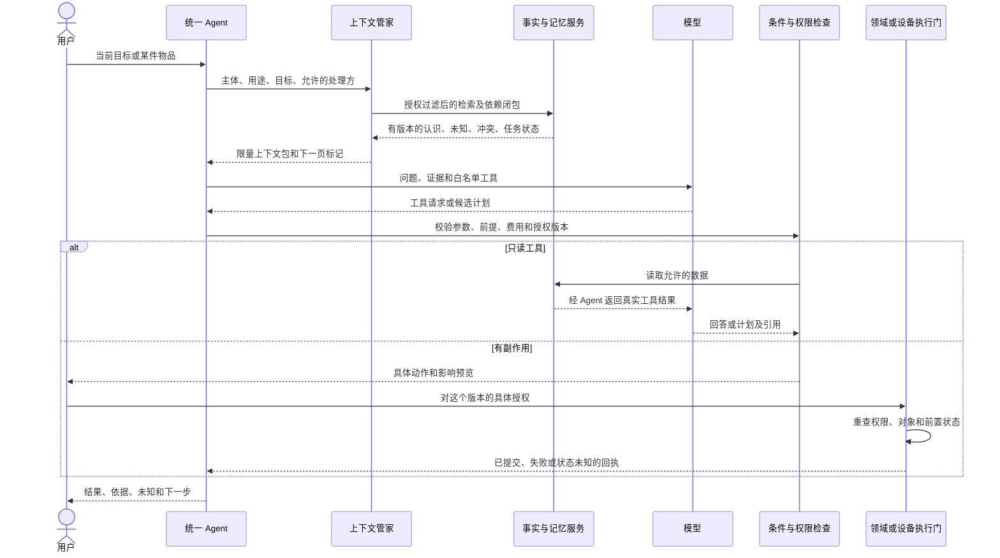

# 统一 Agent：把认识、决策和执行分开

状态：拟定；不在本轮替换运行框架。现有 main 的 [graph.ts](../../src/lib/agent/graph.ts)、[context/builder.ts](../../src/lib/context/builder.ts)、[skills/registry.ts](../../src/lib/skills/registry.ts) 是迁移起点。修复分支已经有富物品读取、4 回合工具循环和条件变化保护，应先纳入兼容测试，不能回退到公开单回合。

## 一个协调员，五个有边界的服务

1. **IntentResolver**：产出目标、入口物品、限制和不确定指代，不直接做写入。否定、指代和多个目标用结构化结果，不用关键词路由直接宣布“没有物品”。
2. **ContextBroker**：按本次用途授权，检索物品、知识、用户、关系、当前任务；负责来源、冲突、预算和失效检查。
3. **Reasoning / Planning**：解释或提出创意与计划，输出结构化假设、依赖和需要的工具。
4. **Policy / Validation**：检查事实引用、前提、未知、计划可执行性、权限和预算。文本正则保留为有限兜底，不作为主要认知算法。
5. **ExecutionGateway**：处理已授权的领域命令和设备适配器；持有凭证，核对状态，提交回执。模型不直接执行 SQL、shell 或任意网络请求。



## 检索不是把全部记忆塞进提示词

拟定输入与输出：

```typescript
interface ContextRequest {
  principalId: string; workspaceId: string;
  purpose: 'item_help' | 'creative' | 'task' | 'reflection' | 'device_exploration';
  question: string; itemIds: string[]; activeGoalId?: string;
  personaId?: string; processor: 'local' | 'model_provider';
  maxInputTokens: number;
}
interface ContextBundle {
  schemaVersion: 'wujian-context-v2'; policyEpoch: number | null; policyStamp: string;
  resources: ResourceSnapshot[]; claims: Claim[]; capabilities: Capability[];
  userUnderstanding: Claim[]; relations: Claim[]; activeTask: PlanSpec | null;
  missing: RequiredFact[]; conflicts: Conflict[];
  snapshotRefs: RevisionRef[]; nextCursor: string | null;
}
```

现有 `Item` 没有通用持久 revision 字段，现有 memory epoch 也不是所有资源的授权版本。P1 不能假造这些能力：只读适配器以授权投影的规范化内容生成不可变 claim ID（包含来源 digest），投影内 revision=1；快照采用下列分型。`policyStamp` 是服务端当次许可/处理方规则的摘要，非认证凭据；P1 的 `policyEpoch=null`，发送/执行前重新查询当前权限并比较适当内容快照。不能用同一个虚拟 revision=1 判定物品从未变化。P2 才在权威写路径增加事务式资源修订与持久授权 epoch；之后也必须重查权限，不能只信客户端带回数字。

```typescript
type RevisionRef =
  | { backend: 'legacy'; id: string; contentDigest: string; policyStamp: string }
  | { backend: 'v2'; id: string; revision: number; policyEpoch: number };
```

摘要与 digest 只覆盖本次获准投影，不通过暴露私有字段哈希或总条数泄露隐藏变更。原来源定位和内部内容哈希仍由服务管理；旧库直接写入也会改变下次读取的内容快照，不依赖新写钩子才能检测。

处理步骤：先由服务端得到 Principal；解析显式物品 ID／当前任务；按 workspace、读用途、处理方和来源闭包过滤，再检索和排序。即使只返回摘要，也必须满足每个派生来源的权限交集。不能先全库向量检索再在模型端过滤，更不能透露隐藏记录数量、标题或 ID。

候选召回由显式 ID、当前任务依赖、时间与关系边、关键词全文召回、可选向量召回共同组成。可用一个起始排序式 `0.35*目标相关 + 0.25*任务关联 + 0.15*显式关系 + 0.15*时效 + 0.10*可靠度`，权重只是实验初值；硬权限、撤回、冲突和用户本次否定条件不参与软打分，直接裁决。用户明确纠正优先于旧推断，不允许高相似度旧偏好覆盖当前愿望。

预算先保留本次指令、硬限制、对象身份、必要证据和执行状态，再压缩历史。压缩产物带 parentClaimRefs；原来源不可读或被忘记，摘要也不可读。超预算时按必要性减少候选并返回未检索完标记，不能静默省略限制、假装已看完全部库存。

## 认识循环与长任务

```text
Observe -> Resolve -> Retrieve -> Propose -> Validate
  -> ask_needed_fact | await_authorization | execute | answer
  -> record_outcome -> propose_memory_update
```

模型提出记忆更新是候选，不直接改用户画像。用户确认或符合已同意的低敏自动记忆政策后，由业务事务写入；来源、极性、有效期与替代关系必填。任务继续时先看已完成步骤和实际回执，而不是仅靠聊天摘要猜测“上次已经做完”。

任务状态拟定为 `draft -> needs_info -> ready -> awaiting_authorization -> running -> awaiting_observation -> completed`；还可 `failed / cancelled / stale`。paused 是调度状态，不等于用户确认。模型调用超时、方案不合格、用户缺信息、预算不足、权限变化各有 typed error，不能统一变成 needs_info。

模型回合、工具执行次数、token／金额、总墙钟时限分别限制。值先沿用修复分支的有限循环作为基线，实验再按任务类型配置；每次实际 HTTP 尝试在发送前持久记账，重启后未知尝试不能漏算。不能为了给最终答复留回合就绕过用户总预算。

## 工具与命令契约

| 拟定接口 | 输入重点 | 输出重点 | 权限与副作用 |
| --- | --- | --- | --- |
| item.list / item.read | ID、分页、任务用途 | 实例快照、事实引用、未知、下一页 | 继承修复分支的读取范围，内部 V2 协议通过适配器暴露 |
| knowledge.lookup | subject、predicate、型号版本 | 原文定位、断言及冲突 | 网络另有来源许可；资料内容不是系统指令 |
| memory.retrieve | 任务、人物／事件关联、purpose | 有源记忆与当前认识 | 不默认读取所有私聊；跨分身仍核对处理方授权 |
| creative.propose / plan.validate | GoalSpec、能力快照 | ConceptGraph、条件结果、PlanSpec | 无硬件副作用；候选不等于已保存计划 |
| memory.propose / memory.correct | 来源、候选／原版本 | 可审阅差异 | 写入走领域命令，模型不能自授 accepted |
| device.explore | 目标、获准目标与材料、风险级别 | 探索状态、证据、候选适配器 | 不把探索许可解释为控制许可 |
| command.preview / command.commit | 对象、payloadHash、expectedRevision、requestId | 一次性确认凭据和幂等回执 | 凭据由服务器绑定具体动作、过期时间和主体；重查后提交 |

工具统一返回 `status, data, evidenceRefs, missing, retryable, sideEffect, nextCursor`。只有传输可重试不代表动作可重试；已调度但没回读的设备动作标 `indeterminate`，先核对，不重复 toggle。只读错误同样要送回模型，让它有机会换路线或说明缺口。

## 运行框架是外壳，不是领域记忆的主人

拟定边界 `AgentRuntime.run(input, contextProvider, toolRegistry, budget, eventSink)`，事件统一为 context_loaded、tool_requested、tool_finished、proposal_ready、authorization_needed、execution_observed、failed。LangGraph 与 Pi 的差异留在适配层，不让 Persona、PlanSpec、权限表或记忆变成框架私有消息格式。

现有 SqliteCheckpointer、interrupt、请求幂等和 memory epoch 有价值，应继续测试。[LangGraph 持久化](https://docs.langchain.com/oss/javascript/langgraph/persistence)、[中断](https://docs.langchain.com/oss/javascript/langgraph/interrupts)。是否切到 Pi Durable，要用相同业务工具检验崩溃、暂停、撤权、费用与幂等，详见 DECISIONS；本 RFC 没有做此替换。

## 防幻觉的实际边界

最终回答每个会影响行动的性质都应引用 claimRef 或标成假设；服务端核对引用是否存在、版本匹配、作用范围和所需前提。推断可以帮助探索，不能成为“已确认能力”。物理规则、类型检查和资料引用只能排除部分错误，不能替代实物测试。遇到无法验证的机制，应输出条件式候选、询问关键事实或换不依赖它的方案，不能靠免责声明放行。
