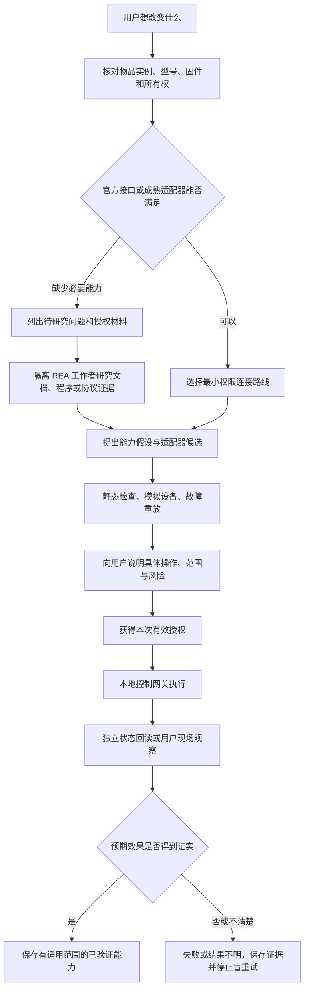

# 设备能力探索：研究不等于控制成功

状态：V2 提案；2026-10-29。本轮没有安装 REA、扫描网络、配对、操作设备或修改固件。案例中的灯、电视和协议字段都是合成测试数据。

## 1. 产品目标与已有边界

设备探索服务于用户目标，例如“把灯接入拍摄流程”“改变电视启动后看到的内容”。不要把“支持某个工具”当成已支持某种设备。

现有工程已经有 [技能注册](../../src/lib/skills/registry.ts)、[动作校验与执行](../../src/lib/agent/graph.ts) 和 [物品知识获取](../../src/lib/life/acquisition.ts)。它们是可复用的业务入口；当前源码没有本 RFC 定义的通用 REA 研究工作区、适配器认证流程或真实灯/电视验收证据。现有模拟动作不能升级表述为物理控制。

## 2. 完整流程



不能跳过目标匹配。例如接口只能开关灯，不能证明支持可调色温；能控制电视开关，不能证明能替换首页或减少广告。

## 3. 路线选择表

| 路线 | 适用条件与具体收益 | 不应承诺的能力 | 接入位置 |
| --- | --- | --- | --- |
| 厂商官方接口/现有可信适配器 | 有文档、合法凭证、型号与地区匹配，优先复用已有操作和状态语义 | 某品牌全型号通用；接口存在就没有云端依赖 | 本地网关或授权云连接器 |
| Home Assistant | 用户已有 HA 或愿意独立部署；复用设备实体、服务、状态订阅 | HA 的状态记录本身就是物理事实；一个 HA 令牌天然只允许一个实体 | Wujian 网关再限制实体和操作；密钥不进入模型 |
| Matter | 实际设备、控制器和网络满足 Matter 条件；适合标准能力互通 | Thread 等于 Matter；蓝牙配网等于运行期 GATT 控制；标准能覆盖厂商所有功能 | 复用已有控制器；需要时核查 Thread 边界路由与 IPv6 |
| ESPHome | 用户拥有受支持硬件和可控固件，已有 native API 时可连接 | 任意成品灯或电视都能无损刷入；刷固件是普通开关操作 | 优先复用 HA；否则隔离 native API 适配器 |
| Bleak | 已配对/可合法连接的 BLE GATT 设备，且特征值协议已知或可研究 | 找到 UUID 就知道命令含义；能扫描就能安全写入 | Python 本地工作者，通过同一工具契约服务 Node 应用 |
| REA | 官方路线不满足具体目标；有授权的软件、固件、日志或协议材料 | 自动绕过权限、自动获得控制能力、生成后直接上线 | 隔离研究工具层，输出证据和候选，不能直接取得执行权限 |

依据：[HA 架构](https://contributors.home-assistant.io/architecture/core/)、[REST](https://contributors.home-assistant.io/core/internals/rest-api/)、[WebSocket](https://contributors.home-assistant.io/core/internals/websocket-api/)、[Matter 接入条件](https://www.home-assistant.io/integrations/matter/)、[ESPHome native API](https://esphome.io/components/api/)、[Bleak 官方文档](https://bleak.readthedocs.io/en/latest/)。实际兼容性须在选定设备上复核，本轮不据文档宣称本机已兼容。

## 4. REA 的正式位置和接入契约

本 RFC 的 REA 指 [rea.tools](https://rea.tools/) / [morluto/rea](https://github.com/morluto/rea)，不是名称相似的第三方克隆。2026-10-29 查询：Git HEAD `429355ca4d1078579fca7d286de85c512bed0a96`；npm `rea-agents` 6.8.0 的 Node 范围为 `^22.23.4 || ^24.22.1 || >=26.12.1`。当前工程运行时是 Node 24.16.0，**不满足该版本要求**。未来应锁定经过验证的 REA 版本、包完整性和独立工作者环境，不为研究工具擅自升级应用全局运行时。[官方 README](https://github.com/morluto/rea/blob/429355ca4d1078579fca7d286de85c512bed0a96/README.md)、[npm 元数据](https://registry.npmjs.org/rea-agents/6.8.0)。

REA 是研究工具集合，不是物间的授权系统。固件与 APK 等分析路径依赖不同原生工具和平台；不能因 CLI 支持 Windows 就假设每个固件工具都支持。安装前按任务核对官方提供者要求，特别是固件解包链路。[固件分析文档](https://github.com/morluto/rea/blob/429355ca4d1078579fca7d286de85c512bed0a96/docs/firmware-analysis.md)。

拟新增 Wujian 包装接口（下面不是声称 REA 已有的工具名）：

```ts
type ExplorationRequest = {
  taskId: string; principalId: string; workspaceId: string;
  itemId: string; itemRevision: number; goal: string;
  allowedArtifactIds: string[]; allowedQuestions: string[];
  mode: 'offline_artifacts' | 'authorized_observation';
  grantId: string; policyEpoch: number; maxSeconds: number;
};
type ExplorationResult = {
  status: 'evidence_ready' | 'partial' | 'failed';
  evidenceRefs: string[]; hypotheses: string[];
  missing: string[]; candidateAdapterId?: string;
};
```

包装器发现已锁定版本的实际工具目录后，只开放任务所需工具与文件、目标设备白名单；未知工具默认拒绝，不能向模型开放任意 shell、全盘文件或无限制 MCP 转发。外来文档、程序字符串、日志都作为不可信数据，里面的指令不能修改授权。

REA 的结果应保留原始记录与结构化结果的联系，读取其 `structuredContent.normalized_result`、`evidence_id` 和适用的分析配置；通过 `get_evidence_bundle` 获取证据包。超时、取消时仍可有部分证据，不把部分结果包装为完整验证。[官方 MCP 契约](https://github.com/morluto/rea/blob/429355ca4d1078579fca7d286de85c512bed0a96/docs/mcp-contracts.md)。原始文件含私人流量、设备标识或凭证时留在受控存储；模型只得到授权片段，秘密值单独进凭证库。

研究记录包含问题、工具/版本、输入哈希、输出证据、限制、失败和耗时。授权材料的访问范围随派生证据传播；“来自公开固件”也不自动证明适用于用户的硬件修订。

## 5. 适配器是可审核的执行包

```json
{
  "id": "adapter:synthetic-lamp-v1",
  "digest": "sha256:fixture-only",
  "applicability": {"modelId": "model:fixture-lamp", "firmware": "fixture-1"},
  "transport": "local_gateway",
  "targetAllowlist": ["device:fixture-lamp"],
  "operations": [{
    "name": "set_power", "input": {"on": "boolean"},
    "risk": "bounded_state_change", "idempotency": "desired_state",
    "readback": {"field": "power", "freshWithinMs": 3000},
    "timeoutMs": 5000, "automaticRetry": false
  }],
  "secretRef": "vault:fixture-reference-only",
  "evidenceRefs": ["evidence:protocol-fixture"],
  "status": "candidate"
}
```

这只是候选清单。签名或哈希用于绑定审核版本，不证明代码安全或协议语义正确。构建时静态检查网络/文件访问；模拟目标验证输入范围、故障和回读；实际部署采用可回收的受限进程与设备连接白名单。任何依赖升级或摘要改变都需要重新审查。

控制接口采用 `preview(command) -> intent -> authorize(intentDigest) -> execute(intent)`。执行前再次核验用户、物品、适配器摘要、权限版本、预期状态、有效期和幂等键。设备离线或权限撤销不能由 Agent 自行“修好权限”。优先 `set_power(true)` 而不是 `toggle`，但最终是否安全重试仍取决于设备协议。

操作回执状态：`prepared -> dispatched -> acknowledged -> observed -> verified`，旁路为 `failed` 或 `indeterminate`。数据库事务不能包住外部世界；使用本地发件箱、每设备执行租约和回执恢复，避免并发冲突。进程在发送后崩溃时，先回读再决定是否重试；没有回读和去重语义时报告结果不明，不宣称“恰好执行一次”。HTTP 成功或网关 ACK 只证明通信阶段成功。

## 6. 风险、验证与失效

| 等级 | 例子 | 授权及停止条件 |
| --- | --- | --- |
| R0 离线材料 | 用户提供的手册、APK、固件副本分析 | 材料与模型处理授权；不连接设备 |
| R1 被动观察 | 限定目标的状态/协议日志 | 明确范围，排除其他家庭成员流量；到期停止 |
| R2 配对读取 | 已授权设备的 GATT 读取 | 配对与读取授权；不推导出写权限 |
| R3 有界控制 | 灯亮度、电视音量 | 操作预览、输入边界、回读、超时与取消 |
| R4 高风险改变 | 刷固件、root、启动链或不可逆设置 | 单独方案、恢复路径及人工决定；不由探索任务自动升级执行 |

验证记录绑定 `itemId + itemRevision + firmware + adapterDigest + operation + environment + observation`。状态回读若只是软件缓存/乐观估计，需标明；涉及真实效果仍需独立传感器或用户现场观察。型号、固件、关键网络条件变化后将能力置为 `stale`，重验前不能继续表述为已验证。

灯的首个验收只做开关与状态；电视先分别判断“官方启动设置”“可用启动器/接口”“与广告有关的设置”的能力。没有依据时给出不能确认，不把网络过滤、替换首页或刷机当成通用可行路线。禁止用读取到的令牌、配对材料扩大权限。

研究任务状态：`draft -> scoped -> researching -> evidence_ready -> adapter_candidate -> sandbox_passed -> awaiting_authorization -> verifying -> verified`；任何阶段可 `failed / cancelled / stale / revoked`。控制回执与研究状态独立：研究完成不等于设备已执行。

## 7. 下一阶段的最小实验

先使用模拟灯验证同一执行契约下的成功、超时、迟到回读、发送后崩溃、授权撤销、固件变化六类情况；不需要安装 HA、Matter、ESPHome、Bleak 全家桶。模型只读 REA 证据替身，不能绕过网关。通过后由产品负责人选择一台自有设备和单一目标，再确定连接路线与实际验证授权。详见 [案例 C](ACCEPTANCE.md)。
