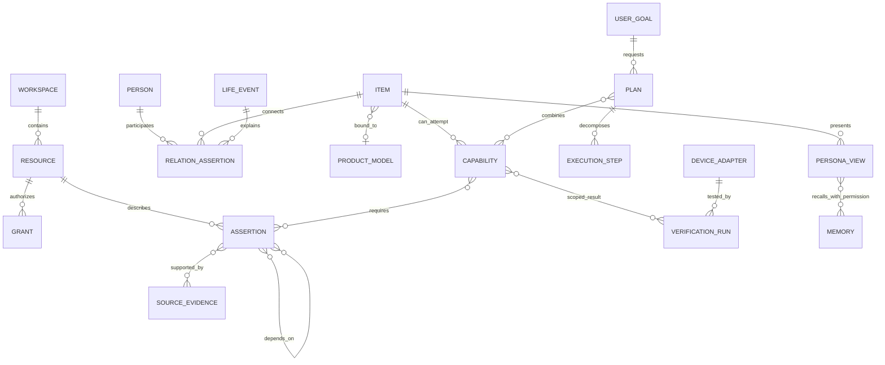

# 领域模型：物品、证据、能力与关系

状态：拟定 V2 契约。本轮不执行迁移。字段是可开发的最小协议，不要求一次把所有实体建成物理表。

## 先看代码里真正有什么

| 已实现 | 真实来源与限制 |
| --- | --- |
| 物品实例、固定演示人物、任务、赠礼 | main 的 [domain.ts](https://github.com/Starry-Curry/ProductAgent/blob/ea32c3f4c9e18992ca267b6dd74e26e418c9e95a/src/lib/domain.ts)：物品含 attributes、availability、productBinding；Person 是三个演示角色，不是真实账号 |
| 工作区整体 JSON + 多组关系表 | [db.ts](../../src/lib/db.ts)、[life/schema.ts](../../src/lib/life/schema.ts)、[foundation-schema.ts](../../src/lib/repositories/foundation-schema.ts)：物品／部分任务在 workspace.body，故事、媒体、记忆、会话等已有独立表 |
| 资料与来源 | [acquisition.ts](../../src/lib/life/acquisition.ts)：型号身份、文档 hash、引用块；还没有覆盖所有用途的统一断言与依赖模型 |
| 修复分支的统一物品卡 | [items.ts](https://github.com/Starry-Curry/ProductAgent/blob/8eca3d72fc93fce9d4cdb27b1ccd6bd70973a52e/src/lib/context/items.ts)：有 ID、属性、来源和未知；是应保留的适配起点，不是完整 V2 能力图 |

下图是拟定的**逻辑关系**，不是要求立即创建同名表。



## 1. 身份与边界

`WorkspaceId` 是家庭／个人空间边界；`PrincipalId` 来自认证适配器，不接受模型或浏览器自报 actor。人作为故事中的人物（PersonNode）和真实账号（Principal）不是一回事：朋友可以出现在关系记忆里而从未注册账号。

main 的 [auth.ts](../../src/lib/auth.ts) 明确只提供受限 local-demo 模拟；公开访客隔离也不等于真实家庭成员认证。P1 使用合成主体与现有隔离，正式多用户/家庭共享及私人设备控制前必须接入可验证会话、成员/角色关系和服务端 Principal 适配器。可复用成熟身份提供方或可信本机单用户入口，不现在空建一整套账号表；未满足该前提时不得开放跨用户私人数据或真实设备权限。

`Resource` 是权限和版本的目录，只有 `id, workspaceId, kind, ownerId, revision, lifecycle, legacyKey?`，**不放任意业务 JSON**。typed kind 区分 item、product、person、event、assertion、source、memory、persona、plan、adapter 等。使用哪种实体才创建相应记录，不为所有物品预建分身或设备任务。

`ItemInstance` 保留稳定身份、用户命名、照片引用、数量／可用状态修订和产品绑定。产品知识属于 `ProductModel` 的品牌、型号、地区、硬件／固件版本范围；用户确认铭牌只是绑定证据，不等于认证材质或实物功能正常。设备地址、配对凭证和访问令牌不放在模型上下文或公开资产 URL 中。

上述资源修订是 V2 目标，不是 main 的现成字段。P1 以内容寻址的只读投影与 legacy 快照摘要检测变化，不能声称旧 Item 已有单调 revision；P2 切换权威写路径后才分配持久版本。过渡契约见 [Agent 设计](AGENT_DESIGN.md)。

## 2. 一条认识必须回答“谁说的、适用于什么、何时有效”

```typescript
type ClaimBasis = 'user_report' | 'source_extract' | 'ai_inference'
  | 'user_observation' | 'device_observation';
type ClaimStatus = 'candidate' | 'accepted' | 'disputed' | 'superseded' | 'retracted';
interface Claim {
  id: string; workspaceId: string; subjectId: string;
  predicate: string; value: unknown; revision: number;
  basis: ClaimBasis; status: ClaimStatus; confidence: number | null;
  validFrom: string; validUntil: string | null;
  sourceIds: string[]; parentClaimRefs: { id: string; revision: number }[];
}
```

`accepted` 表示这条记录已进入可用认识，不表示已物理验证。用户亲口报告的材质可以 accepted + user_report；模型推断仍是 ai_inference，即使 confidence=0.99。未知用显式 missing/unknown，不用 false、不用空字符串，也不从“未记录防水”推出“不防水”。

`predicate` 由小型类型注册表定义，例如 `item.material`、`item.dimensions`、`item.foodContact`、`preference.activity`、`relation.gifted`。值有单位、允许范围、主体类型和纠正策略；不靠自由拼写产生无数同义字段。尺寸统一单位后保留原值和转换来源；转换不提高可信等级。复杂结构先以带出处的描述保存，不凭照片自动生成精密几何参数。

```json
{
  "id": "claim:box-dimensions",
  "workspaceId": "home:synthetic",
  "subjectId": "item:box-1",
  "predicate": "item.dimensions",
  "value": {"length": 0.20, "width": 0.15, "height": 0.10, "unit": "m", "original": "20×15×10厘米"},
  "revision": 1,
  "basis": "user_report",
  "status": "accepted",
  "confidence": null,
  "validFrom": "2026-10-29T00:00:00+08:00",
  "validUntil": null,
  "sourceIds": ["source:intake-box"],
  "parentClaimRefs": []
}
```

`SourceEvidence` 指向版本固定的资料页、原文片段、用户陈述、照片或观察回执；包含 `artifactSha256, locator, capturedAt, sourceKind, modelApplicability, scopeResourceIds`。官方域名只是一条来源属性，不自动证明所有摘录正确或覆盖当前型号。资料摘要是派生认识，必须追溯到实际片段；照片是证据载体，模型识别是另一条推断。

冲突不覆盖：旧报告“木框”与新报告“金属框”并存为 disputed，记录哪条 supersedes 哪条、谁确认、有效时间。撤回来源时依赖它的能力和计划标 stale；不能由“较高分数”静默获胜。当前物理状态、用户本次限制优先于旧偏好，但不改写历史事件。

## 3. 能力是带条件的功能，不是标签清单

```typescript
interface Capability {
  id: string; subjectId: string; revision: number;
  effect: { verb: string; input: string[]; output: string[] };
  requirements: PredicateExpr[]; basisRefs: ClaimRef[];
  status: 'inferred' | 'conditional' | 'verified' | 'failed' | 'stale' | 'revoked';
  verificationRefs: string[];
  applicableTo: { itemRevision: number; modelRevision?: string; firmware?: string; environmentHash?: string };
}
```

纸盒可作为遮挡物是一项候选能力；装重物需要承重、结构与状态条件；“调亮灯”需要适配器、设备身份和配对权限。物理与数字能力共用 `effect + requirements + evidence`，执行方式不同。`verified` 必须引用有范围的观察或实测回执；一次成功只验证对应物品、版本、环境和参数区间，不升级整个类别。

能力不是直接由大模型写成执行权限：模型可以提出 inferred，领域服务核查来源、条件和风险后才决定是否可推荐或进入验证。`conditional` 的前提只能放行对应性质，确认食品接触不能同时放行耐热、承重或光学能力。

## 4. 用户、关系、记忆、分身与计划

| 对象 | 最小内容 | 为什么不混在一起 |
| --- | --- | --- |
| 用户认识 | 有来源的兴趣／偏好、能力限制、有效期、正负极性 | 不能把一次行为、情绪或送礼推成长期事实 |
| 关系断言 | 参与资源及角色、谓词、事件、有效期、证据 | “朋友赠送”可关联画、赠送者、接收者与事件，不能靠一段自由文本才能找回 |
| LifeEvent / Memory | 原始故事／照片与可纠正的派生摘要分开；引用来源和参与者 | 删除摘要不默认删照片；遗忘要阻止从仍保留的故事自动再生成同一认识 |
| PersonaView | 名字、形象媒体引用、语气配置、关联物品、可见位置、允许召回范围、互动开关 | 不包含拥有更大权限的独立账号，也不复制全用户画像 |
| Goal / PlanSpec | 本次成功标准、限制、所用能力和事实版本、步骤依赖、未知、状态与确认 | 创意是候选计划；保存、执行、观察成功是不同状态 |
| Adapter / VerificationRun | 代码与 manifest 摘要、支持范围、作用、回读、失败与授权回执 | 研究结果、可执行软件、实测能力是三个不同对象 |

关系例子：`relation.gifted` 的 value 包含 `giverId, recipientId, itemId, eventId`。只承认用户报告了赠送；“珍惜朋友”另建推断候选。共享画的物品信息，不等于共享包含赠送者的私人聊天。

## 5. 数据库按需求建，不按概念数量建

**P1 不新增业务表**：用旧库只读适配器生成上述契约，先证明上下文能共用。**P2 才试验七个知识核心表**，草案见 [knowledge-core.sql](contracts/knowledge-core.sql)，只在本轮检查器的内存库编译：

| 拟定表 | 需要它的首个真实操作 |
| --- | --- |
| v2_resources | 为画、朋友、证据和断言分配可授权、可修订的身份 |
| v2_item_state | 保存物品实例及操作状态；不把可用性埋进通用 EAV |
| v2_sources | 保留录入陈述／资料／照片定位和 digest |
| v2_assertions | 记录材质、型号、关系等原子认识和认知类型 |
| v2_provenance | 断言到原来源或上游断言的依赖，支持纠正／遗忘失效 |
| v2_grants | 对具体资源、用途、动作和处理方授权；私密内容默认不分享、不上云 |
| v2_operations | 写入请求 hash、幂等回执和状态，避免导入／确认重复写入 |

资源目录不替代强类型领域服务。SQL 外键阻止跨空间引用；主体类型、谓词值、来源闭包、循环依赖和撤权需要事务中的服务校验，不能声称 SQL 已证明全部安全。

P3 出现跨会话关系和分身需求后才增加 memory/persona 的版本投影，或改造已有 personal_memories/persona_profiles；有稳定候选反馈后才持久化能力投影与 PlanSpec。有首个设备验证任务才建 exploration/adapter/verification 表。初期沿用现有 life_fragments/media，保留媒体权限和原 ID 映射，不一次新建整套相册、社交、图数据库和向量库。

## 6. SQLite 是否足够

阶段性判断：足够支撑单机／单写服务的个人与家庭试点。关系与依赖可以用普通索引和递归查询，授权过滤后再做全文检索；FTS5 不是中文语义检索的自动答案，需验证分词与召回，向量索引可晚于正确性契约。SQLite 不自动提供租户行权限，必须由服务统一约束。[SQLite 适用场景](https://www.sqlite.org/whentouse.html)、[WAL 并发边界](https://www.sqlite.org/wal.html)、[FTS5](https://www.sqlite.org/fts5.html)

未来若多台应用需要同时写同一个库、后台任务写锁长期竞争、P95 等待超出事先基线，评估 PostgreSQL；不把活跃 SQLite 放网络盘共享写。变更数据库前记录并发、锁等待、备份恢复和成本证据。媒体先保留 BLOB，实际体积和备份变慢后再迁本地对象目录／对象存储，权限引用不变。迁移、WAL 快照与删除后的回滚限制见迁移方案。
