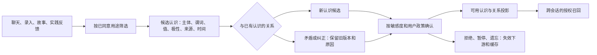

# 理解用户、关系记忆与物品数字分身

状态：V2 设计。现有代码已具备跨会话 personal_memories、persona_profiles、来源事件、记忆 epoch、遗忘和故事召回，不能说 V1 没有记忆。缺的是统一的关系、依赖失效与可纠正认识协议。[memory/store.ts](../../src/lib/memory/store.ts)、[ambient.ts](../../src/lib/memory/ambient.ts)、[organization.ts](../../src/lib/life/organization.ts)

## 四层记忆，各司其职

| 层 | 内容与例子 | 生命周期与使用方式 |
| --- | --- | --- |
| 原始事件 | 用户明确保存的故事、照片、赠送事件、操作反馈 | 原文与媒体独立授权；不自动全部进入模型 |
| 情节记忆 | “朋友去年送我这幅画，我那天很开心” | 引用事件、人物、物品和时间；可压缩但不能丢来源或把虚构当实事 |
| 用户认识 | “偏好安静活动”“目前不方便举重物” | 有来源、极性、有效时间和状态；长期偏好与当前限制分别存放 |
| 工作记忆 | 当前目标、已问条件、尝试过的步骤、待确认动作 | 绑定会话／任务；任务结束后按政策清理，不自动升级长期偏好 |

没有“一个永久不断增长的大摘要”。摘要、关系边和向量都是可重建的投影；原始事件和已接受认识才是有版本的业务记录。认识可以互相冲突，不能用最后一条聊天直接擦掉真实历史。

## 拟定写入循环



初次使用拟提供“只在当前聊”“明确说记住才保存”“低敏线索自动整理、随时可改”三种模式。原型保守默认只处理本次上下文与明确保存；低敏自动候选整理是可选政策，需下一阶段产品决定和用户同意后启用，不默认所有私聊永久上云。敏感情绪、健康、关系冲突、第三方隐私不因用户选择自动整理而自动成为长期事实。

模型提取器输出候选，不拥有 accepted、verified 或扩大权限的字段。统一服务把显式“记住我喜欢安静活动”与“这次选择安静活动”区别处理：前者可按授权接受为用户报告，后者最多形成低置信推断候选。一次说“今天累了”不能变成长期能力下降或疾病判断。

### 关系必须能单独表达和追溯

```json
{
  "id": "claim:gift-painting",
  "workspaceId": "home:synthetic",
  "subjectId": "event:gift-2026",
  "predicate": "relation.gifted",
  "value": {"giverId": "person:xia", "recipientId": "person:owner", "itemId": "item:painting-1", "eventId": "event:gift-2026"},
  "basis": "user_report",
  "status": "accepted",
  "confidence": null,
  "validFrom": "2026-10-29T00:00:00+08:00",
  "validUntil": null,
  "sourceIds": ["source:story-gift"],
  "parentClaimRefs": [],
  "revision": 1
}
```

这使系统可以从画找到赠送者、从朋友找到获准共同经历、从事件找到照片，而不是只靠文字相似度。另一条“我喜欢这幅画”不等于“我喜欢全部抽象画”；“朋友送的”更不能推断亲密程度。关系中出现的人不自动获得任何读取权限。

## 纠正、变化与遗忘

| 用户表达／事件 | 拟定行为 |
| --- | --- |
| “不是朋友送的，是我自己买的” | 新报告指向原认识，原关系标 disputed/superseded；失效相关摘要；不改原故事文字，除非用户要求 |
| “以前喜欢，现在不想做手工” | 结束旧偏好当前有效期，增加当前负向偏好；保留历史发生过，不再据旧偏好推荐 |
| “今天不拍照” | 仅约束当前目标；不自动形成终身偏好 |
| “忘掉这件事，但保留照片” | 撤回选定记忆及下游认识；照片保留但不再自动提取同一主题；说明范围 |
| “删掉这段聊天和从中记住的内容” | 删除原消息可用正文、撤回来源和派生节点，更新 policyEpoch，失效缓存／索引／检查点中的内容；运行中上下文停止 |

遗忘事务先写不可召回状态和失效栅栏，再异步清索引和摘要；异步清理没结束时也不能读到旧内容。为保留故事但不再提取的情况，存最小 `suppression(resourceId, predicateFamily, epoch)`，不在 tombstone 中复制秘密原文。模型提供方已处理的数据、对方已保存的赠礼副本和旧离线备份不能凭本地按钮保证全球抹除，界面应说明可控制范围。

备份保留期拟定 30 天，待产品确认；恢复旧快照必须先应用最新遗忘／撤权栅栏，否则不可对外服务。若无法取得最新栅栏，不回退旧权限开放读取。必要时选择停止服务，而不是“回滚成功”后复活已删除的记忆。

## 数字分身是受限的呈现视图

```typescript
interface PersonaView {
  id: string; itemId: string; revision: number;
  displayName: string; avatarMediaId: string | null;
  style: { tone: string; vocabulary: string[]; fictionalTraits: string[] };
  visibleOn: ('item_list' | 'home' | 'item_detail')[];
  memoryScope: { resourceIds: string[]; allowedPurposes: string[] };
  interaction: { remindersEnabled: boolean; quietHours: string | null };
}
```

`memoryScope` 只能缩小当前用户权限，不能授予新权限；每次会话使用 Principal + item + purpose 再计算交集。名字、头像、性格是用户选择的创作内容；不能把“我是一幅乐观的画”写成实物会感知心情的能力，不能虚构共同生活经历。

统一 Agent 使用同一模型和工具运行器，按本次 PersonaView 渲染语气。默认没有每件物品的后台 LLM 循环。提醒由确定性调度器读取已授权任务，临近提醒时才可能调用模型润色，并单独计费；用户可关闭，物品可永不启用分身。无每日打卡、饥饿值或不互动就责备用户的设计。

可切换的语气不是切换身份：画的分身可讲获准的赠送故事和保养知识，灯的分身不能读取与灯无关的私密倾诉。跨物品共用的偏好，如简短回答，可在用户授权后使用；每件分身不复制一套长期画像，减少费用、冲突和遗忘遗漏。

## 分享、家庭、关怀和数字礼物

共享物品、共享故事、允许云端处理、允许家庭提醒、允许控制设备是不同动作。赠礼先生成白名单清单：选定物品描述、人格样式、头像及其分享权限、选定故事／照片、留言、来源归属和接收者。默认不包括私聊、用户画像、隐藏关系、设备凭证、控制权限或整套分身记忆。

赠礼是可预览的显式快照，不是给接收者一个通往赠送者私人知识库的活链接。复制前检查故事里其他物品／人物和素材的分享条件；不能分享的条目报缺口，不用摘要掩盖来源限制。接收后分身依据接收者权限重新建立视图，赠送者的家庭控制授权不随实物转移。撤销未领取邀请与删除对方已领取副本是不同能力，不承诺后者可远程抹除。

现有 [gifts.ts](../../src/lib/life/gifts.ts) 已选择故事并建立快照，值得保留其范围限制；本轮没有验证完整头像、人格与照片转赠，不能把它们算成已实现。

老年关怀沿用独立 consent、暂停和联系人规则；未回应提醒不是已发生事故，普通使用次数不用于自动诊断健康。可先做确定性的提醒和家庭事项，只有明确授权才汇总给指定人；人格只是温和表达，不替代权限和用户自主性。

## 成本与验收

按事件增量提取，来源 hash 不变不重复付费；先用结构化显式陈述，再对获准内容按批次提候选，召回时只带必要节点。暂停自动整理立即停止新任务，既有记忆可选择保留或删除。验收 A 必须跨三个新会话召回、纠正、遗忘，并在另一人物／访客／分身／处理方下证明无泄漏；缓存命中也必须经过同样授权。
