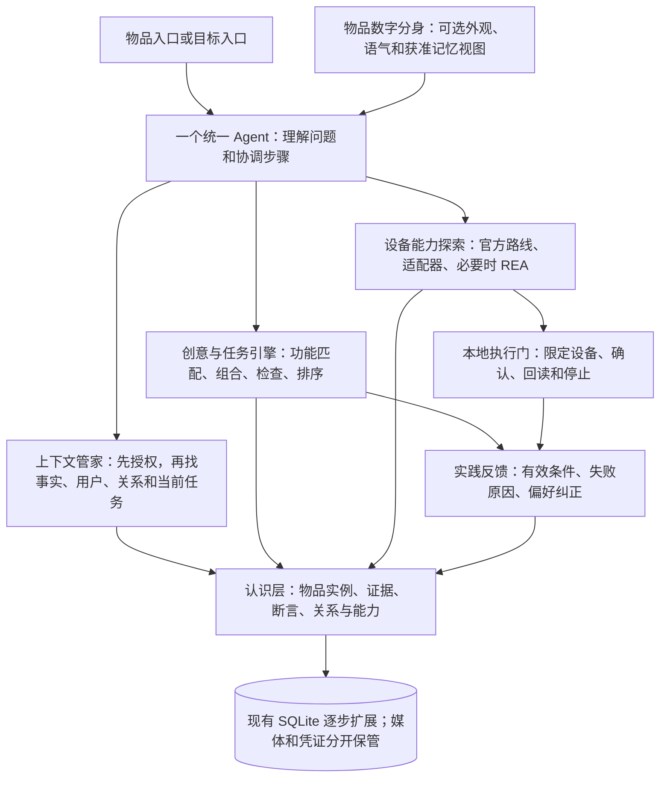

# 物间 V2：先建立共同认识，再创造物品价值

状态：**RFC，待按阶段实施**。2026-10-29。本轮只提交架构、迁移设计与离线设计检查，没有重写业务、迁移真实数据库、操作硬件或调用付费模型。文中的接口、表和流程标为“拟定”时，不代表现在已经存在。

## 给产品负责人的总览

旧系统已经能保存物品、故事和记忆，调用模型，并完成一些受控任务。问题不是完全没有这些零件，而是它们对“这件物品是什么、哪些性质可信、我和它有什么关系”没有共同的表达。回答好坏因此过度依赖某条路由、某段提示和一组文本规则。

V2 用一个共同的认识层连接所有体验：**物品实例 + 有来源的认识 + 可利用的能力 + 人与物的关系 + 有前提的计划**。物品卡、统一助手、数字分身、创意和设备控制都读取它；任何模块都不能把自己的猜测偷偷升级成其他模块的事实。

例如：纸盒的尺寸是用户报告，承重未知；“可以遮挡视线”是有条件的能力推导；把它用于视频中的揭晓道具是创意；用户实践后说好用是一次反馈，不能因此宣布所有纸盒都适用。同样，“朋友送的画让我开心”能形成关系记忆，但不能由赠送事件直接推断“用户喜欢所有同风格作品”。



“认识层”像一本带出处、修订记录和权限的生活笔记；“能力”像用途说明，必须写清条件；“计划”才是这次要做的事。统一 Agent 是协调员，数字分身是可选择的说话方式，不是每件物品背后常驻一台大模型。

## 五个阶段性决定

1. **把来源、认知状态与使用权限分开。** 用户报告、资料摘录、AI 推断和实际观察保持类型；置信度再高也不能变成实测或授权。
2. **物品与目标共用能力和组合引擎。** 不再为“旧纸盒”和“拍视频”各写一套 recipes。先定义效果、资源和前提，再搜索组合并生成候选。
3. **一个 Agent，多个受限视图。** 长期认识由业务记忆维护；会话检查点不是用户画像。分身只改变呈现和召回范围，不能扩大读取、分享或执行权限。
4. **保留 SQLite、现有权限和运行核心，建立可替换边界。** 先做事实／能力契约与旧数据适配，再决定物理表迁移；LangGraph 先保留，Pi 通过同业务故障对照争取替换资格。
5. **REA 正式进入设备探索工具层，但不直接成为执行权限。** 研究得到的是证据和候选适配器；需要版本固定、隔离检查、明确授权和状态回读才能保存为可执行能力。

## 阅读顺序

| 文档 | 回答的问题 |
| --- | --- |
| [DOMAIN_MODEL](DOMAIN_MODEL.md) | 物品、产品、证据、能力、人、关系和计划怎样关联；什么时候建表 |
| [AGENT_DESIGN](AGENT_DESIGN.md) | Agent 怎样找上下文、选择工具、检查结果并恢复任务 |
| [MEMORY_PERSONA](MEMORY_PERSONA.md) | 怎样逐渐理解用户、纠正和遗忘；分身与赠礼怎样隔离隐私 |
| [CREATIVITY_TASKS](CREATIVITY_TASKS.md) | 从性质到能力、从目标到组合的具体算法与中间结构 |
| [DEVICE_EXPLORATION](DEVICE_EXPLORATION.md) | 官方接口、Home Assistant、Matter、ESPHome、Bleak、REA 如何选择 |
| [MIGRATION_PLAN](MIGRATION_PLAN.md) | 哪些代码保留、改造、退出；如何纳入未合并修复并回滚 |
| [DECISIONS](DECISIONS.md) | 框架、数据库和隐私等决定的理由、替代方案与反证条件 |
| [ACCEPTANCE](ACCEPTANCE.md) | 画、旧物新用、灯或电视的端到端验收及自动化标准 |

## 正式基准与证据边界

| 来源 | 固定提交 | 本轮如何使用 |
| --- | --- | --- |
| 正式 `origin/main` | `ea32c3f4c9e18992ca267b6dd74e26e418c9e95a` | 所有现状判断和 RFC 分支起点；没有将成果分支当 main |
| `codex/finals-baseline-audit` | `bc03b76f53af8d6bf336e3f969c13014cea5c616` | 审计问题、结构图和原始证据；其中“尚未提交”的段落是历史快照 |
| `codex/finals-item-understanding-v1` | `8eca3d72fc93fce9d4cdb27b1ccd6bd70973a52e` | 256 项离线测试、148 次真实请求、工具与上下文修复；尚未合 main |

上一轮真实请求估算 0.433 元，包含完整对照与定向调试，不是最终版本独立盲测；F04/F07/T01 等仍有被拒或无用答案。不能由 HTTP 200 或模型自己打分证明创意更好。[原始测试报告](https://github.com/Starry-Curry/ProductAgent/blob/8eca3d72fc93fce9d4cdb27b1ccd6bd70973a52e/docs/finals/item-understanding-v1/TEST_REPORT.md)

本轮隔离工作区：`C:\Users\hp\.codex\worktrees\wujian-architecture-v2-rfc\ProductAgent-LifeContext`；分支 `codex/wujian-architecture-v2-rfc`。原工作区 `D:\ProductAgent-LifeContext` 仍在旧分支，保留未跟踪的 `deliverables/`。本轮没有打开其中的内容或私人数据库。

## 第一项真正要动手的模块

先做 **ItemKnowledgeRepository + ContextBroker 的只读纵向切片**：把现有登记、资料、记忆权限读成有来源的事实与能力上下文，让“朋友送的画”和“纸盒新用途”共用它。保留原写路径，使用合成库比较旧适配器和新适配器；不要先改 UI、换数据库或换 Agent 框架。具体关卡见迁移计划 P1。

## 本轮怎么检查

```powershell
node docs/architecture-v2/check.mjs --repo=.
```

检查九份文档、内部链接、真实源码锚点、固定分支来源、合成验收数据的一致性，并在**内存 SQLite**中编译拟定核心 DDL、验证外键与状态约束。结果见 [CHECK_REPORT.json](evidence/CHECK_REPORT.json) 与 [架构自审](REVIEW.md)。这些是设计检查，**不是 V2 产品验收通过**；未重跑历史 191/256 项业务测试，也没有新增模型或设备验证。
