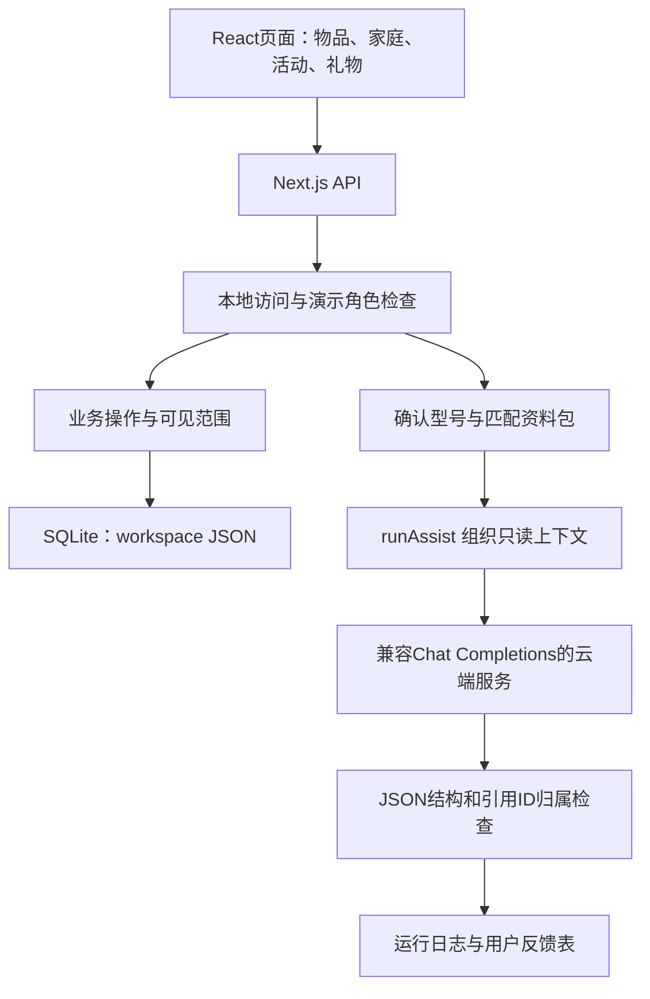

# 物间 Wujian 2.0：功能、架构、启动与改进评审

评审日期：2026-10-16。目录：`D:\Project\Tianmao\wujian2.0\Wujian-Windows-Demo`。

## 1. 结论与验收范围

“物间”把家庭物品作为生活服务入口：记录物品，查询使用帮助，准备出行活动，交接家庭事项，保存故事并在赠送时选择传递。标准版和长辈版共用业务状态，长辈版减少入口和操作项。

它适合承载日常场景。现有实现是 Next.js/React 页面、Node API、SQLite 和可配置的云端文字模型。当前包没有本地9B模型、模型部署器、习惯规则库、Skill版本管理或反馈驱动的自动迭代。页面中的“记忆”是物品故事；这些故事没有进入模型请求上下文。

### 本次实际做了哪些检查

- ZIP的SHA-256与附带校验文件一致；28个核心源文件、启动文件和Node运行时与包内SHA256SUMS一致。
- 实际运行包内Node：`v24.19.0 / win32`；安装版本为Next.js `15.5.28`、React `19.3.1`。
- `next build`成功，生成页面和API路由；服务启动日志输出Ready。
- 九组核心逻辑检查通过：角色过滤、活动清单、家庭事项幂等及确认、模拟关怀、型号和服务配置边界、模拟模型响应及引用、SQLite记录与反馈、礼物归属与故事、型号变化后隔离旧记录。
- **完整HTTP和浏览器验收尚未完成**：本次工具环境的回环连接被拒绝；同一进程内的最小HTTP服务自测也出现`fetch failed / EACCES`。这不能据此判定用户在普通终端启动会失败。
- 没有配置或调用真实付费AI；模拟响应的检查只证明代码路径和结构处理，不能证明真实模型效果。

检查文件位于`wujian2.0/review-2026-10-16/`，其中`verification.json`记录范围和限制。验证脚本使用独立数据或内存数据库；没有更改应用的业务源码。构建产生了`app/.next`。本次临时测试服务已由验证进程结束。

## 2. 功能与实现程度

| 功能 | 当前能做什么 | 边界 |
| --- | --- | --- |
| 物品档案 | 名称、分类、型号、位置、所有者、共享、状态、照片、备注、售后链接 | 照片只作为档案展示，未接视觉识别；用户上传照片首轮限制小于1MB |
| 使用帮助 | 选物品和问题，确认型号、关联资料包，再调用云端模型；显示引用和待核实项 | 未关联受支持资料时，不生成型号专属建议；不是完整说明书助手 |
| 活动准备 | 野餐/郊游、出门旅行两类模板；匹配已有物品，手动改清单状态，保存计划 | 正则关键词和固定模板，不调用AI，不会因“四个人”自动计算四人份数量 |
| 家庭事项 | 维修、清洗、购买/更换、重要提醒；分配、确认知晓、完成、未解决、补充记录和交接 | 角色切换为演示身份；页面打开时轮询，不向手机、微信推送 |
| 长辈版 | 大字与精简入口，突出提问、家人待办、重要提醒 | 不是单独账号，也没有语音输入、语音播报等能力 |
| 发现新用法 | 两条精选固定创意，收藏及尝试记录；可选请求AI提出更多组合 | 精选内容不是模型现场生成；AI候选未经现实验证 |
| 礼物与记忆 | 保存私人故事；赠送时选择祝福、故事、昵称；本地链接预览及显式认领 | 昵称不会开启角色对话；“附带知识”目前只附通用提示 |
| 归属转移 | 认领后改变所有者并关闭共享，清除上一持有者的位置、备注、照片、维护及资料绑定；复制选中故事 | 不是实物物流或交易；仍需用户确认实际取得物品 |
| 维护与关怀 | 用记录日期和示例周期计算维护计划；手动设置授权、暂停、外出、离线、缺少记录 | 没有真实设备接入、使用事件流或24小时后台监测；90天是演示设置 |
| AI运行与反馈 | 记录状态、模型、耗时、tokens、提示版本、引用、工具阶段、“解决了/还没解决” | 成功只表示建议已生成并通过结构校验；用户反馈不等于客观完成验证 |

默认人物为小林、爸爸、小夏；默认物品有台灯、相框、拼豆材料、净水器、保温杯。

**首轮体验容易误解的地方**：默认这五件物品均未绑定受支持资料。直接问台灯或净水器的专属操作，会先被要求确认型号；配置Key不能解除资料范围限制。

当前目录只有罗技M185的`M-R0061`、`MR0102`两个硬件版本。每个资料包是人工整理的三个规格事实：电池、连接/接收器、开关/指示灯信息，并附官方页面链接和限制说明；没有完整维修、配对或更换电池操作教程。代码没有现场抓取厂商网页、向量检索或通用说明书导入。

## 3. 架构与请求链路



### 前端

`app/src/app/page.tsx`负责视图切换、物品、故事、共享、礼物、维护等。`components/HelpEntry.tsx`、`ItemService.tsx`、`ActivityPlanner.tsx`、`FamilyTasks.tsx`、`SellerSupport.tsx`承担主要子流程。角色和长辈模式放在浏览器localStorage，业务数据由服务端保存。

当前大多数页面切换靠同一个页面里的React状态，没有独立可分享的业务路由；礼物页`/gift/[token]`例外。因此刷新通常回首页，而不是回到刚才的物品或活动。

### 业务和数据库

- `lib/domain.ts`定义Item、Task、Memory、Gift、Care、Plan及角色可见性，集中执行白名单业务动作。
- `lib/db.ts`通过Node内置`node:sqlite`存储；普通业务操作由`BEGIN IMMEDIATE`事务保护。
- 多数业务状态保存在`workspace.body`这一整份JSON中；另有`service_runs`、`service_feedback`和迁移版本表。
- `migrations.ts`升级前用`VACUUM INTO`备份，避免直接复制SQLite主文件遗漏已提交WAL内容。
- `service-store.ts`读取运行记录时再次检查演员、物品归属、型号/绑定版本和资源状态；旧授权或型号改变后不继续展示相关记录。

### AI链路

1. `/api/ai`校验问题长度、物品访问权限和模式。
2. `runAssist`解析物品、查找确认后的资料包；普通使用帮助没有匹配资料则返回`needs_identity`。
3. 创意模式仅提供当前可访问、状态允许使用的物品名称、型号、状态。
4. `provider.ts`读取`AI_BASE_URL`、`AI_API_KEY`、`AI_MODEL`，POST到`<base>/chat/completions`。
5. 要求JSON包含`answer`、`evidenceIds`、`uncertainties`，检查字段形状和引用ID属于当前资料包。
6. 网络请求结束后，再检查权限和型号是否改变；保存运行元数据。
7. 用户可以报告解决或未解决；记录的依据明确为`user_report`，`objectivelyVerified`保持false。

工具阶段名称由应用填入日志。现阶段没有模型自主选择工具、执行工具循环或写数据库；业务写入仍由用户操作触发。

**需要区分的两件事**：引用ID合法并不证明回答语义确实受到该事实支持；用户点“解决了”也不证明设备状态已经被传感器验证。

## 4. 怎么启动与停止

### 最简单的启动方式

进入解压后的目录，双击`START.cmd`，或在PowerShell执行：

```powershell
cd D:\Project\Tianmao\wujian2.0\Wujian-Windows-Demo
.\START.cmd
```

启动脚本使用包内`runtime/node.exe`和已有`app/node_modules`，不需要Anaconda、Python、另装Node、npm安装或下载9B模型。

流程是：检查文件完整性→如果没有`app/.next/BUILD_ID`则构建→在3000至3019中选择可用端口→只监听127.0.0.1→通过`/api/workspace`探测就绪→自动打开浏览器。

通常地址是`http://127.0.0.1:3000`，**以窗口打印的实际端口为准**。本次已生成构建，当前这份目录可复用产物；原ZIP没有预构建产物，重新解压后仍会首次构建。

使用时保留启动窗口。停止时在该窗口按Ctrl+C。此项目不使用LocalFlow的8765/8080端口，两个项目的启动和停止入口独立。

### 数据位置和更新

用户正常通过START启动后，数据保存为`app/data/demo.sqlite`。退出后仍保留。SQLite处于运行状态时不要只复制主文件作为完整备份；可以先停止服务，再一起备份`app/data`。

要重新获得初始示例，停止后把`app/data`改名留存，再启动。修改源码后要重建页面：当前启动器只看BUILD_ID是否存在，不检测源码更新时间。开发者可从`app`执行：

```powershell
cd D:\Project\Tianmao\wujian2.0\Wujian-Windows-Demo\app
..\runtime\node.exe node_modules\next\dist\bin\next build
```

再回上一层运行START。编辑服务端`.env.local`中的模型配置后至少重启服务；界面没有“重新连接”按钮。

## 5. 推荐体验顺序

### A. 不配Key先体验完整业务

1. 以小林进入标准版，查看“我的物品”，理解个人与家庭共享范围。
2. 打开“活动准备”，点“周末四个人去野餐”。系统应找到保温杯的记录，其他项标为待确认；手动选择已准备、需要准备或不带，然后保存清单。
3. 在“家庭事项”写“出门前带保温杯”，类型选重要提醒，交给爸爸；可关联共享的保温杯。
4. 切换演示角色为爸爸，再切长辈版，查看提醒，点“我知道了”。这应只记录知晓，仍保留提醒。
5. 回小林标准版，打开相框，写一条故事，再制作礼物，勾选愿意传递的故事。
6. 打开礼物本地预览，切换小夏接收身份，明确勾选实际收到后认领；归属和可见范围随之变化。

这些业务不依赖云模型。礼物地址是本机预览，不能把`127.0.0.1`链接直接发给另一台手机使用。

### B. 配置AI后体验有来源的文字问答

1. 标准版添加一件用于演示的鼠标物品；已有真实物品时先核对底部M/N。
2. 打开使用帮助，展开“补充型号，查找对应说明”。
3. 搜索M185，从`M-R0061`、`MR0102`中选择匹配版本，确认铭牌一致后关联资料。演示材料需明确标注为虚构；不要把其他设备强行绑定为鼠标。
4. 先问资料确实覆盖的问题，如“这个型号用什么规格的电池？”；配对和维修教程目前不在资料范围内。
5. 查看回答依据，报告解决或未解决；失败记录也会保留元数据。

## 6. 需要配置什么模型服务

`.env.example`四项均没有真实服务配置。页面文字写了“千问”，但提供者实现没有锁定千问，实际支持兼容Chat Completions且使用HTTPS的服务。

没有`.env.local`时，从`app/.env.example`复制为`app/.env.local`，再在本机编辑；已有配置时直接编辑，避免覆盖。配置和LocalFlow独立，不会自动读取原来的api.txt。

### 使用DeepSeek的配置起点

```dotenv
AI_BASE_URL=https://api.deepseek.com
AI_API_KEY=在本机填写自己的Key
AI_MODEL=deepseek-flash
AI_JSON_MODE=true
```

BASE_URL不要写到`/chat/completions`，代码会自动添加该路径。这些变量都是现有代码实际读取的变量。DeepSeek当前提供兼容接口，官方推荐使用`deepseek-flash`名称。[官方接入说明](https://api-docs.deepseek.com/)

这只是配置起点，没有完成这份demo的真实API验收。尤其现有provider固定30秒超时、1500输出tokens，只接受`finish_reason=stop`，没有思考模式开关。DeepSeek当前默认开启思考；建议在实际接入修改时为此提供者显式设置`thinking: { type: "disabled" }`，并做一条真实连接测试，避免超时、内容截断或只得到不完整输出。[思考模式文档](https://api-docs.deepseek.com/guides/thinking_mode/)

开启JSON模式仍需合理输出长度和应用结构校验；不能仅凭HTTP成功就判有效。[JSON输出文档](https://api-docs.deepseek.com/guides/json_mode/)

### 使用千问

配置同样三项：百炼对应地域/业务空间的兼容BASE_URL、该地域的Key、账号可用的模型名称。路径需要包含服务要求的兼容前缀，例如`.../compatible-mode/v1`；代码再追加`/chat/completions`。不要混用地域Key和端点。具体值以账号控制台和[百炼兼容接口文档](https://help.aliyun.com/zh/model-studio/compatibility-of-openai-with-dashscope)为准。

### 连接本地模型

当前provider强制HTTPS且强制要求Key，所以不能只把地址改为LocalFlow的`http://127.0.0.1:8080/v1`就使用本地9B。需要增加明确的local提供者：允许回环HTTP、支持本地无Key模式、保留对远程地址的约束，设置适合本地模型的超时与JSON输出约定，再连接现有llama.cpp服务。现在没有实现自动部署或本地/云端路由。

### Clash和网络

仅浏览页面、保存物品和家庭事项不需要访问外网。云问答访问外部API；命令行Node不一定自动使用Clash系统代理。包内Node的help已包含`--use-env-proxy`。

需要代理时，在同一个PowerShell中设置后启动。把下面端口换成Clash当前HTTP或mixed端口；7897是之前LocalFlow使用的历史端口，本次没有确认它现在仍有效。

```powershell
$env:NODE_USE_ENV_PROXY='1'
$env:HTTP_PROXY='http://127.0.0.1:7897'
$env:HTTPS_PROXY='http://127.0.0.1:7897'
$env:NO_PROXY='localhost,127.0.0.1,::1'
.\START.cmd
```

NO_PROXY用于保留本机启动探测和页面请求直连。这些Node开关需要在启动进程前设置；不建议只放入由Next稍后加载的.env.local。保持TLS证书校验。[Node代理配置说明](https://nodejs.org/api/cli.html#node_use_env_proxy1)

## 7. 与LocalFlow和团队设想的关系

| 维度 | 物间当前实现 | LocalFlow已有实现/团队目标 |
| --- | --- | --- |
| 产品入口 | 家庭物品、活动、长辈、礼物，任务意图更具体 | 可复用的材料处理工作台 |
| AI执行 | 可选云端文字问答 | 已有本地Qwen 9B执行与云端Skill修订 |
| 模型部署 | 不含模型和安装器 | Windows项目内模型/环境、llama.cpp启动 |
| 记忆 | 私人故事、物品资料、事项记录 | 任务确认习惯、执行证据和纠错；仍需结构化习惯 |
| Skill | 固定`item-assist-v1`提示版本 | 草案、试跑、人工验收、启用、恢复 |
| 反馈用途 | 保存解决/未解决，不回流到下一次生成 | 已能选择反馈生成修订草案并回放 |
| 模型证据 | 资料包事实ID归属检查 | 字段与来源、固定断言；两者都不能代替现实验证 |

建议保留物间的日常入口和交互，复用LocalFlow的执行与Skill能力，通过明确API适配接入。两份代码的数据结构、家庭Task与执行Task含义不同，不能直接拼接SQLite表或复制整个页面。

比赛展示要区分应用能力与模型能力：当前物间尚不能作为团队自训9B、多模态识别、真实设备监测或Skill自动学习已经实现的证据。

## 8. 改进优先级

### P0：先让首轮体验能够完成

1. **提供一条可用的首屏演示链路**：默认物品中加入明确标注的受支持鼠标样例、对应资料和建议问题；让用户能看到一次可靠帮助，再展示资料不足如何交给家人。现在全部默认物品都缺匹配资料，容易停在确认型号。
2. **连接设置与诊断**：增加提供者选择、Key配置方式、连接测试、模型返回结构和错误原因；移除与实际提供者不符的“千问”固定提示。补DeepSeek非思考参数、合理超时和截断处理。
3. **说明能力边界**：将模板清单、精选创意、云端回答、模拟信号、用户确认分别标明；现有代码已做了不少区分，继续保持。

### P1：补上个性化和Skill迭代

1. 把“故事记忆”和“操作习惯”拆成独立数据对象。习惯保存`owner/scope/condition/target_fields/exception/priority/confirmed_by`，例如“爸爸每次只显示一步”“出门清单总是检查保温杯”“先用已有物品，购买建议另列”。习惯不能改写厂家事实。
2. 对使用帮助和活动准备各建立版本化Skill，包含输入输出、适用资料版本、步骤、工具权限、验收规则；每次run记录skill_version及上下文版本。
3. 目前只存元数据且不保存问题和回答正文，保护了隐私，但无法完整回放失败。增加用户主动选择的脱敏失败样例、期望结果、修改理由及最小必要上下文快照；不要自动上传全部私人故事。
4. 以反馈产生候选→旧例回归→新例检查→人工确认后启用，保留历史和恢复。用户说“解决”可以是一项指标，还要检查实际输出字段、引用及应用操作结果。
5. 接入本地9B，先承担窄而重复的物品资料提取、规格问答、清单归类；云端负责复杂规划和Skill修订。需要先修改当前HTTPS-only提供者，不是仅填一个localhost地址。

### P1：补足资料与场景深度

1. 从两款鼠标规格包扩展到少量真正可完成操作的资料包；包含适用型号、原文、页码、版本、适用条件、不能覆盖的问题。
2. 逐步加入说明书导入、OCR、铭牌视觉确认候选；匹配到外观后仍需核对具体硬件版本。
3. 活动准备加入人数、时长、已有数量、复用偏好和例外；用规则处理确定的数量计算，让模型理解表达和补齐不明确条件。
4. 将引用检查扩展为“结论是否由引用支持”的检查，并为未解决反馈提供具体问题类型；不能只看JSON和ID合法。分别定义service和ideas的证据要求，避免把通用创意强制关联到无关的型号规格事实。

### P2：多人使用和工程维护

- 真正要跨电脑/手机协作时，再加入真实身份、家庭成员权限、服务端同步、通知与可撤销分享；当前演示角色和本机链接只适合单机演示。
- 数据逐步从整份workspace JSON拆为实体表；照片改文件存储和引用，避免每次写事项都重写全部照片数据。
- 拆分约1500行的page.tsx；为物品、活动、事项使用独立路由，减少刷新丢失当前位置。
- 增加首次启动、模型连通、失败路径和迭代回归的可复现验证。包里虽然安装了Playwright，但此次没有找到项目自带测试用例；依赖存在不代表测试通过。
- 启动器记录构建版本/源码变化、明确停止入口；现有BUILD_ID存在判断会复用旧页面。

## 9. 下一阶段建议演示

选一条有事实依据、能看到习惯迁移的链路：

“小林核对鼠标型号并关联资料→爸爸问电池规格→爸爸反馈长段回答不方便→确认‘大字、先给结论、每次一步’的表达习惯→云端生成Skill草案→本地9B在原问题和新措辞问题上回放→比较事实准确、引用、简洁程度和用户完成情况→人工启用。”

另一条可用活动准备：“周末野餐→按已有物品列清单→确认每次带保温杯、不要重复购买已有物品→下次出游复用习惯”。活动模板的确定性部分与模型判断分开计分。

这些是后续设计，当前还没有实现。第一阶段可先接连接配置与本地模型，再完成一个场景的Skill闭环，之后扩展多设备和资料目录。

## 10. 源码入口

| 文件 | 用途 |
| --- | --- |
| `START.cmd` / `start-demo.mjs` | Windows入口、构建、选择端口、启动和打开浏览器 |
| `app/src/app/page.tsx` | 产品主页面和大部分视图 |
| `app/src/components/ItemService.tsx` | 型号确认、问答、反馈、运行记录 |
| `app/src/lib/products.ts` | 两个版本的人工资料包 |
| `app/src/lib/planning.ts` | 固定活动模板与物品关键词匹配 |
| `app/src/lib/domain.ts` | 数据结构、业务动作、共享、家庭和礼物 |
| `app/src/lib/db.ts` / `migrations.ts` | SQLite、事务、备份和迁移 |
| `app/src/lib/ai/provider.ts` | HTTPS模型请求、超时、输出限制 |
| `app/src/lib/ai/harness.ts` | 受控上下文、来源检查与运行状态 |
| `app/src/lib/service-store.ts` | 运行记录、访问范围与反馈保存 |
| `app/src/app/api/*/route.ts` | 业务、AI、资料、礼物和反馈API |

外部参考仅用于核实接入配置与运行机制；功能判断以这份包的源码和上述验证为依据。
