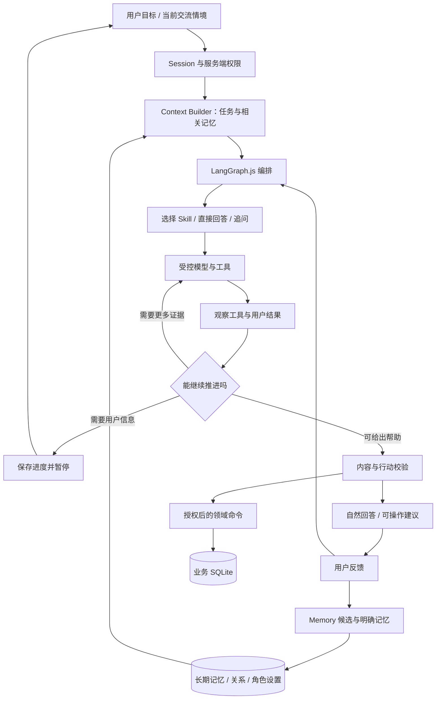

# ProductAgent 下一步设计：自然可靠的 Agent、Memory 与个性化体验

日期：2026-10-18。版本：讨论修订稿 v2。状态：**用户已批准，第一轮基座已落地**。

实际完成范围、Prompt 与闭环见 [实现说明](foundation-implementation-2026-10-18.md)，运行步骤见 [晨间验收](morning-acceptance-2026-10-18.md)。以下正文保留确认前的设计目标，未实现的未来能力不计为本轮交付。

设计时的代码基线：`53a43437e94a51017bb4415cac4ad68d9245cf5a`，当时位于 `chore/architecture-review-20261017`；后续批准的实现位于 `feat/agent-memory-foundation`。用户文件 `docs/1018.md` 保持原样。

本稿承接 [2026-10-17 架构审查](architecture-review-2026-10-17.md)。涉及下一步实现时，本稿对体验、Agent 编排和个性化范围的修订优先于上一版建议；原审查仍作为问题与验证证据。

## 1. 本轮确认前的设计目标

用户提出三项要求：稳定但自然好用；明确是否采用 LangGraph、Codex、Claude Code 一类闭环；个性化覆盖 memory、偏好、喜好、关系与可选陪伴，以人和体验为中心。

产品目标调整为：**用户说出目标后，系统能利用相关知识与过去经历提供实际帮助，按结果调整，逐渐理解这个人，并让用户保有纠正、忘记与选择交流方式的主动权。**

可靠性主要由后台权限、来源、状态与工具约束承担。用户界面优先展示有用的答案和下一步，仅在缺少会影响结论的信息或行动超出已有授权时增加交互。是否用了框架、对话轮数和记住多少信息都不能直接充当用户价值。

## 2. 对上一版方案的具体修改

| 修改点 | 上一版重点或当前限制 | 本次修订 |
| --- | --- | --- |
| 可靠性与表达 | 原文精确匹配承担主要可信判断 | 按内容性质校验，允许自然解释和受控改写；型号参数、操作和关系事实保持独立证据要求 |
| 求助入口 | 有物品、有型号、有资料包后才能进入模型流程 | 先接受目标，允许临时物品；只询问当前任务确实需要的身份或环境条件 |
| 闭环 | 一次模型调用后等待枚举反馈 | 引入有状态的理解、取证、工具、观察、调整循环；可暂停、恢复、取消和交接 |
| 框架选择 | 暂可自建状态机，之后再评估框架 | 推荐 LangGraph.js 作为薄编排层，确认后先做与当前环境的兼容及恢复验证，再接业务 |
| 个性化范围 | 简短/详细、使用经验 | 当下目标、记忆、兴趣喜好、约束、使用习惯、人与物/人与人关系、语气与陪伴共同影响服务 |
| Memory | 物品故事与运行记录各自保存，未用于完整召回 | 建立会话工作记忆、跨次经历、明确偏好、故事、个人方法与候选推测的分类生命周期 |
| 陪伴 | 作为较远期可选能力 | 首轮纳入文字陪伴最小体验：可选角色、授权故事召回、自然交流与事实/想象分开 |
| 确认交互 | 容易把每个动作都做成确认表单 | 明确指令与既有授权可复用；低风险本人记录可保存后撤销；跨人分享、归属变动等单独预览 |
| 迭代标准 | 以通过校验、生成记录为主 | 同时衡量帮助有效性、误拒、重复提问、交接负担、记忆准确性、陪伴舒适度与用户自主性 |

## 3. 当前架构的事实

当前为 Next.js 15 / React 19 / TypeScript / Node.js 24 的本机全栈应用。后端使用 SQLite，主要业务对象仍在 `workspace` 单行 JSON；服务运行与反馈另有表。对象授权、事务、迁移备份、赠礼作者来源和部分执行记录已有实现。

当前依赖与源码**没有接入 LangGraph、Codex SDK 或 Claude Agent SDK**。开发时使用 Codex 不等于产品内部运行 Codex。已有 [harness.ts](../../src/lib/ai/harness.ts) 是自建固定只读流程，`Run.tools` 主要记录阶段标签。它不会基于工具输出持续选择下一步，原有回放也不能等同于断点恢复。

[provider.ts](../../src/lib/ai/provider.ts) 当前只接收文本 JSON 响应，而且要求 `finish_reason=stop`，没有传入工具定义或处理 `tool_calls` 的协议。单纯安装 LangGraph 不会让它自动具备工具调用、长期记忆或个性化。

当前 Memory 主要保存用户主动录入的物品故事；Context 只有指导详略与使用经验。照片用于档案，真实视觉、声音、设备状态和真实多人身份仍是待建设能力。

## 4. 框架决策及依据

| 方案 | 它是什么 | 本项目建议 |
| --- | --- | --- |
| LangGraph.js | 可组合确定性节点和模型节点的有状态编排运行时，支持持久化与暂停恢复 | 首选作为应用内部编排层；保留 Next.js、现有领域逻辑、SQLite 与百炼 Provider |
| Codex / Codex SDK | 带工具与上下文管理的 Agent 产品及可编程集成方式，可用于工程任务与应用集成 | 借鉴检查、行动、验证、修正循环；继续用于开发与评测改进。当前生活服务不需要把完整编码运行时作为前提 |
| Claude Code / Claude Agent SDK | 工具、上下文与执行循环的产品及 SDK 路线 | 借鉴工具结果反馈和持续任务体验；是否采用 SDK 应由模型与工具需求决定，不因为名称相似就叠加多个运行时 |
| 继续完整自建 | 能精确控制依赖与协议，但要自己维护恢复、暂停、状态与循环语义 | 保留业务策略自建；把通用执行能力优先交给经验证的框架 |

框架信息来自官方文档，本项目取舍是设计判断：[LangGraph 概览](https://docs.langchain.com/oss/javascript/langgraph/overview)、[持久化](https://docs.langchain.com/oss/javascript/langgraph/persistence)、[Claude Code 执行方式](https://code.claude.com/docs/en/how-claude-code-works)、[OpenAI 官方 Codex SDK](https://learn.chatgpt.com/docs/codex-sdk)。

### 4.1 为什么现在推荐 LangGraph.js

当前新增需求已包括跨回合继续、等待用户反馈、工具结果驱动调整、长期记忆召回和共享确认，持久化与暂停恢复成为实际需求。采用编排框架的依据是这些能力，而不是追求更复杂的架构图。

LangGraph 节点可以调用自有 Provider，无需为了它切换到 OpenAI 或 Anthropic 模型；百炼仍作为当前模型接口。LangGraph 的开源编排和第三方托管/追踪服务是不同选择。首轮使用本机存储与本地脱敏 Trace，外部追踪属于之后单独评估的连接。

### 4.2 确认后先验证，再接入业务

第一工作包验证 Node 24、Windows、Next 服务端构建、当前锁文件，以及可用的 SQLite checkpointer 实现。图状态持久化可以使用独立 SQLite 文件，业务实体仍由领域 Repository 管理。具体包版本及与 Node 内置 SQLite 的关系在实际安装时锁定，当前尚未验证兼容性。

验证必须包括：进程退出后恢复；用户等待期间不占用长请求；同一暂停点重复提交只产生一次业务结果；并发恢复有版本保护；删除或撤权后旧快照不能重建失效上下文。仅用内存 Saver 跑通不能作为持久化验收。

若关键条件未通过，记录具体阻塞与替代方案供确认，不无声改变本稿的框架选择。框架 checkpoint 与长期用户记忆是两种存储职责，不把前者当作自动完成后者。

## 5. 让稳定性支持体验：分内容处理

| 情境 | 用户看到的行为 | 后台约束 |
| --- | --- | --- |
| 日常通用帮助 | 有条件先直接回答，必要时说明一个简短假设 | 检查相关性与风险；不虚构已经识别到设备或当前状态 |
| 参数、型号专属操作、兼容与载荷 | 自然解释，只追问会影响结论的条件 | 匹配适用版本和证据；对操作、数量、单位及限制单独校验 |
| 创意、活动与兴趣发现 | 给可修改的候选和替代选择 | 区分已知能力、待确认条件与创意；真实物品条件仍受约束 |
| 故事表达与陪伴 | 可以温暖、幽默、改写或创作 | 真实经历来自授权记忆；创作内容有不同内容类型，不能写回真实经历 |
| 本人明确要求记住或纠正 | 直接完成并显示简短回执、撤销入口 | 记录来源与适用范围；无需再弹同义确认 |
| 跨人分享、赠礼转移或超出既有授权的操作 | 展示分享/变更摘要，确认后执行 | 重新核对权限、范围、对象版本和幂等键 |

不会要求每条普通回答逐字等于资料。可信判断覆盖格式、来源、型号与条件、事实与步骤、问题相关性、权限和业务状态；自然语言表达与这些结构化内容分别处理。

普通问题可先提供适用的一般帮助，再按需要收窄。例如双击速度设置先确认操作系统；型号专属硬件操作才需要准确型号。缺资料时给出可补充的信息或下一条可走的路，避免只输出“未通过校验”。

追问优先一次处理一个关键决策，能复用会话或有效记忆中的已知条件就复用；有多个真正必要条件时可简短合并。确认的目的应是让用户作决定，而非把内部技术步骤逐个展示给用户。

界面只展开与当前问题有关的信息；依据、记忆来源与技术诊断可按需查看。危险或未校验的操作步骤在校验通过前不向用户流式泄漏。

## 6. 修改后的 Agent 执行架构



### 6.1 职责与状态

- **Session**：用户正在进行的一个问题或交流，可以关联具体物品，也可以先是临时物品；保存必要进度和待解决点。
- **Run / Graph**：本轮怎样理解、查询、调用和检查，记录实际工具调用而非仅写阶段名称。
- **Skill**：任务目标、适用范围、工具、成功条件与案例；允许根据反馈走不同路径。
- **Context Builder**：根据人、目的、任务和权限选择信息，并记录使用了哪些版本。
- **Provider**：文本、结构化输出与工具调用协议，以及超时、用量、截断和错误分类。
- **Domain / Repository**：权威业务读写与事务，最终决定动作是否能发生。

建议区分任务状态 `needs_info / helping / waiting_user / handed_off / user_resolved / closed` 与技术运行状态。日常交流可以正常结束，无需被迫填写“是否解决”；有任务时才追踪任务结果。

三个闭环分别承担不同职责：

| 闭环 | 根据什么调整 | 影响范围 |
| --- | --- | --- |
| 本次执行闭环 | 工具结果、缺失信息、用户尝试 | 当前问题的下一步 |
| 个人记忆闭环 | 明确表达、经历结果、纠正与忘记 | 获准范围内的跨次个性化 |
| 产品改进闭环 | 经选择的脱敏案例、评测和人工复核 | 版本化 Skill、Prompt、知识与策略 |

这里的“学习”首先来自记忆召回和策略更新，不等于自动训练模型参数。私人记忆不因启用个性化就自动成为公共知识或训练/评测材料。

### 6.2 有边界的行动闭环

模型根据工具结果更新下一步，但只能使用服务端暴露的类型化工具。首轮工具围绕读取物品、检索资料、读取获准记忆、读取会话进度、提出家庭事项、保存明确记忆及纠正记录。工具返回结构化成功/失败与依据，失败原因进入下一次决策。

初始预算建议：常见问答尽量一次模型调用；复杂单回合上限三次模型调用、六次只读工具调用、同一目的的无进展检索最多两次，总执行预算暂定 45 秒，之后通过实际延迟与质量调优。这些是初始配置建议，尚未压测。达到上限时保留可用进度、给出下一步或暂停，不无限自问自答。

“调用完成”“回答有依据”“用户执行”“用户报告解决”“外部观察验证”分别记录。模型自评不能把建议提升为已经修好或已经发生的事实。

### 6.3 Provider 必须同步升级

扩展返回协议，支持内容、`tool_calls`、结束原因、用量、请求关联 ID 与模型能力；工具结果通过正确消息协议交回模型。JSON 回答与工具调用两种返回都能被应用识别，不能把 `tool_calls` 当成不完整输出一律拒绝。依据：[百炼 Function Calling](https://help.aliyun.com/zh/model-studio/qwen-function-calling)。

保留当前北京百炼接入，具体账户/模型能力通过获准的独立联调验证。框架接入不触发真实付费调用；没有模型时仍可查看记忆、编辑资料和处理本机任务，并明确说明本次模型帮助不可用。

### 6.4 恢复与副作用

LangGraph 暂停恢复可能重新执行所在节点，因此业务写入要独立、具备幂等键和事务，不能假设框架天然保证“恰好一次”。参见 [官方 interrupts 的副作用说明](https://docs.langchain.com/oss/javascript/langgraph/interrupts)。

独立 checkpoint 文件与业务库之间没有天然跨库原子事务。业务库保存动作回执；恢复时先查回执，已完成动作不重复执行。模型请求在网络超时后是否已完成也可能不确定，不能声称重试完全不会重复计费。

恢复前重新验证 actor、会话访问、资源版本、同意范围和记忆版本；`thread_id` 只用于定位，不代表授权。用户补充信息时恢复任务，权限变化时重新装配上下文。

## 7. 以人为中心的个性化设计

| 维度 | 如何影响体验 | 示例 |
| --- | --- | --- |
| 当下目标和情境 | 决定这次要帮助什么、详细到哪里 | 赶时间时先给可行下一步，休闲时可以探索 |
| 使用经验与辅助需要 | 调整步骤颗粒度与输入方式 | 同一人在摄影方面熟练，在音箱设置上仍可能是新手 |
| 明确偏好与限制 | 调整呈现、提醒、时间和预算选择 | 少打扰、先用已有物品、先给关键结论 |
| 兴趣与喜好 | 影响候选排序与创意方向 | 喜欢手工、安静的活动，仍保留不同方向的选项 |
| 过去经历与方法 | 复用尝试结果，避免重复无效步骤 | 上次某种连接方式失败，这次先确认变化 |
| 人与物 / 人与人关系 | 理解使用者、照料者、赠送者和情感意义 | 相框是朋友送的；净水器由本人使用、家人协助维护 |
| 交流方式与可选陪伴 | 调整语气、故事表达、角色呈现与回顾方式 | 平时温暖简短，创作时活泼，故障处理时清楚直接 |

这里的个性化会影响“提供什么、先做什么、如何继续”，而不只改变句子长短。兴趣与关系可以变化，不能由购买行为、年龄或一次对话直接确定。用户说“这次不想手工”，当次意图优先于历史兴趣。

首轮提供三种自然交互情境：实用帮助、兴趣发现、可选陪伴。系统可识别情境并允许用户直接纠正；用户无需每句话切换模式。涉及事实、权限和操作时使用相应校验，语气可以保持温和。

## 8. Memory 的分类、来源与生命周期

“Memory”是保存、选择、更新与忘记信息的机制，“个性化”是利用合适信息改善服务的行为，“陪伴”是用户选择的一种体验；三者有联系，但不能合成一段无限增长的系统提示。

| 记忆类别 | 保存内容 | 可怎样使用 |
| --- | --- | --- |
| 会话工作记忆 | 当前目标、条件、已尝试步骤、结果、未完事项 | 跨回合继续，不重复问已知条件 |
| 明确事实、偏好与兴趣 | 用户主动表达且选择保留的信息，带适用范围 | 跨次调整方案、表达和候选排序 |
| 经历记忆 | 使用、维修、活动、试做及其用户报告结果 | 提醒历史、参考过去的有效/无效方法 |
| 故事与关系记忆 | 真人故事、物品意义、赠送关系、选中快照 | 回顾、表达心意、陪伴交流；保护作者与持有人 |
| 个人方法记忆 | 对这个人、这个场景曾有效的做法 | 提出可复用建议，不提升为所有型号的官方操作 |
| 角色连续性 | 用户选的昵称、交流风格和约定 | 可选角色体验，不替代真实经历和产品事实 |
| 候选推测 | 模型归纳的可能喜好、规律 | 供用户确认或忽略，首轮不当作已确认画像使用 |

商品官方资料独立存储为 Evidence / ProductPack；其来源和有效范围不因为用户喜欢某个角色而改变。LangGraph 的短期 checkpoint 与跨会话存储也有不同职责，官方概念可见 [Memory overview](https://docs.langchain.com/oss/javascript/concepts/memory)；本节分类与策略是本项目设计。

### 8.1 最小记录结构

| 字段组 | 设计字段 |
| --- | --- |
| 身份和关联 | memoryId、ownerId、workspaceId、kind、关联物品/人员/会话 |
| 内容 | 结构化字段、必要摘要、用户原文引用（选择保留时）、事实/用户报告/创作类型 |
| 来源 | 来源类型与记录 ID、原作者、事件时间、记录时间、明确/推测/未知 |
| 适用性 | 任务/类别/物品范围、有效起止、过期时间、版本、被哪个记录更正 |
| 使用授权 | 本人/选定成员可见、允许的使用目的、是否允许当前云端用途 |
| 生命周期 | active、candidate、superseded、deleted；更正与删除事件、派生摘要/索引引用 |

模型自报置信度只能辅助排序，不能替代用户同意、事实来源或权限。用户报告“做完了”与设备确认结果分开。旧故事迁入时保留原作者、未知归属和赠礼来源，不能把推测的作者补成确定值。

### 8.2 记住的方式要低负担

- 默认提供必要会话进度保存，并告知和提供关闭/删除入口；长期个性化记忆是可选能力。
- 用户说“记住我喜欢先给结论”，视为明确保存指令，保存后给轻量回执与撤销入口。
- 用户启用“从日常交流整理长期记忆”后，低风险明确表达可按范围整理，集中展示变更；不逐条弹确认打断聊天。
- 仅本次有效的时间、预算和安排放在会话里。重复行为归纳的兴趣先成为候选，可集中确认；敏感关系或跨人信息不会因同意普通偏好整理就自动扩权。
- 用户说“别记这段”“这次不要用以前的记录”，可进入临时交流；保留必要操作回执时避免写入私人内容。

建议初始保留规则：临时会话七天，完成任务摘要三十天，明确收藏或“记住”的内容直到用户更正/删除，未确认推测候选七天；均可关闭或调整。失败模型正文默认不作长期记忆。上述是待确认初始策略，不是当前已启用设置。

### 8.3 召回过程

先校验身份和访问范围，再排除删除、过期、被更正记录，再判断目的和上云许可，然后按当前目标、物品关系、明确程度、相关性和时间筛选。小规模首轮使用结构化条件与中文关键词匹配；是否引入 embedding 由真实召回评测决定。

上下文只取少量相关条目，初始建议五条长期记忆以内，并设长度预算。没有合适记忆就正常回答，不为了展示“认识你”硬插入旧故事。用户问“为什么这么推荐”，可以展示影响这次建议的记录并直接纠正。

明确且适用的新记录优先于旧记录；推测不能覆盖明确表达。范围不同的偏好可以并存。发生真正冲突时仅在影响当前任务时询问，不要求用户先维护完整画像。

### 8.4 纠正、忘记与快照

更正会让旧记录失去当前效力，保留最小变更依据；删除立即停止召回并失效派生摘要、缓存和检索索引。恢复旧 checkpoint 必须重新读取有效版本和删除标记，不能将过去的模型摘要重新写成新事实。

Checkpoint 尽量保存记忆 ID 与版本引用，避免复制所有长期私密记忆；其中包含被删内容的消息或摘要也须失效重建。备份保留与恢复策略独立明确，恢复后继续应用删除标记；不把界面隐藏当成完成遗忘。

记忆中的文字、用户上传内容与外部资料均作为数据，不授予工具权限，也不覆盖系统执行规则。

## 9. 可选陪伴与物品角色

陪伴的连续性来自记得合适的经历、理解用户当下意愿和保留交流风格。用户可以选择普通助手、温和伙伴，或给一件有意义的物品设置昵称与角色；每件物品无需有独立 Agent 进程。

角色设置与真实记忆分开存储。授权故事可以被自然回顾或协助改写；想象性角色台词和创作片段采用不同内容类型，不能自动进入真实经历记忆。来源可以在故事卡片或“为什么记得”中查看，不在每句话中堆砌技术标签。

例子：用户曾明确保存“这个相框是朋友送的”，角色交流可以回顾这条记录；没有保存共同旅行，就不能生成“我还记得我们去过海边”并当成真实共同经历。

交流中遇到故障或风险，优先给清楚的帮助和下一步，仍可保持温和语气。陪伴可随时关闭；主动回顾与提醒按用户选择的时间和频率进行，安静时不靠想念、愧疚、签到喂养等方式催促用户。

赠礼时单独预览选中的故事和可传递角色设置；原主人的兴趣画像、私人对话与后续记录不随物品转移。收礼人有自己的角色与记忆选择。

## 10. 数据与模块设计

### 10.1 目标实体与权威来源

| 实体 | 职责 |
| --- | --- |
| service_sessions / session_events | 问题、交流目标、必要进度与用户可见事件 |
| service_runs / run_events | 本轮模型、工具、校验、版本与执行状态 |
| feedback_events | 用户尝试、结果、原因及更正 |
| memory_records / memory_events | 明确记忆、经历、故事、个人方法、候选及生命周期 |
| person_item_relations | 拥有、使用、照料、赠送等关系，带来源和范围 |
| persona_profiles | 可选角色设置与交流风格 |
| grants / action_receipts | 访问与目的授权、写入回执和重复执行保护 |
| ProductPack / Evidence | 公共知识、适用型号、事实与步骤；版本化内容可先继续在 Git 中维护 |
| graph_checkpoints | 运行恢复状态，与业务实体分开管理 |

当前保留 Next.js 与 SQLite。按版本增量迁移，优先新增会话、记忆、反馈与角色所需数据；后续迁移物品、任务与附件。每类数据只保留一个权威写入口，避免长期双写。用户日常数据和测试数据使用不同目录，升级前备份，验证迁移幂等和恢复。

现有演示身份仍不能作为真实多人账号。公共访问和跨设备家庭使用前，服务端身份与成员关系必须落地。Context、Memory 的 owner 字段设计为可替换真实用户 ID，避免继续把三个演示角色写进新能力的通用协议。

### 10.2 模块草图（待实现）

```text
src/lib/agent/             图、状态、执行策略、预算、恢复
src/lib/skills/            item-help、family-handoff、memory-capture、companion
src/lib/context/           上下文装配、目的过滤、引用与版本
src/lib/memory/            记录、候选、更正、删除、召回
src/lib/persona/           角色设置、语气与内容类型
src/lib/tools/             工具注册、类型、权限与动作回执
src/lib/repositories/      SQLite 存储适配
src/lib/ai/                百炼 Provider 与响应协议
content/skills/            任务说明、正反案例、评价标准
content/product-packs/     版本化事实、过程、条件与出处
```

Application Service 组织领域命令与存储；框架只编排这些接口，不能直接获取数据库任意写入能力。首轮一个编排入口配任务 Skill，复杂度由实际质量与延迟决定，不为每个物品或角色复制一套运行时。

## 11. 界面与三个首轮验收旅程

首页保留自然提问入口，物品录入与记忆设置按需要出现。增加可继续的会话、轻量记忆回执、可查看与纠正的“关于我/记住的事”，以及自选陪伴入口。大部分内部状态不进入普通用户主流程。

### 旅程 A：可靠但不僵硬的实用帮助

用户提出新物品问题 → 系统先判断需要哪些条件 → 能给一般帮助就先给 → 缺型号或系统信息时问必要的一项 → 用户尝试 → 下次继续时记得结果 → 需要家人时预览共享摘要并交接。

验收重点：没有型号也能进入流程；事实有依据但答非所问不能算有效帮助；不会反复要求填写已经明确的信息。

### 旅程 B：记忆与喜好真正影响服务

用户明确保存喜欢手工、这次只想用已有物品 → 系统在适用候选中优先考虑，但保留其他方向 → 用户说今天想做别的 → 当前选择优先 → 用户更正兴趣后下一次生效。

验收重点：能说明用了什么记忆；买过/送过东西不直接推断喜欢；兴趣变化不需要重建账号；不重复推荐已明确无效的做法。

### 旅程 C：有连续性的可选陪伴

用户为相框设置昵称并保存一段真实故事 → 选择温和陪伴 → 之后能自然回顾这段故事或协助表达心意 → 创作片段与真实经历分别保存 → 删除故事后，包括恢复旧会话时都不能继续召回 → 关闭陪伴后照常使用实用功能。

验收重点：温暖自然、可选择、记忆准确；赠送后仅传选中内容，接收者私人交流独立。

## 12. 实施工作包与本次确认范围

建议首轮 MVP 覆盖 A—D，逐包展示验证结果；E 为随后扩展。三个验收旅程贯穿首轮，不把 Memory 和陪伴只留在架构图上。

| 工作包 | 改动点 | 完成依据 |
| --- | --- | --- |
| A. 执行底座与协议 | LangGraph.js 兼容验证、持久化与暂停、Provider 工具协议、Skill/结果 schema、幂等动作边界 | 隔离存储能在退出后继续，重复恢复不重复写入；实际工具结果进入下一步 |
| B. 实用会话与内容 | 临时物品、按需追问、自然回答与分类校验、少量完整资料场景、反馈及基本家庭交接 | 旅程 A 可运行；用户能知道下一步，缺资料不是终点 |
| C. Memory 与个性化 | 记忆结构、显式保存/纠正/忘记、相关召回、兴趣与关系、上下文用途过滤、记忆管理入口 | 旅程 B 可运行；删除、更正、私有范围、临时模式可验证 |
| D. 文字陪伴与整体验收 | 自选语气/物品角色、授权故事、创作分离、关闭与不打扰；质量与体验门禁 | 旅程 C 可运行；三个旅程与现有权限回归通过 |
| E. 后续深化 | 全量业务分表/附件、更多内容与动态发现、活动执行、真实身份、语音视觉、主动提醒、按需向量检索 | 依实际用户需求与评测分阶段确认 |

相对上一版，第一批新增了 LangGraph 实际验证与接入、Memory 全生命周期、兴趣与关系个性化、文字陪伴最小体验；原来的单物品闭环、家庭交接和权限边界继续保留。界面和内容也属于首轮交付。

## 13. 质量、体验与演进门槛

同时评估可靠性和帮助有效性：危险建议漏放、无依据事实、答非所问、有效回答误拒、首个有用回应所需交互、重复追问、延迟/用量、交接负担、记忆召回准确性、更正/删除生效、用户对交流舒适度及可控性的评价。不会以聊天时长、角色活跃度或记录条数直接优化留存。

首轮应覆盖以下正反案例：

1. 通用问题未绑定型号仍获得有用帮助；型号专属问题才追问型号。
2. 自然改写与简短说明可以通过，真实参数与步骤仍核对来源。
3. 双击速度问题收到电池事实时不标成任务有效完成。
4. 用户已尝试的无效步骤不会无条件重复推荐。
5. 喜欢手工影响候选，但“今天想做别的”立即优先。
6. 赠礼或购买行为不自动变成个人兴趣事实。
7. 临时日程不会变成永久画像，候选推测不覆盖明确记录。
8. 未允许上云的记忆不进入请求；请求前后权限变化会重新检查。
9. 更正、删除在下次召回及旧 checkpoint 恢复后都生效。
10. 角色创作不能写成真实共同经历，关闭陪伴不妨碍使用帮助。
11. 家庭共享及赠礼只传选中内容；私人记忆和收礼人新记忆不回流。
12. 重复动作、进程中断、暂停恢复、超时与模型不可用都有真实可验证的处理路径。

离线替身、真实模型、人工审阅和实物结果分别记录。上轮 26/26 与浏览器检查是已有代码基线，本稿没有重新运行或把这些成绩算作新设计已实现。验证见 [历史摘要](review-validation-2026-10-17.json)。

运行反馈先转成脱敏案例，再形成 Skill、Prompt、知识或检索策略的候选改进，通过回归与人工复核后发布。可借鉴 [OpenAI 官方闭环改进示例](https://developers.openai.com/cookbook/examples/codex/build_iterative_repair_loops_with_codex) 的验证反馈机制；模型自己说“变好了”不作为发布依据。

## 14. 待确认的决策

本稿建议确认：

- 保留 Next.js、SQLite 和北京百炼，采用 LangGraph.js 作为首选编排层，并先通过工作包 A 的实际兼容验证。
- 将“自然可靠”落实为分类校验、按需追问、可恢复的工具反馈闭环与低负担确认。
- 将会话、长期记忆、喜好、关系和可选文字陪伴纳入首轮 A—D，并按上述保留与使用规则提供用户控制。
- 使用三个可运行旅程验收，按工作包展示结果；真实多人身份等需求如需近期开放则前移。

用户确认前，仅维护这份设计与关联文档；不把“完成设计”写成“完成接入/记忆/陪伴”。当前环境文件与用户密钥不在本轮读取或修改范围。

## 15. 官方资料

- [LangGraph.js 概览](https://docs.langchain.com/oss/javascript/langgraph/overview)：编排定位和确定性/模型节点组合。
- [LangGraph persistence](https://docs.langchain.com/oss/javascript/langgraph/persistence)：线程 checkpoint 与跨线程存储职责。
- [LangGraph interrupts](https://docs.langchain.com/oss/javascript/langgraph/interrupts)：暂停恢复及副作用约束。
- [LangChain Memory 概念](https://docs.langchain.com/oss/javascript/concepts/memory)：短期与长期记忆的区别。
- [Claude Code 执行循环](https://code.claude.com/docs/en/how-claude-code-works)：上下文、行动、工具结果与验证。
- [OpenAI 官方 Codex SDK](https://learn.chatgpt.com/docs/codex-sdk)：程序化开始、继续和恢复 Codex 任务。
- [OpenAI 官方闭环改进示例](https://developers.openai.com/cookbook/examples/codex/build_iterative_repair_loops_with_codex)：根据验证反馈继续修正并设置停止条件。
- [百炼 Function Calling](https://help.aliyun.com/zh/model-studio/qwen-function-calling)：工具定义、工具调用返回与结果回传。
