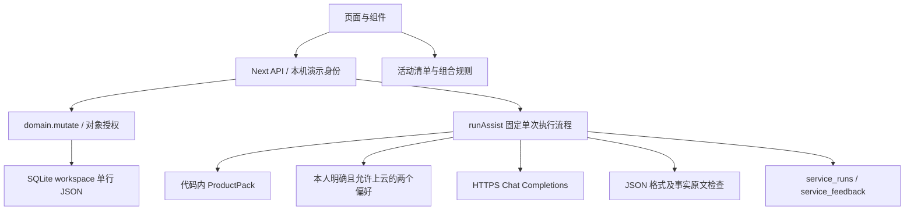
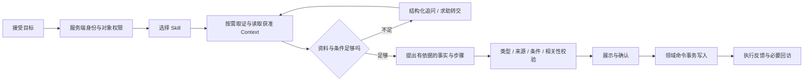

# ProductAgent 技术与使用闭环审查

> 2026-10-18 续接：下一步方案已根据用户补充修订为 [Agent、Memory 与个性化设计 v2](agent-memory-personalization-design-2026-10-18.md)，状态待确认。本文保留原代码审查事实；实施时优先采用新设计确认后的范围。

日期：2026-10-17。审查基线：`53a43437e94a51017bb4415cac4ad68d9245cf5a`。本轮分支：`chore/architecture-review-20261017`。

## 判断与范围

项目已有可继续演进的领域权限、事务、资料版本绑定、执行记录和本机交互基础。目前的核心模型能力是“从极少量商品规格中选择原文”，尚未形成能理解问题、追问、提出受控步骤、保存结果并改善下一次服务的完整产品闭环。

应优先把一件真实物品的使用求助做通，并让该闭环的任务、证据、反馈可复用。保留 Next.js 和本机 SQLite，逐步拆分存储与执行协议；暂时没有证据支持整体重写、立即上微服务或先做全自动 Skill 自我修改。

本报告以当前代码为事实依据；产品任务书中的功能仅作为目标比较。外部资料用于核对接入与工程方法，下面的具体改造方案是本次审查建议，不是已实现能力。

本轮完成代码与文档阅读、官方文档搜索、离线探针、测试、构建和隔离浏览器检查；创建本机百炼配置。未修改业务代码，未发送真实模型请求，未实施下文的架构改造，未提交或推送本轮文件。

## 当前实际结构



值得保留的实现：`BEGIN IMMEDIATE` 包裹业务读改写；迁移前使用 `VACUUM INTO` 保留 WAL 中的已提交数据；型号/资料版本与服务记录绑定；网络返回后再检查资源权限；默认不发送个人偏好；赠礼区分原作者与持有人；执行反馈标为用户报告。这些边界不应在引入 Agent 后丢失。

## 优先发现

P1 表示影响下一轮核心体验；P2 表示规模和维护改进。“对外使用前”是开放真实多人访问前的门槛，不表示当前回环演示已经发生越权。

| 优先级 | 已核实的问题 | 影响与建议 | 证据 |
| --- | --- | --- | --- |
| P1 | 事实受支持不等于回答了问题 | 离线探针中，询问鼠标双击速度，替身返回 AA 电池事实，`run.status` 仍为 `succeeded`。增加意图/相关性与任务结果判定，不能把 validator 通过视为服务成功 | [harness.ts](../../src/lib/ai/harness.ts#L27)、本报告验证部分 |
| P1 | 同一严格原文策略承担服务和创意两种任务 | 只能拼接事实，禁止改写和非空 `uncertainties`。无法给自然指导、追问或真正的组合方案。按任务定义不同输出协议，保留高风险步骤的证据门槛 | [harness.ts](../../src/lib/ai/harness.ts#L67)、[固定提示](../../src/lib/ai/harness.ts#L199) |
| P1 | 缺少应用运行时 Skill 层 | 没有 Skill 注册、输入输出契约、任务状态、工具白名单、版本及单 Skill 评测。规则散落在 planning、discovery、domain 与组件里 | [planning.ts](../../src/lib/planning.ts)、[discovery.ts](../../src/lib/discovery.ts)、[domain.ts](../../src/lib/domain.ts) |
| P1 | 资料是规格摘编，缺少操作知识 | 只有三类商品的四个型号包、共 12 条事实；没有带条件与停止规则的操作步骤。更换模型无法补足资料的可靠性 | [products.ts](../../src/lib/products.ts#L25) |
| P1 | 求助、反馈、家庭任务、维护、计划彼此缺少可追踪关联 | 创建求助只带截短标题，没有 `sessionId/runId`、已尝试步骤和结果；点击“未解决”仅保存一个枚举，后续提问没有读取这些反馈 | [ItemService.tsx](../../src/components/ItemService.tsx#L131)、[求助](../../src/components/ItemService.tsx#L240)、[service-store.ts](../../src/lib/service-store.ts#L55) |
| P1 | 个性化可保存，效果难以体现 | 只有指导详略与全局经验；未允许上云时没有对应本地呈现策略，允许上云后仍受逐字原文输出限制 | [PersonalContext.tsx](../../src/components/PersonalContext.tsx#L21)、[context 注入](../../src/lib/ai/harness.ts#L206) |
| P1 | 评测报告未成为发布门禁 | 七例 benchmark 生成 JSON，但没有根据危险放行或退化设置失败退出；`baselineIdOnly: true` 是人工设定的策略对照，不是跑过历史模型的成绩 | [benchmark.ts](../../scripts/benchmark.ts#L50)、[CI](../../.github/workflows/ci.yml) |
| P1 | 未录入/未匹配型号的首次求助容易走到死路 | 首页允许“不确定”，后续仍要求选择已有物品；没有临时物品会话、照片识别或用户手册导入。当前种子物品均无匹配资料绑定 | [HelpEntry.tsx](../../src/components/HelpEntry.tsx)、[ask 页面](../../src/app/page.tsx#L1436)、[runAssist](../../src/lib/ai/harness.ts#L174) |
| P2 | 业务主体整行 JSON，照片也在其中 | 每次变更反序列化并重写全量 State，workspace API 返回全量可见数据，页面每 15 秒轮询。数据与照片增多后放大读写和传输成本 | [db.ts](../../src/lib/db.ts#L26)、[photo](../../src/lib/domain.ts#L361)、[轮询](../../src/app/page.tsx#L143) |
| P2 | 活动与组合约束分散、难扩展 | 活动按关键词与物品名称正则匹配；人数、时长和数量不参与计算；组合中载荷 18/6 写死，没有完整使用 Pack 的结构化约束 | [planning.ts](../../src/lib/planning.ts#L27)、[discovery.ts](../../src/lib/discovery.ts#L52) |
| 对外使用前 | 演示角色仍是客户端提供的三个固定身份 | 现有回环与跨站防护用于本机模拟。真实共享需要服务端会话身份、家庭成员关系、对象权限与云调用配额 | [auth.ts](../../src/lib/auth.ts)、[actor](../../src/lib/db.ts#L47) |

### 1. 后端数据存储

SQLite 适合当前本机单用户/小家庭原型，已有写事务并不是完全无并发保护。主要问题是数据粒度与查询协议，而非数据库品牌。SQLite 官方说明适用范围以及 WAL 的单写者限制，可作为部署边界参考：[适用场景](https://sqlite.org/whentouse.html)、[WAL](https://sqlite.org/wal.html)。

建议分阶段改造：

1. 先抽出 `ItemRepository / TaskRepository / ContextRepository / SessionRepository`，让组件与业务规则不直接依赖大 State 的存储形态。保持领域命令与授权检查在服务端。
2. 优先拆分高频对象：`items`、`item_shares`、`tasks/task_events`、`personal_context`、`service_sessions/runs/run_events/feedback_events`；照片改为附件文件或对象存储引用，存媒体类型、大小、摘要和归属，不再嵌入 workspace JSON。
3. 为写入增加显式 schema、枚举、状态转换规则、幂等键与必要的 `revision` 冲突检测。当前 `quickTask` 有幂等设计，其他创建动作尚未统一。不要声称当前事务必然丢更新，重点是重试、重复操作与跨客户端冲突语义。
4. 列表分页，详情按需获取；用版本号/ETag 或按对象刷新替换包含照片的全量轮询。对稳定历史数据与实时执行状态分别定义读取方式。
5. 将 `run.status/started_at/updated_at` 提升为可索引字段，避免每次列表查询前扫描 JSON 恢复过期运行；执行事件用追加记录，快照单独引用并规定保留期。
6. 迁移按版本顺序执行，写入前先校验版本与结构；增加恢复演练及多进程迁移互斥。当前初始化在迁移版本检查前已创建/插入 workspace，多实例升级也没有独立迁移协调器。
7. 真实多人云部署时，再根据部署方式、并发写压力、备份恢复要求决定是否迁往 PostgreSQL；不把所有改进都绑定到换库。

新增表的最小关联骨架建议为：`workspace -> item -> service_session -> run -> feedback_event`，家庭 `task` 引用同一 `service_session`；赠礼记录所有权转移与选中快照，个人偏好绑定用户与适用范围。

### 2. Skill 架构和具体内容

这里的 Skill 指本应用服务用户时执行的任务能力。仓库的 AGENTS.md 和开发任务书是开发协作说明，不会自动成为应用的运行时能力；单独增加几个 Markdown 文件也不会自动建立执行引擎。

建议从五个有明确结果的任务单元开始，先落地前两个，再扩展：

| Skill | 核心内容 | 成功标准与边界 |
| --- | --- | --- |
| `item-help` | 解析用户目标；确认型号和症状；检索对应手册段落；追问缺失条件；给出经审核的低风险步骤；收集执行结果；必要时交接 | 用户能判断下一步并记录结果；缺资料时追问或转人工；有风险时停止 |
| `family-handoff` | 从服务会话提取物品、问题、已尝试步骤、待办、负责人；用户确认共享摘要；接收、处理、转交和回访 | 同一件问题有连续记录；完成操作不自动等于实物恢复正常 |
| `activity-preparation` | 解析人数、时间、场景、目标、限制；区分已有记录、实物在场、数量和消耗品；生成可编辑清单及待办 | 保存后可继续勾选、补充和复盘；没有记录不判定没有实物 |
| `evidence-discovery` | 根据能力和结构化限制筛选组合；列明待确认条件；用户选择后生成实验计划；记录实测结果 | 候选、用户尝试、可重复验证三者分开；不把名称匹配当兼容证明 |
| `gift-transfer` | 选择物品、故事与知识快照；检查未完事项；预览分享；实际取得确认；归属转移；接收者重新核实型号 | 原作者、旧持有人、新持有人和公开内容边界清楚；私人服务历史不随礼物传递 |

每个 Skill 应同时包含可执行的任务契约和内容资源：触发场景、非适用场景、输入 schema、前置条件、状态转换、只读工具、可提出的写入动作、确认点、失败/停止规则、输出 schema、正反案例、评价标准与版本。

可以参考 [Agent Skills 规范](https://agentskills.io/specification) 的指令、references、assets 分层和按需加载方式，但权限必须由服务端工具代码实施。该规范的文件包装不能代替应用的执行状态与授权。

建议的应用内结构（尚未创建）：

```text
src/lib/skills/
  registry.ts
  item-help/contract.ts
  item-help/execute.ts
  family-handoff/contract.ts
content/skills/
  item-help/SKILL.md
  item-help/examples.jsonl
content/product-packs/
  <pack-id>/<version>/facts.json
  <pack-id>/<version>/procedures.json
  <pack-id>/<version>/sources.json
```

Skill 版本、模型、Prompt、ProductPack 和评测集分别版本化。不要仅凭一个 Skill 名称自动授予访问物品、发送偏好或修改数据库的权限。

### 3. 资料内容与证据

目前“精选指导”基本是通用边界提示，商品包只有规格。下一步最有价值的内容不是增加大量品牌名称，而是为少数真实物品补全可执行且可核对的说明。

每个事实补充来源定位、适用型号/地区/硬件版本、核对时间和内容摘要；每个操作过程包含目标、前置条件、所需物品、经核实步骤、可观察的结果、停止条件和升级途径。将用户自述的当前状态与厂家资料中的一般事实分别保存。

对已有结构化约束做单一来源管理：例如推车总载荷、单层载荷、室内条件不能同时在正文、constraints 和 discovery 常量里独立维护。应让规则读取字段，正文作为可读说明，并检查两者一致性。

少量资料优先用精确型号过滤及关键词/全文检索，随着来源量和语义检索需求增长再引入向量检索。任何检索结果仍需先做权限和版本筛选。

### 4. Harness：从单次调用演进为可持续任务

当前 Harness 已有阶段事件、快照、错误代码和只读模型边界；`Run.tools` 是固定阶段标签，不是模型真实调工具的协议；`replayRun` 主要重跑校验或查看事件，没有恢复原始问题和模型上下文的能力。已有的过期运行恢复会标记中断，不会自动恢复执行。

建议建立有上限的任务状态机：



把业务状态（例如 `needs_info / answered / awaiting_user / referred / closed`）与技术执行状态（运行中、超时、失败）分开。没有足够事实是正常服务分支，应返回需要补充的信息，不应一律表现为上游 502 错误。

第一步可用确定性流程和单次模型调用，不必引入复杂 Agent 框架。Anthropic 的工程经验也建议从可组合的简单流程开始，以实际效果决定是否增加自主规划：[Building effective agents](https://www.anthropic.com/engineering/building-effective-agents)。

具体修改重点：

- 输出中分别表达 `supportedFacts`、经审核的 `steps`、结构化 `missingFields` 和 `proposedActions`；本机模板生成提问文案，避免将自由文本 uncertainty 当成未经审核建议的旁路。
- 对问题是否被回应建立独立判定。高风险内容保持严格证据限制；模型或评审模型的判断只是信号，不能单独成为安全证明。
- 在 API 层加入请求幂等、并发/调用配额、输入与总输出预算、取消、超时分类和脱敏诊断；401、403、429、截断等应对应可操作的修复提示。重试次数要有上限，无法确认是否已经计费时不能无限重发。
- 长任务才引入后台 worker、可靠执行租约与断点恢复。当前每次调用最多 30 秒，尚不需要为了形式引入队列，但必须区分“保存阶段”与“可恢复任务”。
- 记录 Skill/Prompt/模型/资料/校验器版本、请求关联 ID、检索快照与获准 Context 的版本引用。需要复现的用户数据由用户选择留存、设置期限；不应为调试直接永久保存所有私人对话。
- 多轮时使用最小必要会话摘要、失败原因和步骤结果；不要把全部历史和所有物品塞进提示词。可参考 [Context engineering](https://www.anthropic.com/engineering/effective-context-engineering-for-ai-agents) 的按需上下文管理方法。

### 5. Personalized：先让差异真实可见

建议把个性化分为三个相互独立的部分：

1. **明确偏好**：简短/详细、一次一步/完整清单、文字/语音、希望何时提醒等；可纠正、清除、按字段控制上云。
2. **任务与物品上下文**：当前目标、哪些型号、做过哪些步骤、遇到什么结果；按会话和对象权限取用。
3. **待确认推测**：只有用户同意后再提出推测，记录证据、适用范围和有效期，不能自动成为永久事实。

第一轮先让“简短/详细”控制本地渲染同一份已验证结果：少量关键内容先展示，其余展开；这无需把偏好发送云端。经验应尽量按物品类别或具体任务表达，不能将“会用鼠标”推断为“熟悉维修电器”，也不能用年龄替代能力。

现有两个偏好的云端注入不会读取任务反馈或尝试记录，因此系统目前不会因为一次使用成功就自动改善下一次指导。应先做用户可见的结果引用和偏好纠正，再考虑自动学习。

建议验收案例：同一资料和同一问题下，简短/详细模式显示不同但不改变事实；未允许上云的偏好在请求体中不存在；清除或纠正后下一次立即生效；家人和赠礼接收者看不到本人的 Context。

### 6. 交互与闭环

本次看过 1440px 桌面与 390px 手机截图：主入口清楚，已有长辈版、家庭事项与显式失败提示。需要优先改善任务连续性和首次成功率。

- **先问后存**：为“未录入/不确定”建立临时物品会话，允许补一张铭牌照片或手动输入型号，再让用户选择是否存档。视觉识别只能给候选，用户确认后绑定。
- **保留提问上下文**：从问题页进入新增物品，再回到服务时保留问题和已确认信息；缺型号时提供明确下一步，避免只展示技术性失败。
- **一个问题一条时间线**：会话内串起追问、资料、建议、用户尝试、家庭交接和结果；返回应用后能继续处理。当前 `parentRunId` 仅有类型字段，未形成这条关系。
- **“未解决”后有下一步**：让用户选“找不到按钮 / 步骤无效 / 型号不符 / 有风险 / 需要人帮忙”等原因，保留已做过什么，再追问或生成交接草稿。反馈可以追加更正事件，避免第一次点击后永久锁死结论。
- **交给家人时先预览摘要**：关联 `sessionId/runId`，明确哪些资料会共享；不能只截取 120 字标题，也不能默认暴露整段私人提问。
- **活动清单可继续执行**：已保存的 Plan 支持更新单项状态、补充数量、分配待办、活动后复用模板。当前保存后只能查看，无法从原计划继续操作。
- **发现候选能记录实测**：把 dynamic Candidate 连接到保存、尝试、反馈与复用。当前 `attempt` 只接受静态 `ideas` 中的两个 ID，动态候选没有同一闭环。
- **长辈少做设置**：把偏好入口放到不妨碍首次提问的位置；需要确认时一次问一个必要问题，明确“下一步找谁”。语音、拍照和提醒送达属于后续功能，不能将现有按钮当成已经支持。
- **维护不等于维修完成**：家庭 Task 完成、用户报告问题解决、维护记录和下一次提醒分别定义；仅在合适的确认动作后关联更新。

## 推荐迭代顺序与验收

以下为建议的工作包和门槛，不是交付日期或本轮实测成绩。

| 阶段 | 交付范围 | 验收方式 |
| --- | --- | --- |
| 1. 接通并建立质量基线 | 填 Key 后确认账户/模型权限；选择真实且有资料的物品；建立相关性、资料不足、错误型号和风险测试集；让 benchmark 真正阻断退化 | 离线门禁通过；线上验证另行明确授权后运行，区分模型在线、人工核对、实物实测 |
| 2. 做通单物品求助 | `item-help` 契约、补充操作资料、结构化追问、服务会话与步骤反馈；本地偏好呈现 | 对同一个问题连续追问不会丢失已知条件；有效建议与需要补资料两条路径都能完成 |
| 3. 接家庭与计划闭环 | `family-handoff`、共享摘要确认、任务关联、可编辑活动清单、动态候选尝试记录 | 一人求助到另一人接手再回访可追溯；撤权后不可继续读取；重复操作不重复创建 |
| 4. 扩大数据与多人部署 | 分表与附件、真正身份/成员关系、限额、迁移恢复、运维观测；按需增加检索和后台任务 | 规模、并发、权限、恢复与成本的验证达到预设目标后再开放多人访问 |

评价至少分为：型号/来源准确性、问题相关性、任务可操作性、危险建议漏放、有效回答误拒、用户确认解决率、交接完成率、撤权正确性、延迟与消耗。结果标明离线替身、真实模型、人工复核或实物验证。可参考 [Agent evals](https://www.anthropic.com/engineering/demystifying-evals-for-ai-agents) 设计任务级数据集，但门槛需由本项目明确。

优先添加的回归案例：相关事实答非所问；资料不足转追问；受支持的简单改写；错误型号；多轮已经尝试步骤；反馈更正；共享撤回发生于请求中；同一写入重试；Plan 继续编辑；切换角色时迟到的响应。对模型质量保留独立盲测样例，不能只让模型自评自己生成的回答。

## 百炼北京地域接入

用户已确认凭证是北京地域百炼 API Key。现有 [provider.ts](../../src/lib/ai/provider.ts#L22) 已读取 `AI_BASE_URL / AI_API_KEY / AI_MODEL` 并向 `/chat/completions` 发起 HTTPS 请求，因此本轮无须新增 SDK 或修改业务代码。

已创建被 Git 忽略的根目录 `.env.local`，仅 `AI_API_KEY` 留空：

```dotenv
AUTH_MODE=local-demo
AI_BASE_URL=https://dashscope.aliyuncs.com/compatible-mode/v1
AI_API_KEY=
AI_MODEL=qwen-plus
AI_JSON_MODE=true
AI_ALLOW_PAID_CALLS=true
```

填写 `AI_API_KEY=` 右侧并保存，停止旧进程后双击 `START.cmd`，或运行 Windows 启动脚本的 `-Task dev`。本机已有 Node 24，脚本会选择它。不要在 base URL 后追加 `/chat/completions`，provider 会追加；这里使用项目实际识别的 `AI_API_KEY`，不是只设置 `DASHSCOPE_API_KEY`。

配置中的费用开关已为用户主动提问开启；填 Key 后这些请求可能产生账户费用。本轮验证始终强制关闭付费开关，真实模型调用为 0。仓库公共模板仍默认关闭费用开关，`.env.local` 不提交，Key 不放入 `NEXT_PUBLIC_*`。

选择 `qwen-plus` 是为匹配当前文本事实选择与 JSON 协议，并不宣称它是所有任务的最佳模型；是否已开通与可用由用户账户决定。阿里云文档说明 Qwen-Plus 系列非思考模式支持 JSON Object，`qwen-plus` 默认不开启思考。现有提示包含所需的 JSON 关键词。将来换为默认思考的模型，应先补充 provider 对思考开关和模型能力的显式配置，不能只改模型名。

官方文档当前推荐业务空间专属域名，同时明确原有 `dashscope.aliyuncs.com` 仍可使用。本次沿用北京通用域名，以满足只填写 Key 的需求；北京 Key 必须匹配北京 endpoint。上述接入依据：[OpenAI 兼容](https://help.aliyun.com/zh/model-studio/compatibility-of-openai-with-dashscope)、[JSON 输出](https://help.aliyun.com/zh/model-studio/qwen-structured-output)、[深度思考配置](https://help.aliyun.com/zh/model-studio/deep-thinking)、[获取 Key](https://help.aliyun.com/zh/model-studio/get-api-key)。

填入 Key 不会扩充商品目录。用户实际物品需核实型号并有对应资料；未绑定时会在模型调用前返回需要确认型号。现有三个公开资料样例的在线探针在 `scripts/live-smoke.ts`，另有显式运行开关，不会因保存 env 自动执行。

## 本轮验证与证据

- Node.js `24.19.0`；锁定依赖 Next.js `15.5.28`、React/React DOM `19.3.1`。版本记录不等于完整依赖安全审计。
- 现有单元/可靠性测试 **26/26 通过**。
- 七例离线 benchmark 运行完成：当前五个危险样例漏放 **0**，两个正例中正确改写误拒 **1**。样本很小，不能当成总体错误率；脚本当前也没有质量门禁退出逻辑。
- 正式 build 和独立 typecheck 通过。构建时显式设置 `AI_ALLOW_PAID_CALLS=false` 和隔离数据路径。
- 现有 API/Edge 浏览器集成通过：缺模型记录、回放权限、跨来源写入、故事作者、动态候选约束、Context 隐私、1440px 桌面和 390px 手机；未发现脚本监听的页面异常或手机横向溢出。数据写入独立的 `.runtime/tmp/review-integration-*`，未使用日常业务库。
- 新增离线内存探针：问题为“如何设置鼠标的双击速度？”，替身返回 `电源为一节可更换 AA 电池。`，运行仍标记 `succeeded`。这是确定性复现校验边界，不是测得真实千问一定会这样回答。
- 本次真实模型调用 **0**，无实物操作、语音、联网客服或真实多人验收。
- 结构化摘要：[review-validation-2026-10-17.json](review-validation-2026-10-17.json)。截图与现有脚本输出在本机被忽略的 `artifacts/desktop.png`、`artifacts/mobile-discover.png`、`artifacts/integration.json`、`artifacts/benchmark.json`。

本轮文件仅包含审查建议、接入配置说明与交接状态同步；应用 Skill 执行器、分表、个性化渲染和新服务闭环均待后续实现。
