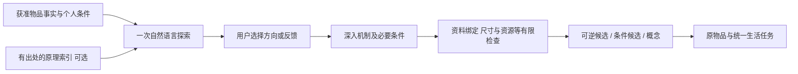

# 物间创造力 V2：开放探索、真实灵感与渐进核对

**产品判断：软件链路已改善，创意质量仍未达标。** 本轮按最后一份用户指令收敛，不自动开展 V3/V4，也未接入 REA 或更换 Agent 框架。

用户现在可以在同一件物品里先广泛找新用途，再选一个方向深入条件、收藏/否定并明确决定是否让反馈参与下一轮，最后回到统一家庭对话。探索第一轮不要求 JSON、来源编号、固定点子数或字数；默认一次自由发散，社区原理启发可选。大胆想法可以保留为概念，实施条件不成立时不输出操作步骤。

体验：本机本轮预览 [http://127.0.0.1:3207/#home](http://127.0.0.1:3207/#home) → SAMLA 或其他物品 → **让它多一种可能**。这是独立模拟家庭，没有真实持有/硬件验证。未改动原来的 3204 服务。

- [质量审阅与实际例子](QUALITY_REVIEW.md)：为什么没有认定创造力成熟。
- [测试、调用与复现](TEST_REPORT.md)：362 项离线测试、API/浏览器结果和账目。
- [社区来源及获取边界](SOURCES.md)：8 条真实案例原理索引，未接通小红书/Reddit搜索。
- [REA 有界预研](REA_RESEARCH.md)：源码、环境要求、适配器边界与下一轮建议，未运行 REA。
- [决策](DECISIONS.md)：默认简单路径、可选检索与延后实施检查。
- [匿名样本入口](evidence/blind/09.md)、[空白真人评审表](evidence/human-review.csv)；共 24 个任务、92 个匿名对照槽位，失败也保留。尚无独立真人盲评结果。
- 实际截图：[探索桌面](evidence/explore-desktop.png)、[探索移动](evidence/explore-mobile.png)、[条件核对](evidence/conditions-desktop.png)、[回到统一对话](evidence/continued-mobile.png)。截图中的点子不是推荐其物理真实性。

## 本轮实际机制

检查只能发现覆盖到的明确问题，不是完整物理模拟或心理效果验证。真实模型仍会编造支点、材料性质和夸大的认知效果；没有证据支持更复杂流水线、换模型或开思考就能稳定解决。
