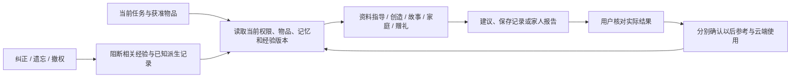

# 本轮实际改变了什么

## A. 已证实改善的用户任务

- **经验能够累积。** 已复现旧版“完成台灯B导致耳机A经验在C中丢失”，修复后跨任务、跨会话及105条无关历史仍可召回。普通新增反馈不再清空账号Context；耳机经验可以更正、停止复用或忘记。
- **授权与经验一起生效。** 历史结果涉及多件物品时，每件都须仍获授权；已撤销经验及其已知派生链不能自动复活。允许本人参考与允许上云是两个决定。
- **同一任务不只共享编号。** 单物品指导和开放创造会获得获准经验；发现入口有实际TaskRun。家人接手、未解决、报告完成会在同一事务更新原任务，页面也能看到状态。用户报告完成不等于现实维修完成。
- **纠正不会无条件清空一切。** 已知物品的破坏性变更使相关长期经验失效；可证明无关的单物品会话保留。全局、开放创意/自动任务或依赖不明的旧历史仍保守清理，所有在途检查点重新核对。
- **赠礼保留边界。** 原故事只以用户选中的快照传递，接收者建立独立实例，其后双方私人经历不自动共享。原有分身、创造力V2与REA软件实验保留。

## 为什么改这些代码

| 模块 | 原因 | 本轮处理 |
|---|---|---|
| foundation/tasks、memory/store | 同一epoch承担“新增”与“破坏性失效”，长期经验只能保留最近一批 | 独立隐私scope版本、经验revision/依赖、正常追加不清空、作者更正/忘记API |
| foundation/schema | 老记录没有独立有效性元数据 | 有备份的增量V2；只保留升级时仍有效的旧经验，不恢复陈旧记录 |
| context/builder、grounded-answer、ideas | 长期经验此前主要进入家庭长流程 | 当前权限下检索；独立云许可；接入单物品及开放创造 |
| collaboration、specialists、service | 旧家庭状态更新不意味着统一任务更新 | 同事务同步阶段/revision/用户报告依据，摘要仍须明确确认 |
| evidence、reviewed-facts、acquisition | 引文存在不证明结论；中文检索可能漏掉英文后部操作 | 标注literal_only；有限主张审阅锚点及范围核对；跨语言主题找段落 |
| TaskContinuity、EvidenceClaims | 用户无法直接管理经验有效性或看来源边界 | 同一入口查看经验、纠正/停止复用/忘记，展开厂家主张与原文 |

## B. 尚未证明体验提高的工程改进

有限原子主张系统能拒绝未覆盖的ANC否定、维修费/保修、错误型号/地区/固件；不再直接发布实验模型的自由事实段落。但它只有少量服务器审阅属性，不是通用语义验证器。逐字锚点、规范值和来源哈希是边界，不是任意结论的证明。实验事实问答仍默认关闭。

本轮公开读取Sony、Logitech和DJI资料，并对本地真实缓存进行9项确定性核对。IKEA抓取失败、DJI规格页内容不足均保留。A/B模型执行器输入与工具往返采用替身验证；不能据此声称模型更聪明、创意更好或回答更快。

## C. 阻止成为可靠产品的问题

1. 34个真实模型场景本任务尚无付费授权；没有新的直接千问对照、事实正确率或模型有效完成延迟。
2. 语义主张覆盖窄；动态网页、来源冲突、地区/固件未知仍需更可靠的审阅与适用范围判断。
3. 跨物品创意仍须真实模型与真人评审，物理条件不能靠同模型认可证明；本轮没有实物验证。
4. 旧依赖不明的会话只能保守清理；不识别用户手工再次粘贴的同义信息，不能承诺语义遗忘或远程删除已分享副本。
5. 家庭结果仍是用户报告，本机独立账号不是公网身份/恢复体系。任意设备适配、真实硬件、公网部署未验收。

结论：已经修复可复现的经验与任务断点；没有证明整体智能升级成功。测试和授权建议见[测试记录](TEST_EVIDENCE.md)与[未达标项](REMAINING_GAPS.md)。
