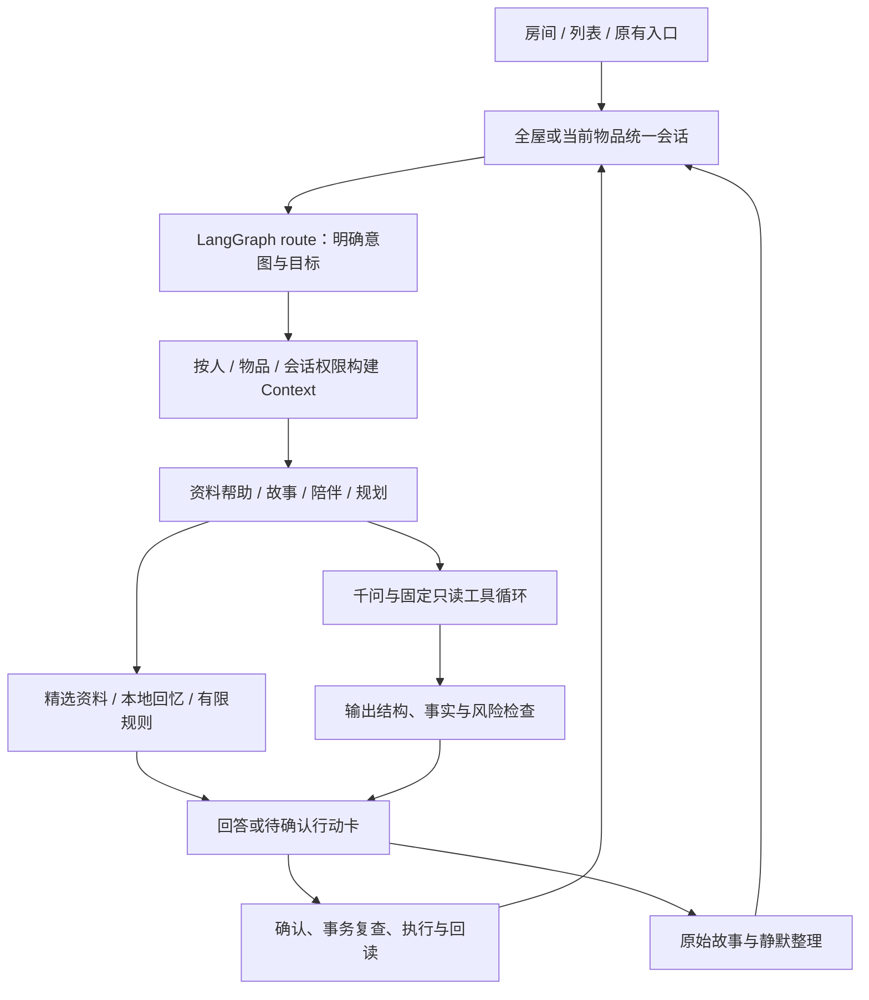

# 家庭空间、物品伙伴与全屋 Agent：实现及验收

> 后续更新：记忆回复已由[记忆表达 Skill](memory-storytelling-2026-10-18.md)深化；当前 Prompt、本地组织、云端授权与来源检查以该说明为准。下文保留家庭空间实现的历史记录。

基线：4394b06。分支：feat/home-scene-item-companions。日期：2026-10-18。设计依据见 [迭代文档](home-companions-iteration-2026-10-18.md)，测试事实见 [最终验收摘要](home-companions-validation-2026-10-18.json)。本轮没有添加模型服务商或改变 Key 配置。

## 可以直接体验什么

启动根目录 START.cmd，打开 http://127.0.0.1:3100。新克隆先安装 Node24、npm ci、npm run build、npm run start:local；配置模型仍用 .env.example → .env.local，只在本机填写 Key。

1. **我的家**：切换客厅、厨房、书房等预设房间。默认同时显示有标记的演示物品，可取消“显示演示物品”。未知位置留在“待布置”。列表仍可使用，不需要完整户型。
2. **点开一个物品角色**：同一输入框可问使用方法、讲真实经历、说“聊聊以前的故事”或“今天很累，陪我聊聊”。来源和当前意图显示在回应内；“物品资料与故事记录”回到旧档案。
3. **自己的故事**：添加真实物品后讲述，例如“毕业那天妈妈送我这个相框，我喜欢阅读”。明确叙述保存到该物品原时间线，静默整理保留来源；提问、假设、请求创作和请求回忆不会当作新经历。演示角色内的故事保持案例隔离。
4. **全屋对话**：点“返回全屋对话”；可问“家里有哪些物品？”、某物品“在哪里？”或“帮我准备周末野餐”。同名、不能精确匹配或需要选择案例时展示候选，不假装已确定。
5. **计划**：野餐、旅行、阅读角可生成规则清单，展示候选和待核实内容，确认后保存到原“活动准备”。其他布置/整理目标可以走模型建议，没有对应行动卡时不声称已保存或执行。真实资源不混入案例物品。
6. **家庭协作**：选已共享的日常物品，说“请爸爸帮我固定这件书架”，先看实际摘要，确认后在原“家庭事项”查看。只分享该摘要；演示物品的新增事项标明演示，不附上私人记忆和整段对话。
7. **位置**：选择自己拥有的物品，点“调整摆放”，支持拖动、房间选择和键盘可用的滑块。保存后刷新仍保持，并同步原物品档案。其他家庭成员可查看共享物品，不能代替所有者调整位置。位置是用户记录，不是实际家具自动移动或设备定位。
8. **角色**：类别外形、ID 配色与细节、呼吸/眨眼/思考/回应动画。新建物品会按名称/类别匹配书架、桌、沙发、椅、床、冰箱、洗衣机等模板，未知类别使用通用形象；不是自动识物。待办状态来自已登记家庭事项，不能推断设备故障或人的健康。关闭动画可持久保存，系统减少动态效果时不播放动画。
9. **原有体验**：首页记忆区单独可见；“使用帮助与原有功能入口”展开旧帮助表单/家居案例。活动、家庭、发现、礼物及长辈版保留。旧步骤示例仍可离线测试。

## 实际架构

每件物品有独立身份和会话范围，使用同一个 LangGraph 运行时和千问适配器；不启动每物品常驻进程。本轮 router 为明确选物、有限中文规则和澄清，不是通用模型语义分类器。多物品的可访问清单可通过原生工具供模型提出建议。模型没有 SQL、shell、任意写工具或未授权第三方服务。

旧 service / story / ideas / companion 模式兼容。新增 mode=auto，每轮在 route 节点决定有效 Skill/Context，存储会话类型保持 auto。当前默认预算仍是 3 次模型、6 次工具、45 秒；SQL checkpoint、租约、requestId 和 revision 继续生效。

Prompt 升至 human-item-agent-v1.3：角色与物品名称位于任务数据而非插入系统指令；自然回应本次叙述，不要求填写画像；真实故事使用 general，创作与经历区分；没有行动回执不声称已经通知、移动或完成操作。验证仍是结构和有限规则，不能宣称全面语义安全。

## API 与代码地图

| 路径 | 职责 |
| --- | --- |
| src/components/HomeExperience.tsx | 房间、列表、选物、摆放与统一对话容器 |
| src/components/ItemCharacter.tsx / src/app/home.css | 原创 SVG 模板、按 ID 呈现和交互状态动画；无额外运行依赖 |
| src/lib/home/router.ts / decisions.ts | 明确路由、有限场景、本地找物及动作预览 |
| src/lib/home/contracts.ts / store.ts | Zod 契约、位置权限/版本、到期行动建议与事务回执 |
| src/lib/agent/graph.ts / contracts.ts | LangGraph route 节点、有效 Context/Skill、auto 模式、行动卡 |
| src/lib/repositories/sessions.ts | 故事提交、每轮目标、跨物品会话权限与反馈隔离 |
| src/lib/memory/ambient.ts | 严格区分请求回忆与叙述，回填遵守逐条 capture 标记与物品范围 |
| src/lib/repositories/home-schema.ts | v6 增量迁移及升级前备份 |
| src/app/api/home/route.ts | 经过本机角色保护的位置读取/修改、确认/取消 |

GET /api/home：返回预设 rooms 和当前角色可访问的 placements。

POST /api/home：`{action:"place",input:{requestId,itemId,roomId,x,y,expectedRevision,expectedLocation}}`；坐标归一化且有边界。`{action:"confirm"|"cancel",id}` 仅处理服务端已生成且已提交到对应会话的行动卡，不接受客户端自编动作。

POST /api/assistant 原契约新增 mode=auto；回应增加 route 和可选 actionCards。行动确认返回最新会话 revision 和真实领域结果；重复确认只返回同一回执，不再创建计划或任务。会话刷新后行动状态仍在。

## 数据与隐私不变量

- v6 新增 home_placements、home_place_requests、home_proposals。房间是预设常量，本轮没有户型编辑器或自定义房间 CRUD。主 workspace 仍是 JSON，其余原表和故事保持。
- v5→v6 升级前 VACUUM INTO 保存完整已提交数据，保留原备份。位置含版本、物品身份和当时档案位置；旧坐标失效不覆盖新档案。修改同时核对 revision 与 expectedLocation，避免覆盖另一窗口的修改。
- 行动卡 15 分钟到期；事务内复查本人、会话、物品授权/身份、资源状态和位置版本。未提交的孤立建议不能执行；租约期间不能并发确认；关闭/到期会话不再执行。访问时清理到期建议。
- 全屋会话记录引用过的物品身份；任意相关物品撤权或流转后，旧会话不能继续读取。切换目标清除旧排障条件和尝试状态；另一物品的反馈不进新目标模型 Context。
- 原始故事与派生记忆分开；用户消息带 itemId 和 capture 标志。待澄清、找物与行动请求不作为新经历回填；后台核对也遵守该标志。模型返回和创作不被提取为真实故事。
- 新统一对话可能把本次消息交给已配置的千问。历史私人记忆仍默认不上云，逐条授权过滤不变；不会自动把全文历史发给模型。连续自然对话对未授权历史的理解仍有限，本地回忆可用。
- 合成案例继续有 demo 标记，不计入真实持有、全局画像和活动资源；全屋请求案例故事会引导到该物品对话。案例中的用户新讲述同样限定在该案例。首次介绍仍仅一次。

## 验证与实际边界

自动验证全部隔离数据库、关闭真实模型费用。新增测试包含迁移、同名/隐私、位置 CAS、重复动作、取消/过期/撤权、故事/回忆切换、案例隔离、跨物品反馈隔离、工具循环和模型执行中撤权。协议替身是离线协议测试，不作为在线千问成功记录。

运行：npm test、npm run typecheck、npm run test:benchmark、npm run build、npm run test:acceptance。仅调试新旅程可使用 Node24 运行 `node scripts/verify-local.mjs home`。最终摘要与合成截图在本轮 validation 和 review-evidence/home-companions-20261018。

没有新增真实识物/OCR、语音、IoT、后台通知、订单、真实登录或跨设备家庭。没有全品类知识、任意语义画像、精确户型或自动改变 Prompt/Skill 上线。网页存在可选人格设置；进入普通物品对话不会自动开启主动关怀、云端历史授权或真实设备监测。

## 后续顺序与回退

先用少量真实物品核实连续交流与错误记忆，再用独立评测集改进路由/提取的语义能力；补资料导入和来源过程；需要跨设备家庭时先完成真实身份、实体关系与备份恢复，再扩展同步和通知。任意视觉/语音/外部集成按费用与授权单独推进。

回退代码需要匹配的数据库版本。不要用旧程序直接打开 v6 日常库或覆盖原数据。先停服务并另存当前库/WAL，在隔离 PRODUCT_AGENT_DATA_DIR 中用升级前 v5 备份与旧代码核验；本轮后新增的业务数据需另行迁回。审查 ZIP 只带源码、锁文件、测试与脱敏证据，不带 Key、日常数据库、依赖或构建缓存。
