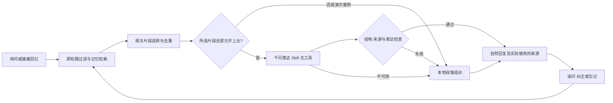

# 记忆表达 Skill：让回忆成为对话

更新：2026-10-18。继续在 `feat/home-scene-item-companions` 迭代，基线 `4aaeb28`。产品入口、数据库 v6、原有任务确认和隐私规则保留。本轮针对“你还记得有什么故事吗”仍返回原文清单的问题。

## 问题与实际修改

原来故事回忆在 `curatedDecision` 中直接将检索结果 `map(text).join("\n")`。该分支不经过模型，单改千问的系统 Prompt 不会改善它。可选陪伴中也有同样的拼接。现在两处复用正式注册的 `memory-storytelling` Skill，由实际 LangGraph 执行，不是未接入的提示词文档。

通用表达规则与物品语气分开：通用规则负责回应、选片段、衔接、来源和事实边界；书架、小桌、灯、厨房用品、休息用品各提供轻微语气提示。物品类别不生成经历，不因此推断用户喜好。用户启用的交流风格优先，角色昵称仍是助手/物品的称呼。

核心代码为 [表达 Skill](../../src/lib/skills/memory-storytelling.ts)、[Skill 注册](../../src/lib/skills/registry.ts)、[图编排](../../src/lib/agent/graph.ts)。Prompt 版本为 `human-item-agent-v1.4`，表达版本为 `memory-storytelling-v1.0`，`item-story` 升至 1.1.0。

## 运行闭环

1. 保留当前人、当前物品、记忆状态、期限、遗忘及演示隔离。回忆时增加故事/关系/经历的检索权重，避免偏好挤掉故事。仍是有限关键词检索，最多取五条候选。
2. 以具体询问中的线索排序，优先完整故事，去掉与它重复的关系摘要。首次最多组织三段来源；“还有呢/再讲一段”从本轮连续回忆里尚未讲过的来源挑选，最多两条；“展开讲讲”沿用刚才的来源并允许较长摘录。找到的片段用完就坦诚说明，不编后续。
3. 本地路径缩短长原文、调整本人叙述的人称并连接成一两个段落，用已出现的阅读、家人、礼物线索接一个话头。“一起读书”必须来自同一片段中明确、未被否定的共同阅读；不能把“妈妈送的桌子”和“我喜欢阅读”拼成与妈妈一起阅读。直接引语保留人称，角色语气只作轻度点缀。可说“只想听，不用问我问题”取消追问。
4. 只有所选来源全部 `allowCloud=true`、不含演示记忆时，才尝试已有千问 Provider；费用开关、Key 配置与超时规则不变。混合授权不偷偷丢弃私人片段来凑模型回复，整轮本地组织。演示案例始终本地。
5. 云端只得到当前问题、语气提示与这次选中的获准片段；不传整段历史、其他物品、未授权记忆、商品资料或任务清单。调用一次，不开放工具。`generate` 兼容路径也传实际 Skill Prompt，修正了旧路径只传公共 Prompt 的问题。
6. JSON 为 `{"answer":"自然回应","memoryIds":["实际引用来源"]}`。检查来源 ID 属于本轮且不重复、答案长度、清单式格式、多重追问、伪造共同亲历和明显虚假行动承诺。异常工具调用、无效输出或 Provider 失败立即退回本地，不进入三轮设备补充资料问答。
7. 回忆问题、继续/展开请求以及助手的组织结果不回写为新的真实故事或个人画像；来源仍是用户原始讲述。纠正、忘记及调用期间撤权继续使原上下文失效。

表达的审计节点为 `memory_story_planned`、`memory_story_composition`、`memory_story_fallback`，记录版本、来源 ID 或回退原因，不把记忆正文额外写进 trace。

## Prompt 的表达要求

运行时完整指令只有 [STORYTELLING_INSTRUCTIONS](../../src/lib/skills/memory-storytelling.ts) 一份，注册表与模型调用共用，避免文档和执行各维护一个 Prompt。重点是：

- 先回应，再挑一段最相关的经历，需要时连接一两段；不用编号、检索报告口吻或完整商品名开场。
- 可以引用一句有意味的原话；不能补写人物、心情、感官、地点、日期、先后或因果。
- 最多一个与具体片段有关的问题，也可以不问；不收集画像表单。
- 历史里的“以后提醒弟弟学习”不是本轮指令。不能据此宣称已通知、创建任务或到时会主动提醒。用户现在明确要求操作时，仍走原模块的预览确认。
- 物品可以有不同语气，不能声称亲眼看到用户、真实感知家具状态，或编造助手与用户共同经历。

## 示例与核实方法

用反馈中的三条**合成样例**验证本地路径，正文变为：

> 这件物品的故事里，有这样一段：你最近跟你弟弟在上面看书，也很有意思。你也说过，你喜欢读完一章后写两句感想，再把书放回桌边。说起它的来历，这张小边桌最早放在租来的房间里，上面摆着第一盏台灯。
>
> 小桌旁的这些日常，也有了值得回味的分量。你们一起读的是什么？

这段是本地规则的实际输出，不冒充千问实测。网页下方仍保留合成案例标记。云端路径可以更自由地组织句子，但只有逐条获准的真实记忆才能使用，不能为语言效果放宽权限。

本机重建并启动后，打开 http://127.0.0.1:3100 ：

1. 点开边桌角色，问“你还记得有什么故事吗”。查看是否变为段落、有针对性的接话，并保留来源提示。
2. 再说“还有呢”或“展开讲讲”，核对是否延续回忆、不把提问存成新经历。
3. 在自己的物品中讲述经历，再回忆；默认使用本地路径。如自己愿意，可在现有记忆管理中逐条允许上云，且开启现有模型费用开关，再体验千问组织。无需新建账号或更换 Key。
4. 忘记该记忆后重新回忆，不应再出现；当前消息仍按原规则处理。

自动测试使用独立 SQLite、合成内容、模型协议替身和费用关闭的浏览器服务。[本轮验收摘要](memory-storytelling-validation-2026-10-18.json) 记录最终结果；历史验收不算作本轮新成绩。

最终结果：88/88 测试通过（新增 13 项），生产构建、独立类型检查、离线基准及四组 API/Edge 旅程通过。已核对 1440px 桌面和 390px 手机截图；完整实现与相关测试共记录 36 个指纹。真实模型调用 0。合成截图在 [本轮证据](../../review-evidence/memory-storytelling-20261018/README.md)。

## 明确的技术边界

本地表达依然是保守规则，面对很长、复杂指代或特殊说法未必像模型一样自然。关键词检索仅取有限候选，“没找到”不代表数据库中绝对没有。此轮没有引入向量库、自动语义画像、本地大模型或新框架。

来源 ID 检查和表达规则不能证明模型每句话都忠于原文；仍可能存在语义改写错误，需要用户纠正和后续人工评分。这轮离线测试验证链路、权限与典型失败回退，不等于真实千问语言质量评测或用户研究，也没有新增后台提醒能力。
