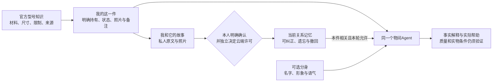

# 本轮实施决定

1. **复用既有型号包，限定三款商品入口。** 名称/型号/精确官网路径识别，现有有界HTML/PDF读取器刷新型号并发现说明链接，保留资料日期。替代方案是全网商品抓取或模型自动认证网页，成本与来源风险较大，本轮不采用。未知商品继续手动录入，不能把范围有限说成通用商品平台接通。
2. **公共设计与个人实例分开。** 复用productPacks与workspace.items；持有、型号、可用状态分别确认；个人照片校验归属；测试身份明确。没有新建全套V2表或迁库。旧API的带包录入新增持有要求，这是有意的契约收紧；旧UI和测试已跟进。
3. **故事只保留一个当前事实引用源。** 原始故事继续私人展示，明确确认后由personal_memories保存关系及来源。SQLite事务一起关闭原片段召回，避免更正/遗忘后从旧故事复活事实；原文修改/删除撤销派生记忆。替代方案是同时检索原文与更正记忆再让模型判断，本轮拒绝，因为无法可靠尊重遗忘。用户若重新主动授权旧原文，需要自行承担重新确认，当前不做自动恢复。
4. **分身复用同一个LangGraph。** persona_profiles的JSON新增可选avatar，旧数据自然兼容；名字、语气、记忆政策和启用独立。统一物间与分身显式切换；私密信息按原用户/物品权限读取，不随赠礼转移。无需Pi、Mastra或常驻多Agent。模型错误称呼仍是待修质量问题，不能把schema正确当角色理解正确。
5. **上下文按本件与本轮授权扩展。** 物品页显式允许时，相关关系记忆可参与实际帮助；不扩大共享用户权限，不自动使用所有故事。临时问题、off/explicit政策、allowCloud、归属和遗忘仍有效。切换选项会开启新的UI会话边界；同一session的服务端也截断旧授权范围之前的模型历史。
6. **保留模型答复的失败证据。** 单件隐含目标优先当前物品帮助；明确新玩法仍走原创意链。用户给出的空间尺寸进入数值检查的条件来源，但不视为厂家规格，没有提供的数字仍拒绝。没有放松物理适用性检查来“刷成功”；当前误判、过度修辞、动作条件不充分如实保留。

下一轮优先修“有来源的自然答复与实际行动建议”接缝：区分官方事实、用户条件、推导和待验证动作；针对这批保留的被拒草稿、错误称呼、混合问题建立质量验收，避免继续堆关键词或让安全校验被迫判断整段文章。应先使这两条生活流程的帮助值得使用，再扩数字分身表现或REA。仍没有足够证据支持换框架或数据库。无必须由产品负责人决定的阻断问题；后续可选择分身默认语气、授权文案及是否优先支持下一款真实SKU，属产品体验取舍。
