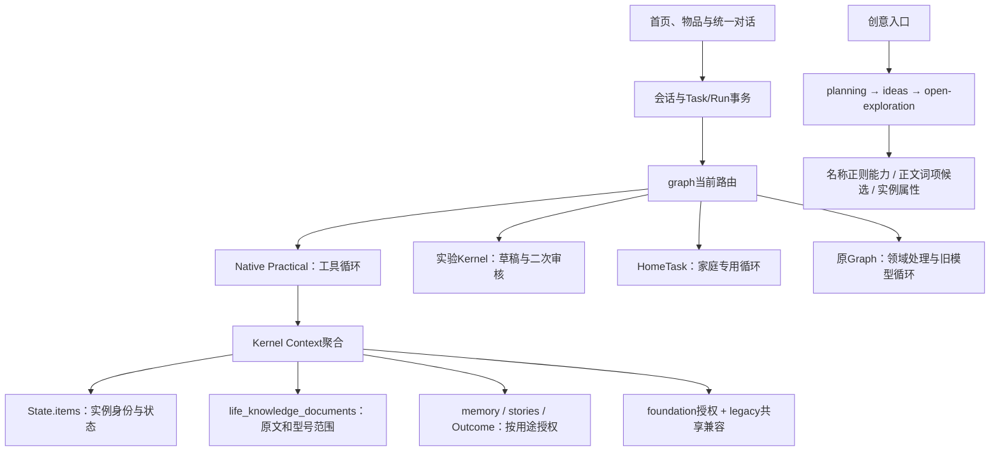

# Qwen-first 统一底座：执行状态

基线：远端 `codex/wujian-outcome-qwen-v3@c18b26d758af9281677150c513d9225a19bb4e67`，2026-11-02实际核对；main为ea32c3f。工作区 `.runtime/qwen-foundation-v1`，分支 `codex/wujian-qwen-foundation-v1`。原项目未跟踪deliverables与上一轮工作区保留。产品定稿、Instructions不改。

本轮授权：用户批准150次/80元，含只放公开商品资料的临时百炼知识库（预留最多10元）；首批技术证伪最多12次/8元。**目前真实上游调用0次**。旧250次轮次不续用、不修改。先通过Gate0/1才开始Gate2真实实验。

## Gate 0：调用链和故障复现

这张图描述**本轮基线**，不是声称已经完成收敛。service还有已确认步骤续接短路；旧Graph保留的故事、准备清单、安全和事务不能随循环直接删除。

已由源码和隔离fixture确认：

1. Practical空ID读取前八件，和相关物品混合。修复为空ID只展开已选相关物品；检索发现将在共享compiler按目标处理。
2. planning按“纸/灯”等名称把无能力事实的纪念物推为照明/记录；已删除此段名称正则，改消费同一个实例/pack事实投影。
3. 正文 `does not support playback` 仍被documentCapabilities作为声音播放候选：必须退役词项式能力提取，而非加一串否定词补丁。
4. 过期foundation授权在Kernel拒绝，但仅用canRead的底层共享reader可返回实例。已统一有DB读取到authorize；无DB纯投影只能读所有者数据。合法跨人业务必须提供DB，不扩大共享。

模型、工具和协议还未因本轮修改获得真实质量验收。首次复现的手造会话缺owner/identity导致409，属于测试fixture错误，日志gate0-repro-before保留、排除产品归因；改为真实respond生命周期后，gate0-repro-fixture-corrected才是前八件与名称推断问题的有效红测。

基线npm test：489通过/0失败/1跳过（本工作区未配置既有REA工具），不是“490全通过”。原始数据用validationFixture独立SQLite；未复制私人数据库。准确型号必须在item.model，物理事实在attributes.physicalFacts；测试先断言这两个字段，避免重犯输入错误。

## 后续门槛

- Gate1：共享语义投影、任务相关compiler、来源/修正/撤权/冲突负例；通过后才进入下一门。
- Gate2：首批12次/8元比较成熟工具与真实路径；依据结果替换重复通用机制。未建KB/未读文件不能算成功。
- Gate3：四条真实App旅程与负例。
- Gate4：独立冻结6SKU×3问题至少15/18首答，零严重错误；质量/成本对照及旧路径实际退役。

冻结集由分离的验收子任务建立，开发不读取标准答案；历史污染题不作为本轮盲测。阶段提交是恢复点，不是ACCEPTED。
