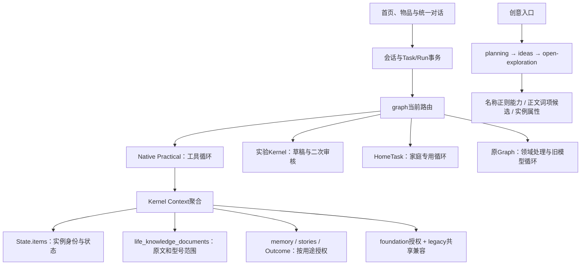

# 2026-11-03 新任务：底座收敛候选

旧任务已安全暂停并完整推送543a933；随后才启动本轮。当前最新状态只看[CURRENT](../CURRENT.md)。下文是原始历史快照，保留失败与恢复证据，不覆盖当前代码。

已实现：公开原文定位进入同一既有知识库记录，Reality/Context、资料页与开放创意复用；普通缓存问题取消强制抽取；旧Graph/HomeTask循环清退且保留领域业务；在途状态、跨物品历史、规划续接与软件REA回归修复。技术取舍见[收敛决策](CONVERGENCE_DECISION.md)，团队接口见[SERVICES](SERVICES.md)。

当前离线582/582、类型通过；生产构建正在对最终候选复验。真实PDF原76页读取导致高费用及最终答复失败，已改本地实际页码索引→选页→Qwen视觉；r4页面已回答，6请求/49.985秒，仍需原文与图示独立复核，不能把图中编号说成实物印字。关系/赠礼r4域UI两旅程通过但没有调用模型；冻结18题与四旅程完整验收尚待运行，仍NOT_ACCEPTED。

唯一费用轮次不变：qwen-foundation-20261102-r1，150次/¥80，历史台账哈希保留；实际次数金额以evidence/model-calls.json为准。原始失败r1–r3均保留。

---
# Qwen-first 统一底座：执行状态

## 2026-11-03：按用户要求暂停旧任务并保护现场

本节优先于下方历史快照。旧 Qwen Foundation 任务的后续执行已暂停，三个子任务的待恢复 turn 已取消，未强制终止文件写入；原预览/测试会话句柄均已结束。其他无法确认归属的本机 Node 进程未触碰。新《统一智能底座最终研发、工程方法升级与正式验收》须在本次 checkpoint 推送成功后才开始，不并发改同一工作区。

- 唯一授权轮次仍为 `qwen-foundation-20261102-r1`，150次/¥80；现场实际74次、估算¥9.042812，无台账 `started` 请求，余76次/估算¥70.957188。没有重置历史轮次、创建知识库或上传私人资料。
- 保留的实际改动：HomeTask薄桥、旧Graph通用模型循环删除、家庭专属Context/voice/计划与反馈、陌生官方候选保留与排序、社区文章不认证为厂家资料、连续引文引用到原文hash/范围的计划确认、当前Task意图不强迫每轮生成动作。旧领域事务和纯函数回归保留。
- 陌生开发SKU SRS-XB100未预置资料链接：r1检索找到但本地丢弃章节失败；r2故事路由回归（0模型调用）失败；修复后的r3在真实UI自主取得官方资料并完成配对及追问，共6请求，首答71.695秒、追问17.383秒。与冻结6SKU无重合，不当作最终验收。
- Task浏览器r1暴露新语义ID被旧确认接口误拒；修复后的r2已实际保存候选计划及明确授权的合成反馈，随后恢复脚本因错误折叠details超时。task-resume-r1虽ID断言通过，纠正后的实际回答为unavailable，**质量失败**，不能按脚本checks称通过。修复Task意图过度约束、按当前主题选择章节后的task-resume-r2三问均answered，共6请求，实际使用更正报告并在遗忘后不再获得该Outcome；自然语言仍有技术字段外露和不够精炼问题，未宣布完整旅程正式通过。
- 定向保护已通过：家庭相关76项、发现/读取16项、共享执行迁移7项、引文确认/呈现合同18项（各自日志为准，不能简单相加当独立总数）。新完整回归快照为569项中534通过、33失败、2取消；主要是旧generate/complete协议及待恢复回归，尚未迁完，绝不复用上一个checkpoint的561全通过宣称当前通过。
- `shared-runtime-typecheck-r2.txt`记录一次测试替身漏tokens字段导致的类型错误；暂停检查又发现foundation协议替身两处缺少options参数及其必填字段，均已按实际接口补齐。最终以`pause-checkpoint-typecheck-r3.txt`为准，不覆盖失败原文。尚未执行本次大删除后的正式构建。
- 0模型关系/赠礼UI脚本完成无型号照片与关系保存，随后在“纠正内容”选择器等待超时；实际失败留档，未宣称赠礼/4旅程完成。冻结18题仅做哈希与执行准备，**0/18 executed**；PDF正式App脚本已准备但**not_run**。
- 冻结题、答案、历史台账、私人数据库、原项目与其他工作区均未覆盖。本次仅为完整可恢复checkpoint，状态仍为 **NOT_ACCEPTED**，不建立develop发布基线、不合并main。

待新任务接续：先做简短保留/替换/删除决策，收敛公共知识积累与高效问答，完成尚未通过的协议/业务回归，再使用未污染的冻结首答和四条旅程验收。具体实施顺序由新任务决定，不机械复跑历史清单。

---

基线：远端 `codex/wujian-outcome-qwen-v3@c18b26d758af9281677150c513d9225a19bb4e67`，2026-11-02实际核对；main为ea32c3f。工作区 `.runtime/qwen-foundation-v1`，分支 `codex/wujian-qwen-foundation-v1`。原项目未跟踪deliverables与上一轮工作区保留。产品定稿、Instructions不改。

本轮授权：用户批准150次/80元，含只放公开商品资料的临时百炼知识库（预留最多10元）；首批技术证伪最多12次/8元。实际用量以evidence/model-calls.json为准，Gate0/1检查点真实上游调用0次。旧250次轮次不续用、不修改。

Gate0与Gate1已通过离线保护门槛；完整回归519通过、0失败/跳过（gate1-regression-final.txt）。**这不是Gate2–4真实模型/浏览器质量验收。**

## Gate 0：调用链和故障复现

这张图描述**本轮基线**，不是声称已经完成收敛。service还有已确认步骤续接短路；旧Graph保留的故事、准备清单、安全和事务不能随循环直接删除。

已由源码和隔离fixture确认：

1. Practical空ID读取前八件，和相关物品混合。修复为空ID只展开已选相关物品；检索发现将在共享compiler按目标处理。
2. planning按“纸/灯”等名称把无能力事实的纪念物推为照明/记录；已删除此段名称正则，改消费同一个实例/pack事实投影。
3. 正文 `does not support playback` 仍被documentCapabilities作为声音播放候选：必须退役词项式能力提取，而非加一串否定词补丁。
4. 过期foundation授权在Kernel拒绝，但仅用canRead的底层共享reader可返回实例。已统一有DB读取到authorize；无DB纯投影只能读所有者数据。合法跨人业务必须提供DB，不扩大共享。

模型、工具和协议还未因本轮修改获得真实质量验收。首次复现的手造会话缺owner/identity导致409，属于测试fixture错误，日志gate0-repro-before保留、排除产品归因；改为真实respond生命周期后，gate0-repro-fixture-corrected才是前八件与名称推断问题的有效红测。

基线npm test：489通过/0失败/1跳过（本工作区未配置既有REA工具），不是“490全通过”。原始数据用validationFixture独立SQLite；未复制私人数据库。准确型号必须在item.model，物理事实在attributes.physicalFacts；测试先断言这两个字段，避免重犯输入错误。

## 后续门槛

- Gate1：共享语义投影、任务相关compiler、来源/修正/撤权/冲突负例；通过后才进入下一门。
- Gate2：首批12次/8元比较成熟工具与真实路径；依据结果替换重复通用机制。未建KB/未读文件不能算成功。
- Gate3：四条真实App旅程与负例。
- Gate4：独立冻结6SKU×3问题至少15/18首答，零严重错误；质量/成本对照及旧路径实际退役。

冻结集由分离的验收子任务建立，开发不读取标准答案；历史污染题不作为本轮盲测。阶段提交是恢复点，不是ACCEPTED。

## Gate1 实际代码与减法

- `context/reality.ts`从原Item/已确认商品pack生成事实、条件化能力、来源、未知、冲突及修订；不新增平行数据库。用户报告≠官方事实≠模型假设≠实物回读。官方pack目前没有生产程序步骤，新适配程序测试明确是合成契约。
- `context/compiler.ts`迁入原Kernel有效的权限/型号/相关原文与经历聚合，删除原`agent/kernel/context.ts`；两个位置不会长期各养一套。发现目录按目标和明确身份匹配，没有匹配不取前八件，具体读取仍再次鉴权。
- `modelReality`用来源字典与短语义卡传输，原始事实/说明书没有被摘要覆盖。事实值、依据、冲突及原文指针均有传输完整性测试；尚不宣称实际Token与答案质量改善，留给Gate2同模型实测。
- `affordances`、`creativeFacts`、开放探索和Practical共用该投影；删除重复物品/pack解析和名称能力正则。`documentCapabilities`词项提取被删除，替换为保留原文的`documentEvidence`候选；出现playback不再自动得到正向能力。
- 图文读取显式区分html_text/pdf_text_layer/unknown；PDF不可经网页抽取路径冒充读图。官方来源的型号/地区/厂家链接范围成为统一的`evidence-scope`服务，文字、读页与读图使用同一边界。
- workspace/life/collaboration的当前可见物品统一DB授权；过期/撤回后当前引用不可执行，本人历史文字与原始数据库不删。真实Request handler的独立账号测试通过，不当成浏览器。

回归曾发现两项：紧凑传输改变了结构，新测试的整对象镜像断言改为逐事实/来源完整性；旧光影任务fixture只有名字没有能力，补充明确标记的合成照明报告后继续测其原有反馈/排除/权限行为，另保留名称不能证实功能的负例。第一次514项回归的2个失败日志保留，冻结新验收题未改。

实验V3/HomeTask/旧Graph尚未退役，属于Gate2替换后的必要工作，不用本次Context迁移冒充所有Runtime已收敛。

## Gate2 进行中：可恢复切片，未最终验收

实际采用 AgentScope TypeScript 0.0.15（包内Apache-2.0 LICENSE）替换Practical手写工具循环；继续使用已有OpenAI SDK作百炼传输与费用门禁。实际SDK/AS同模型探针均2次请求，AS未显示智力优势；采用理由是复用通用工具事件/错误生命周期，权限/事务/硬预算仍在物间。安装首次受全局缓存EPERM，改用工作区缓存完成，不改全局Node环境。

`generate/complete`通用手写HTTP/SSE已被SDK替换；旧`readCompletionStream`仅历史离线测试兼容，不再生产调用。已删除实验Kernel的生产入口与execute.ts，历史执行脚本在网关前停止并给固定基线恢复方法。**HomeTask与旧Graph仍有领域及旧循环引用，尚未完成正式路径收敛。**

已接入严格JSON Schema资料选择。早期让模型抄连续引文会因换行/引号/跨chunk拼接错误拒绝有效步骤；现在模型选择服务器提供的段落编号，服务器从未改的原文恢复连续范围，连同中间前提保留。fact/operation只是组织标签，不再被当作语义授权。短文档只提供一次，长文档仍按当前问题选窗口。紧凑视图只去重复来源字段，完整原文、引用范围、未知图示与失败记录保留。

最终Function Calling呈现分清：普通解释、带来源的说明书指导、关联资源的跨物品物理方案。指导用户在手机操作≠授权读取或控制手机；不为此伪造个人库存ID。型号指导检查当前物品/来源、已知必要条件；物理方案复用现有依赖检查。失败不发布自由completion绕行草稿，不加第二模型审稿。**格式与引用仍不证明释义、图示解读或物理语义正确。**

真实开发浏览器原始证据：`evidence/runtime-app-review.md`、`runtime-app-sony-r1/r2.json`、`runtime-final-response-r1/r2/r3/r4.json`及截图。前两次关键词脚本虽“通过”，人工复核仍判质量失败；最终合同r1预算用尽且引用分类错配、r2预览到时关闭（0请求）、r3有一次工具恢复且呈现重复，都保留。r4真实千问2请求、完整回答43.981秒、官方准备/配对/密码/连接步骤覆盖，无工具失败，无此前虚构按钮印字/未请求初始化扩展。**这是开发样本复验，不是6SKU盲测或4/4旅程结论。**

截至该恢复点：真实请求30次，估算¥2.679932（网关台账为准；历史轮次不改）。完整离线回归561/561通过（gate2-checkpoint-offline-final），最新合同24项定向及类型检查通过。生产构建通过快照见gate2-build-r1，后续源码改动另做检查点构建。不得将这些工程结果当作Gate2–4已通过。

账号配置只检查键名及公开endpoint形状：已有DashScope模型入口，没有核实workspace/KB配置。KB/file_search/Embedding/Rerank尚未实测；不猜workspace或空库ID，不把官网研究当服务成功。服务前提与费用依据见`evidence/official-service-prerequisites.md`、configuration-scope.json。原生搜索、网页抽取、图文与严格Schema的正式路径证据仍按实际事件逐类核对，不能将一次图文HTTP成功当读图准确。
