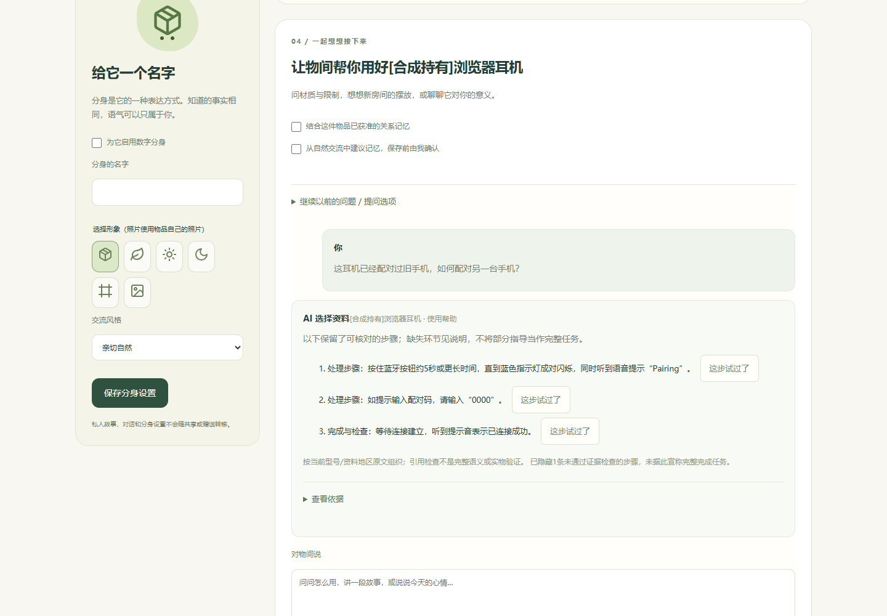
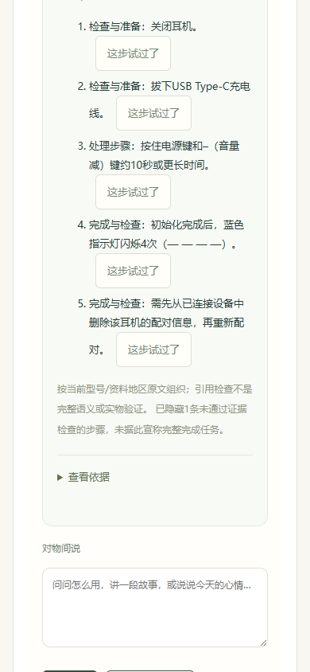

# 真实智能与长期经验闭环：本轮交付

**已经改善了“经验明明保存却不出现在帮助中”、英文操作被误删，以及未经核对的型号结论绕过门禁的问题。整体可靠问答和跨物品创造仍未达标。** 本轮没有上线自由事实综合，没有更换框架或操作硬件。

- [实际改动和失败复现](STAGE_FIXES.md)
- [真实模型结果、成功与失败](MODEL_RESULTS.md)
- [34案逐案评分](CASE_REVIEW.md)／[可分析JSON](evidence/case-reviews.json)
- [测试报告与四条旅程](TEST_REPORT.md)
- [环境、运行和恢复](RECOVERY.md)
- [费用台账](evidence/model-calls.json)／[总统计](evidence/summary.json)／[授权边界](ROUND.md)
- [匿名样本](evidence/blind-samples.jsonl)：评分留空，尚未进行独立真人盲评；对应关系另放[blind-key](evidence/blind-key.json)。

## 用户实际能感受到什么

1. 同一耳机的新会话可以展示已经允许复用、允许上云的处理经验；中间做台灯任务不会将其冲掉。纠正后显示新的报告，遗忘后旧报告退出输入与回答。个人报告单独注明来源，不冒充厂家结论。
2. 英文配对正文更容易被检索到；小米台灯“旋转调亮度、按住旋转调色温”不再因英文表达差异丢掉后半句。WH‑CH520初始化来源已纠正为约10秒以上。
3. 回答中被拒绝或缺失的步骤显示为部分指导。把型号事实叫做“general”不再能直接绕过有资料的物品帮助核对；这会增加诚实的资料不足提示，也反映问答仍有能力缺口。

## 本轮实测判断

固定版本`qwen-plus-2025-12-01`，共137次真实上游请求，含1次超时；报告了603,996输入Token、61,524输出Token。已知估算费用0.606245元，超时用量未知继续保守预留0.451952元，合计约1.058197元。**不是实际账单实扣。** 历史150次台账哈希保持不变，未重置历史额度。

先做8案对照，再执行其余26案，覆盖原有34个唯一live_model场景；又做默认路径8案、定向修复、真实经验/创意反馈及浏览器复验。没有把第一版脚本参数错误、替身模型或HTTP成功算产品通过。

34案主要受控实验中，物间的有限事实投影没有发现新增无据断言，但22案未回答，另有范围或检索问题。逐案工程复核仅6案完整通过。直接模型覆盖更多问题，也出现无据否定、维修政策和几何/设备能力扩写。这一批**不能证明物间整体比直接千问更智能**，更不能把它当作默认产品已通过34案；实验开关与默认路径已分开记录。

跨物品创意真实跑通并接收反馈，但仍输出倒置灯具悬空、错误凝结机制、亮度变化令固定投影长度变化等问题。只作为失败证据，未认证为实施方案。下一轮优先做统一Task Context与可核对行动/主张之间的衔接，避免再增加生成和自评回合。

## 实际页面

本机保留[离线独立账号预览](http://127.0.0.1:3226/)；原3224未动。费用网关测试完成后已关闭。离线预览不冒充可以继续调用千问，真实回答见证据。

图中两案的请求、流式返回和前端呈现通过；人工复核仍判部分覆盖：配对缺设备选择动作，初始化未完整说明耳机端全部配对信息被删除。截图不是完整任务成功证明。

源码恢复点`797b1a3`；独立分支[`codex/wujian-real-intelligence-eval-v1`](https://github.com/Starry-Curry/ProductAgent/tree/codex/wujian-real-intelligence-eval-v1)。未合并main。
