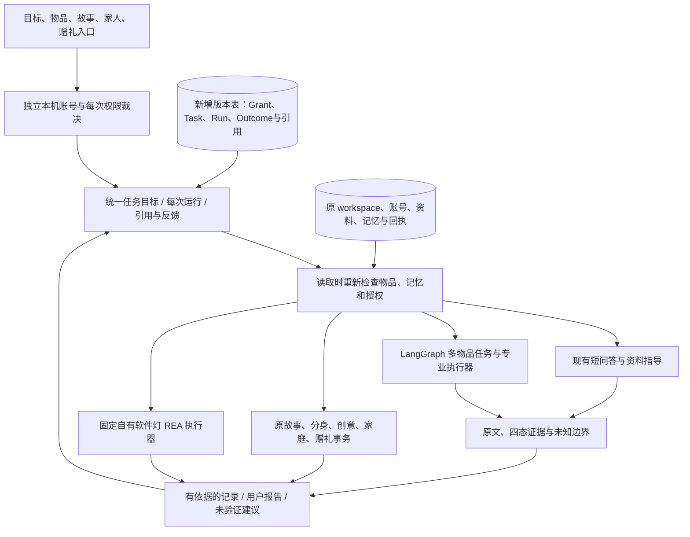

# 统一智能基座 V2：实验分支交付

**整体结论：有可运行的业务升级，尚未达到任务书的最终验收。不得合 main 或默认启用事实综合实验。**

收口复验：2026-10-31（北京时间）；本目录沿用任务包的2026-10-30版本日期。新增付费调用与授权边界见[用量记录](evidence/model-usage.json)。

以 `codex/wujian-product-foundation-v1@d8eee9306e8eb53975e80eb98d3b1ace812777b7` 开始，远端 main 仍为 ea32c3f。新分支 `codex/wujian-unified-foundation-v2`，隔离目录 `D:/ProductAgent-LifeContext/.runtime/unified-foundation-v2`。原目录的 `deliverables/` 未跟踪内容、旧服务和私人数据库没有迁移或覆盖。

## 用户真正能做什么

- 在“继续我的事”留下目标和相关物品，新建时直接开始；切到展柜、故事或家庭后，可以带同一 TaskId 返回。恢复旧目标不会自动重新发送历史内容。
- 任务的每次回答有独立运行记录。建议、待确认和用户报告完成分开；用户可以记录“还没解决”，选择是否本人以后复用，以及**另行**决定是否允许云端 AI 使用结果。
- 在当前任务下保存故事、准备赠礼和确认家庭交接，关联原来的任务。家人只看到明确批准的摘要及获准物品，不看到原始私人目标、其他实物、私聊或自己的结果备注。
- 普通界面在切换栏目、回到窗口和定时刷新时更新资料，修复故事已保存但列表没有、家人共享了物品但展柜仍空的断点。
- 大字模式可以读取已审核的 M185 电池资料，再直接请获准家人帮忙；摘要自动带当前问题，发送前仍需确认，不要求重复输入。
- 资料区可展开核对型号、地区、原文与来源。修复相邻网页参数单元格粘连造成的型号漏识别；小米 MJTD01SYL、SAMLA 494.408.37、KALLAX 703.518.86 重新联网读取并索引成功。
- REA 软件灯沿用真实静态分析、授权、写入及回读，接入统一运行/结果引用，登记软件验证状态。中途撤权与未确认请求不被当成成功或盲目重做。**这不是实体灯控制。**

## 实际架构与兼容边界

商品与实物先用读适配层分离，保留 Item.id、原 workspace.body 和旧专业模块。关系不是访问授权，逐件共享与 Grant 在同一事务更新；新任务 Context 不复制全部私人记录。新结构为增量版本表；已有 LangGraph 检查点和执行器回执继续复用，而非另建一套运行框架。

**不能据此声称完成了全部正规化或任意设备能力平台。** 当前 Relation 主要投影已有归属/赠礼，Capability Registry 只覆盖已实现的软件灯；复杂关系生命周期、任意设备与统一外部执行调度仍未完成。专业模块通过兼容桥接接入，并未一次重写所有旧 API。

## 门禁与证据

- G0：产品定稿、架构映射、原包校验和无损回退规则已冻结；14文件清单一致，输入85案结构有效。
- G1：已有身份复用、实物/型号读视图、逐件授权镜像、撤权及私人字段过滤通过离线和真实账号浏览器。无损备份、重开、两Node进程并发新增任务已验证。
- G2：四态 Claim、逐字依据、精确型号/地区和数值范围门禁有代码。**通用语义事实证明与来源冲突自动消解未完成，真实生成质量未通过。** `WUJIAN_EXPERIMENTAL_FACT_QA` 保持关闭。
- G3：任务/运行/Context/Outcome 核心、幂等、revision、跨页面接续、同任务家庭摘要隔离、纠正遗忘后的模型语境失效通过。未知运行仅查询/核对，不擅自重做副作用。
- G4：保留专业能力并接入共享运行或引用；故事、赠礼、家人、大字求助与软件灯有实际流程。创造力和分身的模型效果没有新质量认证，不因接了 Context 宣称更聪明。
- G5：382项离线测试通过；最终类型、构建、benchmark、旧API/浏览器及新桌面/390px旅程通过。85案中 **46 pass、5 blocked、34 blocked_model_budget**；包含9项原型预设路径可达性，不能当真人研究。

本轮新增付费推理 **0次，0元**。旧150次账目不重置；无新真实模型输出、正确回答延迟或创造力提升结论。全部34个 live_model 案待单独授权后执行。5个其他阻断详见 [REMAINING_GAPS](REMAINING_GAPS.md)。

## 恢复与继续

G0 `94de196`、G1 `65f7135`、G2 `b06b716`、G3 `f805f83`、G4 `6154dc4` 为本分支阶段恢复点。最终代码提交与最新分支见 [分支](https://github.com/Starry-Curry/ProductAgent/tree/codex/wujian-unified-foundation-v2)。运行与环境见 [README](README.md)，命令及真实失败见 [TEST_EVIDENCE](TEST_EVIDENCE.md)。

下一步是补齐证据语义与专业任务桥接边界、获批后执行34案真实模型内容审阅；不是解除实验开关或进入新框架迁移。公开部署、真实硬件、外部通知、不可逆迁移和 main 合并仍未授权。
