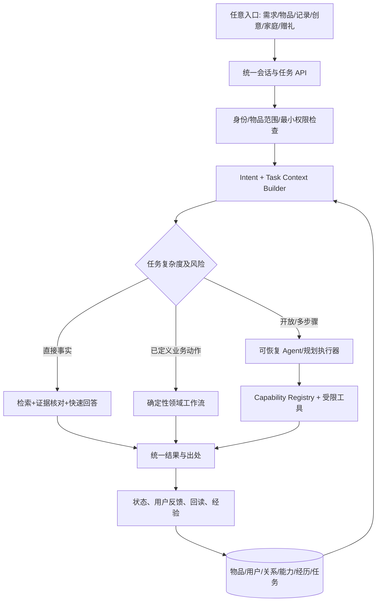

# 物间 Wujian｜统一智能架构与整体产品升级 RFC V1.0

**日期：** 2026-10-30  
**状态：** 技术与信息架构候选方案；供产品负责人评审，**不是已经批准的代码改造指令**。  
**产品依据：** 《物间_产品理念价值与功能体系_定稿_V1.0_20261030.md》（理念与价值逻辑已确认）。  
**代码基线：** `Starry-Curry/ProductAgent`，分支 `codex/wujian-product-foundation-v1`，提交 `d8eee9306e8eb53975e80eb98d3b1ace812777b7`。  
**配套测试：** 《物间_真实物品与跨模块验收场景_V1.0_20261030.md》及 `wujian_realworld_acceptance_v1.jsonl`。  
**工作边界：** 本 RFC 不改动仓库、不合并主分支、不消耗模型调用额度。基于代码阅读及已发布的开发证据提出方案；未独立运行该仓库全部测试。

---

## 0. 结论摘要

**推荐方案：一个用户感知的物间 Agent，多个专业执行器，同一套任务、物品与权限上下文。**

- 用户可以从目标、物品、生活记录、创意、家庭、赠礼等场景进入；**不预设六个一级导航**。
- 普通资料问答走 **低延迟、证据优先的短路径**；复杂任务走 **显式状态机/可恢复工作流**；REA 与设备操作走 **独立授权和回读的工具边界**。
- 各模块共享六种领域概念：**具体物品实例、用户、关系、能力、任务、经历**；产品规格知识与私人实物状态严格分开。
- 事实判断加入**正面证据、反面证据、证据不足、来源冲突**四态语义；**不能以“检索到一份文档/生成了引用”为正确性证据**。
- 先增加兼容新模型与适配层，保持旧数据可读、现有能力可用，经过回放/对比验证再切换默认路径。**不建议仅因追新框架就替换 Next.js、SQLite 或 LangGraph。**
- 产品升级可以由 Codex 在**同一轮长任务**执行，但必须先通过架构决策门，并在每个阶段保留测试证据、迁移/回退办法与可恢复提交。

## 1. 产品与价值的不可变约束

核心理念：**释放人与物的价值**。认知主线：**理解物 → 物与物 → 物与人 → 人与人**。四种价值释放方式：**兑现、创造、延续、传递**。四者是价值机制而非四个页面、四种互斥业务、四个 Agent。

| 价值机制 | 需要真正发生的用户结果 | 相关能力（可跨域） |
|---|---|---|
| 兑现 | 物品知识正确解决具体问题，指导用户完成任务 | 录入、官网资料、问答、操作指导、维护、目标规划 |
| 创造 | 使用现有物品形成新用途、新组合或经过验证的新能力 | 创造力、组合、设备 API/REA、个性化配置、实施反馈 |
| 延续 | 物品保持可用，个人有效经验和生活意义可持续保留 | 维修/保养、状态、记忆、故事、数字分身、生命周期 |
| 传递 | 家人/朋友实际获得使用帮助、资源或精选经历 | 共享、协作、长辈关怀、赠礼、借用、转移与故事延续 |

**基本业务事实：** 购买记录 ≠ 持有；型号能力 ≠ 个人设备当前可用；软件模拟反馈 ≠ 实物验证；加入家庭 ≠ 共享全部私人信息；“对方已收到任务”≠“已读/已做”；“资料未提到”≠“明确不支持”。

## 2. 已阅读代码的实际断点（以当前远端提交为准）

| 位置 | 已有实现 | 对统一架构的限制 |
|---|---|---|
| `src/lib/domain.ts` | Item、Task、Memory、Gift、Care、Plan，已增 `u_` 用户、`sharedWith`、转移来源 | 核心状态仍较集中；角色与共享语义还带演示历史；复杂多关系、生命周期扩展困难 |
| `src/lib/agent/graph.ts` | LangGraph、路由、工具、校验、检查点 | 模拟公寓 `young-apartment-v1` 采用 `executeHomeTask` 独立入口；多条回答路径不共享统一任务契约 |
| `src/lib/agent/grounded-answer.ts` | 已有授权资料上的单次生成、可选流式输出、操作路径原文校验 | 普通事实自然语言生成缺逐条语义证据校验，现被实验开关关闭；全量引用不能证明每句准确 |
| `src/lib/context/builder.ts` + `context/home-task.ts` | 物品知识、分身、个人记忆过滤，模拟家庭上下文 | Context 按不同使用场景分别组装；缺稳定的跨入口 TaskContext 协议与任务级最小授权 |
| `src/lib/accounts.ts`、`collaboration.ts` | 本机独立账号、邀请、逐件共享、已读/接手/报告完成 | 不是正式公网身份服务；关系类型、成员退出、全生命周期及跨设备部署仍待设计 |
| `src/lib/devices/software-lab.ts` | 真正调用 REA 6.8.0，分析自有软件灯，授权执行、幂等回执、状态回读 | 固定测试目标/固定适配器，尚未形成通用能力注册与设备执行器 |
| 现有 stories/memory/gifts | 多物品故事、可纠正记忆、赠礼快照与新实例 | 需要统一关系、权限与 Provenance，不能把记录自动变成可共享 Context |

**交付证据边界：** 最新交付报告称 371 项离线测试、类型/构建/浏览器回归通过；150 次上游模型调用的30案候选轮 `answered=18`、`unavailable=6`、`needs_info=4`、`blocked=2`，P50 完整服务约11.1秒，不代表正确回答P50。模型曾虚构维修政策、把无证据解释成否定证据。该轮 P1 事实问答默认关闭。参阅 `docs/engineering/product-foundation-2026-10-30/`。

## 3. ADR-01：统一 Agent 的含义与执行路径

**决定建议：** 使用**逻辑单 Agent + 路由器 + 专业工作流/工具**，不使用“所有请求交给同一大模型循环”的结构。单 Agent 指用户的连续感知与任务所有权，不等于一个巨大的 Graph 或一个独立进程。



**路由规则：**
1. `read`: 已明确物品、资料可检索、无需现实写入；尽量一次检索、一次生成/或确定性解释，不进入多轮 Agent。
2. `guide`: 操作指导需要型号级证据、逐步确认与恢复；证据校验失败时保留“待核实/暂停”而不伪造步骤。
3. `transact`: 共享/赠礼/事项确认是确定性业务动作；模型仅建议并组装参数，服务端再验证身份、授权、版本和幂等。
4. `explore`: 创造力、复杂多物品目标、未知设备能力使用长任务与工具编排；尽量可暂停、可续接。
5. `record`: 生活经历、已授权记忆、用户纠正、价值结果归档；不必每次启动付费模型。

**多 Agent 的条件：** 仅在同一长任务中确实存在独立研究子任务、并行性能收益超过协调成本，且共享任务状态和权限一致时考虑；当前不是默认方案。

**保留 LangGraph 的条件：** 已有中断、检查点、权限回归和测试能够复用。只有独立实验显示在同质量/成本下明显更优，才考虑局部替换，禁止纯偏好型框架迁移。

## 4. ADR-02：统一 TaskContext（任务的第一等对象）

跨页面、跨执行器、跨人员的连续性必须靠**任务 ID、明确上下文快照、授权和持久状态**，不能依赖一段越积越长的聊天记录。

### 4.1 建议协议（逻辑类型，尚非代码实现）

```ts
type TaskContextV1 = {
  taskId: string; schemaVersion: 'task-context/v1'; revision: number;
  actorId: string; workspaceId: string;
  intent: 'read'|'guide'|'plan'|'create'|'record'|'collaborate'|'gift'|'control';
  goal: string; origin: { entry: string; sessionId?: string; itemId?: string };
  itemInstanceIds: string[]; participantIds: string[];
  constraints: { availableTimeMin?: number; budget?: number; noPurchase?: boolean;
    userStatements?: string[] };
  grants: { grantId: string; subjectId: string; scopes: string[];
    expiresAt?: string }[];
  contextRefs: { type: 'item'|'knowledge'|'memory'|'relation'|'device';
    id: string; revision: string; reason: string }[];
  state: 'draft'|'ready'|'running'|'waiting_user'|'waiting_other'|
    'verifying'|'completed'|'partial'|'blocked'|'failed'|'cancelled';
  steps: { stepId: string; toolId?: string; state: string;
    requestId?: string; resultRef?: string }[];
  outcome?: { goalStatus: 'achieved'|'partial'|'not_achieved'|'unknown';
    basis: 'document'|'user_report'|'software_simulation'|'device_readback'|
           'external_receipt'|'not_verified'; evidenceRefs: string[] };
  createdAt: string; updatedAt: string;
};
```

**原则：** Context 引用最小数据，读时按权限再解析；只保存可纠正的必要快照，不能直接把全家历史故事粘进每个 Task；撤权后未来步骤必须重新校验，历史回执按法规/用户许可处理。

### 4.2 生命周期

- 创建 `draft`：用户发起目标或操作；物品和意图可能待确认。
- 准备 `ready`：必要物品、权限与关键约束已核对。
- 执行 `running` → 可能 `waiting_user`（批准/回报）、`waiting_other`（家人接手）、`verifying`（只读验证）。
- 收束到 `completed / partial / blocked / failed / cancelled`；**生成答案 ≠ 自动完成现实任务**。
- 客户端刷新/跨入口返回按 `taskId` 恢复；有副作用的操作按幂等键执行，网络中断后查询回执而不是盲重试。

### 4.3 同一个任务的多种界面呈现

`taskId` 应由任务卡、物品详情的最近任务、家庭交接、Agent 对话和结果记录引用。界面路由与 Agent 运行状态解耦；任务不应因用户从「物品」切到「家庭」就重置。

## 5. ADR-03：领域模型：商品知识与私人实例分离

推荐逻辑实体（初期可以在 SQLite 表与现有 JSON body 并存）：

| 实体 | 建议主键与关键字段 | 原有数据迁移要点 |
|---|---|---|
| `ProductModel` | `modelKey`、品牌、规范型号、地区、硬件/固件版本 | 型号标识必须与私人 `ItemInstance` 独立；不要“类似型号”自动绑定 |
| `ItemInstance` | `itemId`、`modelKey?`、持有人、位置、状态、来源、版本 | 维持现有 itemId、故事/任务关联；多件同型号也各有独立身份 |
| `Person` / `Household` | 真实账号 ID、家庭 ID、成员生命周期 | 演示身份仅保留 demo 环境；共享不会转移私人 Context |
| `Relation` | `edgeId`、from/to、类型、有效期、visibility、provenance | 拥有/使用/维护/共用/借出/赠出、物物兼容及故事人物关系分开 |
| `KnowledgeDocument` / `Claim` | 型号匹配、版本、来源、引用原文、hash、时间 | 官方文档与用户链接、社区案例和用户报告区分 |
| `Capability` | capabilityId、主体、动作、条件、证据、适配器、可执行状态 | 文档描述能力、猜测、REA 候选与验证过的软件/硬件能力分开 |
| `Experience` / `Memory` | 作者、相关物品/人物、原始来源、时间、可见范围、撤回 | 继承现有故事与候选记忆；共享快照不是永久授权 |
| `Task` / `Outcome` | taskId、上下文、步骤、回执、实际结果依据 | 统一家庭事项、计划、创意尝试、设备操作之间的成果语义 |

**不要第一天重写全部旧数据。** 先在 domain adapter 下读旧结构并写入新增的正规化实体；按业务路径做数据对照与原子迁移；不可逆改动需要独立确认。

### 5.1 关系和授权

关系可以是：`owns`、`uses`、`maintains`、`can_view_item`、`can_help`、`shared_household`、`gifted_to`、`used_together_with`、`mentioned_in_story`。关系**不天然产生访问权**：必须有可评估的 `Grant`（主体、资源、操作、到期/撤回）且每次工具使用服务端重验。

### 5.2 具体设备能力

```text
说明书记录某功能
 → CapabilityClaim (reported_in_document)
 → 适配器发现候选 (discovered_candidate)
 → 安全的只读能力验证 (observed)
 → 用户授权写操作 (authorized)
 → 工具执行 + 回读 (software_verified / hardware_verified)
```

REA 的当前软件灯属于 `software_verified`，不能上升为 `hardware_verified`；非电子物品也可以有「人工执行/可核验」的物理 affordance，而不是强造控制接口。

## 6. ADR-04：事实语义与可信回答

**本轮最高优先级技术风险：** 现有路径在有引用的情况下仍然出现「未提及→明确否定」「编造保修/维修政策」。这不是单纯加一句“不要幻觉”可以解决的。

### 6.1 Claim-level evidence contract

```ts
type EvidenceClaim = {
  claimId: string; itemModelKey: string;
  subject: string; predicate: string; object: string;
  status: 'supported'|'refuted'|'not_found'|'conflicting';
  source: { url: string; title: string; model: string;
    region?: string; firmware?: string; fetchedAt: string;
    textHash: string; passageId: string; excerpt: string }[];
  verdictBasis: 'explicit_text'|'source_comparison'|'unknown';
};
```

例子：
- Sony WH-CH520 说明书明确「按电源键约2秒」→ `supported`。
- IKEA SAMLA 官方页面明确「不批准食品接触」→ 食品接触适用性 `refuted`。
- 只有某帮助目录没出现「主动降噪」→ **`not_found`，不能推出 `refuted`**。
- 产品参数与说明书型号不同/固件差异 → `conflicting` 或 `needs_model_check`，不能跨版本补全。

### 6.2 建议回答流水线

1. **型号/来源门禁**：真实实例绑定正确品牌、完整型号、地区、资料版本；禁止用户随意 URL 自称官方。
2. **检索完整性**：按多问题拆分召回、术语中英双语映射；安全/操作段不能被规格回退吞掉。
3. **事实结构化**：按用户所问的逐个问题构建候选 Claim，附最小证据和不确定性。
4. **关键语义检查**：数字、否定、比较、功能支持、保修政策、维修方案、危险操作必须有直接出处或明确标注未知；引用列表不能替代句子级核验。
5. **生成自然回答**：使用已校验 Claim 生成简洁中文，必要时附出处；尚未校验的流式文本应视为草稿，不能立即宣称最终真实结论。
6. **失败降级**：能准确摘录原文就给有来源摘录，无法回答就提出一个有用的核对动作，不能从本次模型自由补造。

验证器可组合确定性模式/数据型校验、规则边界和模型语义复核；**复核模型也会犯错**，不能以第二次模型输出作为真实世界证明。先为高风险错误定一组对抗测试。

### 6.3 质量指标（建议阈值，不是现有达成）

| 指标 | 目标与门禁 |
|---|---|
| 型号级原文支持率 | 对操作、数值、功能否定、保修等关键句：**100% 可追溯证据**，没有则明确未知 |
| 关键事实编造率 | 关键验收集 **0 次无依据的确定性断言**；容许「不知道」，不容许编造 |
| 多子问题覆盖 | 逐题人工判定，建议 ≥90% 的可回答子问题被充分处理；不可答也要说明缺口 |
| 常见问答完整有效 P50 | 目标 ≤10 s，P95、首有效信息和成本一同报告；只能对**正确/可用回答**计时 |
| 安全/权限 | 越权、误写入、重复副作用、危险步骤为阻断级缺陷 |
| 创造力 | 物理可行性、资源真实、差异性和有用性分别打分；不能用 API 成功率代替 |

注：指标最终须结合运行环境、业务场景和预算做验收协议。现有 150 次请求台账已用完；新收费实验必须另经批准。

## 7. ADR-05：统一能力注册与行动执行

定义每个 `Skill/Tool` 的最小契约：`capabilityId`、适用对象/版本、前置条件、只读/写入风险、授权范围、执行器 ID、输入/输出 Schema、幂等键、超时、失败/未知状态、状态回读方法、审计记录与版本。

工具可按类型进入不同执行域：
- `knowledge`：查询官方页面/说明书、引用、内容抽取；通常只读。
- `planning`：跨物品约束规划与创意核验；默认产生方案，不修改现实。
- `personalization`：配置、分身与授权记忆；写入需独立许可。
- `collaboration`：家庭任务、分享、赠礼认领；确定性事务。
- `device`：经授权的真实/模拟控制；只读探索与写入两级授权；结果回读。

**领域动作必须由服务端确定性执行**；模型只可以产生意图和建议，不可以绕过身份、授权和目标版本检查。不要让 REA 的研究输出直接变成可执行的任意网络/终端命令。

## 8. ADR-06：前端信息架构——先评估三种，再选

**已经确定的是多意图入口、跨页面不断任务，以及 Agent 随时可达。** 一级导航数量未定。

| 方案 | 一级结构示例 | 适合处 | 核心风险 |
|---|---|---|---|
| A：3入口 | 此刻 / 我的物品 / 关系与生活 | 低认知成本；Agent 承接场景 | 生活记录、创意、家庭事项可能隐藏太深 |
| B：4入口（优先原型验证） | 此刻 / 我的物品 / 生活记录 / 家人与分享 | 兼顾表达和故事关系 | 家庭+赠礼仍需层级组织；用户可能把故事当独立内容平台 |
| C：现有多入口 | 现有多个功能栏目 | 每项能力可见 | 重复入口、上下文丢失、导航负担 |

**一个重要替代：任务中心 + 物品详情的上下文行动区。** 不必把创意、分身、售后、赠礼都放在一级栏；它们可以在具体物品、当前任务或用户场景中被主动发现。家庭的“待我处理”也可在「此刻」聚合显示。

### 8.1 最低限度原型与决策规则

- 对每个候选只做可点击导航树/低保真原型，不先重做视觉稿。
- 用配套验收集里 **I 类入口任务** 测试「第一次点哪里」「能否找到」「上下文有没有连续」「是否能返回继续」。
- 建议先找5—8位没参与研发的人，记录任务完成率、误入比例、返回次数、完成耗时；小样本只用于发现设计问题，不做统计显著性宣称。
- 对高频任务更重视速度；对故事、赠礼等低频高情感任务重视可发现与可理解。
- 真实测试后才能将3/4/多入口之一写成设计定案。

## 9. 整体升级的实现路线：允许一次大任务，但必须经过决策门

### Gate 0：方案可执行（Coding 前）
- 产品定稿已明确；架构 RFC 已经评审，不把候选导航/技术路径当定案。
- 定义 TaskContext v1、Knowledge Claim、Relation/Grant、Capability、Outcome 契约及兼容策略。
- 列出各模块现有可保留代码、需要替换的接口、受影响的数据和所有写操作的回退。
- 测试集与成功标准固定，特别是“关键事实不能编造”和“权限零越界”。

### Gate 1：兼容底座和事实问答
- 新旧模型可并行；旧数据可读；相同任务可灰度切换，不破坏现有独立账号/家庭/故事/赠礼。
- 证据 Claim 流水线先通过离线回放，再在获批的模型预算内复验。
- 常见问答的速度与正确率联合评估；流式响应不能让未经核验的确定性陈述先行误导用户。

### Gate 2：统一任务和跨模块 Context
- 任意真实录入物品进入同一个 Context 协议；家庭求助/赠礼/故事/创意复用 Task ID 与 Grant。
- 已有业务功能可继续执行，支持中断恢复、幂等、权限变化和来源失效。
- 真实独立身份的任务交接与新旧实例的隐私/出处回归通过。

### Gate 3：能力与长期智能
- REA 软件实验迁入通用 Capability Registry，明确模拟/实物边界；保留已验证安全策略。
- 创意、个人化与分身调用统一物品/人/关系上下文；先验证可行性、独特性与真实帮助，再考虑视觉增强。
- 结构化任务结果反馈能对未来任务产生**正确且有权限**的改进，而不是盲记每句对话。

### Gate 4：交互与端到端体验
- 用真实任务决定导航方案；完成任务中心、物品详情、故事、家庭和赠礼的无断裂旅程。
- 桌面、手机、两独立账号、陌生型号、无网络/无授权情境均测试。
- 五条主旅程从用户目标到可核实结果完整运行，不能把单模块演示当通过。

### Gate 5：发布验收
- 全量离线与集成、类型、构建、浏览器、真实模型质量与性能、数据迁移、权限/泄露防护全部有原始报告。
- 关键 P0 缺陷为0；保留已知未实现的界限；代码提交到独立分支，评审后再决定合并/部署。

**工程组织：** 可以一轮连续执行 Gate1—Gate5，不限制功能数量；关键是每个 Gate 有清楚的完成条件、阻断缺陷和可恢复提交。测试不通过时修复或提出明确架构变更，不在执行中任意重写产品目标。

## 10. 测试策略与基线

使用配套的**真实型号 + 官网资料**测试套件。主要样本包含 Sony WH-CH520、JBL Clip 5、Logitech M185、Canon EOS R50、Mi LED Desk Lamp 1S、Philips HD9252/90、IKEA SAMLA 11L、IKEA KALLAX 77×77、DJI Osmo Mobile 6。

**事实真值来自厂家页面或适用说明书；拥有者、位置、照片、故事、家庭身份和设备当前状态来自明确标记为模拟的测试 fixture。** 不因为测试真实商品，就冒充拥有真实设备或真实家庭数据。

- 静态离线：模型/权限/事务/检索/证据规则与迁移兼容。
- 集成浏览器：独立身份、多入口续接、故事赠礼、共享与撤权、移动端。
- 有预算的真实模型：引用准确度、否定证据错误、未知处理、响应延迟、两语言检索。
- 软件设备：REA 真实运行+自有软件模拟器+权限+回读；不代表真实硬件。
- 实物与真人：只有获得真实物品/用户参与后才能认证；不能在虚拟测试中打勾。

必须按每类任务保存 `expected`（预期行为）+ `observed`（实际结果）+ `evidence`（可核对来源）+ `verdict`（独立或人工审查）+ `failureReason`；无法确定的内容单列不确定性。

## 11. 风险与真正待定的决策

| 优先级 | 待决定事项 | 目前建议 | 最低验证 |
|---|---|---|---|
| P0 | 是否采用统一 TaskContext 协议 | 是，渐进兼容 | 真实物品问答→家庭交接→继续处理不断 Context |
| P0 | 是否采用 Claim-level 事实证据 | 是，先约束高风险事实 | 无证据的 ANC/维修政策与跨型号混淆被正确阻断 |
| P0 | 现有家庭/赠礼业务如何迁移 | 保留现有事务，新增身份/关系适配 | 原有数据不丢失、双向隐私回归 |
| P1 | 单 Agent/多 Agent 技术选择 | 单逻辑 Agent + 专业执行器 | 等质量性能对照，不为换框架重写 |
| P1 | 一级入口数量 | B方案优先验证，A/C作对照 | 真实任务的导航测试 |
| P1 | 产品化账户与公网部署 | 本地可演示，公网需专门安全工作 | TLS、找回、退出、跨家庭隔离与权限测试 |
| P2 | 真实设备支持什么协议 | 以具体设备和授权条件逐件接入 | 实物读回与安全操作证明 |
| P2 | 创造力与分身的最终表达 | 先连通真实上下文，再深化表现 | 用户盲评与场景复用测试 |

## 12. 执行规范：避免 Codex 重新把架构做散

1. 所有新增功能标记至少一个价值方式及相关人/物/关系/任务对象。
2. 不允许只用新页面或 Skill 数量证明实现价值；必须有跨模块任务验收。
3. 常见问答不强制走完整图；复杂工作流不能逃避授权、来源、结果状态。
4. 修改模型或数据库结构时，补兼容测试、迁移与回退说明，旧数据不删除。
5. 引入新模型/框架要给出可复现的基线比较与失败例，不做技术时髦驱动迁移。
6. 商品知识以真实官方资料为主，注明型号、版本、时间和 URL；自造人设/故事必须显著标注为测试数据。
7. 实际费用、外部发布、不可逆数据迁移、设备高风险操作另获批准；当前不重置此前150次调用的台账。
8. 版本定案后以本 RFC、产品价值定稿与验收套件为唯一一致性依据；代码与文档冲突时明确记录，不能自作主张改写理念。

---

## 附：核对来源

**内部：**
- 《物间_产品理念价值与功能体系_定稿_V1.0_20261030.md》（产品正式共识）
- GitHub：`docs/engineering/product-foundation-2026-10-30/{README,HANDOFF,TEST_REPORT}.md`
- GitHub：`src/lib/{domain,accounts,collaboration}.ts`、`src/lib/agent/{graph,grounded-answer}.ts`、`src/lib/devices/software-lab.ts`
- 项目附件：《物品智能服务 V0.1》《cherry studio会议纪要+核心摘要》《AI行业案例文章｜结构化研究汇编》《产品研究核心来源与问题地图 V1.1》

**方法启发，不是架构真值：** Cherry Studio 关于 Gateway/Runtime/Skills/adoption 的访谈；千问 Personal Agent 关于 Context 和专业执行器的二次研究；Instinct 关于无形入口和长期任务的二次研究。这些案例不能直接证明物间应照搬其具体实现。
