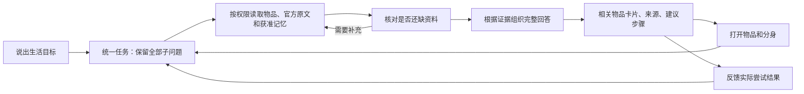

# 统一家庭体验 Beta · 2026-10-30

**已经连通真实商品、私人关系、分身和生活任务；回答内容仍未整体达到产品验收标准。** 不把浏览器跑通或引用编号有效当作建议正确。

现在可以打开一个固定的虚拟公寓，从“今晚写旅行手账”开始，让同一段对话读取书桌、台灯、收纳盒及获准偏好；也能同时询问赠画来历和桌面布置，从回答进入画作详情，再让物品分身回到原任务。建议步骤沿用已有反馈入口，反馈代表用户报告，未操作硬件。

## 打开体验

本机预览：<http://127.0.0.1:3204/#home>。首页点击“打开模拟家庭”；云端使用模拟物品、偏好和赠画故事的复选框默认不选。加载不覆盖原有物品；切回原有空间会开启独立聊天，避免把私人历史带入模拟家庭。可从首页、物品展柜、详情和统一对话使用同一组记录。

在本分支工作区运行（Node 24）：

```powershell
npm ci
npm run build
node scripts/unified-home/preview.mjs --port=3204
# 当前任务已授权真实模型时才添加 --cloud；仅服务器进程读取既有配置，不复制密钥。
node scripts/unified-home/preview.mjs --cloud --config=D:/ProductAgent-LifeContext/.env.local --port=3204
```

预览只使用本工作区 `.runtime/home-preview` 的合成数据库。默认运行不调用模型；云端预览用本轮独立网关记录真实请求，记录位于相邻 `unified-home-evidence/model-calls.json`，不沿用上一轮的预算台账。本轮用户明确要求按需要验证、保留基本调用记录，没有另外指定人民币统计任务。退出进程即停止网关。

## 这个家里有什么

|真实商品身份|官方入口|本轮实际结果|
|---|---|---|
|米家台灯1S MJTD01SYL|[大陆规格](https://www.mi.com/mjsmartlamp-1s/specs)|实际读取规格及官方香港版说明书；操作与电气参数必须区分地区|
|MICKE 白色书桌 803.542.81|[宜家商品页](https://www.ikea.cn/cn/zh/p/micke-desk-white-80354281/)|实际读取商品及组装 PDF；这个货号桌面是73×50厘米，不能套用其他 MICKE 尺寸|
|SAMLA 194.408.48|[宜家商品页](https://www.ikea.cn/cn/zh/p/samla-box-with-lid-transparent-s19440848/)|实际读取；另保留之前审核的型号资料缓存|
|KNAGGLIG 103.926.01|[宜家商品页](https://www.ikea.cn/cn/zh/p/knagglig-ka-na-ge-he-song-mu-10392601/)|实际读取商品及组装 PDF；收纳承重不能推导成画架能力|
|JBL GO 4|[原定商品页](https://www.jbl.com/GO-4.html)|该页受限；实际读取官方规格表及快速指南作为备用来源；之前下载失败仍保留记录|
|Jellycat Bashful Beige Bunny BAS3B|[精确SKU页面](https://jellycat.com/bashful-beige-bunny/?sku=BAS3B)|实际读取；动态页面没有充分确定该变体尺寸、材质，继续保留未知|
|LEGO 10328 玫瑰花束|[原定商品页](https://www.lego.com/en-us/product/bouquet-of-roses-10328)|原页受限，实际读取官方拼搭说明页及两册 PDF|

另有《远山》原创画：40×30厘米、纸本木框、朋友小夏赠送和搬家经历均是**模拟私人报告**。支架、挂件、玻璃、重量未知。全部八件都是模拟持有，位置、状态、安静偏好等也不是厂家事实。没有下载或生成冒充真实 SKU 的商品图片；图标明确占位，画作 SVG 明确标注模拟。

官方来源的逐次成功、失败、时间及内容哈希见[联网脚本证据](../../../artifacts/unified-home/network.json)和[最终App来源记录](../../../artifacts/unified-home/app-network.json)。应用页面分别展示本次读取、缓存、未取得正文，不把缓存说成实时成功。淘宝/天猫检索确实发现历史导购、淘宝推广跳转和小米天猫店；店铺跳转登录，未取得可以核对型号的商品详情，**没有虚构详情ID或接通平台API**。见[商城探索](../../../artifacts/unified-home/marketplace-discovery.json)。

## 从“分别问工具”变成“共同完成一件事”



这是模拟家庭的有界任务路径，继续使用 LangGraph、原 SQLite 检查点、会话租约、授权与记忆机制。八件物品的简要资源上下文共用；较完整原文按读取请求选择。关系记忆只读请求涉及的物品，另读取本家庭已授权偏好，真实库存及其他角色的私人资料不混入。

调度节点只决定读什么及是否还需读取，**不要求先生成一份完整答案再反复修格式**；最终节点直接使用当前证据、用户要求和任务历史组织回答。首轮使用百炼实际支持的命名函数调用，防止“说要读取”但不真正读取。引用只允许本次读取的事实或原文编号；记忆撤回、会话变化、物品换主、资料过期/变化时丢弃在途草稿。编号校验仍不是语义或实物证明。

数字分身是同一任务的可选表达身份，没有新增常驻 Agent、独立记忆库或硬件工具。修改/遗忘依旧走原有确认接口；遗忘问答记忆不会擅自删除私人原故事，原故事也不会重新进入模型；如需删除原故事，另到故事入口处理。

## 当前结论和下一步

三条主要浏览器旅程的界面与调用流程已经连通，完整原始回答及**人工发现的问题**见[模型结果](MODEL_RESULTS.md)、[测试报告](TEST_REPORT.md)。当前千问仍可能添加未登记的软布、虚构旋钮方向、把桌面总尺寸当空余空间，或过早建议重置。**不能据此声称统一智能 Beta 内容验收完成。**

不采用本轮强模型替换：`qwen3-max` 在当前服务返回404且不在账户模型列表；列表中的 `qwen-max` 能返回，却没有改善该样本，引用错误且仍建议未知支撑的靠放。实际预览继续原 `qwen-plus`。`AI_TASK_MODEL` 只是可选最终综合配置，未修改用户全局环境或原配置。

下一轮优先把说明书中的操作及适用条件做成可复用的证据动作，再让 Agent 组合；同时验证资源缺失、桌面可容纳与支撑条件。先解决这些已复现的断点，再扩展数字分身或 REA。不更换框架、不迁移私人数据库。

工程基准：`codex/wujian-personal-objects-v1@113696effe5f7f162fe9dccfbdf0bb64a7737d55`，正式 main 仍为 `ea32c3f4c9e18992ca267b6dd74e26e418c9e95a`。本轮分支 `codex/wujian-unified-home-beta`，工作区 `D:/ProductAgent-LifeContext/.runtime/unified-home-app`。未将上述功能分支当成 main 已有能力，未合并 main。
