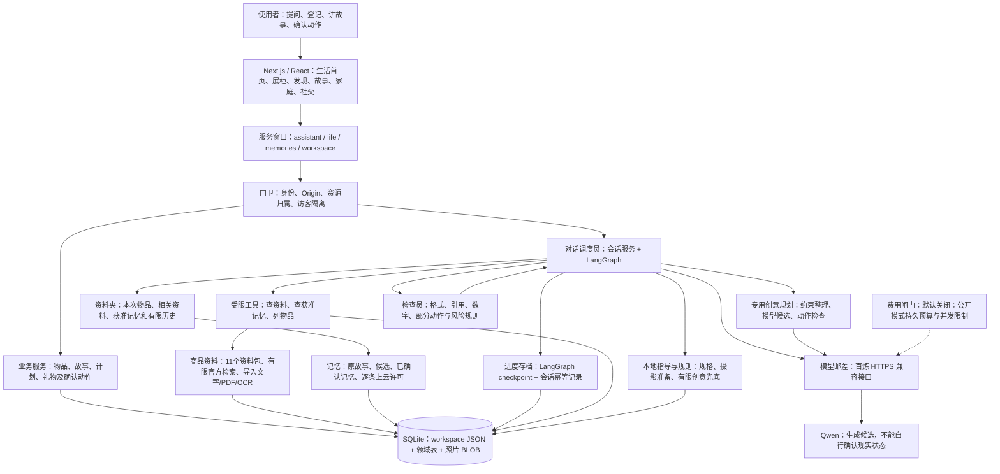
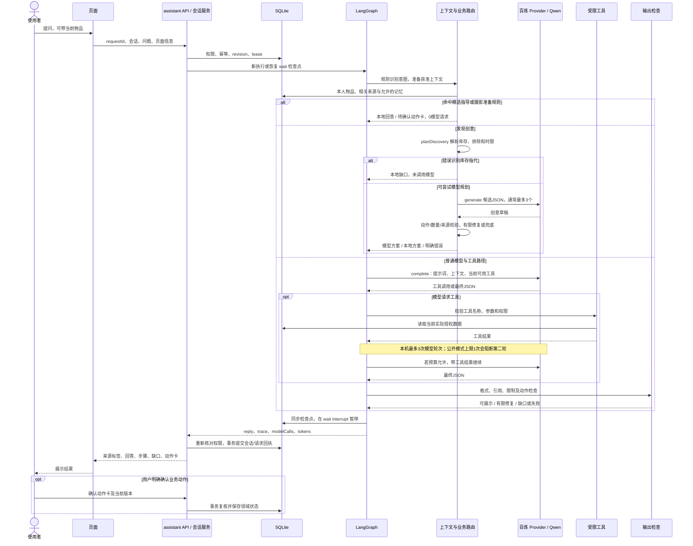

# 当前真实架构

依据 `ea32c3f` 源码；产品说明中的未来能力不计入。以下路径均从仓库根目录解析。

## 整体模块与数据关系

界面像一个家中服务台；API 是各项业务的窗口；权限层决定谁能看哪件物品。资料夹只挑本次能使用的信息，检查员尝试阻止乱编，业务服务才有权保存更改。模型是受限的建议者。

图中的“列物品”目前只返回名称、状态和 demo 标记，**不是完整物品知识接口**；“检查员”也不是通用物理证明器。规则生成和模型生成是不同路径。

### 存储事实

| 内容                           | 实际保存方式                                                                                                                       | 关系与限制                                                         |
| ------------------------------ | ---------------------------------------------------------------------------------------------------------------------------------- | ------------------------------------------------------------------ |
| 物品、家庭任务、礼物、准备计划 | `workspace(id, body)` 的 JSON                                                                                                      | 依靠稳定物品 ID、owner/shared、领域事务连接；没有独立 SQL items 表 |
| Agent 会话与幂等请求           | `agent_sessions`、`agent_requests`、`agent_feedback`                                                                               | revision、90秒 lease、requestId；与长时任务调度不同                |
| 图执行进度                     | `graph_checkpoints`、`graph_writes`                                                                                                | 自定义 Node SQLite checkpointer，恢复图状态                        |
| 记忆与风格                     | `personal_memories`、`memory_events`、`memory_epochs`、`persona_profiles`                                                          | owner/scope、allowCloud、过期与 epoch 失效                         |
| 图文故事与关联                 | `life_fragments`、`life_fragment_details`、`life_fragment_items`、`life_media`                                                     | 正文一份，多物品关联；照片在 SQLite BLOB；回忆与上云许可分开       |
| 章节/理解                      | `life_chapters`、`life_understanding`                                                                                              | 引用事件及指纹，用户确认派生理解                                   |
| 商品与创意                     | `life_sources`、`life_knowledge_documents`、`life_knowledge_fetches`、`life_creative_evidence`、`life_ideas`、`life_idea_feedback` | 资料身份/版本、来源与反馈；事实 ID 合法不证明语义成立              |
| 公开访客                       | `visitors.sqlite` 注册表 + 每访客独立 `demo.sqlite`                                                                                | 临时演示隔离，仍非生产账号/家庭邀请体系                            |

代码入口：[`db.ts`](../../src/lib/db.ts)、[`domain.ts`](../../src/lib/domain.ts)、[`life/schema.ts`](../../src/lib/life/schema.ts)、[`repositories`](../../src/lib/repositories/)、[`cloud/runtime.ts`](../../src/lib/cloud/runtime.ts)。生活 schema v6，迁移保留 `VACUUM INTO` 备份，WAL/foreign_keys/busy_timeout 已使用。

## 从输入到最终回答的真实过程

`wait` 是把这次对话停下来等下一句，**不代表每个模型工具调用都有人工审批**。写动作卡由独立领域服务确认；当前四个模型工具主要是读取，联网资料获取可缓存。纯进度报告另有 `continueVerifiedGuidance` 快捷路径，重新检查当前证据后复用步骤，0新增模型请求。

真实实现入口：[`agent/service.ts`](../../src/lib/agent/service.ts)、[`agent/graph.ts`](../../src/lib/agent/graph.ts)、[`agent/prompts.ts`](../../src/lib/agent/prompts.ts)、[`context/builder.ts`](../../src/lib/context/builder.ts)、[`skills/registry.ts`](../../src/lib/skills/registry.ts)、[`life/planning.ts`](../../src/lib/life/planning.ts)、[`home/store.ts`](../../src/lib/home/store.ts)。

## 功能共享到了哪里

首页/详情/发现可以进入统一会话，发现续谈会带先前候选；故事和记忆经权限过滤进入任务；家庭、礼物依靠物品 ID 和预览确认连接。共同存储已经存在，无须先重建一个“统一大脑”。

缺口在于接口不一致：对话工具清单丢掉属性；创意规划走另一套专用输入、错误修复和来源检查；摄影准备只覆盖有限场景；模型统计跨路径不完全一致。需要统一可授权的业务能力契约，而不是把所有内容无差别塞进模型。
