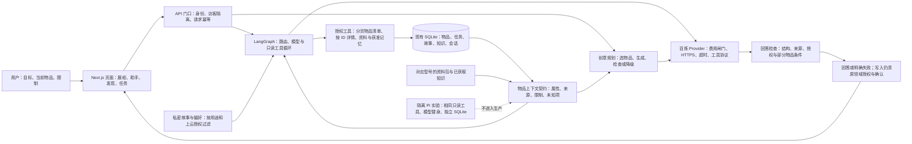
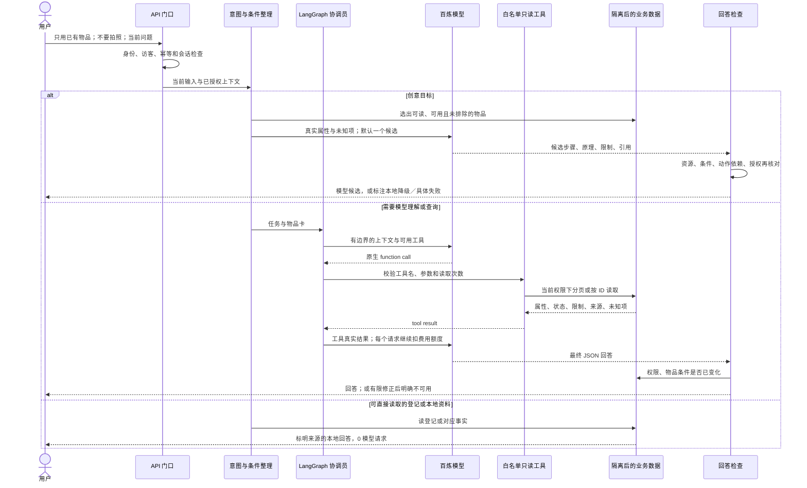

# 架构：让物品事实真正进入回答

## 模块和数据关系

页面是入口；API 像门卫；Graph 是协调员；上下文契约像一张带来源和“尚不知道什么”的物品卡。数据库仍是同一套业务账本。型号资料描述产品设计，不是实物体检报告。创意规划像按现有材料提出草案并检查条件的工作台，不代表草案已经做成功。

物品卡复用 `Item.attributes`，包括 material、dimensions、power、care、quantity、capabilities，以及已有状态与型号绑定；没有新增数据库表或迁移。结构没有可靠来源时放未知，不能从“不锈钢杯”推出镜面、304、耐热或食品级。私人位置、备注、故事和照片不放进新物品工具；私密记忆继续经过原权限过滤。

## 从输入到模型与最终回答

Graph 主循环最多 4 个模型回合、6 次工具调用、1 次校验修正；第四回合不再提供新工具，留给收尾。缺失的官方操作补齐路径另有一次受控修正，实际 HTTP 请求仍由原费用闸门逐次记账。公开模式不再因为“只允许一回合”而在工具返回后停止；公开访客额度、全局额度与限流没有放宽。

物品工具默认每页 20 件，最多 40 件，返回 total 和 nextOffset；模型必须继续翻页或声明未读完，不能把首页当全部库存。按 ID 详情不扩大权限。每次读取记下当前物品条件，等待模型期间若撤权、可用性或登记属性变化，旧回答中止。

创意默认单候选请求 30 秒，候选修正 20 秒；网络失败不自动偷偷重试。传输错误、候选不合格、信息不足分别保留。最终检查是有限的程序规则和来源检查，无法证明所有物理机制；剩余风险见决策文档。
