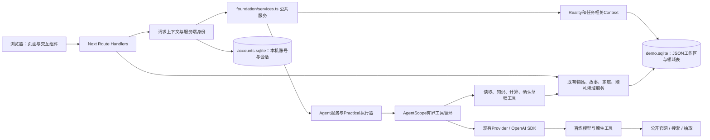
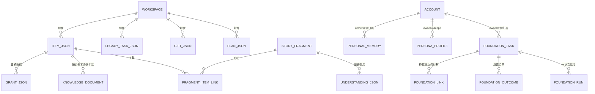
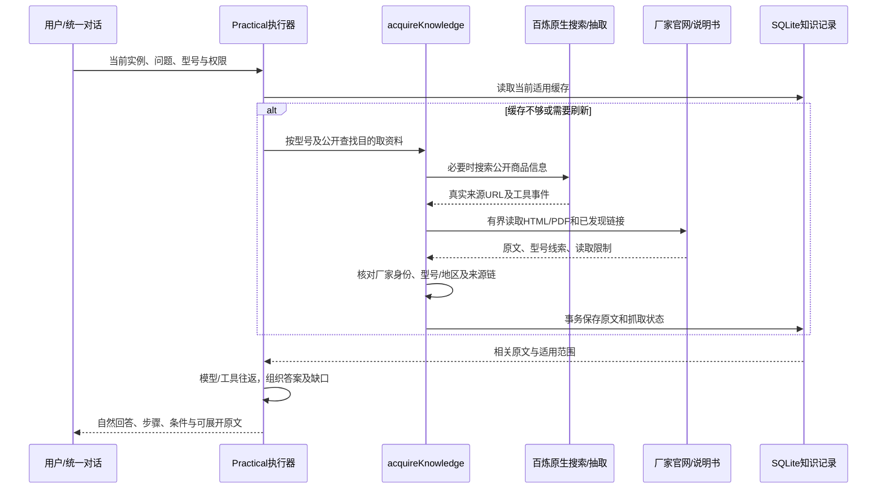
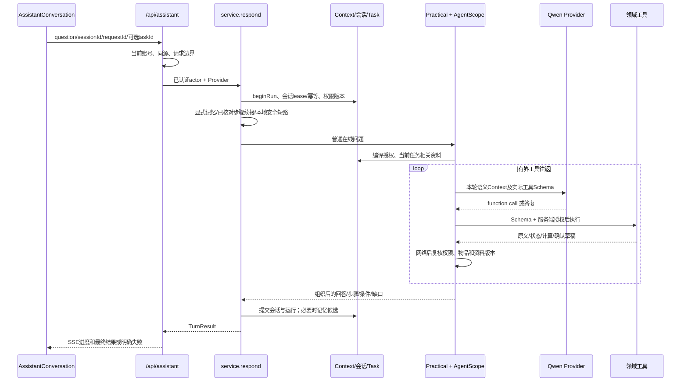

# 物间：结合源码的技术架构、数据与智能链路审计

> 2026-11-05（北京时间），共同开发前审阅稿。配套：[功能、交互与产品架构](PRODUCT_FUNCTIONS_INTERACTIONS.md)。产品权威：[PRODUCT_FINAL_V1](../../product/PRODUCT_FINAL_V1.md)。本文解释实际实现，不提出另一轮大架构替换，也不批准发布。

## 0. 审计基线、方法与证据等级

源码固定为 `32c6119d5f29f954fc78c15c74ea567833bbbfe1`，工作区 `D:\ProductAgent-LifeContext\.runtime\qwen-foundation-v1`。main=`dbd93cf`；团队候选=`codex/wujian-team-ready-v2`。develop开始时为`f449067`，审计期间PR #4已在远端合并，提交前核对为`3285e8d85407dbd7a17f598fb2994398ac2c20f0`，其代码树与审计SHA完全相同。本次文档放在独立 `codex/wujian-predevelopment-audit-v1`。开始时工作区干净；不读取用户数据库、Key、Cookie或聊天，不修改业务源码、不迁移数据库、不调用收费模型。远端变化见[复核记录](evidence/remote-state.json)。

审计方法：核对产品定稿→追踪当前UI/API/服务真实调用→检查类型、SQL、事务、Provider与开关→对照历史原始成功/失败→零费用离线回归→文档交叉核对。文件存在不代表活跃调用，命名“graph/skill/evidence”不代表相应能力已完整实现。

用语：**代码事实**表示静态调用可定位；**测试复现/通过**指本次或明确标明的历史测试；**风险推断**表示代码表达的限制，尚无端到端复现；**未验证**不能写通过。所有链接均为仓库源码，阅读未来版本时应回到上述固定SHA对照。

## 1. 技术栈和真实默认执行器

| 层 | 当前实际实现 | 不能误解成什么 |
| --- | --- | --- |
| App/页面/API | Next.js 15.5.28、React 19、TypeScript；App Router；主视图有客户端hash切换 | 不是独立前后端两套服务，也没有新建微服务集群 |
| 数据 | Node24 `node:sqlite` 的 `DatabaseSync`，领域JSON与SQL表混合 | 不是远程MySQL/PostgreSQL，也不是完整知识图谱 |
| 默认在线Agent | `service.respond → graph.executeGraph → practical.executePractical → tool-runtime.runToolAgent` | `graph.ts`文件名不表示当前每轮在运行LangGraph StateGraph |
| 工具循环 | AgentScope TypeScript `0.0.15`，自有Provider/权限适配 | 没有启用框架长期记忆、自动压缩或第二个审稿模型 |
| 模型传输 | OpenAI Node SDK `7.47.0` 兼容百炼；Chat Completions/Responses按任务使用 | 不是通过Codex聊天界面替App回答，也没有自托管Qwen |
| 资料解析 | Cheerio、pdf-parse、Sharp、Tesseract及已打包中英文OCR数据 | 没有在生产链安装Docling大型解析服务 |
| 编码 | ZXing浏览器解码、Open Library/Open Food Facts候选查询 | 不是完整商品平台或正版厂商数据库 |
| 保留代码 | LangGraph依赖/检查点、旧知识包问答、旧创意路径、旧UI | 留存用于兼容/恢复不等于已纳入当前默认链 |

依据：[package.json](../../../package.json)、[graph.ts](../../../src/lib/agent/graph.ts)、[tool-runtime.ts](../../../src/lib/agent/tool-runtime.ts)、[provider.ts](../../../src/lib/ai/provider.ts)。本次没有更换技术栈。

## 2. 模块和部署关系



Next进程、SQLite文件、账号模式、模型开关由启动环境决定。默认只监听本机回环地址；同一代码可以运行不同数据空间。3251的离线状态是启动配置，不代表知识/模型代码已经被删除。

## 3. 本地数据库究竟是什么形式

### 3.1 文件与目录

| 文件/目录 | 内容与创建点 |
| --- | --- |
| `<PRODUCT_AGENT_DATA_DIR>/demo.sqlite` | 主业务SQLite，[db.database](../../../src/lib/db.ts)打开并迁移 |
| 同目录 `accounts.sqlite` | 独立账号、会话hash和登录限流，[accounts.accountDB](../../../src/lib/accounts.ts)按需打开 |
| `*.sqlite-wal` / `*.sqlite-shm` | WAL事务日志/共享内存辅助文件；运行中不是可随便删除的缓存 |
| `*.before-*.sqlite` | 各版本迁移前快照，由迁移代码创建；不是每次编辑的自动备份 |
| `.runtime/team-dev/alice` | 当前团队命令的独立数据根；bob使用另一目录 |
| `.runtime/finals-product-preview` | 先前决赛预览的测试空间；不与alice自动合并 |
| `.next-team-*` | 构建缓存，不是业务数据库 |
| 历史 `model-calls.json` | 评测网关费用/请求台账，不是物品或记忆数据库 |

SQLite是二进制文件。部分表的 `body` 列是JSON字符串，仍由SQLite事务管理；不要用文本编辑器修改SQLite。没有配置SQLCipher或应用级数据库加密，不应宣传为“本地加密存储”。账号口令是加盐scrypt哈希，不是明文密码；这不等于整库加密。

主业务库启用 `busy_timeout=5000`、WAL、外键；账号库启用WAL和busy timeout。`DatabaseSync`是同步连接，多数写操作短事务，但大JSON解析/序列化和部分加密操作仍会占用事件循环。没有实现水平分片、多实例写入协调或分布式锁。

### 3.2 混合数据模型：一份工作区JSON＋领域表



图中的JSON实体是逻辑关系，不是实际独立SQL表。主库和账号库分开，跨库owner/实例ID主要由领域代码校验，并非全部有外键。

`workspace(id=1, body TEXT)`保存 [State](../../../src/lib/domain.ts)：`items/tasks/memories/gifts/saved/attempts/care/contexts/plans/virtualHomes` 等。物品没有独立 `items` 表；每次领域变更读取当前State、调用 `mutate`、写回整体JSON。`read()`解析JSON，不维护一个能独立取代数据库的第二内存世界模型。

### 3.3 主要表族和责任

以下为源码声明的表族；部分辅助表按功能调用惰性建立，不表示每个数据库从第一秒就有全部表。

| 表族 | 关键表 | 内容/边界 |
| --- | --- | --- |
| 基本工作区/版本 | `workspace`、`schema_migrations`、`migration_audit` | 原领域状态、版本和备份说明 |
| 旧问答运行 | `service_runs`、`service_feedback` | 旧知识包执行/回放记录，不是当前全部运行 |
| 会话/请求 | `agent_sessions`、`agent_requests`、`agent_feedback` | 会话JSON、revision、lease、请求hash/缓存、尝试反馈 |
| 个人记忆 | `personal_memories`、`memory_events`、`memory_epochs` | 类型化记忆、版本、事件和在途失效标记 |
| 自然抽取 | `memory_capture_settings`、`memory_source_receipts`、`memory_capture_slots` | 开关/起始时间、去重收据、纠正/遗忘锁定 |
| Persona/显式操作 | `persona_profiles`、`action_receipts`、`memory_introductions` | 全局/物品人格、幂等收据、一次介绍记录 |
| 旧图检查点 | `graph_checkpoints`、`graph_writes` | 历史兼容与清除；不能据此断言默认LangGraph运行 |
| 知识 | `life_sources`、`life_knowledge_documents`、`life_knowledge_fetches` | 用户资料、适用官方文档、抓取时间/缓存/失败 |
| 物品录入 | `life_requests` | 同用户requestId对应的录入payload与物品ID |
| 故事/媒体 | `life_media`、`life_fragments`、`life_fragment_items`、`life_fragment_details` | 图像BLOB、原话、物品关联、日期/媒体/召回/上云许可 |
| 故事理解 | `life_chapters`、`life_understanding` | 章节、带证据与确认状态的派生认识 |
| 创意 | `life_ideas`、`life_idea_feedback`、`life_creative_evidence` | 候选、收藏/尝试反馈和选定外部证据 |
| 模拟空间/草稿 | `life_installations`、`demo_content_installations`、`home_placements`、`home_place_requests`、`home_proposals` | 安装标记、位置、带期限/确认/幂等的预览卡 |
| 统一任务 | `foundation_schema`、`foundation_tasks`、`foundation_runs`、`foundation_outcomes`、`foundation_links` | TaskSpec/Run/Outcome及现有业务引用 |
| 权限/失效 | `foundation_grants`、`memory_privacy_scopes` | 显式授权版本与全局/物品级隐私修订 |
| 家庭协作 | `household_members`、`household_invites`、`collaboration_receipts` | 成员关系、邀请hash、领域幂等 |
| 软件实验 | `software_adapters`、`software_operations` | 固定软件适配器/授权及请求结果；不是物联网平台 |
| 独立账号库 | `accounts`、`account_sessions`、`login_limits` | scrypt/salt、token hash、到期和限流 |

源码：[主迁移](../../../src/lib/migrations.ts)、[Agent/记忆表](../../../src/lib/repositories/foundation-schema.ts)、[自然记忆表](../../../src/lib/repositories/ambient-schema.ts)、[生活表](../../../src/lib/life/schema.ts)、[统一任务表](../../../src/lib/foundation/schema.ts)。这份表不是新增表的设计提案。

### 3.4 数据维护、升级和恢复

主迁移 `schema_migrations` 当前到6；生活模块 `life_schema` 到6；统一任务 `foundation_schema` 到2。新库或旧版启动时由代码按版本升级：必要时 `VACUUM INTO` 备份→`BEGIN IMMEDIATE`→加表/兼容改写→记录版本→COMMIT；异常ROLLBACK。代码对高于已知版本的数据库会拒绝继续迁移，不代表可把任何旧程序安全指向新版数据。

维护原则：

1. 日常数据修改走领域服务，不手工SQL改 `workspace.body`；它会绕过权限、收据、记忆失效和关联更新。
2. 结构改动新增可复现的迁移步骤，先用合成旧库验证重复执行、失败回滚和备份恢复；当前三套版本须一并核对。
3. 运行中的WAL库不要只拷一个主文件当备份。开发备份可在停止写入后复制完整数据目录，或使用SQLite一致性备份机制；账号库与主库必须成套保留。不要在当前私人库上试恢复。
4. Git记录源码，不记录个人数据库/照片/Key；恢复分支或SHA不等于恢复用户数据。
5. 迁移备份不是完整日常备份体系。已有代码主要保证迁移可回滚，尚未实现可视化定时备份、加密保管、灾难恢复演练或自动跨版本降级。
6. `existsSync`避免重复覆盖迁移备份，不构成备份完整性验证。恢复前仍需验证文件、版本、完整性及账号与业务一致性。

**局限**：同一工作区JSON的并发粒度较粗，许多关系靠代码而不是SQL约束；框架和新表的版本并非一个统一迁移系统。当前小规模本机演示可运行，不能据此认定已适合云端多实例并发或长期大规模生产。

## 4. 物品、商品知识与Reality的实际形态

[Item](../../../src/lib/domain.ts)包含 `id/name/brand/model/region/owner/location/state/availability/synthetic`，以及 `attributes.material/dimensions/power/care/quantity/expiresOn/capabilities/physicalFacts`、照片、备注、资料链接、绑定知识包等。

- `id`是实物实例ID；`model`是用户报告的型号；`productBinding`记录已确认知识包及版本，不能反过来证明持有或完好。
- `createLifeItem`要求真实账号明确 `ownsConfirmed`，在同一事务创建实例和requestId收据；重复内容重放返回同一物品，改变payload拒绝409。
- `ItemManagementSnapshot`给物主编辑快照及revision；新表单带回 `expectedManagementRevision`。`db.write`在实际写事务中核对，旧页冲突保留草稿。旧调用可省略该字段，保护不是全局强制。
- `usable()`结合状态、数量和有效期判断候选可用性；仍是记录判断，不是传感器回读。

### 4.1 Reality不是另一套物品数据库

[readReality](../../../src/lib/context/reality-service.ts)重新授权后读取Item、当前适用知识和原文选择；[projectReality](../../../src/lib/context/reality.ts)投影成 `reality/1`：

```ts
// 摘录结构，字段含义以实际类型为准。
type Reality = {
  itemId: string;
  identity: { brand: string | null; model: string | null; region: string | null;
              firmware: null; identityBasis: 'user_report' };
  instance: { state: string; usable: boolean; synthetic: boolean; basis: 'user_report' };
  facts: RealityFact[];
  capabilities: RealityCapability[];
  operations: unknown[];
  unknowns: string[];
  revision: string;
};
```

事实区分 `official_source/user_report/inferred_unverified`、商品范围/实例范围、来源/型号/版本。能力包含作用、证据、前提、`conditional/unavailable/hypothesis/conflicting`，投影中的 `executable=false`、`verifiedForThisInstance=false` 是明确边界；真实软件执行授权另走适配器。

通用规范化词汇只做别名，不从“盒子/灯”等名称自动证明承重、耐热或连接能力。未知项没有被自动补全成事实。相同范围/属性出现不同值时可标冲突；这不是通用自然语言矛盾推理器。

官方说明书仍保存在知识记录中；此前选取的原文定位可进入Reality，**并非取得一份PDF就自动构建出完整部件图或全部功能语义**。段落作为知识定位，不应全部变成“可执行能力”。

## 5. 物品功能讲解到底是不是RAG

**广义上是检索增强生成；当前不是以Embedding向量库为核心的通用RAG平台。** 实际组合是：

1. 静态经审核 `ProductPack`：保留少量商品的事实/条件/过程，见 [products](../../../src/lib/products.ts) 和 `catalog/*`。
2. 本人资料：公开链接、手工文字、说明书解析到 `life_sources`，未核实的用户提供资料不自动升级为官方事实。
3. 自主发现：按品牌/型号/查找目的，通过已有域名目录、一般厂家身份发现、官方页面真实链接和Qwen原生搜索取得资料。
4. 持久原文：`life_knowledge_documents`保留提取文本、URL、型号/地区、hash、来源链、分块和读取限制。
5. 检索：词法/中英文主题锚点、类别/问题相关性与上下文预算；可选Qwen Rerank重排公开原文；然后让同一主模型结合工具结果回答。

当前默认链没有独立向量数据库、普遍Embedding入库、统一BM25服务或已落地托管百炼知识库。仓库/历史计划提到这些工具，不等于生产查询正在使用它们。`rerank`也不是Embedding建库或事实审核。

### 5.1 官方资料发现与读取



[acquireKnowledge](../../../src/lib/life/acquisition.ts)先授权并确认具体型号；查找目的有general/specifications/operation/care/policy。它保留品牌域名目录，同时 [publisher](../../../src/lib/life/publisher.ts)通过公开机构记录（DBpedia/Wikidata等）、准确品牌标签/官方网站及HTTPS解析补充未知厂家身份。**已减少仅靠白名单的限制，但没有证明任意陌生品牌都能成功。** 公开机构目录也会缺项、重名或网络失败。

`Provider.search/extractPage`通过 [qwenResearch](../../../src/lib/ai/qwen-native.ts)调用百炼Responses，解析真实 `web_search_call` 事件/来源；不是从模型自由文本里正则挖URL。其原生接口限定已核对的北京兼容地址，`store:false`、有界工具数/超时；不代表所有地区/模型支持，也不承诺供应商绝对不保留数据。

检索出站仅应包含商品型号/公开问题目的，不携带私人故事。目标页面仍经 [sources](../../../src/lib/life/sources.ts)检查HTTPS、主机/DNS、公共地址、重定向、类型和大小，不让工具URL直接变成访问内网的授权。

### 5.2 型号、地区和说明书核对

- `knowledgeIdentity`绑定品牌、型号、地区和知识包；文档还保留实际model/region/hash。
- `trustedOfficialDocument`核对已知厂家域或厂家身份证明；CDN说明书须有准确型号官方页面的真实链接链，不能凭CDN域名整体放行。
- `scopedProductKnowledge`再限制准确型号/产品SKU列表及地区；共同分类目录或其他SKU页脚出现型号，不应成为泛化认证。
- `manuals.isProductManual/notProductEvidence`区分产品说明、法律/隐私/备案等资料；PDF扩展名本身不代表说明书。
- `product-inspection.inspectProduct`的初步“official”判断仍偏已知域名＋正文型号匹配；它是草稿检查，不等同后续完整的知识适用性核对。两个入口能力并不完全一致，是接入时应注意的缺口。

### 5.3 原文怎样存储和检索

`makeKnowledgeDocument`计算提取文本hash，并按约1000字符窗口、附加最多350字符后续上下文建立chunk，记录字符offset；**offset不是PDF页码**。HTML由Cheerio提取，PDF由pdf-parse取文字。`AcquiredDocument.text`是解析后的原文文本，不等于完整原始HTML或PDF二进制。部分公开JSON会另存原payload/hash；上传照片则会重编码、去EXIF，不保留原图。不要笼统承诺所有文件字节原封不动保存。

`retrieveKnowledge`按中英文关键词、操作/清洁等主题及段落类别打分，补多语言锚点和任务段落选择。当前实现仍有类别/正则启发式，不能宣传已彻底淘汰规则检索。`kernel/retrieval`当前仍被复用作段落选择，但这不表示V3整套执行器还在默认运行。

取得资料后按抓取记录复用：成功缓存通常7天、同目的失败通常10分钟；强制刷新可重试。刷新失败可以沿用明确标注时间的旧缓存，不称实时获取成功。保存/失效有事务/SAVEPOINT及当前hash核对；锚点定位新增不等于全文换版，查询参数也不能与fragment随意混同。

### 5.4 PDF图示、照片和OCR

- [documents](../../../src/lib/life/documents.ts)：PDF文字层优先；需要时本地Tesseract OCR，使用现有语言数据，不自动下载外部识别模型。
- [pdf-pages](../../../src/lib/life/pdf-pages.ts)：读真实页索引、按需渲染最多3页，先核对型号文本/必要时封面OCR；限制前80页、大小和图像字节，不把全文offset当页码。
- `inspect_manual_visual`可把已选官方图示交给配置的视觉模型；结果保留页码/hash与 `provider_visual_reading_not_verified_fact`，不是厂家新事实。
- [vision](../../../src/lib/life/vision.ts)：私人照片逐张明确授权；只生成可见文字支持或外观推测的候选，不能凭外形猜精确型号，服务端在网络后复核媒体权限。

扫描件、图标、装配顺序、跨页表格、OCR误读仍可能失败；代码/几张合成图测试不能证明任意说明书都读得懂。

## 6. 与Skill、开源组件及历史机制的真实关系

| 名称 | 代码中的实际角色 | 当前结论 |
| --- | --- | --- |
| `src/lib/skills/registry.ts` | 自写的goal/instructions/tools/success登记 | 不是动态安装和执行SKILL.md的通用平台 |
| `skills/knowledge.ts`、`document-help.ts` | 经整理知识、既有规则/证据指导等兼容能力 | 部分离线/旧路径仍引用，不是每轮在线必经 |
| `memory-storytelling.ts` | 故事召回/组织与边界，部分在默认路由仍有效 | 确有业务作用，不等于每物品独立Agent |
| AgentScope Toolkit | 注册实际Zod工具及事件循环 | `builtInSkillTool:false`；使用框架并不自动启用Skill库 |
| Codex/Desktop Skills | 开发阶段使用的浏览器、REA等工具方法 | 不自动部署到App，终端用户不能据此调用开发机全部工具 |
| Docling、Pi、Mastra、Home Assistant等 | 部分历史比较/设计材料 | 未因文档出现而纳入当前生产运行时 |

`source-semantics.ts`确实实现了“模型选原文片段→服务器核对连续原文/主体/地区”的独立服务；本次源码搜索只见其定义、测试等材料，**不能把它写成当前Practical每轮必经的动态抽取/审稿步骤**。缓存问答现在直接使用相关原文和已保存定位。引用恢复检查仍不是语义蕴含证明。

`/api/ai → ai/harness.runAssist`旧知识包链仍保留可调用，`/legacy`仍保留路由。它要求按静态claim原文输出，是历史兼容路径，不能说全仓只剩一条执行器。主UI删除旧入口不等于旧端点/代码已清退；审计前不新增接入，也不无依据删除。

## 7. 用户提问到最终回答的真实调用过程



### 7.1 服务与路由

`respond`解析输入，为非临时对话建立Run；Task可省略，不强迫每句聊天建持久Task。`respondLegacy`只是保留的会话/业务外壳名称，不说明它必然使用旧模型链。`executeGraph`保留确定性危险限制、部分领域预览、本地故事处理和离线回退；普通在线模型/工具往返进入 `executePractical`。`executeHomeTask`是同一执行器的家庭兼容入口，不另起多Agent。

仍有 `routeHome` 与规则路由；不能宣称所有意图均由动态LLM规划。显式“记住”、已验证步骤续接、危险操作等可零模型完成，必须把来源显示为本地记录/规则而不是模型生成。

### 7.2 Context里面有什么，怎样选择

`compileTaskContext`的选择顺序包括当前物品、已关联Task物品、明确提及的名称/型号、按目标匹配的能力候选，再保留精简获准目录供继续发现。详细初始候选有数量预算，浏览目录可继续分页；没词法匹配不等于用户没有这个物品。

包含：实例/型号/状态/能力与未知、当前资料及原文、Task/已试步骤、获准相关个人事实、偏好/经历、所选计划、确定性必要条件、权限与revision。目录不默认附带全部故事、私人备注/位置；当前任务需要且授权后才交付具体个人信息。`authorizedItemIds`是服务端边界，不能把整个编译包直接交给任意模型或客户端当权限令牌。

相关性主要是规则/词法/既有证据选取，实际不等于语义知识图谱。兴趣/偏好可由工具按已获准的类别读取；物品故事/关系在当前入口、显式回忆、Persona策略等条件下才带入。

### 7.3 AgentScope和工具契约

[tool-runtime](../../../src/lib/agent/tool-runtime.ts)把现有Provider适配到AgentScope，注册同一Zod Schema、统一guard、维护tool-call ID，修正当前SDK格式化中的模型/工具回合边界。框架自动压缩关闭，不持久化另一份供应商记忆，不建立第二审核模型。

主要工具：`get_item_context`、`search_product_knowledge`、`read_official_page`、`inspect_manual_visual`、`get_relevant_experiences`、`check_constraints`、`prepare_action`、`open_item_capability`、限定软件读取/探索，以及最终 `complete_answer`。动态工具列表只给当前真实原文ID/章节/资源，Schema限制不替代服务端授权。

工具报错可返回同一模型处理；403/409等权限/生命周期失败会终止。SDK验证错误只恢复可读错误路径，不修改参数后偷偷接受。`prepare_action`生成待确认草稿；模型不能自己同意共享、记忆或实物执行。

### 7.4 有界执行与费用必须分层看

| 边界 | 代码事实 |
| --- | --- |
| 整体Practical轮次 | 约150秒deadline，由guard反复检查；不是对所有底层IO的瞬时硬中断保证 |
| 主循环 | AgentScope `maxIters:6`；Provider生成前检查本轮calls预算，工具计数超过8拒绝 |
| 输出/上下文 | 普通主调用约2400 token、思考模式约6000；输入序列化字节预算；当前资料原文另有字节预算 |
| 单轮估算 | 当前代码以输入12/输出36元每百万token等固定估算及约3元轮次门禁计算；不是供应商实时账单 |
| 原生搜索/抽取/图像/重排 | 也消耗请求和Token；不把Agent回合数等同所有实际HTTP请求数；原生工具还可能有服务方额外计费 |
| 全轮800次台账 | 由既有评测网关/锁/授权记录维护；每次失败/重试留存；不能换工作区重置 |

**已证实的集成缺口**：`governedModelFetch`在非public-demo环境直接返回原request；本机只有按原预览启动的network-hook/ALPHA_GATEWAY才连到评测台账。普通 `life-local --cloud`、不同环境或专业模块直接创建Provider，不保证自动进入该800次网关。双费用开关不等于统一硬额度。公开演示有另一套治理，也不能与本机评测轮次混称同一预算。依据：[cloud/runtime](../../../src/lib/cloud/runtime.ts)、[life-local](../../../scripts/life-local.mjs)、[finals/preview](../../../scripts/finals/preview.mjs)、[finals/gateway](../../../scripts/finals/gateway.mjs)。本审计没有发起请求利用该缺口。

**第二开关还依赖调用方**：`lifeProvider()`会把 `WUJIAN_ALLOW_PAID_CALLS`合并到第一开关；但原始 `createProvider().ready/configuredClient`只检查 `AI_ALLOW_PAID_CALLS`。旧 `/api/ai`直接创建原始Provider。因此不能笼统声称所有入口都受两个开关控制。本次[零网络复现](evidence/provider-gate-probe.mjs)仅注入假HTTP响应、使用无效测试域名和占位凭证，确认第二开关关闭时，原始Provider仍可调用注入的传输；不是一次真实付费请求，也没有验证外部账号可越权调用。建议后续先收敛Provider创建/费用入口，而非依赖每个专业模块记住额外约定。

因此团队暂不能自行打开收费做自由试验；正式联机入口需要证明所有收费能力均受当前授权/台账约束。换模型还须更新/核实价格和协议，不能只改模型名便声称成本约束正确。

### 7.5 最终回答究竟校验什么

[response-contract](../../../src/lib/agent/response-contract.ts)定义 `message + guidance`：

- `message`承载完整自然事实解释；`guidance=null` 时仍是未经独立语义证明的模型说明。
- `procedure`核对物品范围、原文ID及已知冲突条件；步骤释义/翻译仍可能错误。
- 物理计划用实际资源及动作依赖、操作原文和必要条件；不能由“引用有效”证明支撑/材料/光学/稳定性。
- 最终工具失败时不能绕成普通模型文本发布行动；但这不是通用语义验证器，不能保证所有自然语言断言正确。

在 `AI_STRUCTURED_OUTPUT=json_schema` 的配置下要求最终工具；其他配置的自然终止处理不完全相同。普通事实message仍是模型生成，不应该宣传成逐主张全部验真。

**开关审计**：源码搜索未见当前 `src/`使用 `WUJIAN_EXPERIMENTAL_FACT_QA`、`WUJIAN_EXPERIMENTAL_KERNEL_V3`、`WUJIAN_AGENT_RUNTIME`来切换主执行器；它们仍出现在启动脚本中。设false可以表达实验不启用的意图，**不能作为当前回答获得额外验证或旧路径完全退役的证据**。以实际调用链而非环境变量名判断。

### 7.6 流式呈现

`/api/assistant` 的SSE输出进度与最终reply；Practical中主模型delta通常转为“正在整理依据”等状态，内部thinking、工具原始参数和私人结果不直接显示。`AssistantConversation`渲染Markdown、Task、动作卡、条件和可展开原文。流程结束后还要检查会话/权限；退出后的迟到响应会被阻断。

这是一种受控进度流，不应宣传成对所有路径逐字直出最终答案。首字时间、HTTP200、SDK finish_reason都不证明任务完整正确。

## 8. 个性化信息怎样识别、存储和调用

### 8.1 不是一个“万能记忆表”

| 信息 | 真实存放点 | 使用方式 |
| --- | --- | --- |
| 私人物品名称/位置/尺寸/备注/状态 | `workspace.body.items[]` | 当前获准实例的Reality/Context |
| 个人偏好/兴趣/关系等 | `personal_memories.body` | 相关性、状态、来源、策略和云端许可过滤 |
| 少量旧偏好 | `workspace.body.contexts[]` | `explicit`状态与allowCloud限定；如解释长短、技能水平 |
| 物品故事原文与照片 | `life_fragments/details/items/media` | 显式关联、召回/上云许可；必要时生成确认候选 |
| 故事整理的认识 | `life_understanding` | 证据指纹、适用任务和确认状态；可撤回 |
| 数字分身 | `persona_profiles(owner,scope)` | 全局/物品配置合并，统一执行器读取 |
| 操作经验 | `foundation_outcomes`及相关Run | 同用户、同物品范围、复用许可、依赖和隐私版本过滤 |
| 历史赠礼故事 | `workspace.memories`快照与origin | 精选分享，不自动成为接收者亲历或长期记忆 |

### 8.2 四类写入来源

1. **明确记忆命令**：`service.ts`对“记住：...”走本地 `saveMemory`，默认 `allowCloud:false`；不代表一次闲聊自动形成云端画像。
2. **自然聊天候选**：`memoryPolicy=candidates`且已开启捕获、Provider可用时，`proposeMemories`从本轮原话选择最多4个连续片段（兴趣/偏好/关系/要求），服务端核对原文包含、安全字段等；等待本人确认，candidate不参加普通长期召回。
3. **本地被动提取**：`ambient.extractChat/captureEvent`用有限规则抽取兴趣、表达风格、购买/关系或近期要求。存在兼容旧策略/应用事件的本地active写入，不能笼统说“所有自动记忆都必经确认”。此类默认不上云，敏感/假设/引用等受过滤，规则并非完整自然语言理解。
4. **故事及反馈派生**：原故事保留；`organization`从明确自述提出Understanding，确认适用范围并保存来源指纹；Task反馈保存Outcome，不凭成功报告猜测真正因果。

`captureSettings()`首次建行默认 `enabled=1`；当前对话还以 `memoryPolicy=off/read/candidates`限制本轮是否抽取。全局捕获设置、会话策略、候选确认和上云许可是四层不同控制，不能把其中一层关闭描述成所有旧入口都关闭，也不能把默认启用的本地捕获说成默认关闭。代码位置为 [ambient.captureSettings](../../../src/lib/memory/ambient.ts)。

近期requirement有会话范围/7天期限等限制；兴趣/偏好可以全局适用但不是永久不可变人格。“每次都喜欢安静”也不表示知道用户的完整性格或生活规律。

### 8.3 MemoryRecord的关键字段

```ts
// 真实结构见 agent/contracts.ts 的 memorySchema / MemoryRecord。
{
  id, owner, itemId?, version,
  kind: 'preference' | 'interest' | 'relationship' | 'story' | /* ... */,
  text, status: 'active' | 'candidate', allowCloud,
  source: 'user' | 'automatic',
  provenance?: {kind, sourceId, sessionId?, basis, at, extractor},
  expiresAt?, polarity?, createdAt, updatedAt
}
```

删除记录另有deleted墓碑语义。必须保留“本人明确说过/模型选择原话/应用记录/用户反馈”的来源区分，不能把 `source=automatic`或候选文本当测得事实。

### 8.4 如何召回，是否向量搜索

`recallMemories`先过滤owner、物品/归档、active、非fiction、期限、会话限定、演示范围及当前问题的排除要求，再按同物品、偏好/兴趣、故事回忆和中英文词/中文二字片段相关性加分，取少量结果。它不是向量语义记忆。

`buildContext`叠加Persona的 `memoryUse=off/explicit/relevant` 等策略、任务相关性及故事来源有效性；`cloudMemories`必须逐条 `allowCloud && !demo`，故事片段还检查allowRecall/allowCloud/origin。`compileTaskContext`再按当前会话策略和物品范围组合。若模型知道有已获准兴趣类别，可通过 `get_relevant_experiences.globalKinds`按需取内容，不默认塞全部历史。

所以信息“已保存但没被回答使用”可能是候选未确认、未上云、已归档/撤权、入口策略关闭、任务无关、词法召回遗漏或模型未利用；不能全部归因成数据库丢了。

### 8.5 纠正、遗忘与隐私失效

- `saveMemory`有事务、版本、requestId收据；纠正时锁定自动抽取slot，旧来源不能悄悄覆盖更正。
- `forgetMemory`清空该memory body、标deleted、更新版本并留下事件/去重障碍，清除相关旧会话缓存/检查点。**它不是全库法定彻底抹除**：用户原始故事、聊天、备份等独立数据可能仍存在；需分别按领域删除/保留规则处理。
- `deleteFragment`会失效派生Understanding/记忆并处理无引用媒体；明确撤回来源不能在下次读取时重建旧认识。
- `memory_epochs`用于让在途模型/会话过期；`memory_privacy_scopes`分全局/物品级的破坏性隐私变更，Outcome还保存依赖版本。
- 普通新增Outcome不再调用清空owner Context；新增经验应持续积累，不能因为完成台灯任务就让耳机经验消失。更正/遗忘/撤权仍需必要失效，不能简单关闭epoch机制。

代码见 [store](../../../src/lib/memory/store.ts)、[ambient](../../../src/lib/memory/ambient.ts)、[context-lifecycle](../../../src/lib/memory/context-lifecycle.ts)、[organization](../../../src/lib/life/organization.ts)、[tasks](../../../src/lib/foundation/tasks.ts)。

## 9. 数字分身如何使用知识与记忆

`persona_profiles`按 `(owner,scope)`保存全局或物品ID配置；`getPersona/effectivePersona/savePersona`合并和修改。名字、avatar、style、enabled、memoryUse不改变物品真实身份，不把物品昵称当用户姓名。

物品详情把同一itemId/获准Task传给统一对话，Practical在同一Provider调用中注入物品交流身份和已获准记录；不是为每物品开独立数据库/常驻Agent。关闭Persona不删除物品/故事；记忆读取权限不因“开启分身”自动全部放行。

当前偏重设置、语气、来源和权限衔接；“人格随真实经历自然成长、与功能深度结合”仍是部分实现，不是已成熟的情感产品。

## 10. Task、Plan、Outcome与跨功能连续性

### 10.1 有几种任务，不能混称一张表

- `State.tasks[]`：原家庭/协作事项，有assignee、logs、seen/accepted/reported状态。
- `State.plans[]`及Preparation：准备清单/候选计划及资源/条件依赖。
- `foundation_tasks`：统一 `TaskSpec`，有goal/intent/itemInstanceIds/participants/revision/currentStage/contextRefs。
- `foundation_runs`：某次执行和读过哪些物品/经验、状态与请求hash。
- `foundation_outcomes`：本人确认的结果、条件、复用/上云许可；不是自动验证的成功原因。
- `foundation_links`：以kind/ref_id把既有故事/家庭/创意/计划等对象关联Task。

`foundation/specialists.recordSpecialist`是原业务事务中的桥接，保存故事等可生成“记录已保存”的Run/Outcome，但 `basis=saved_personal_experience`不应当成操作成功或后续方法有效，`canReuseForFutureTasks`也不是自动开启。

### 10.2 反馈与未来使用

`recordOutcome`要求明确confirmed、稳定requestId、expectedRevision和有效Run；保存 `goalStatus/notes/basis=user_report/occurredAt/itemInstanceIds/reuse/allowCloud/privacyStamp/experienceRefs`。重复同payload返回旧结果，改payload或旧revision拒绝409。

`resolveTaskContext/recallOutcomes`只检索当前用户相关物品的合法最新报告，过滤forgotten、复用许可、失效隐私版本、关联资源权限与依赖版本；通常限少量最新结果。`allowCloud`在模型Context中再过滤。纠正/遗忘不能回退到同Task更早的旧成功报告；保存故事的收据不能遮蔽独立操作反馈。

**真实增量的必要条件**是建议因此改变，例如避免上次失败方法；只复述“你上次说过”不够。已有有限真实样本，不能从离线模型替身推导一般经验学习效果。没有在线训练、自动微调或通用因果学习。

## 11. 家庭、赠礼、媒体与REA边界

家庭邀请/加入/按件共享在 [collaboration](../../../src/lib/collaboration.ts)中，授权镜像 [policy](../../../src/lib/foundation/policy.ts)与旧Item状态同时核对；显式撤销/到期不能回退旧shared获得权限。私有Task/记忆/故事不默认随物品共享；家庭管理员不是任意私人数据管理员。

真实账号赠礼认领在原 [domain](../../../src/lib/domain.ts)逻辑中生成接收者独立实例，原物品标gifted并撤共享；默认不复制私人note/photo/全部故事/Persona。精选故事以快照保留原作者与origin，接收者要用作记忆仍单独确认。旧演示角色兼容分支不要与真实账号路径混写。

媒体 `storePhoto`限制类型/大小，Sharp解码重编码剥离EXIF；item照片和story-only媒体分用途。读取还受当前物品授权/作者范围影响，不能只凭知道mediaId就读。已遗忘内容的备份、供应商留存和日志有各自生命周期，不应声称“一次点击全球所有副本即时消失”。

REA [software-lab](../../../src/lib/devices/software-lab.ts)固定目标和版本、分析hash、授权epoch、单次确认、幂等和回读；工具在 `.runtime/rea-tools`，缺失返回明确错误。软件灯具模拟器和真实设备协议不是同一能力，不把HTTP写入/模拟器亮度变化称为真实台灯操作。本次不新增接入任何旧硬件实验。

## 12. API与团队接口地图

| 入口 | 用途 | 状态/注意 |
| --- | --- | --- |
| `/api/account` | 本机注册/登录/退出 | 同源回环限制，本机账号，不是生产身份平台 |
| `/api/life` | 物品、资料、故事、创意等现有领域动作 | 大型组合Route，不能把任意client actor当身份 |
| `/api/life/media/[id]` | 图片读取 | 按当前权限过滤 |
| `/api/assistant` | 会话、提问、反馈、SSE、续接 | 当前默认统一对话入口 |
| `/api/foundation` | Task读取/创建、Outcome、修正/恢复 | 同一业务数据，不是第二数据库 |
| `/api/memories` | 记忆、Persona、候选/纠正/遗忘等 | owner/来源/策略分别检查 |
| `/api/home` | 位置和确认草稿 | 不代表实体自动搬动 |
| `/api/collaboration` | 跨账号共享与事项 | 确认/事务/撤权 |
| `/api/gift/[token]` | 精选赠礼预览/认领 | 链接与实物交付分别确认 |
| `/api/device-lab` | 固定自有软件实验 | 显式开关/授权，不是任意设备命令 |
| `/api/workspace`、`/api/products`、`/api/discover`、`/api/ai`、`/api/service-runs` | 旧/兼容领域与问答入口 | 仍有可调用代码，不能说已经全部删除；审计后再定退役 |
| `/api/demo/session`、`/api/health` | 公开演示会话/健康检查 | 健康200不证明模型质量或真实任务成功 |

团队服务端只以 [services.ts](../../../src/lib/foundation/services.ts)为公共入口：

```ts
import {
  readReality, discoverCapabilities, respond,
  createTask, recordOutcome, amendOutcome,
  type Provider, type TurnRequest,
} from '@/lib/foundation/services';
// 由现有认证Route组合层注入 db/read/actor/provider；不是浏览器直接操作数据库。
```

独立功能示例 [goal-feature](../../../examples/foundation/goal-feature.ts)和 [run-mock](../../../examples/foundation/run-mock.ts)实际复用这些服务。普通页面优先调用现有API/回调；不要引用内部Practical/SDK或测试fixture。新领域工具先写独立服务，再协调当前工具注册/权限分派；没有任意动态注入工具或完整Skills平台。

公共入口可兼容增加可选字段；不兼容变更必须列出消费方、适配期和消费者测试。Provider可替换不等于模型协议/价格可以无验证随意切换。`AgentError`常用400/403/409，账号入口401；Provider错误与 `reply.outcome=unavailable/needs_info/blocked`分别处理，HTTP200不是成功状态。

## 13. 审计发现与发布前阻断项

| 编号/优先级 | 类型 | 事实或风险 | 依据/验证要求 |
| --- | --- | --- | --- |
| A01 / P0 | 代码已证实 | 团队3251强制关闭模型/搜索；不能作为真实联网底座通过 | `team-dev.mjs`；需同账号/数据真实模型—工具—Task—反馈另验 |
| A02 / P0 | 代码与零网络替身复现，未实际付费 | 本机普通Provider不必然经过全轮费用网关；原始Provider只检查第一开关，第二开关依赖调用封装 | `governedModelFetch`、`lifeProvider`、旧`/api/ai`；正式收费入口逐项治理 |
| A03 / P0 | 历史真实模型失败 | 取得官方资料仍可能误译/扩写；最终工具/引文不认证所有message/步骤 | `response-contract`明确限制；历史QUALITY_REVIEW/原始样本 |
| A04 / P0 | 历史真实模型失败 | 隐含资源/错误支撑等物理问题仍存在 | 动作/必要条件检查只覆盖建模部分；禁止宣称通用物理验证 |
| A05 / P1 | 代码已证实 | `graph.ts`/LangGraph依赖/旧开关与当前运行机制不一致，容易误接旧路径 | 当前调用链、`src/`开关搜索；不能再按文件名选框架 |
| A06 / P1 | 代码已证实 | 已知小目录商品认识、陌生资料读取/发现的认证能力不完全一致 | `product-arrival`、`product-inspection`、`publisher/acquisition`分别存在 |
| A07 / P1 | 代码已证实 | 多种任务/记忆表示并存，领域桥接有条件 | State/领域表/links，不等于所有专业模块已统一生命周期 |
| A08 / P1 | 代码已证实 | 自然记忆含有限规则和词法召回；不是完全语义理解；兼容事件可本地active | `ambient`、`recallMemories`，候选与active须分开 |
| A09 / P1 | 代码已证实 | 混合JSON/表、三套迁移、惰性表；逐库备份恢复缺完整运维服务 | 迁移源码；新版本与真实库不可随意互指 |
| A10 / P1 | 风险推断，未做新端到端复现 | 更换模型后固定单价/协议限制可能失准；大JSON/同步计算影响并发 | Practical固定估算、DatabaseSync；需明确支持配置和并发实测 |
| A11 / P1 | 代码已证实 | 退出/纠正/撤权有多层guard，但不等于所有外部副本彻底删除 | 会话、备份、原故事、供应商数据边界应清楚告知 |
| A12 / 待决策 | 已实现边界 | 旧UI/旧API/旧模块仍在；PR #4已远端合并且包含大量历史证据 | 合并不证明质量；按引用/回归决定采用、归档、退役，不整包默认恢复旧入口 |

P0表示正式产品/开放收费前的阻断，不表示本次已发现并验证了新的权限泄漏。现有权限回归通过不保证不存在其他缺陷；本次不绕权限做未授权探测。以上发现按用户要求报告，不在本轮暗中重构或改写既有质量门槛。

## 14. 本次验证、未测与历史证据

**本次实际执行**：Node24，`npm test`离线 **683/683**、0失败；`npm run typecheck`复验退出0。原始摘要/日志见 [审计复验](evidence/verification.json)、[offline](evidence/offline.txt)、[typecheck](evidence/typecheck-r2.txt)。测试使用现有隔离合成fixture；没有读取私人数据库。测试证明有限协议/规则与回归，不证明真实Qwen智能、物理可行或产品整体完成。

另运行一次原始Provider费用开关的[离线复现](evidence/provider-gate-probe.json)：第一开关关闭时拒绝传输；仅第二开关关闭时原始Provider仍调用注入的假传输。复现进程禁止全局网络、未加载 `.env`、未读任何真实凭证。该项单列，不混入683项回归数，也不算真实模型成功。

文档[范围与引用检查](evidence/document-checks.json)覆盖本地Markdown目标存在、15个固定SHA源码行入口、代码块成对、仅文档/证据变更；新增文本的常见秘密模式扫描无发现。这不是完整安全认证。6张Mermaid图已人工核对结构，本轮未运行渲染器，不将文本检查称为页面视觉验收。

本次仅文档/索引修改，未重跑生产构建或浏览器；源码32c6119的前阶段构建、7项团队通路与公开登录HTTP检查见 [audit-hold证据](../../engineering/team-ready-2026-11-05/evidence/audit-hold/)，更早的实际浏览器录入/匿名拒绝见 [团队交接](../../engineering/team-ready-2026-11-05/DELIVERY.md)。明确不把旧记录称为本次浏览器实测。

**本次未执行**：新付费Qwen、外部搜索/商品重新抓取、云知识库、陌生商品留出集、真人盲评、真实硬件、私人数据迁移/恢复、生产并发/渗透测试。来源URL列在商品/案例数据中，只表示当前保存值，不代表今天重取成功。

历史本轮费用账目仍为368/800项请求，已知估算¥55.783876、未知用量预留¥1.786268，实际账单以供应商为准；本审计新增0请求。台账SHA256保持 `50bc0e9fe96614a1dd70110ecc5a6f2f1fc2a5e5e4289a32690c3ee93ed270b4`。不清零、不覆盖首答、不把剩余额度自动当新授权。

历史真实任务与失败：[决赛DELIVERY](../../engineering/finals-product-2026-11-05/DELIVERY.md)、[QUALITY_REVIEW](../../engineering/finals-product-2026-11-05/QUALITY_REVIEW.md)、[Core首答审阅](../../engineering/qwen-foundation-2026-11-02/CORE_REVIEW.md)。Formal18题首答0/18不改写；Core/Full与完整产品仍NOT_ACCEPTED。

## 15. 共同开发前的结论和待确认决定

**可保留并消费**：现有Item/来源/Reality投影、服务端身份/权限、会话/Task/Outcome、确认/事务/幂等、作者所有的故事/记忆、Provider接口和独立Mock示例。它们有真实代码和离线回归，不需要各组复制重建。

**不能据此放行**：全SKU可靠资料发现、全部语义事实正确、复杂物理创意、生产账号/长期运维、任意设备控制、所有入口统一费用治理。团队能并行写功能不等于这些已经验收。

需共同确认：

1. 哪些公共契约作为v1消费面，哪些旧端点只保留恢复，不再允许新模块依赖。
2. 正式联网入口如何保留现有账号/数据并强制费用治理；谁可以启动/变更模型配置。
3. 过程材料如何归档、原始失败/费用/许可证和固定SHA如何恢复；不把仓库瘦身等同删除业务历史。
4. 本机账号是否仅用于比赛/开发，正式身份、备份/删除政策何时单独设计。
5. P0质量的真实验证计划和授权；不能用接口稳定或文档写齐替代真实任务门槛。

本审计没有合并或更新main/develop。[PR #4](https://github.com/Starry-Curry/ProductAgent/pull/4)已于审计期间在远端合并，代码树与审计基线一致；后续分支起点用最新develop，旧交接中“PR未合并前”的操作仅作历史。分工职责见 [TEAM_WORK_PLAN](../../engineering/TEAM_WORK_PLAN.md)。**本文是可追溯审阅与待确认清单，不是完整智能底座发布证书。**

## 16. 固定源码导航：从哪里开始逐层读

下面链接锁定审计SHA及函数入口；未来代码变化不会改变本次引用。按表从上往下读，可复现本文对主链的判断。

| 关心的问题 | 固定源码入口 | 重点读什么 |
| --- | --- | --- |
| 本地库打开和整体JSON写入 | [db.ts:17](https://github.com/Starry-Curry/ProductAgent/blob/32c6119d5f29f954fc78c15c74ea567833bbbfe1/src/lib/db.ts#L17) | 文件位置、迁移、read/write事务和actor |
| 型号/事实/能力怎样成为共享视图 | [reality.ts:26](https://github.com/Starry-Curry/ProductAgent/blob/32c6119d5f29f954fc78c15c74ea567833bbbfe1/src/lib/context/reality.ts#L26) | 用户报告、官方主张和推测分别投影 |
| 本次任务选哪些信息 | [compiler.ts:26](https://github.com/Starry-Curry/ProductAgent/blob/32c6119d5f29f954fc78c15c74ea567833bbbfe1/src/lib/context/compiler.ts#L26) | 先授权再选择、目录/原文/经历分层 |
| 会话、Task和模型的边界 | [service.ts:65](https://github.com/Starry-Curry/ProductAgent/blob/32c6119d5f29f954fc78c15c74ea567833bbbfe1/src/lib/agent/service.ts#L65) | Run、幂等、会话策略、提交结果 |
| 当前路由是否走模型 | [graph.ts:519](https://github.com/Starry-Curry/ProductAgent/blob/32c6119d5f29f954fc78c15c74ea567833bbbfe1/src/lib/agent/graph.ts#L519) | 本地分支、家庭包装和Practical分派 |
| 工具如何真正进入推理 | [practical.ts:126](https://github.com/Starry-Curry/ProductAgent/blob/32c6119d5f29f954fc78c15c74ea567833bbbfe1/src/lib/agent/practical.ts#L126) | 初始Context、工具Schema、guard及最终回答 |
| SDK执行循环 | [tool-runtime.ts:74](https://github.com/Starry-Curry/ProductAgent/blob/32c6119d5f29f954fc78c15c74ea567833bbbfe1/src/lib/agent/tool-runtime.ts#L74) | AgentScope、回合、工具错误和授权检查 |
| 模型与费用开关 | [provider.ts:288](https://github.com/Starry-Curry/ProductAgent/blob/32c6119d5f29f954fc78c15c74ea567833bbbfe1/src/lib/ai/provider.ts#L288) | 原始Provider及调用方责任 |
| 检索/联网获取 | [acquisition.ts:230](https://github.com/Starry-Curry/ProductAgent/blob/32c6119d5f29f954fc78c15c74ea567833bbbfe1/src/lib/life/acquisition.ts#L230)、[acquireKnowledge:431](https://github.com/Starry-Curry/ProductAgent/blob/32c6119d5f29f954fc78c15c74ea567833bbbfe1/src/lib/life/acquisition.ts#L431) | 本地检索与真实获取是不同步骤 |
| 记忆怎样落地和召回 | [saveMemory:160](https://github.com/Starry-Curry/ProductAgent/blob/32c6119d5f29f954fc78c15c74ea567833bbbfe1/src/lib/memory/store.ts#L160)、[recallMemories:437](https://github.com/Starry-Curry/ProductAgent/blob/32c6119d5f29f954fc78c15c74ea567833bbbfe1/src/lib/memory/store.ts#L437) | 来源、状态、云许可、归档与相关性 |
| 自然记忆捕获开关 | [ambient.ts:123](https://github.com/Starry-Curry/ProductAgent/blob/32c6119d5f29f954fc78c15c74ea567833bbbfe1/src/lib/memory/ambient.ts#L123) | 默认值、暂停/恢复、事件收据 |
| 经验怎样影响下次任务 | [recallOutcomes:300](https://github.com/Starry-Curry/ProductAgent/blob/32c6119d5f29f954fc78c15c74ea567833bbbfe1/src/lib/foundation/tasks.ts#L300)、[recordOutcome:523](https://github.com/Starry-Curry/ProductAgent/blob/32c6119d5f29f954fc78c15c74ea567833bbbfe1/src/lib/foundation/tasks.ts#L523) | 过滤失效、记录用户报告和复用许可 |

此表帮助定位实现，不建议专业模块直接导入这些内部文件；组员正常消费面仍是 `foundation/services.ts`和现有API。
