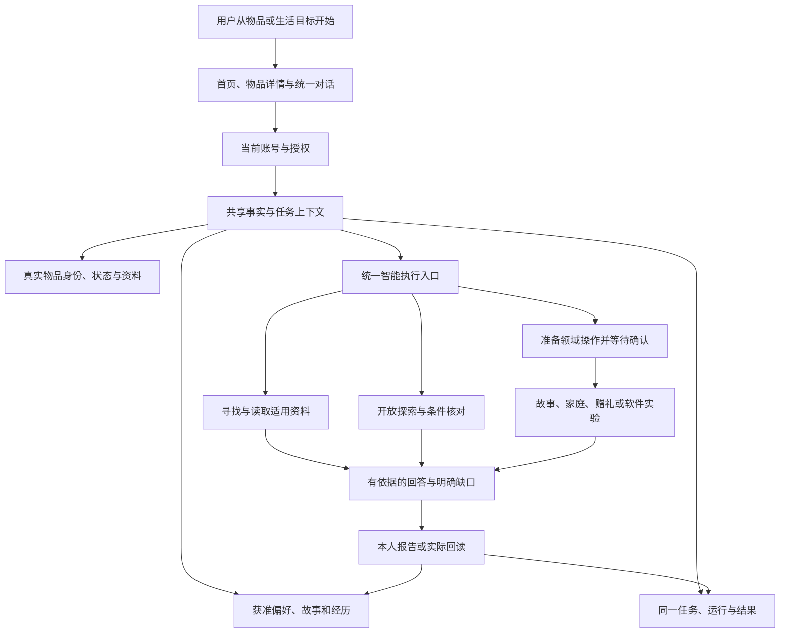
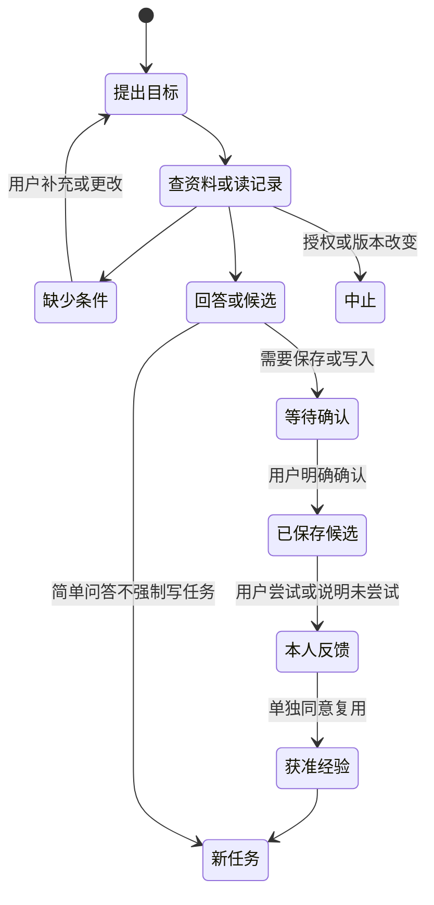

# 物间：完整功能、交互与产品架构审计说明

> 共同开发前审阅稿，2026-11-05（北京时间）。产品权威仍为 [PRODUCT_FINAL_V1](../../product/PRODUCT_FINAL_V1.md)，本文不重新定义产品。配套：[结合源码的技术架构审计](CODE_ARCHITECTURE_AUDIT.md)。

## 1. 本文审计什么，结论是什么

**物间的目标是释放人与物的价值。当前代码具备多种可运行流程，但尚未达到可靠、统一的完整产品。** 不能把导航、模型文本、保存成功或测试通过理解为全部功能完成。

本次对照的是实际工作区 `D:\ProductAgent-LifeContext\.runtime\qwen-foundation-v1`，源码快照 `32c6119d5f29f954fc78c15c74ea567833bbbfe1`，不是从旧 main 或压缩包重新推断。

| 项目 | 审计时状态 |
| --- | --- |
| main | `dbd93cfc9f684ccac7b0f80727cdaebcea898ca9`，此前已按负责人授权更新 |
| develop | 开始审计时为`f449067`；提交前复核已为`3285e8d85407dbd7a17f598fb2994398ac2c20f0`，代码树与审计SHA相同 |
| 团队候选 | `codex/wujian-team-ready-v2@32c6119` |
| 本次文档 | 独立 `codex/wujian-predevelopment-audit-v1`，不修改运行架构或私人数据 |
| PR #4 | 起初Draft；2026-11-05 15:35:13（北京时间）已在远端合并到develop；本审计未执行合并，后续发布仍需质量确认 |
| 3251 本地入口 | 独立本机账号、独立开发数据；付费模型、公开搜索、设备实验关闭 |

本次没有真实付费模型请求、设备操作、数据库迁移或业务重构。代码核对与离线复验支持“这些机制存在并能在有限条件下工作”，不能重新认证历史真实模型质量。原冻结首答 **0/18**、Core/Full **NOT_ACCEPTED** 保留。

**远端状态变化**：PR #4在本次审阅进行期间合并。`git diff 32c6119 origin/develop --name-only`为空，所以无需以新版本名重做或重算这次源码审计；后续组员可从最新develop创建分支。远端合并不代表产品质量获批，也不改变“历史过程材料不能默认当成正式能力”的要求。见[复核记录](evidence/remote-state.json)。

### 1.1 全文状态用语

- **代码已实现**：存在从入口到领域服务/持久化的代码，不保证现实效果成熟。
- **离线已验证**：确定性规则、合成账号/物品或 Mock 验证过数据流和边界。
- **真实模型有限验证**：历史留存真实千问输出，成功只限指定案例和条件。
- **模拟/原型**：模拟持有、合成关系、软件模拟器；不得冒充真实用户历史或实体设备。
- **未实现/未证实**：没有完整代码链、缺少证据，或只能在文档中找到目标。
- **产品未达标**：路径存在，但回答、机制、可用性或真实任务结果仍失败。

这些状态可以同时出现，例如“接口已实现、Mock通过、真实创意质量未达标”。

## 2. 产品完整设计：理解什么、释放什么价值

四个认知方向是理解物、物与物、物与人、人与人；四种价值方式是兑现、创造、延续、传递。它们不等于四个页面或四个独立 Agent。

| 认知方向 | 用户真正需要 | 贯穿的信息 |
| --- | --- | --- |
| 理解物 | 知道这件东西是什么、怎么用、限制是什么 | 实例ID、品牌/型号/地区、原文、状态、未知项 |
| 物与物 | 用已有东西完成目标、组合或替代 | 可用资源、能力依据、尺寸/连接条件、实施前提 |
| 物与人 | 让东西适合自己的习惯、承载经历 | 获准偏好、故事、尝试反馈、可选人格 |
| 人与人 | 围绕物品帮助、协作、赠送和传递精选故事 | 真实账号、按件权限、共享摘要、独立实例与私人记录 |

产品不要求先录完整库存，不要求每日养成，不以更多聊天/购买/提醒作为价值。一次成功排障、旧物产生有用的新作用、一次有意义的记录都可以是价值结果。

## 3. 当前信息架构与交互框架

### 3.1 实际页面，不是最终导航定案

主应用位于 [WujianApp](../../../src/components/life/WujianApp.tsx)。普通版目前有：生活首页、物品展柜、发现新玩法、生活故事、问物间、家庭、社交。右上角可切换关怀版；导航结构仍属于现有实现，不是产品定稿中已确认的最终七入口方案。

主要页面在同一 Next.js App 中，主视图多以 `#home`、`#item/<id>` 等 hash 切换；服务端数据仍由同一组 API/SQLite提供。`/gift/[token]` 是收礼页面，`/guide` 是操作说明；`/legacy` 仍为保留的历史路由，当前主导航已不再展示旧版入口，待审后决定去留。

| 入口 | 用户能做什么 | 关键交互/局限 |
| --- | --- | --- |
| 首页 | 进入自己的空间、可选加载虚拟公寓、恢复任务、开始录入或提问 | 首页内容取决于当前账号与数据目录，不会自动合并旧工作区资料 |
| 物品展柜 | 浏览获准物品、按件进入详情 | 展示可见不代表拥有、可修改或可控制 |
| 物品详情 | 帮助/交流、资料与管理、故事、新玩法等相关入口 | 部分入口相连，但仍有多处切换/确认负担；不能称体验已经完全统一 |
| 问物间 | 围绕生活目标或具体物品继续对话 | 同一会话、任务和获准 Context；模型关闭时可能仅有本地摘录/记录回复 |
| 发现新玩法 | 开放目标、选可用资源、探索方向、保存反馈或深化 | 与统一对话的生成路径不同，质量/状态表达仍需统一评审 |
| 故事/家庭/社交 | 已有专业领域流程 | 暂停主动扩展，不能因为菜单还在就纳入本次底座验收 |

### 3.2 为什么前面有登录页

[AccountBoundary](../../../src/components/life/AccountBoundary.tsx) 在 `AUTH_MODE=authenticated` 时显示本机账号登录/注册。作用是隔离物品、故事与记忆；账号存于当前开发目录，不是 GitHub、微信或百炼身份，也不是生产级统一身份平台。

- 每位组员创建自己的测试账号，口令按现有界面要求填写；这里不填模型 Key。
- 登录不会开启模型，也不表示付费已授权。
- `npm run dev` 保留的演示角色模式不等于独立账号验证；不能用“小林/爸爸/朋友”切换冒充真实多账号隔离。
- 同样地址的不同端口/目录可能是不同开发实例，看到不同物品不等于旧数据被删除。

### 3.3 当前本地入口为什么看起来“功能少了”

`team:dev --name=alice --port=3251` 强制关闭收费、联网检索和设备实验，读取 `.runtime/team-dev/alice`；此前决赛预览读取 `.runtime/finals-product-preview`，还可通过原费用网关调用千问。**代码版本、启动模式、账号、数据空间必须分别比较。** 当前3251不是完整联网产品的验收入口，不能把离线能力下降解释成删除全部智能功能。

## 4. 产品层模块与共享关系

生活化理解：物品档案是“知道自己有什么”；Context是“这次要用到的资料袋”；Agent是“按需找资料和使用工具的助手”；Task是“正在办的事情”；Outcome是“用户实际报告了什么结果”。数字分身是同一物品的交流身份，不是另一个独立物品数据库。

## 5. F1—F12完整功能与落地状态

### F1：物品进入与身份

**设计**：用户提供名字/型号、照片、编码、公开链接或说明书，先认识商品，再确认自己拥有的具体实例。普通商品知识不能自动成为“我拥有”和“这件实物状态正常”的证明。

**当前交互**：

1. 从录入入口认识商品；已审核的 SAMLA、KNAGGLIG、JBL GO 4 有小范围商品到达流程。
2. 陌生商品可手工填写型号/地区，读取公开资料草稿，上传说明书或照片。
3. 图片识别须单张授权上云，只给待确认候选；编码可查 Open Library / Open Food Facts 等公共候选库。
4. 本人确认拥有、可用性、是否合成测试，再创建实例；补位置、备注、照片、尺寸/材料等本人报告。
5. 实例ID与商品型号分别保存，两个同型号实物不能合并为一个对象。

**已实现**：确认录入、幂等、用户报告字段、资料草稿、照片候选、编码候选、小范围已审核商品缓存。条码浏览器解码依赖现有 ZXing；图码历史仅验证生成QR，不是所有现实包装的成功认证。

**未完成**：普遍可靠的看图认SKU、通用天猫商品/订单API、任意购物平台自动导入。天猫登录/反爬不能绕过；厂家页面和缓存成功不能冒充平台接通。代码见 [Intake](../../../src/components/life/Intake.tsx)、[ProductArrival](../../../src/components/life/ProductArrival.tsx)、[intake](../../../src/lib/life/intake.ts)、[vision](../../../src/lib/life/vision.ts)。

### F2：单物品理解、说明与使用服务

**设计**：同一物品连续回答规格、使用、安装、配对、清洁、排障等问题；相关资料齐全时覆盖多个子问题，缺一项不能吞掉其他答案。用户报告已试过的方法后应接着处理，不反复从头要求型号。

**当前流程**：物品/统一对话→取得准确实例/型号/地区→选相关原文或发现官网→模型与读取工具往返→组织事实、步骤和未知→展示引用/逐步原文→用户继续追问或报告效果。

来源存在、引用ID有效、文本能匹配都不是完整语义证明。私人状态、用户反馈和商品通用知识分开展示；不声称已经远程开机、修好或测得实际状态。逐步展开原文有助核对，不会把模型解释自动认证为厂家事实。

**真实模型有限成功**：THERMOS JNL-355规格三问复测、M350s已配对设备切换的窄场景；此前Sony/Canon等记录仍在历史材料中。**仍未达标**：陌生品牌发现不稳定、可能混淆按钮/方向/版本、无依据扩写、漏答和过度保守。模型关闭时仅能提供本地真实记录、摘录或不可用提示，不能冒充联网问答。实现见 [practical](../../../src/lib/agent/practical.ts)、[acquisition](../../../src/lib/life/acquisition.ts)。

### F3：目标驱动与跨物品组合

**设计**：“今晚写旅行手账”“给爸爸拍视频”等目标应先发现相关已有资源，再核对条件、给候选和缺口。选中三件物品代表资源池，不默认三件都必须用。

**当前实现**：资源发现、精简目录与详细Context分层；工具可继续分页读取获准物品；方案可以关联同一Task，保存前预览，反馈后修订。确定性工具可计算数值区间、二维占地或画幅关系；不能因此认证完整兼容、支撑稳定、光学/电气机制。

**交互状态**：探索构想→条件待核→用户确认保存候选→本人尝试→报告结果。保存卡片不等于执行。现有几条路径仍会暗藏额外书本/胶带/支撑、混淆功能或强行组合，属于真实任务未通过，不是仅待美化。

### F4：创造力与新玩法

**设计**：从物品性质、用户需要及类比案例产生新作用；开放发散和施工核对分开。支持单件新用途、多物品组合、个性化玩法；允许大胆假设，但要区分设想、条件化方案、实际验证。

**实际有三类路径，尚非完全一致的引擎**：

- 发现页的默认 `free`：模型自然语言开放探索，不强制第一阶段复杂JSON或固定点子数；`retrieval/hybrid` 可加入本地真实案例原理索引。
- 深化/旧机制路径：`goal/analogy` 等使用结构化动作、证据和必要条件检查；历史 `legacy` 保留复现，不代表推荐主路径。
- 统一对话：由Practical工具循环讨论，必要时准备现有计划卡，并走现有领域确认。

本地案例库有原始链接、作者、机制、额外资源、限制和许可状态；它是小规模索引，不是实时小红书/Reddit全站内容接入。没有模型训练或在线强化学习；反馈作为下次输入和筛选依据。**创新度、实际价值和物理可行性仍未稳定达标**，没有真人盲评证明整体胜过直接千问。见 [open-exploration](../../../src/lib/life/open-exploration.ts)、[ideas](../../../src/lib/life/ideas.ts)、[inspiration](../../../src/lib/life/inspiration.ts)。

### F5：设备探索与改造

**设计**：目标→官方接口/既有适配器优先→必要时授权研究→生成适配器→确认→执行→回读→记录能力。能力描述不是控制授权。

**当前实际**：有自有软件灯具目标、REA 6.8.0分析、适配记录、单次确认、回读、幂等和撤权。设备实验需要显式开启；团队3251默认关闭。REA运行环境在独立工具目录中，新克隆没有它会明确失败。

**范围边界**：这是软件模拟器，不是米家台灯硬件；没有完成真实电视改首页、去广告、刷固件、任意BLE设备控制。Home Assistant、Matter、ESPHome、ADB、BLE不能因为研究文档里出现就算已接通。接口与证据见 [software-lab](../../../src/lib/devices/software-lab.ts)。

### F6：个性化与可选数字分身

**设计**：用户给某件物品选择名字、头像、风格及是否启用；允许它结合真实知识和获准故事提供帮助。风格不能覆盖事实，昵称不是用户姓名，不编造共同经历。

**当前实现**：全局/物品级Persona设置，统一模型入口按需要读取；不为每件物品常驻一个LLM进程。头像与风格配置、故事关联、记忆使用策略存在，可修改/关闭。私人信息不因更换物主自动移交。

**局限**：独特人格与真实功能的融合仍有限；名字/风格设置成功不代表形成长期可靠理解。当前页面保留部分显式授权操作，不能为了减少点击默认同意上云。见 [ItemBelonging](../../../src/components/life/ItemBelonging.tsx)、[memory/store](../../../src/lib/memory/store.ts)。

### F7：故事、经历与个人记忆

**设计**：用户自然讲述物品来源、赠送者、经历和当前愿望；原始叙述保留来源，偏好/关系理解可确认、纠正、遗忘、授权后复用。不能将一次发言永久定为性格。

**当前不同记录**：故事原文、结构化个人记忆、用户确认的人物理解、Task结果、旧工作区故事快照并存。照片有独立媒体记录。故事可关联多个物品、记录事件日期、整理章节；聊天候选有规则抽取和可选模型原文选择。

**关键交互**：原文记录≠允许检索≠允许上云；候选≠已确认；本人说“有用”≠知道成功原因；编辑原故事会影响由它派生的认识。归档私人记录可能仍属于作者，但不能复活其物品/任务权限。

**限制**：自动抽取和召回仍含规则/词法逻辑，并非完整的人物世界模型；可能漏掉隐含兴趣、误选相关性。跨会话确有有限验证，不能推导任意时间跨度均可靠。见 [stories](../../../src/lib/life/stories.ts)、[ambient](../../../src/lib/memory/ambient.ts)、[organization](../../../src/lib/life/organization.ts)。

### F8：维护、生命周期与购后服务

已有数量/单位、有效期、可用性、位置、维护日期/周期、本人补充供电/养护信息及计划清单。零数量/过期等能影响资源可用性；尺寸/材料缺失保持未知。

仍不是完整的订单/售后/保修平台：没有普遍接通厂家售后政策或自动化凭证核验，没有证据证明存在生产级后台定时推送、库存同步或真实耗材遥测。保修/维修政策必须按资料取得，不能由同类商品推断。新管理表单有版本冲突保护；兼容旧调用省略版本时，不能声称也有同等保护。

### F9：家庭协作与关怀

已有独立本地账号、邀请/加入、按件共享、事项分配、已读/接手/报告结果及撤权。共享物品的可用知识与必要状态，不自动分享私人聊天/经历；领域动作须事务与确认。关怀大字版保留简化交互。

当前领域中的家庭事项与统一Foundation Task并非同一张表，由桥接关联；“分配成功”“已读”“接手”“用户报告完成”分别记状态，不是现实完成证明。关怀信号有演示状态，不能诊断健康/紧急事件。没有生产通知、账号找回和正式家庭身份认证的完整服务承诺。见 [collaboration](../../../src/lib/collaboration.ts)、[FamilyPanel](../../../src/components/life/FamilyPanel.tsx)。

### F10：赠礼、分享与流转

已有赠送草稿、精选寄语/故事快照、预览token、撤销和认领；真实账号接收形成独立实例，原物品退出可用范围，新故事独立积累。接收者若想将分享故事供个性化使用，仍须确认与单独云端许可。

不默认传递原作者聊天、全部记忆或Persona。不把生成链接当实物交付；实物取得仍是用户确认。公开社区、二手交易市场、物流支付、完整借用生命周期未形成成熟产品。旧演示人物兼容分支不等于真实账号路径。见 [gifts](../../../src/lib/life/gifts.ts)、[domain gift mutations](../../../src/lib/domain.ts)。

### F11：统一Agent与任务

多入口共用物品、Context、Practical执行器和任务领域服务。简单提问不强制创建持久Task，但非临时对话通常有运行记录；复杂流程可连接同一Task、Run、Plan及Outcome。

现实中仍保留家庭事项、Preparation计划、Foundation Task等业务对象，靠关联而非全部重建为一张表。任务ID一致是必要条件，不等于所有流程都已自然连续。会话超时、跨空间切换、撤权和更正可能要求重开；模型异常必须显示未完成，不能仅因HTTP200显示成功。

### F12：身份、权限、可信度与长期可维护性

本机账号、物品所有权/共享、显式授权、原文来源、记忆/云端许可、幂等、版本和在途失效检查已有实现。备份迁移、真实多账号测试和历史失败证据保留。

边界：本机开发认证不是生产身份平台；本地文件未实现数据库加密；API成功和引用正确不保证语义。费用双开关并不自动等于所有入口都经过800次额度网关，这一部署/调用治理边界必须先解决再广泛开放收费。技术风险的代码定位见配套技术文档。

## 6. 固定虚拟家庭：可以演示什么

八件物品是明确的模拟持有：米家台灯1S MJTD01SYL、MICKE 803.542.81、SAMLA 194.408.48、KNAGGLIG 103.926.01、JBL GO 4、Jellycat BAS3B、LEGO 10328，以及40×30厘米无品牌朋友赠画。商品来源与说明书按型号/地区保存，位置、状态、故事是模拟设定。

一键加载有安装记录，云端许可单独记录；原账号空间与模拟家庭的任务/记忆选项分开。不是默认认为用户拥有这八件物品，也不拿商品尺寸代替桌面实测空余面积。前三条生活旅程曾有真实模型失败：手账布局暗含额外用品；赠画能答关系却错误建议支撑；台灯操作扩写不必要重置。不能因家庭加载正常说三条质量全部通过。

## 7. 四条连续旅程应怎样验收

### 7.1 陌生商品→指导→反馈→下次使用

输入型号/资料→确认持有→核验适用官方原文→回答全部子问题→继续追问→关联Task→本人报告操作/条件/结果→分别选择未来复用和上云→新会话调整建议→纠正/遗忘后不再引用旧结论。资料失败与推理失败分开记录；合成操作经历必须标注。

### 7.2 开放目标→跨物品方案→行动

用户先说目标→Agent发现获准资源，必要时补充现实条件→少量有差异候选→用户选择→核对尺寸/结构/连接和额外资源→保存候选计划→尝试/失败反馈→后续避免相同失效步骤。不能把观察、改名或免责声明充当创造；不能通过提高拒答率制造安全成功。

### 7.3 一件有故事的物品

录入画作或图书→本人讲赠送故事→保留原文与来源→可选确认记忆/上云→可选数字分身→新会话结合实际尺寸与当前布置目标→纠正赠送者→后续使用新事实→遗忘后不再恢复。能说出赠送者但没回答布置目标，仍是部分失败。

### 7.4 跨账号共享/赠礼

物主明确选共享内容→另一账号只能读获准物品资料和摘要→接手/认领→新记录独立→原Task按实际桥接更新→撤权后旧链接/旧会话/迟到模型结果不泄露。私人记忆、照片和Persona分别核对，不能认为物品共享就全部共享。本阶段保留回归，暂停新增专业体验。

## 8. 通用交互与状态约定

| 界面表现 | 必须表达的真实状态 |
| --- | --- |
| 正在搜索/读取/整理 | 进度，不是已完成的模型答案 |
| 有来源的指导 | 取得何种原文、适用型号；引用不等于语义认证 |
| 待确认卡片 | 尚未写入/未执行；计划确认只保存候选 |
| 条件待核/纯概念 | 不能用“可直接尝试”的外观掩盖必要条件 |
| 用户报告有效/未成功 | 本人报告，不是硬件或因果验证 |
| 409冲突 | 保留草稿并重新核对，不静默刷新版本重放 |
| 401或退出 | 重新登录；不继续展示退出后的私人迟到结果 |
| 模型不可用 | 已有数据仍在，不能用固定回复伪装千问成功 |

当前SSE主要传进度及整理后的答复，不应宣传“未经核对操作逐字直出”。多个开关、来源编号和授权控件仍有技术感，是后续交互改进项，不因安全必要就认为现有表达已成熟。

## 9. 共同发布前的主要断点

| 优先级 | 问题 | 对用户的影响 | 应如何判定改善 |
| --- | --- | --- | --- |
| 阻断 | 3251离线与完整联网体验混淆 | 用户以为新版不能调用API/功能被删 | 同一账号/数据有清楚模式说明，真实联网链路另行验收 |
| 阻断 | 未认证来源、型号/地区错绑或模型误读 | 错误操作指导 | 新SKU、有完整原文、逐子问题核对，严重错误为零 |
| 阻断 | 费用入口治理不统一 | 组员误开收费且未进入统一台账 | 所有正式收费入口可证明受同一有效授权与硬限约束 |
| 高 | 三类创意路径及动作验证表达不完全一致 | 用户不知道设想可否执行 | 选想法到实施时事实、条件、资源状态一致 |
| 高 | 多种Task/记忆对象并存 | ID连上但任务仍割裂，纠正可能漏路径 | 四方向端到端与消费方测试，不只看ID |
| 高 | 相关性/自然记忆仍有词法和规则局限 | 漏掉有用经历、频繁追问或机械回答 | 新表达/新物品实测，经验实际改变建议 |
| 待确认 | 七入口、关怀版、分身/故事呈现是否保留现形 | 导航负担和功能割裂 | 小样本真实任务查找/接续测试，由产品负责人决定 |

## 10. 本次共同确认清单

- [ ] 产品理念和F1—F12范围保持定稿；菜单存在不等于已通过。
- [ ] 同意区分团队接口可开发、联网底座可运行、完整智能质量通过三种状态。
- [ ] 先明确共享服务/身份/费用/任务契约；不因历史代码保留就恢复旧执行器。
- [ ] 旧页面、实验脚本、证据和许可证保留待审，采用/归档/删除另列引用与恢复依据。
- [ ] 真实硬件、购物平台接口、公开社交/交易等不按原型状态宣称已实现。
- [ ] 专业功能各组从最新develop开独立分支消费同一底座；本审计不继续合并或将历史材料自动认定为正式能力。

这些方框是待共同确认项，不是本次自动批准。团队认领方式见 [TEAM_WORK_PLAN](../../engineering/TEAM_WORK_PLAN.md)。

## 11. 证据入口与阅读顺序

1. 本文看产品与交互全貌；配套技术文档看表、函数和真实调用链。
2. [最新工程状态](../../engineering/CURRENT.md) 是状态入口，历史文档中的“当前”只指当时。
3. [决赛交付](../../engineering/finals-product-2026-11-05/DELIVERY.md)、[质量失败审阅](../../engineering/finals-product-2026-11-05/QUALITY_REVIEW.md)、[对抗覆盖](../../engineering/finals-product-2026-11-05/ADVERSARIAL_COVERAGE.md) 保留真实输出和限制。
4. [团队交接](../../engineering/team-ready-2026-11-05/DELIVERY.md) 保留公共接口、账号/浏览器和构建证据；本次新增离线复验见配套文档，不把旧证据冒充重跑。

**本次结论：可作为共同开发前的审阅基准，不构成Core/Full Foundation或完整产品的发布批准。**
