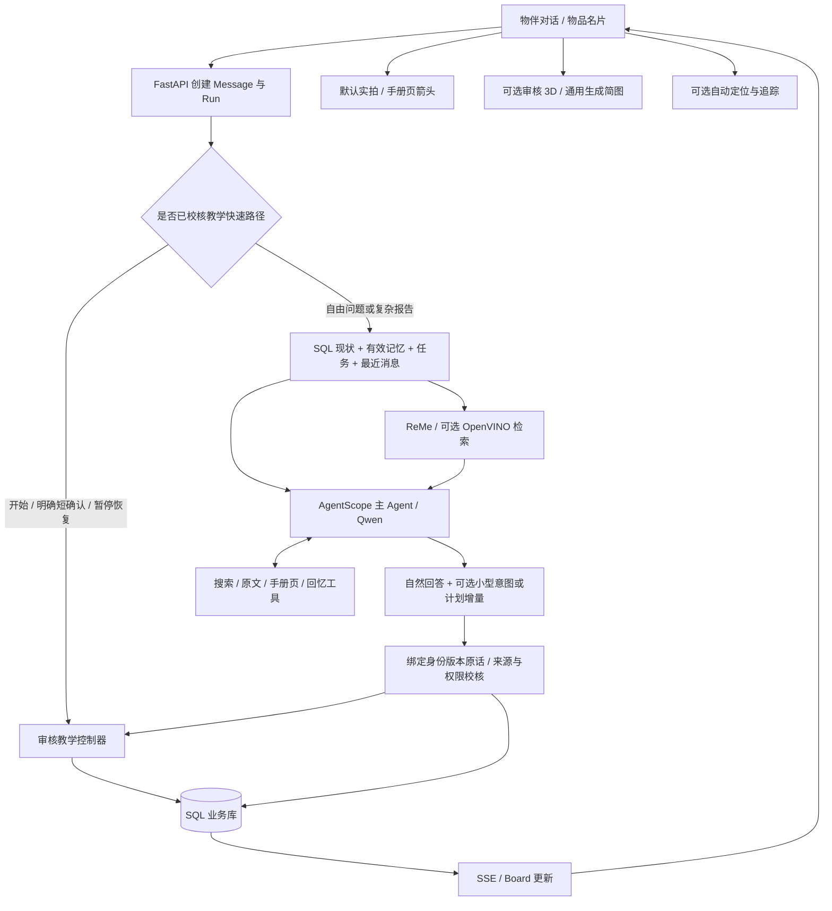
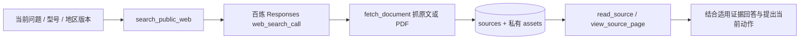

# 讲解答疑模块：技术架构与工作流

版本：2026-11-07，`feat/as2-adaptive-lessons`。描述本分支实际代码；“可选”“未验收”不代表已经实现或普遍可靠。复现入口见 [AS2演示复现指南](AS2演示复现指南.md)。

## 1. 现在能做什么，泛化到哪里

8021 是使用真实阿里云 API 的可操作开发版。用户可以自由提问、报告失败、补充材料、暂停和继续，不要求复述固定台词。它有两条教学路径：

| 路径 | 适用范围 | 计划与图示来源 | 边界 |
|---|---|---|---|
| 已校核 AS2 教学 | 明确匹配 LOKLiK AS2 / 大陆 HPA01 实物 | 手册骨架、人工核对实拍坐标和 Codex 制作的几何；模型解释疑问和提出补充核对 | 12 个基础动作不是 12 轮对话；可增加/调整核对步骤，但不随意省去实物确认 |
| 通用讲解答疑 | 其他已记录物品，或用户说明的真实问题 | 主 Agent 结合现状/记忆/文档按需形成一两步 plan；可动态续接 | 并非所有物品已有审核图示；Qwen 生成的 3D、资料匹配和视觉定位仍需核验 |

普通知识问答可以只回答，不强行创建 plan。确认需要动手解决问题时才维护持续步骤。软件“已显示”、定位框“已找到”和真实世界“操作成功”是不同事实。系统没有机器温度/压板等遥测。

## 2. 技术栈和模型分工

| 层 | 当前实现 | 对最终结果的作用 |
|---|---|---|
| Web / API | React 19、TypeScript、Vite、FastAPI、SSE | 当前对话、单步工具栏、默认照片、可选 3D/相机；客户端通过业务 API 写状态 |
| Agent 主循环 | AgentScope 2.0.11，单个主 Agent，ReAct 工具选择 | 决定是否搜索/读资料/回忆，解释当前问题，产生结构化回答和状态建议 |
| 云端主模型 | `qwen3.6-plus`，可由环境变量替换 | 普通问答与带照片的主对话；已校核教学关闭 thinking、约束较小输出结构，减少无谓重试 |
| 云视觉 | `qwen3-vl-plus` | 已读取说明书页、照片/视频帧的部位定位，以及有图时的通用简图生成；不是所有帧都上传 |
| 默认检索 | ReMe 0.4.2.1，BM25 + 阿里云 `text-embedding-v4`（配置 Key 时） | 检索授权的记忆/知识/来源/任务；索引是投影，SQL 重查身份、可见性和有效内容 |
| 可选本地语义检索 | OpenVINO 2026.4.1 + multilingual MiniLM-L12-v2，384 维，静态 `[1,128]` | 在指定 GPU/NPU 上编码查询/资料，语义排序与关键词 RRF 融合；命中资料进入回答上下文，影响 AI 输出 |
| 事实与状态 | SQLAlchemy、SQLite、Alembic | 同一套物品、记忆、任务、来源、消息和权限；不再建立另一套教学数据库 |
| 默认静态图 | 审核实拍裁图 / 已读取 PDF 页 + SVG 箭头 | 让用户知道在哪里操作；校核图可预生成，通用情况调用视觉定位 |
| 3D | Bygga 渲染代码 + Three.js，有界 JSON 场景 | AS2 使用审核外观与逐部件运动；Bygga 是渲染器，不限制宜家家具，也不负责“理解物品” |
| 本地视觉 | OpenCV.js ORB/RANSAC、ViTTrack ONNX、LK 光流 | 参考面匹配或云端框初始化后跟随当前部位；当前网页路径在 CPU/WASM，不能声称已用 NPU |

以上版本来自锁文件/源代码，不意味着必须升级为上游最新版。框架复用了 [AgentScope](https://github.com/agentscope-ai/agentscope)、[ReMe](https://github.com/agentscope-ai/ReMe)、[Bygga](https://github.com/Nutlope/bygga) 和 [OpenCV Zoo ViTTrack](https://github.com/opencv/opencv_zoo/tree/main/models/object_tracking_vittrack)；产品的权限、证据、教学状态和资产绑定由本仓库实现。

## 3. 总体架构



核心入口是 `wujian/agent_runtime.py::AgentRunner._execute`，不是“检索结果拼接后直接返文本”的固定工作流，也没有让后台另一个 Codex 代答。Agent 可按上下文选择工具，但写业务状态必须经过共同业务操作和校验。

## 4. 一轮问答如何生成

1. `server.py` 接收 `POST /api/chat` 或 `POST /api/guidance`，检查登录、物品和照片访问权，建立本轮用户 Message、Run；后台执行，前端订阅 SSE。
2. `lessons.prepare_turn` 先检查是否准确匹配已校核教程。开始教程、明确短确认、暂停/恢复等可直接进入同一控制器。usage 标记为 `reviewed_procedure_no_model_call`，不冒充模型推理。
3. 其余输入从 SQL 加载当前物品、任务版本、当前步骤、材料输入和最近观察；按 `run_id + role=user` 锁定本轮消息。历史对话保留最近 12 条消息，不反复重放完整旧工具日志。
4. `memory_context.prepare_memories` 提供当前有效私人理解；如配置本地语义模型，再检索来源/知识，将命中内容和设备回执加入上下文。
5. 普通问答使用常规工具与 skills；已校核教学只开放读物品、回忆、搜索、获取文档和读页等工具，不允许模型从该模式任意调用其他业务写操作。
6. 主 Agent 使用原生结构化输出。已校核教学得到 `LessonReply(answer, topic, lesson_action)`；普通问答得到 `TurnResult(answer, continuation, learning, story_refs)`。
7. 服务器绑定任务/当前步骤/版本/用户原话，校验并提交。成功后 Message、Run、Task 一致更新，SSE 通知前端刷新同一 board。答案只有一个最终提交入口，不把旧步骤模板再渲染成第二条助手消息。

教学模式 ReAct 最多 4 次迭代，普通模式 7 次；主循环超时分别约 60/85 秒。失败时可用不继续研究的恢复回答（额外请求超时 22 秒），只回答、不借此写业务状态。恢复也可能失败，不能承诺所有网络状况都可回复。调用耗时、工具失败和恢复原因保留在 Run 事件。

## 5. 记忆如何使用和更新

记忆是有拥有者、关联物品、上下文、过期时间和来源原话的 SQL 记录。首先选择当前有效且与本轮物品相关的记录；记录较多时用 ReMe 排序，再从 SQL 重取，防止检索等待期间的纠正/遗忘继续生效。不会把全部私人生活史塞进每一轮。

普通模式的 `learning.memory_updates` 可做新增、替换或遗忘，`knowledge_updates` 区分文档、用户报告与推测；`learning.py` 和 `foundation.py` 检查本轮依据、权限及对象。当前用户纠正优先于旧偏好。

**当前已校核 lesson 模式会读取长期记忆，但它的小型输出结构不直接写长期 learning。**材料和本轮实际观察写在任务中。不要把这个设计描述为“每轮教学都会自动生成永久记忆”；这是后续可扩展点。普通聊天、任务观察、长期理解、主动回忆墙也不能互相冒充。

## 6. 搜索和说明书：何时用、怎样失败

已有信息足够就先回答；需要型号专用操作或用户明确要求联网时，由主 Agent 选择：



`knowledge.search_web` 检查服务实际返回 completed 的搜索调用；搜索摘要只标作 `search_result_not_full_document`。`fetch_source` 下载正文、抽取 PDF 或保留原始资产；`source_access.readable_source` 检查读权限。网络抓取限制私有地址并重新检查重定向，防止把任意内网端点当说明书。

搜索不等于已读说明书，已读网页也不等于该型号/地区适用。搜索超时、站点阻挡、PDF 无文本、无适用结果都可能发生。工具返回明确失败后应该用已有信息给初步解释、保留未知，而不是循环搜索、伪造来源或只说无法回答。

AS2 大陆手册来自[官方资料下载](https://www.loklik.cn/files-download/)，PDF 文本是转曲。示范中保留原 PDF 和页图，并另存 `reviewed_guide` 导览改写；它不是 OCR 原文，也不冒充逐字引文。包内资料足够时，不需要每一轮重复联网下载同一手册。

## 7. Plan 与状态：如何真正陪用户一步一步做

所有计划复用 `tasks.plan`，schema 为 `interaction/1`、kind 为 `guidance`。简化结构：

```json
{
  "entries": [{"id": "mode", "state": "pending", "guidance": {"kind": "verify", "instruction": "核对当前屏幕", "success_signal": "报告实际显示", "evidence": []}}],
  "guidance": {
    "active_step_id": "mode",
    "observations": [],
    "lesson": {"definition": {}, "phase": "waiting", "inputs": {}, "adjustments": []}
  }
}
```

`lesson` 只用于已校核数据包；通用计划不要求这个字段。AS2 快速路径与自然语言模型意图最终都进入 `lessons.apply_action`。

| 意图 | 实际操作 | 不代表什么 |
|---|---|---|
| `explain` / 无动作 | 回答当前疑问，记录报告；留在当前步骤 | 没听懂不算完成 |
| `provide_input` | 分轮记录材料、基材和已报告参数，缺失留空 | 提供包装参数不代表机器已设好 |
| `adapt` | 在当前主步骤前插入 identify/observe/verify；已是补充步骤时修订它 | 不重写整张教程、不抹掉历史完成记录 |
| `confirm` | 校验本轮明确报告/当前步骤/版本后，当前 entry 变 ready，指向下一步 | 不把整项目标自动算作成功 |
| `pause / resume` | 保存暂停状态，再恢复同一步 | 暂停不会丢掉材料与观察 |
| `topic=other` | 正常回答临时问到的其他物品，并清除当前教学动作 | 其他物品“好了”不推进 AS2 |

已校核教学模式的模型只提交 `LessonIntent`，服务器用 `bind_intent` 绑定真实 task ID、step ID、expected_version 和本轮用户原话，避免模型伪造标识或为了引文字段复读用户。完成按钮走同一 `guidance-feedback` 业务操作，带 `receipt_id`；重复回执不会重复推进。版本变化会拒绝陈旧操作。

材料类别已明确时可使用手册推荐预置，来源标记为手册；未知“塑料片”不能自动认定为 HTV。非预置参数来自用户实际报告的字段与单位，保存为 user_packaging；这不是材料适用性认证。条件不齐则继续识别，不能强行解锁。当前提供输入的步骤完成后，仍要等用户确认机器实际状态。

在 `lesson_action` 路径，`turns.commit_result` 用数据库保存点分离回答与状态建议。状态建议发生 409 冲突时保留有用回答，记录 `lesson_action_rejected`；403/404 权限错误仍拒绝。通用 `continuation` 仍有 SDK 的完整结构/证据校核，不保证每种坏计划都能以相同方式保住回答。已校核教学不能被另一个普通会话的 continuation 整表覆盖。缓存签名依据当前步骤内容，避免用昨天的控件指示回答今天的问题。

通用模式由 `turns.py / guidance.py` 验证计划增量与本轮观察，保留原步骤并接续当前动作；不自动套 AS2 数据包。当前适应能力不等于已经做成可任意重排、自动删去所有步骤的通用规划器。

## 8. 照片、3D 和视频由同一步驱动

### 默认实物照片

`lesson_assets.py` 负责来源绑定，`StepIllustration.tsx` 负责展示。AS2 从校准实拍裁图/手册页按当前步骤叠箭头；通用物品可从已读 PDF 页或用户照片，通过 Qwen 视觉定位当前目标。坐标在显示图片上归一化，不能直接拿静态照片坐标当视频坐标。找不到就保留原图、不画一个猜测箭头。

### 可选 3D 动画

AS2 的 `loklik-as2-model.json` 定义审核外观，教学数据包定义 focus、movement、part_movements。`cache_aids` 预先为各步准备场景；`teaching_diagram.py` 校验部件数量、几何/运动边界和缓存签名。前端 Bygga/Three.js 渲染按键、抽屉、放布与压板动作，默认整机，可切换细节。

已审核场景失效时从审核几何恢复，不能降级为临时 Qwen 简图。其他物品仍可由照片/文档和当前步骤生成有界场景 JSON，但不是从一张照片重建准确 CAD；无需使用名为 Bygga 的特定物品。生成资产是指引，不是对实物状态的检测。

### 可选相机 / 视频辅助

`CameraGuidance.tsx` 自动取帧，`AutoCameraSession` 管理 seeking/following/waiting/stopped：

1. 有已校核参考面时，先做实际帧 ORB 描述子匹配、比例检验和 RANSAC 单应矩阵，把参考图上的目标投影到当前帧。
2. 参考面没有匹配到时，上传当前帧与本步目标到 `POST /api/tasks/{id}/grounding`；Qwen3-VL 返回可见性、normalized bbox、歧义候选与说明。
3. 云结果有延迟，调度器缓冲期间的本地帧，先把旧帧定位对齐到当前帧，再持续追踪。ViTTrack 是小神经网络，不是语义检测器；兼容回退可用 LK。
4. 低置信、越界、丢失或步骤版本更新时，清除旧框并重新寻找；关闭弹窗会停摄像头、追踪和未完成请求。用户无需逐帧点“识别”。

AS2 的参考坐标不是预录运动轨迹；实际视频每帧仍要匹配。看得见某个控件不能证明它被按下。当前实拍视频不包含完整压烫，持续追踪也存在视角变化后漂移/丢失，不能拿 UI 演示当精度验收。

## 9. NPU 到底在哪里

当前网页 ORB/LK 和 ONNX Runtime Web WASM 都跑 CPU；Three.js 绘图用 GPU不算 AI 推理。OpenVINO ViTTrack 脚本是设备迁移实验，尚未接成网页 NPU 服务。本机 GPU 小模型试验在 7.67 秒处跟丢，不能宣称可靠覆盖完整视频。

较明确的比赛部署路径是已有 MiniLM 语义检索：输入 token → 指定 NPU 模型推理 → 资料排序 → Agent 上下文 → 回答。`WUJIAN_LOCAL_AI_REQUIRED=true` 会在启动时检查指定设备，不悄悄回退 CPU；`/api/local-ai` 与 Run 的 local_ai_context 给出 EXECUTION_DEVICES、设备名和推理次数。Intel 机器仍须按[官方 NPU 说明](https://docs.openvino.ai/2026/openvino-workflow/running-inference/inference-devices-and-modes/npu-device.html)检查驱动、编译与实测，当前开发机的 NVIDIA GPU 结果不能冒充 Intel NPU 验收。

## 10. API、数据与代码审阅索引

| 入口 | 职责 |
|---|---|
| `POST /api/chat`、`POST /api/guidance` | 普通问题/物品教学；创建 Run |
| `GET /api/runs/{id}`、`GET /api/runs/{id}/events` | 最终结果与 SSE 进度 |
| `GET /api/tasks/{id}/board` | 同一任务的当前步骤、来源、图示、完成数 |
| `POST /api/tasks/{id}/guidance-feedback` | 幂等的本步反馈和继续 |
| `POST /api/tasks/{id}/picture`、`/diagram`、`/grounding` | 同一步的照片指引、3D 和相机定位 |
| `GET /api/assets/{id}` | 按登录权限读取已登记资产 |
| `wujian/agent_runtime.py` | 主 Agent、工具与恢复路径 |
| `wujian/memory_context.py`、`learning.py`、`retrieval.py` | 记忆选取/更新和检索 |
| `wujian/lessons.py`、`guidance.py`、`turns.py` | 已审核/通用教学与事务校核 |
| `wujian/knowledge.py`、`source_access.py` | 搜索、原文、PDF 和来源权限 |
| `frontend/src/features/TaskBoard.tsx` | 当前教学辅助入口，避免重复回答画布 |
| `TeachingDiagram.tsx`、`StepIllustration.tsx`、`CameraGuidance.tsx` | 三种展示方式 |
| `demo/as2/`、`scripts/run_as2_demo.py` | 发布资产、校验和可复现演示入口 |

本地默认 SQLite，可按文件用 DBeaver / DB Browser 打开，不是远程数据库服务。新演示库为 `var/as2-demo/wujian.sqlite3`；主要表是 users、items、memories、knowledge_claims、tasks、conversations、messages、runs、sources、assets。`tasks.plan` 保存进度；`runs.events/usage` 保存调用与错误；资产是路径登记，不是把全部媒体塞进数据库。

## 11. 验证口径与后续边界

原 feature 修复有 112 项离线回归、真实 Qwen 材料分支复测和浏览器检查；公开资产包另有完整性/无 FFmpeg 初始化/新会话保留测试。离线测试不调用付费模型。实际复现结果见复现指南与本次交付说明。

HTTP 200、合法 JSON、来源存在和框显示都不是智能质量验收。需要继续验证的重点是：其他型号/地区资料适用性、未知耗材照片识别、模型在意外反馈下的自然解释、长文分块检索、通用 3D 外观/运动、严重抖动遮挡后的重定位，以及比赛 Intel 设备的 NPU 实际执行。
